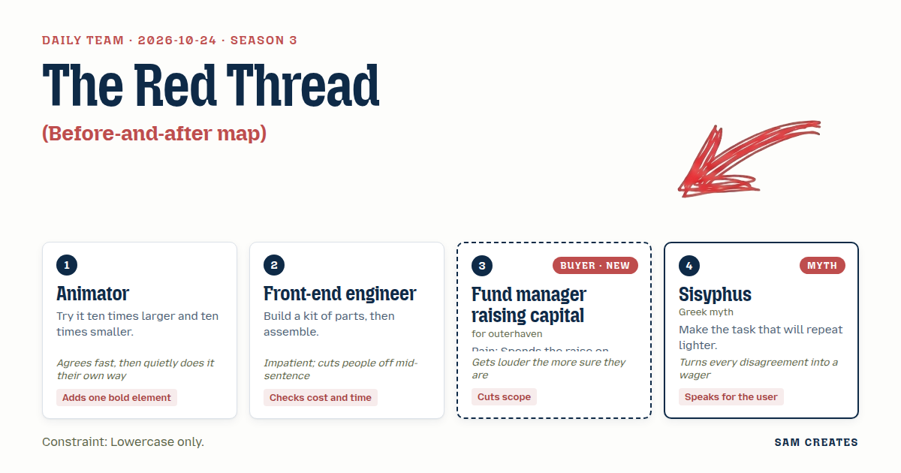
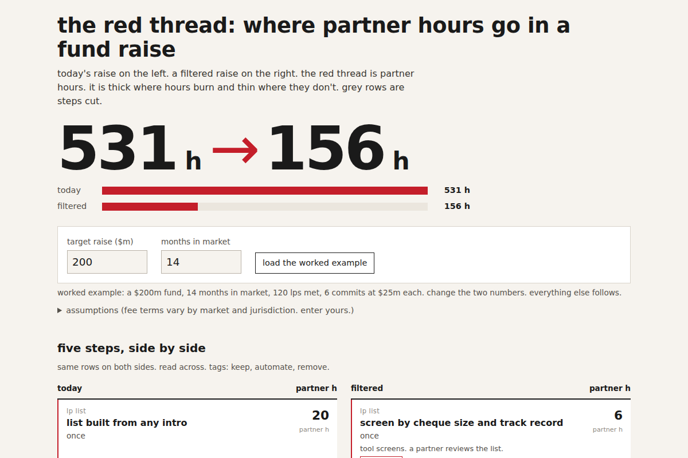
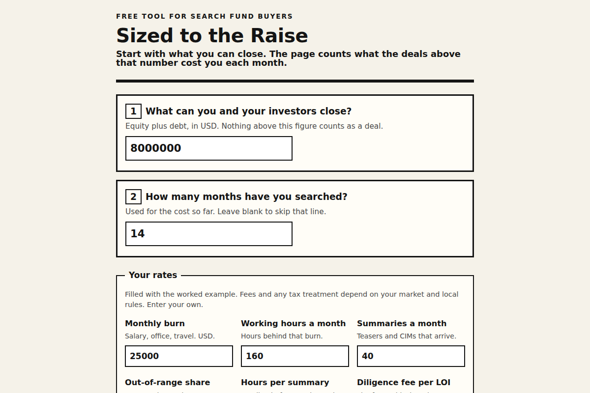
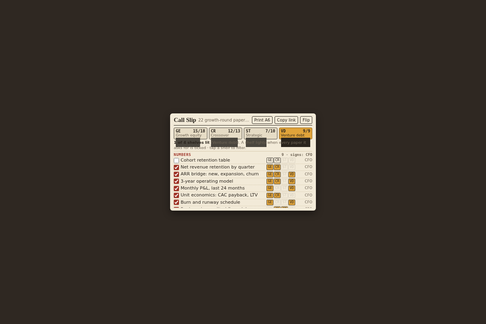
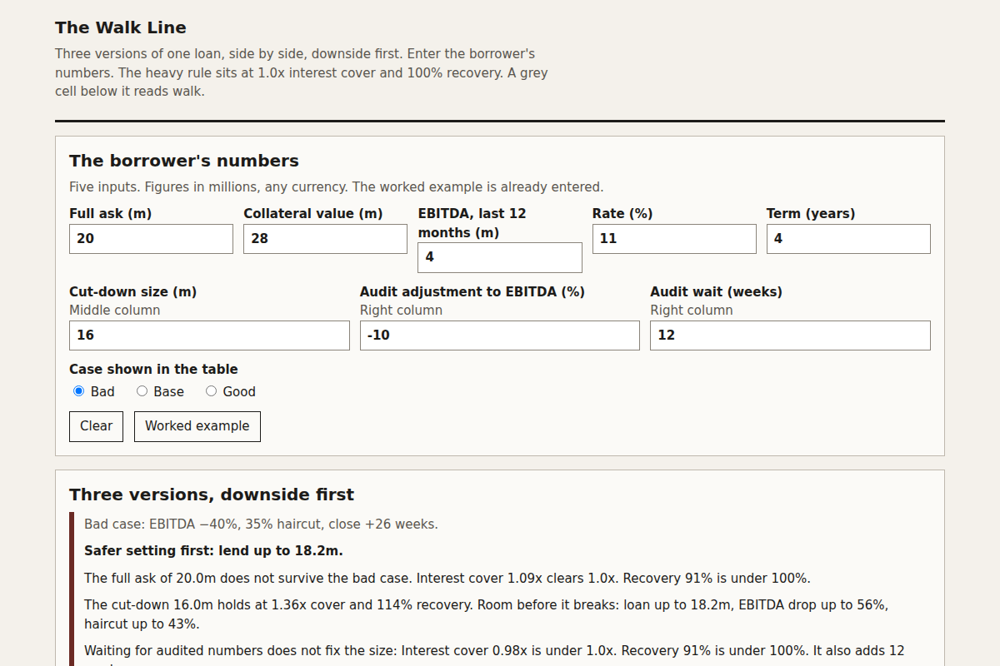
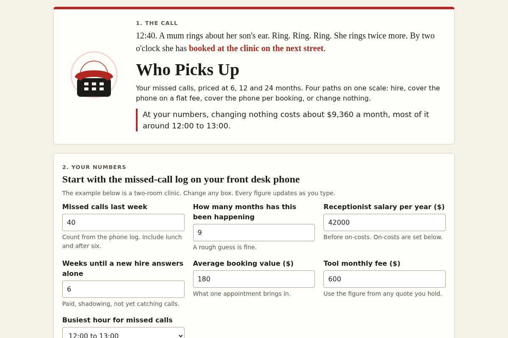
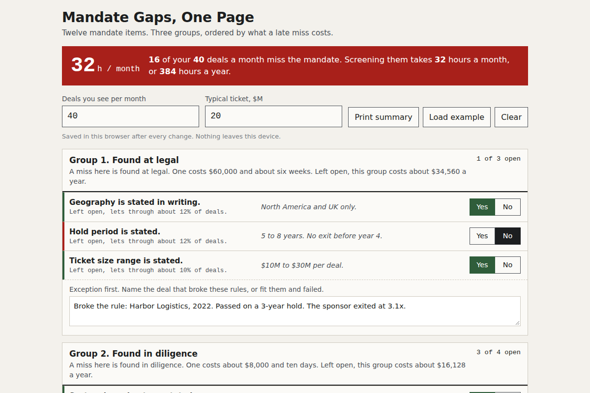

# daily-team

A new four-person creative team every day, and the small web tool it built. This repository is the record: each day's team, its plan, and its asset, kept in [days/](days/) and listed in the [archive](ARCHIVE.md).

Everything in `days/` is written by a language model and checked by scripts, not by hand. The model and provider for each day are on its page.

## Today

<!-- TODAY:START -->
### 2026-10-24: the red thread

**Task:** Before-and-after map: today's process as a list of steps becomes a side-by-side view marking the steps that could be removed or automated.

**Decision:** the page takes a fund manager's target raise and months in market, lays today's fundraising steps beside a filtered version, tags each step keep, automate, or remove, and shows partner hours, capital closed, and placement costs for the b...

[Open the day](days/2026-10-24/) · [Archive](ARCHIVE.md)
<!-- TODAY:END -->

## This week

<!-- WEEK:START -->
**Season 3**, since 2026-10-07. New this season: the first 20 buyers. A new season with 8 new roles and 8 new methods is drafted every Monday.

### Vote on what gets built next

[Suggest a task](https://github.com/chasehamby123/daily-team/issues/new?template=task-suggestion.yml) or vote with a thumbs-up on [open suggestions](https://github.com/chasehamby123/daily-team/issues?q=is%3Aissue+is%3Aopen+label%3Atask-suggestion+sort%3Areactions-%2B1-desc). The most voted are screened every Monday.

No open suggestions yet.
<!-- WEEK:END -->

## Recent days

<!-- RECENT:START -->
| Date | Asset | Task | Team |
|---|---|---|---|
| [2026-10-24](days/2026-10-24/) |  | the red thread | Animator · Front-end engineer · Fund manager raising capital · Sisyphus |
| [2026-10-23](days/2026-10-23/) |  | The 9:14 Lead | Puppeteer · Bookbinder · Insurance agency owner · Katsushika Hokusai |
| [2026-10-22](days/2026-10-22/) |  | Sized to the Raise | Costume designer · Sign painter · Search fund entrepreneur · Alice |
| [2026-10-21](days/2026-10-21/) |  | Call Slip | Librarian · Taxidermist · Founder raising a growth round · Don Quixote |
| [2026-10-20](days/2026-10-20/) |  | The Walk Line | Chef · Upholsterer · Private credit fund manager · Janus |
| [2026-10-19](days/2026-10-19/) |  | Who Picks Up | Brand strategist · Luthier · Clinic owner · Florence Nightingale |
| [2026-10-18](days/2026-10-18/) |  | Mandate Gaps, One Page | Blacksmith · Urban planner · Family office CIO · Charles Darwin |

[All 21 days](ARCHIVE.md)
<!-- RECENT:END -->

## How it works

1. **The team.** `team.sh` turns the date into four members, each with a role, a method, and a stance, plus a constraint and a task. From season 3, each member also has a temperament: how they argue. The same date always gives the same team. Within a season no role or method repeats within 7 days, no constraint within 22 days, and no task within 61 days.
2. **The guest.** From season 2, member 4 is a guest who brings one method: a historical figure, a figure from myth, a character from an old book, an archetype, a person from the future, or a creature. Historical guests never speak as the person. Other guests speak in character, in original words, never quoting the source. Real people and authors must have died at least 100 years ago, myths are used in their traditional form, and gods of living religions, brands, and modern franchises are excluded.
3. **The cast.** Every Monday a language model drafts the next season: 8 new roles, 8 new methods, 4 new temperaments, and 2 new guests join, the longest-serving leave, and voted suggestions become tasks. Scripts check the draft and it opens as a pull request for review. Seasons start on a future Monday, so past days never change.
4. **The work.** Each morning a language model plays the team. Each member pitches their own version of the task in the voice of their craft. They argue for 6 to 10 lines, then the lead decides. If the team splits, a neutral referee picks one side. Then they build their version as one HTML file.
5. **The checks.** The file must have a title and a mobile layout, stay under 100 KB, and make no network requests. A file that fails is retried once, then marked "needs review".
6. **The record.** The workflow takes a screenshot, draws the team card, writes the day page, updates the archive and this README, and commits the result. Days that fail are recorded too.
7. **The weekly report.** Each Sunday a script gathers the week's changes, days, seasons, and GitHub activity, and a language model writes a short summary from those facts only. A check rejects any number or name that is not in the facts. Reports are in [reports/](reports/).

## Buyers and ventures

This fork adds a buyer to every team. Member 3 is a real customer type from `pools/<season>.txt` under `#@ buyers`, one per line: `venture | name | pain | walks when | opens up when`. The last two fields keep buyers true to life: what they have heard about people like you, and the framing that gets them to listen. Members 1 and 2 keep their crafts and member 4 stays the guest, so two outsiders and a figure from history or myth question the premise while the buyer asks one thing: would I use this and forward it.

Tasks are lead-magnet formats (a payback calculator, a readiness scorecard) that the team fits to the day's buyer. Buyers are written by hand and carry over to every new season; the weekly recruit only rotates roles, methods, constraints, and tasks.

Four rules apply every day. The team asks where AI can do the work and counts what it saves, most of all in the bad case. The team looks for the shortcut: the path that keeps a share instead of a fee for the same work, only when the bad case is covered. The lead owns the commercial goal: each result shows a problem that runs for months or a deal worth a share, and asks at most two qualifying questions. And someone runs the bad case: every result shows bad, base, and good cases, and the team only pushes for the bold version when the bad case holds.

`ventures.json` maps each venture to the name shown in the page footer and one call-to-action link. Leave `cta_url` empty and the page has no link.

## Take part

[Suggest a task](https://github.com/isas1/daily-team/issues/new?template=task-suggestion.yml), vote with a thumbs-up on open suggestions, or read [CONTRIBUTING.md](CONTRIBUTING.md).

## Run your own

Fork the repo, then add one secret:

- `OPENROUTER_API_KEY` for OpenRouter's free models (the default). Create the key with a credit limit.
- Or `CLAUDE_CODE_OAUTH_TOKEN` from `claude setup-token` to use a Claude subscription, and set the repository variable `PROVIDER` to `claude`. Each day uses 2 to 5 requests from your plan's limits.

Optional variables: `MODEL`, `CLAUDE_MODEL` (default `claude-opus-5-5`), `ARTIFACTS` (0 to 4, default 1), `TZ`, and `PAGES` (`true` to publish the tools on GitHub Pages). To record a day by hand with your Claude login, run `sh daily.sh`. It commits and pushes.

The folder also works as a Claude Code skill: clone it into `~/.claude/skills/daily-team`, then use `/daily-team`.

## Safety

- Keys are passed only to the step that calls the model. They are never written to disk or printed.
- The Claude provider runs with no tools, no MCP servers, no user settings or hooks, and no CLAUDE.md, so the model can only return text.
- Every asset gets a Content-Security-Policy that blocks network requests. On GitHub Pages, assets run only inside a sandboxed frame.
- Free models can log prompts. Do not put private material in `brief.md`.
- See [SECURITY.md](SECURITY.md) to report a problem.

## License

Code and content: MIT.

Design: the Sam Creates design system, in [brand/](brand/). The fonts are Mozilla Headline and Mozilla Text under the SIL Open Font License 1.1; see [brand/fonts](brand/fonts).
