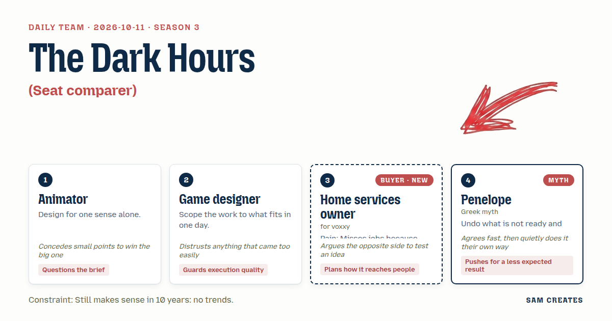
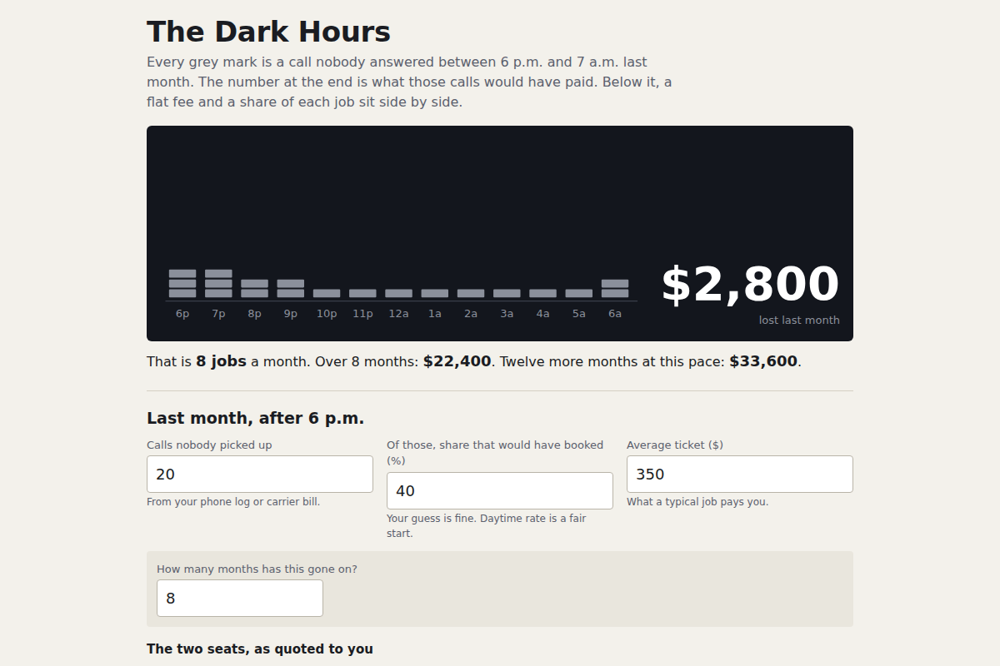

# 2026-10-11: The Dark Hours

[Today](../../README.md) · [Archive](../../ARCHIVE.md)



**Task:** Seat comparer: the same work done for a fee or for a share gives cash now against value later, with the bad case for each and the point where the share wins.

**Constraint:** Still makes sense in 10 years: no trends.

**Season:** 2026-10-07

**Decision:** The page counts the after-hours jobs an owner lost last month in dollars, then sets a flat-fee answering line beside a 10% share of booked jobs, with the bad case for each and the job count where one costs less than the other.

## Asset

<a href="artifact-1.html"></a>

[artifact-1.html](artifact-1.html), led by Animator. Model: claude-opus-5-5.

## The session

### Pitch

**1 · Animator: The Dark Hours**\
Sight only. No chime, no ringing sound, no voice clip.\
One strip across the page, 6 p.m. to 7 a.m. Each missed call becomes one grey mark.\
I question the brief. "Fee or share" is our question. Theirs is "what did last month cost me."\
So the strip fills first, and the comparison sits under it.\
Two bars of the same width: fee seat, share seat. One thin vertical line where they cost the same.\
That line is the page. Everything else leads the eye to it.

**2 · Game designer: One Month Ledger**\
Three inputs, one result, built in a day.\
Calls missed after six. How many of those would book. Average ticket.\
Out comes money lost per month, then two seats side by side: $300 flat, or 10% of each booked job.\
The bad case row sits under each seat, always visible, never behind a toggle.\
Plain number fields. If it needs a slider library, it is cut.\
If the crossover looks clean at the defaults, I break it with ugly numbers before I trust it.

**3 · Home services owner: What I Lost in September**\
Last outfit sold me an app. My office manager lost two afternoons to it and it still didn't route right.\
Show me the dollars I didn't get. Then tell me what you take. In that order.\
I forward my line at six and I'm done. If I have to download anything, I close it.\
I'd send this to the guy who does my drains if the top number looks like his month.\
And I'll argue it now: I'd rather pay flat. Percentages are how the card processor bleeds me.

**4 · Penelope: The Loom Switch**\
Neither seat is a vow. Start on the share and let the numbers come in.\
After three months, pick it apart if it does not fit, and weave it again as a fee.\
The page names the month the switch pays for the owner, even when that costs the seller.\
That is the result nobody expects from a seller's page, so it is the one they believe.\
Slow cloth holds. A rushed pattern frays at the first wash.

### Clash

**2 · Game designer:** Penelope, a three-month switch is state over time. That is a timeline, a chart, and a day I do not have.

**4 · Penelope:** Then give me one field: months on the share. One column more. Agreed, no chart.

**3 · Home services owner:** Animator, I don't read rows of dots. I read dollars. Your strip of grey marks tells me nothing until it has a number on it.

**1 · Animator:** Fair. The dollar total goes at the right end of the strip, in large type. Between the marks and that number, no words. The marks have to carry the count by sight.

**3 · Home services owner:** Penelope, you heard me say I'd rather pay flat. So why would your page tell me to start on the share at all?

**4 · Penelope:** Because you have never counted. The share lets you count without risk, and you switch once you know.

**2 · Game designer:** Running the bad case. Defaults: 20 calls, 40% book, $350 ticket. That is 8 jobs, $2,800 a month. Share costs $280, fee $300, crossover at 8.6 jobs. Volume halves to 4 jobs: share $140, fee still $300 against $1,400 recovered. The machine answers at $0.10 a minute, 4 minutes a call, so $8 a month at 20 calls and $4 at 10. A human answering service at $1.50 a minute is $120, and most carry a $150 monthly minimum, so it costs more in the slow month. Both seats hold. Double the share to 20% and the crossover drops to 4.3 jobs. At 8 jobs the owner pays $560 against $300. The share loses.

**1 · Animator:** Then the bold version, share as the default seat, only holds at 10%. We lock the rate at 10% and show 20% as the bad case.

**3 · Home services owner:** Still no default. You put a default on the share, I assume you rigged it. Side by side, mine to pick.

**4 · Penelope:** Agreed. Side by side. The switch line stays under the crossover, one sentence.

### Decision

The page counts the after-hours jobs an owner lost last month in dollars, then sets a flat-fee answering line beside a 10% share of booked jobs, with the bad case for each and the job count where one costs less than the other.

Concept: The Dark Hours

- Animator: the 6 p.m. to 7 a.m. strip of missed-call marks, the dollar total at its end, and the single vertical crossover line between two bars of equal width.
- Game designer: three plain number fields, the always-visible bad case row under each seat, and the tested defaults of 20 calls, 40% booking, and a $350 ticket.
- Home services owner: dollars lost shown before any price, setup stated as "forward your line at 6 p.m., about 3 minutes, nothing to install," and no default seat.
- Penelope: one sentence under the crossover giving the month count at which moving from share to fee pays for the owner. The three-month timeline is out. Disagreement remains with the buyer, who reads that sentence as a sales line.
- Penelope lost the switch timeline to the Game designer, because a timeline and chart do not fit one day. The Animator lost share-as-default to the owner, because a preset seat reads as a rigged one to someone who has been sold to before.
- Bad case: tested volume halved to 4 jobs a month and the share rate doubled to 20%. At 10% both seats hold for the owner and the seller, and the machine line costs $4 to $8 a month against a human service's $150 minimum. At 20% the share loses to the fee above 4.3 jobs, so the rate is locked at 10% and 20% appears only as the bad case.

### Build notes

1. Build one file, `seat-comparer.html`, with three number inputs (missed calls, booking rate, average ticket) and two qualifying inputs (months this has run, average job size reused from the ticket field). Multiply the monthly loss by months to show the running total. At the defaults over 8 months, that is $22,400.
2. Draw the strip as 13 hourly columns in inline SVG with one mark per missed call. Draw the two seat bars at equal width, with the crossover line placed at fee ÷ (rate × ticket) jobs. Under each bar, print the half-volume row and the 20% rate row in plain text.
3. Add one fixed line below the seats: "A named person at your business approves the call script and the monthly invoice before anything is billed." Also state the setup in one sentence with no install step.

**Guest:** Penelope (myth; Greek myth). The method is drawn from public-domain history, myth, or literature, or invented. The guest speaks in character in original words, never quoting the source, and nothing here is endorsed by anyone.

## Team

```text
Team for 2026-10-11
Season: 2026-10-07

1. Animator
   Method: Design for one sense alone.
   Stance: Questions the brief.
   Temperament: Concedes small points to win the big one.
2. Game designer
   Method: Scope the work to what fits in one day.
   Stance: Guards execution quality.
   Temperament: Distrusts anything that came too easily.
3. Home services owner (buyer; voxxy) [buyer] [new]
   Method: Pain: Misses jobs because nobody answers after hours. Walks when: Setup takes more than ten minutes or needs new software. Opens up when: It counts the jobs they lost last month in money.
   Stance: Plans how it reaches people.
   Temperament: Argues the opposite side to test an idea.
4. Penelope (myth; Greek myth) [guest]
   Method: Undo what is not ready and buy time to get it right.
   Stance: Pushes for a less expected result.
   Temperament: Agrees fast, then quietly does it their own way.

Constraint: Still makes sense in 10 years: no trends.
Task: Seat comparer: the same work done for a fee or for a share gives cash now against value later, with the bad case for each and the point where the share wins.
```

Provider: claude. Model: claude-opus-5-5.
