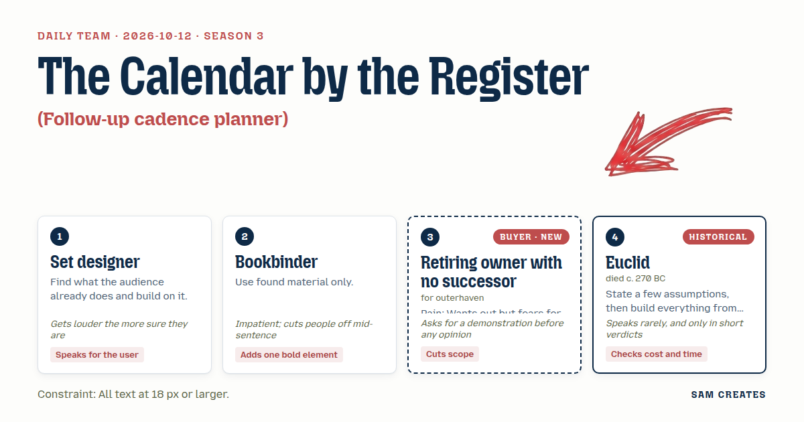
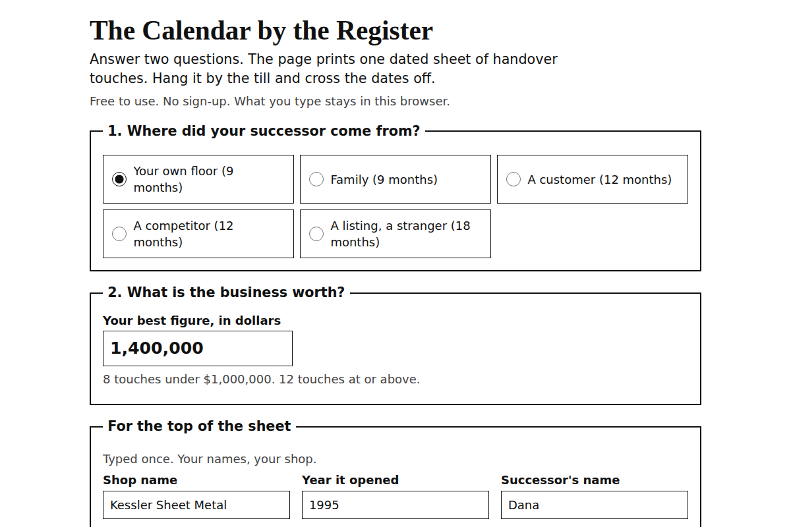

# 2026-10-12: The Calendar by the Register

[Today](../../README.md) · [Archive](../../ARCHIVE.md)



**Task:** Follow-up cadence planner: a lead source and deal size give a dated sequence of follow-up touches, printable.

**Constraint:** All text at 18 px or larger.

**Season:** 2026-10-07

**Decision:** The page asks where the successor came from and what the business is worth, then prints one dated sheet of handover touches, with the broker path and the note path side by side and the bad case under each.

## Asset

<a href="artifact-1.html"></a>

[artifact-1.html](artifact-1.html), led by Set designer. Model: claude-opus-5-5.

## The session

### Pitch

**1 · Set designer: The Calendar by the Register**\
Every owner I have met keeps a paper calendar by the till. Supplier dates, pen marks, somebody's birthday circled.\
So the page prints that calendar. Big dates you can read from the stool, nothing under 18 px.\
Two questions only. Where did your successor come from: your own floor, a customer, a competitor, family, a listing. And what is the business worth.\
The touches land on real dates. First coffee. The books meeting. Telling the staff. The day the keys change hands.\
When the successor is one of your own people, the staff hear it early. That is what good owners ALREADY do.\
No software to log into. Print it, hang it, cross the dates off.

**2 · Bookbinder: The Handover Folio**\
Use what is already in the drawer. The shop name. The year it opened. The staff list.\
No stock photos, no icons. Their words, their names, typed in once.\
Each touch gets a half sheet. Fold it, staple it, two copies: one for the owner, one for the successor.\
One bold element. The key date gets a single red bar across the page, full width.\
Everything else stays black on white.

**Retiring owner (buyer; outerhaven): One Name, One Page**\
Thirty-one years. Eleven people on payroll. I don't need a folio and I don't need twelve sheets.\
Show me Dana. My foreman. Shop's worth about 1.4 million. Print it, then I'll tell you what I think.\
Last fellow who came round had "exit multiple" on slide two. Didn't see slide three.\
One page. Who I talk to, what I say, what date. And where my people stand at every step.\
If the word "target" shows up anywhere, I'm done.

**Euclid (guest): Three Givens**\
Given: a successor, a price, a key date.\
The source sets the length. Own staff, nine months. A stranger from a listing, eighteen.\
The price sets the count. Under one million, eight touches. Over, twelve.\
Each touch carries hours and dollars. Add them up at the foot.\
Nothing goes on the page that does not follow from the givens.

### Clash

**Retiring owner:** Set designer, before anybody argues, print it for Dana. Foreman, 1.4 million.

**1 · Set designer:** Retiring owner, here it is. Own staff, so nine months. Coffee with Dana on Oct 19. Books with Dana on Nov 2. You and Dana tell all eleven together on Nov 23. They hear it from YOU, BEFORE any supplier does.

**Retiring owner:** Set designer, that's the order I'd do it in. But "tell eleven staff" isn't how it goes. It's Marta first, then the floor. And it's one sheet, not twelve.

**2 · Bookbinder:** Retiring owner, one sheet, fine, but it carries the shop name and the year you opened, or it reads like anybody's—

**1 · Set designer:** Bookbinder, owners won't type a header, they WILL write on a cal—

**2 · Bookbinder:** —they'll type their own shop name in two seconds. Name, year, one red bar on the key date. Without that it looks like a broker's printout.

**4 · Euclid:** Retiring owner. Two paths, same givens. A broker sells to a stranger: 140,000 fee, eighteen months. Dana buys on a note: 280,000 down, you carry 1.12 million at 6 percent over seven years. The second path keeps the interest. Print both.

**2 · Bookbinder:** Euclid, the books meeting is where the money goes. AI reads three years of statements and cuts them to one page for about 300 dollars. Your accountant checks it and signs it. Doing it all by hand runs about 6,000.

**Retiring owner:** Euclid, don't show me the good year. Show me Dana missing payments.

**4 · Euclid:** Profit halves in year three. Dana stops paying. The note is secured on the shop, so it comes back to you. You have collected 280,000 plus two years at about 200,000, so 680,000, and the eleven still have jobs. Broker path: the stranger walks at month eleven. You have paid 6,000 for the books, you have nothing, and the clock restarts. Both paths survive. The note path survives with more money and the same staff.

### Decision

The page asks where the successor came from and what the business is worth, then prints one dated sheet of handover touches, with the broker path and the note path side by side and the bad case under each.

Concept: The Calendar by the Register

- Set designer: the dated calendar format, the two-question intake, and the rule that staff hear it from the owner before any supplier.
- Bookbinder: the shop name and founding year at the top, one red bar on the key date, and the AI one-page books summary that the accountant signs.
- Retiring owner: one printed page, touches written as plain "who, what to say, which date," named staff steps instead of a headcount, and no "target," "exit," or "acquisition" anywhere.
- Euclid: length set by source, touch count set by price, hours and dollars totalled at the foot of each path.
- Set designer lost the twelve monthly sheets because the owner will not hang twelve pages for eight touches. Bookbinder lost the stapled folio for the same reason. Bookbinder still holds that a bare sheet reads like a broker's printout, and that stays open until an owner sees the printed sheet.
- Bad case: profit halving in year three and a missed note were tested against a buyer walking at month eleven. The note path leaves the owner 680,000 and eleven jobs. The broker path leaves the owner 6,000 down. The page holds and shows both results.

### Build notes

1. Build a single HTML file with a print stylesheet set to one US Letter page. Every element, including footnotes and the totals row, is 18 px or larger. The key-date bar is the only colour on the sheet.
2. Map the five sources to lengths: own staff 9 months, family 9, customer 12, competitor 12, listing 18. Use 8 touches under 1,000,000 and 12 at or above it. Dates are counted forward from the day the page is printed, and each touch has one named field for the staff member told at that step.
3. Below the calendar, put two columns from the same inputs. The left column is the broker sale at a 10 percent fee. The right column is the note path at 20 percent down and 6 percent over 7 years. Each column ends in a bad-case row. List the AI books summary at 300 dollars against 6,000, with a blank line labelled "Reviewed and signed by" for the accountant.

**Guest:** Euclid (historical; died c. 270 BC). The method is drawn from public-domain history, myth, or literature, or invented. The guest never speaks as the figure, and nothing here is endorsed by anyone.

## Team

```text
Team for 2026-10-12
Season: 2026-10-07

1. Set designer
   Method: Find what the audience already does and build on it.
   Stance: Speaks for the user.
   Temperament: Gets louder the more sure they are.
2. Bookbinder
   Method: Use found material only.
   Stance: Adds one bold element.
   Temperament: Impatient; cuts people off mid-sentence.
3. Retiring owner with no successor (buyer; outerhaven) [buyer] [new]
   Method: Pain: Wants out but fears for staff and the name on the door. Walks when: It sounds like private equity buying to strip and flip. Opens up when: You talk about carrying on what they built and keeping the team.
   Stance: Cuts scope.
   Temperament: Asks for a demonstration before any opinion.
4. Euclid (historical; died c. 270 BC) [guest]
   Method: State a few assumptions, then build everything from them.
   Stance: Checks cost and time.
   Temperament: Speaks rarely, and only in short verdicts.

Constraint: All text at 18 px or larger.
Task: Follow-up cadence planner: a lead source and deal size give a dated sequence of follow-up touches, printable.
```

Provider: claude. Model: claude-opus-5-5.
