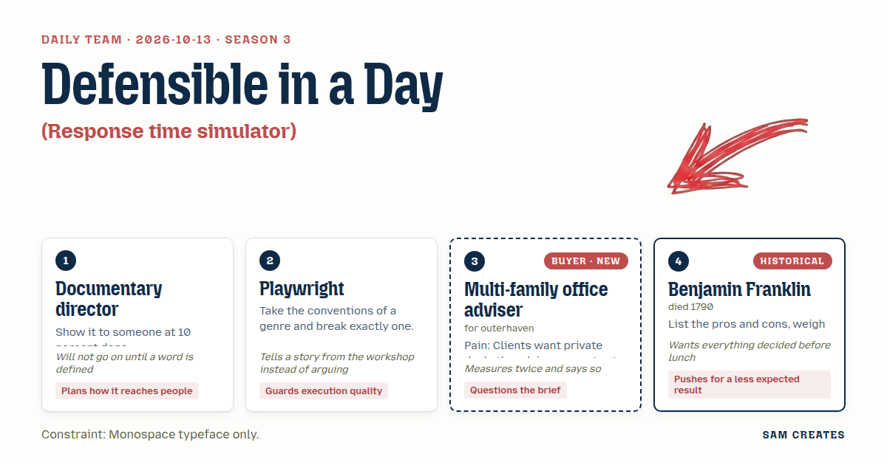
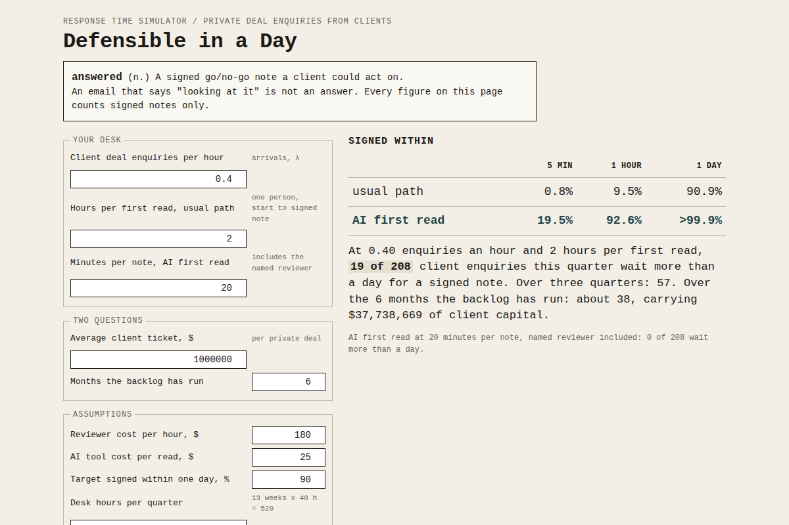

# 2026-10-13: Defensible in a Day

[Today](../../README.md) · [Archive](../../ARCHIVE.md)



**Task:** Response time simulator: enquiries per hour and reply delays give the share answered within five minutes, one hour, and one day.

**Constraint:** Monospace typeface only.

**Season:** 2026-10-07

**Decision:** The page takes deal enquiries per hour and hours per first read, and shows what share of client enquiries get a signed go/no-go note within five minutes, one hour, and one day, both for the usual path and for an AI first read with a name...

## Asset

<a href="artifact-1.html"></a>

[artifact-1.html](artifact-1.html), led by Documentary director. Model: claude-opus-5-5.

## The session

### Pitch

**1 · Documentary director: The Waiting Room**\
Before any numbers, I need the word "answered" pinned down.\
For this adviser, an answer is a signed note the client could act on. An email that says "looking at it" does not count.\
I would put a rough page in front of one adviser by Thursday. It would have three inputs and one output, and nothing styled.\
The result is one sentence: how many clients this quarter waited past a day.\
Then it gives the count over three quarters, because the backlog does not clear by itself.\
Qualifying questions: average ticket size, and how many months the backlog has run.

**2 · Playwright: Night Log**\
Every calculator ends on a large number in a box. I would break that one convention and keep the rest.\
The result is a timestamped log of 20 sample enquiries in monospace rows: `09:14 IN  Series B, logistics  →  answered Thu 16:02`.\
The reader watches the delay pile up row by row.\
The inputs, the units, and the plain labels stay standard, so the one break carries the weight.\
In a workshop, a cast once read a list of dates aloud and the room went quiet at row eleven. That is the effect I want here.

**Multi-family office adviser (buyer; outerhaven): Defensible in a Day**\
I want to question the brief first. Nobody wants a private-deal view in five minutes. It would be reckless.\
Keep the three windows, but count only a signed go/no-go note as an answer. The five-minute column will read close to zero. I am fine with that, because it is true.\
Inputs: client deal enquiries per hour, and hours my team spends on a first read.\
Do not write "deal flow" or "AI-powered" anywhere. I have closed four vendor tabs this year over those words.\
I would forward this to a partner only if it shows a memo I could defend in front of a client's children.

**4 · Benjamin Franklin: Two Columns, Equals Struck**\
Put the usual path on the left and an AI first read with a named reviewer on the right.\
Use the same inputs for both. Wherever a row comes out equal on both sides, strike it through.\
Whatever survives the strikes is the decision.\
The less expected result is a decline rule: the page should say how many enquiries to turn away in the first hour.\
Pricing should sit on its own row: a fee per memo, or a small fee plus a share of deals the client closes.\
I want the columns agreed before lunch.

### Clash

**3 · Multi-family office adviser:** Director, your "answered" is the only definition I would sign. But if the page also counts "we got your email" at five minutes, I will close it.

**1 · Documentary director:** Then "answered" means a signed note, one curve, three cut points. Playwright, does your log still hold if every row needs a signature time?

**2 · Playwright:** It holds better. A designer once cut our stage clock to a single date per scene, and the audience tracked the delay through the dates alone. A signature column does the same work.

**3 · Multi-family office adviser:** Twenty rows I have to read is unpaid work. Put three percentages at the top and the log underneath. Otherwise I am out.

**4 · Benjamin Franklin:** Then I take the top. Manual at 0.4 an hour with two hours per read gives 0.8 percent in five minutes, 9.5 in one hour, 91 in one day. An AI read at 20 minutes gives 19.5, 92.6, and close to 100. Every other row is equal and gets struck.

**1 · Documentary director:** Run the bad case, Franklin. Volume doubles.

**4 · Benjamin Franklin:** At 0.8 an hour the manual queue never clears, and the page should say so in plain words. The AI path holds at 16.7, 88.9, and close to 100. On pricing, a 500-dollar fee covers the 360 dollars of AI and review, and a 0.5 percent share sits on top. At a 5 percent close rate that is 25,600 a quarter against 12,000 for flat fees.

**3 · Multi-family office adviser:** Your numbers hold. My objection does not change. A share in my client's deal reads as a conflict, and my reputation pays for that. Show the share row and I stop forwarding.

**4 · Benjamin Franklin:** The share row is how you get paid on deals clients bring back next quarter. Strike it and you strike the reason to build this.

### Decision

The page takes deal enquiries per hour and hours per first read, and shows what share of client enquiries get a signed go/no-go note within five minutes, one hour, and one day, both for the usual path and for an AI first read with a named reviewer.

Concept: Defensible in a Day

- Documentary director: "answered" means a signed note; the result line counts clients who waited past a day each quarter; the page asks two questions, ticket size and months of backlog.
- Playwright: a 20-row timestamped log of enquiries with signature times sits under the numbers.
- Multi-family office adviser: the three windows apply to signed notes only; three percentages lead; no vendor vocabulary on the page.
- Benjamin Franklin: two columns with equal rows struck through; a decline count for the first hour; the pricing comparison.
- Lost: the playwright lost the log as the headline, because the adviser will not read 20 rows before seeing the result. The share row stays on the page, collapsed and labelled "fee model, adviser's choice." The adviser still holds that showing it at all is a conflict, and this stays open.
- Bad case: at double volume (0.8 per hour), the manual path never clears and the page says so. The AI path still gets 88.9 percent signed within an hour. At a 5 percent close rate, fee plus share earns 25,600 a quarter against 12,000 for flat fees. The page holds.

### Build notes

1. Compute each share as `P(T≤t) = 1 − e^(−(μ−λ)t)`, where μ = 1/hours per read. When λ ≥ μ, print `QUEUE DOES NOT CLEAR`. Run this for both columns at t = 5/60, 1, and 24 hours.
2. Build one file, `defensible-in-a-day.html`, with every element in `font-family: ui-monospace, Menlo, monospace`. Use `<s>` for rows that come out equal. Generate the 20-row log from the same λ and μ with a fixed seed.
3. Put a signature line on the AI column: `Reviewed and signed: [name], [date]`. Keep the share row inside a closed `<details>` with a 500-dollar floor and the 5 percent close case shown first.

**Guest:** Benjamin Franklin (historical; died 1790). The method is drawn from public-domain history, myth, or literature, or invented. The guest never speaks as the figure, and nothing here is endorsed by anyone.

## Team

```text
Team for 2026-10-13
Season: 2026-10-07

1. Documentary director
   Method: Show it to someone at 10 percent done.
   Stance: Plans how it reaches people.
   Temperament: Will not go on until a word is defined.
2. Playwright
   Method: Take the conventions of a genre and break exactly one.
   Stance: Guards execution quality.
   Temperament: Tells a story from the workshop instead of arguing.
3. Multi-family office adviser (buyer; outerhaven) [buyer] [new]
   Method: Pain: Clients want private deals the adviser cannot vet fast. Walks when: It adds unpaid work or puts their reputation at risk. Opens up when: Diligence is done and written up so they can defend it to clients.
   Stance: Questions the brief.
   Temperament: Measures twice and says so.
4. Benjamin Franklin (historical; died 1790) [guest]
   Method: List the pros and cons, weigh them, and cross out equals.
   Stance: Pushes for a less expected result.
   Temperament: Wants everything decided before lunch.

Constraint: Monospace typeface only.
Task: Response time simulator: enquiries per hour and reply delays give the share answered within five minutes, one hour, and one day.
```

Provider: claude. Model: claude-opus-5-5.
