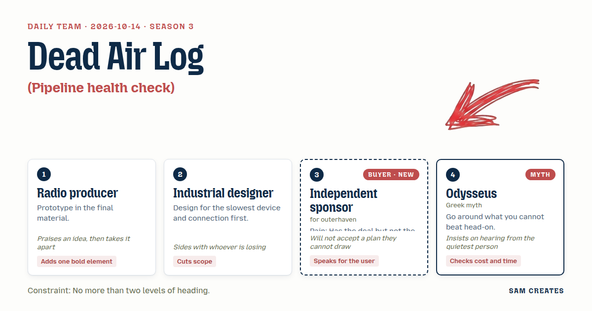
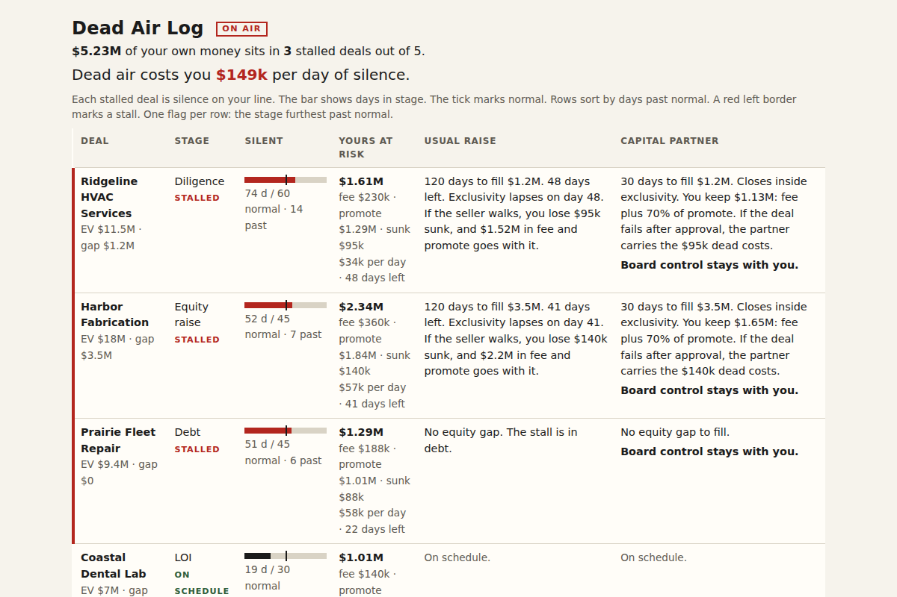

# 2026-10-14: Dead Air Log

[Today](../../README.md) · [Archive](../../ARCHIVE.md)



**Task:** Pipeline health check: deals by stage and age give a list of stalled deals and the total value at risk.

**Constraint:** No more than two levels of heading.

**Season:** 2026-10-07

**Decision:** The page takes a sponsor's pasted pipeline and returns their stalled deals by stage and age, the sponsor's own dollars at risk on each, and, for every stalled deal, the usual equity raise next to a capital-partner route under which the s...

## Asset

<a href="artifact-1.html"></a>

[artifact-1.html](artifact-1.html), led by Radio producer. Model: claude-opus-5-5.

## The session

### Pitch

**1 · Radio producer: Dead Air Log**\
Every stalled deal is dead air. A listener notices four seconds of it. A seller notices forty days.\
I'd build it straight in the HTML today. No wireframe. Paste the pipeline: deal, stage, days in stage, enterprise value, equity committed.\
Out comes the log. Each deal gets a bar showing how long it has sat silent against how long that stage should run.\
My one bold element is a single number at the top: your dollars at risk per day of silence.\
That number is your fee, plus your promote, plus your dead costs, divided by the days left on exclusivity.\
The page asks two things only: your biggest equity gap, and how many months your oldest deal has sat.

**2 · Industrial designer: Pocket Ledger**\
Test it on a five-year-old phone on airport wifi. That's where this person reads it, between seller calls.\
It's one table. Static HTML, no chart library, under 40 KB.\
Rows sort by days past normal. Stalled rows get a 4 px left border, so the flag doesn't depend on colour.\
The total at risk is the first line of text, ahead of the table, so it loads first.\
Cut the stage editor. Use five fixed stages: LOI, diligence, equity raise, debt, close.

**Independent sponsor (buyer; outerhaven): The Napkin**\
I've got an LOI. Exclusivity runs out in 41 days, and I'm $3.5M short on equity. That's my week.\
The last fund I called offered to "take it off my hands." I hung up.\
Show me stages I could draw on a napkin. The same five I'd draw.\
Value at risk means my money. My 2% closing fee, my promote, and the $140k I've already spent on QoE and legal. Leave out their headline EV.\
My name stays on the deal. If the page calls me an intermediary, I close the tab.

**4 · Odysseus: Around the Headland**\
Fifteen family offices, one at a time, is rowing straight into the current.\
Put two routes beside each stalled deal, with the same inputs.\
The usual route raises the equity piece by piece and takes about 120 days.\
The way around is one capital partner who fills the gap in 30 days for a share of the promote, and carries the dead costs if the deal fails.\
Count the days against exclusivity on both routes. Count what's lost if the seller walks.\
Let a machine read the CIM and the QoE draft first. That takes hours where an analyst takes weeks. A named accountant signs off.

### Clash

**1 · Radio producer:** Industrial designer, your table loads fast, and that's a gift. But a table is a transcript, and nobody leans in to a transcript. The number at the top is the voice.

**2 · Industrial designer:** Radio producer, a number that redraws every second drains a battery on an old phone. It also misleads, because the risk changes once a day. Compute it on load and print it.

**3 · Independent sponsor:** Odysseus, I can draw your two routes. But "a share of the promote" — how much? If I can't write the figure on the napkin, it's a fund coming in through the side door to take my deal.

**4 · Odysseus:** The figures are 30% of the promote. Board control stays with you. The partner pays the dead costs if the deal fails after they approve it. The page says it in exactly those words. Industrial designer, you've barely spoken. Where does this go on your one table?

**2 · Industrial designer:** Two columns per row, Odysseus: days to close on each route, and your dollars lost if the seller walks. No second page. And the sponsor's worry is the right one, so the control line sits in the row itself.

**1 · Radio producer:** Sponsor, the napkin is the whole show, and I mean that. Here's the problem with it. Five stages assume one stall per deal. Half these deals stall on equity and debt at once. Put two flags on one row and the eye skips both.

**3 · Independent sponsor:** Then flag the worse one, Radio producer. I already know which one is killing me. I don't need the page to tell me twice.

**4 · Odysseus:** Here is the bad case. The deal slips six months and committed equity halves, from $2.5M to $1.25M. On the usual route, exclusivity lapses on day 41 and the seller walks. You eat $140k and lose a $360k fee and about $1.8M of promote. On the way around, the partner covers the $140k, and you keep 70% of the promote if it closes, about $1.26M. It holds.

**1 · Radio producer:** Then the counter stays, as dollars per day of silence, computed on load. That's my one bold thing.

**2 · Industrial designer:** Computed on load I can live with. Large type at the top I won't accept. On a 360 px screen it pushes the table below the fold.

### Decision

The page takes a sponsor's pasted pipeline and returns their stalled deals by stage and age, the sponsor's own dollars at risk on each, and, for every stalled deal, the usual equity raise next to a capital-partner route under which the sponsor keeps control.

Concept: Dead Air Log

Radio producer: the dollars-per-day-of-silence line at the top, computed on load from fee, promote, and dead costs over days left on exclusivity.
Industrial designer: one static table under 40 KB, five fixed stages, sorted by days past normal, with a 4 px border on stalled rows.
Independent sponsor: value at risk counts only their 2% fee, promote, and sunk costs. The page never uses the word intermediary, and each row states that board control stays with them.
Odysseus: two routes per stalled row with the same inputs, plus a first read of the CIM and QoE draft by AI before the $85k QoE engagement, signed off by a named CPA.
Radio producer lost the live ticking counter, because the risk changes daily and the redraw costs battery and screen space. The counter runs in body type at 1.25x, which settles the open point with the designer.
Bad case: a six-month slip with committed equity halved from $2.5M to $1.25M. The usual route loses $140k sunk, a $360k fee, and about $1.8M of promote. The capital-partner route loses $0 sunk and keeps about $1.26M of promote. The page holds and keeps the capital-partner route.

### Build notes

1. Set the stall thresholds in days: LOI 30, diligence 60, equity raise 45, debt 45, close 30. A deal past its threshold counts as stalled. Each row shows only its worst stall.
2. Compute value at risk per deal as 2% of EV, plus estimated promote at 20% over an 8% preferred return, plus the sunk costs the user enters. Show the total in the first line of text, then the table.
3. End the page with the two qualifying questions: equity gap in dollars, and months the oldest deal has been stuck. Route gaps over $2M with more than 3 months stuck to a call request that says "your deal, your board seat."

**Guest:** Odysseus (myth; Greek myth). The method is drawn from public-domain history, myth, or literature, or invented. The guest speaks in character in original words, never quoting the source, and nothing here is endorsed by anyone.

## Team

```text
Team for 2026-10-14
Season: 2026-10-07

1. Radio producer
   Method: Prototype in the final material.
   Stance: Adds one bold element.
   Temperament: Praises an idea, then takes it apart.
2. Industrial designer
   Method: Design for the slowest device and connection first.
   Stance: Cuts scope.
   Temperament: Sides with whoever is losing.
3. Independent sponsor (buyer; outerhaven) [buyer] [new]
   Method: Pain: Has the deal but not the equity to close it. Walks when: It treats them like a broker or tries to take the deal. Opens up when: You respect their deal and bring capital that keeps them in control.
   Stance: Speaks for the user.
   Temperament: Will not accept a plan they cannot draw.
4. Odysseus (myth; Greek myth) [guest]
   Method: Go around what you cannot beat head-on.
   Stance: Checks cost and time.
   Temperament: Insists on hearing from the quietest person.

Constraint: No more than two levels of heading.
Task: Pipeline health check: deals by stage and age give a list of stalled deals and the total value at risk.
```

Provider: claude. Model: claude-opus-5-5.
