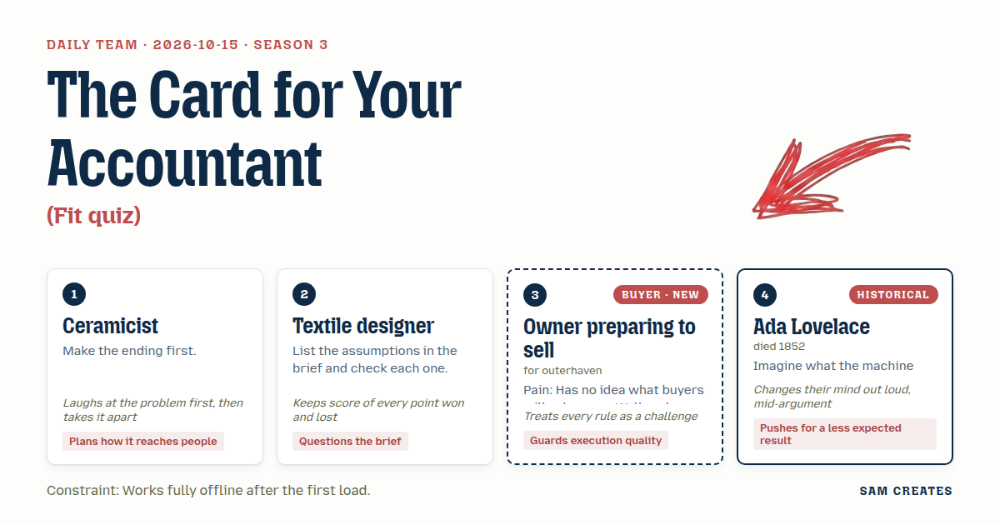
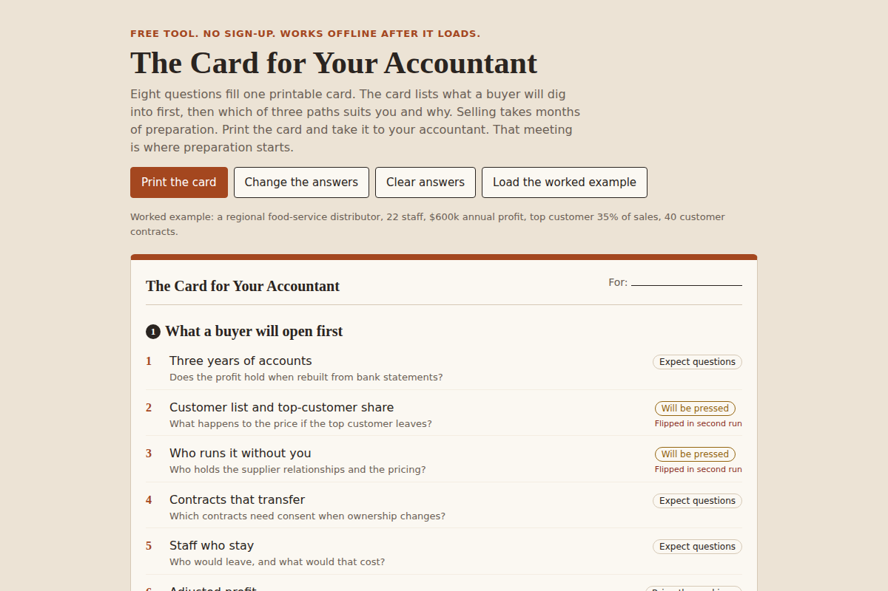

# 2026-10-15: The Card for Your Accountant

[Today](../../README.md) · [Archive](../../ARCHIVE.md)



**Task:** Fit quiz: eight multiple-choice questions give which of three approaches suits the buyer and why.

**Constraint:** Works fully offline after the first load.

**Season:** 2026-10-07

**Decision:** The page asks eight multiple-choice questions, shows the six things a buyer will dig into first, then names which of three paths suits the seller and why, and reruns the answers with the two weakest flipped to test whether that path holds.

## Asset

<a href="artifact-1.html"></a>

[artifact-1.html](artifact-1.html), led by Ceramicist. Model: claude-opus-5-5.

## The session

### Pitch

**1 · Ceramicist: The Card for Your Accountant**\
I made the result screen before any question.\
One printable card. Top half: the six things a buyer will open first, in the order they open them.\
Bottom half: one of three paths, why it fits, and the months each one takes to get ready.\
The card gets forwarded. The owner hands it to the accountant, the accountant books a meeting. That meeting is the call.\
Eight questions only feed the card. Two of them ask annual profit band and months until you want out.\
Everything in one HTML file, answers kept in localStorage, no network after load.

**2 · Textile designer: Assumption Check**\
The brief carries five assumptions. I checked each one.\
One: the owner knows the three paths exist. False for most. Name them plainly.\
Two: "suits the buyer." On this page the user is the seller. The word means the other side.\
Three: eight questions is enough. It is, if each tests one thing a buyer checks.\
Four and five: the owner wants a price, and the owner wants to sell all of it. Both unproven. I'd keep each answer tied to the assumption it tests.

**Owner preparing to sell (buyer; outerhaven): What They'll Dig Into**\
Eight questions, fine. Why eight, though. Because somebody said so.\
Make every one a question a buyer actually asked someone I know. Top customer share. Who runs it when I'm on holiday. Are the books clean three years back.\
No price on the first screen. The last broker opened with eight times earnings and I stopped listening.\
Tell me what they'll pull apart, then tell me which way to go.\
If I can't finish it between two supplier calls, I won't.

**4 · Ada Lovelace: Second Run**\
Once the quiz scores the answers, the same engine can run them again with different inputs.\
First run: your answers as given, and a path.\
Second run: the two answers a buyer will press hardest, flipped to their weak side.\
If the path changes, the page says so. If it holds, the page says that.\
The quiz turns into a diligence rehearsal. It is still eight clicks.

### Clash

**Owner preparing to sell (buyer; outerhaven):** Ceramicist, your card has a dollar range on it. Third line. That is where the last broker lost me.

**1 · Ceramicist:** Ha. I glazed it before I threw it. Fine, the range drops to the bottom, under the dig list. It stays, though. Your accountant will want a number to argue with.

**2 · Textile designer:** Score: owner one, Ceramicist nil on the price. And the result says "suits the buyer." The person reading is the seller. Call it "which path suits you" or we confuse the one person on the page.

**4 · Ada Lovelace:** I'd flip every answer to its weak side on the second run. No, that's wrong. A buyer won't assume the worst everywhere. Flip the two lowest-scoring answers only.

**Owner preparing to sell (buyer; outerhaven):** If those two come out as my top customer and me being the only one who knows the suppliers, that's the meeting I dread. That version I'd send to my brother. He sold his print shop in 2023.

**2 · Textile designer:** Ceramicist, the shortcut. Path three, sell a majority now and keep a share. It keeps upside for the same diligence work. The page has to show it next to the full sale, same inputs, both bad cases.

**1 · Ceramicist:** Then run it. $600k profit, top customer 35%. Full sale: slips six months, price cut 20%, $60k in fees spent. Majority sale: 60% now, the 40% only pays if the business runs without the owner. If owner dependence is high, the kept share is worth little.

**4 · Ada Lovelace:** So the second run decides whether path three is offered at all. And the same rules can sort three years of books and 40 customer contracts into the data-room list. That cuts accountant hours from 60 to 12, about $9k down to $1.8k, and most of that saving lands in the case where the deal dies.

**Owner preparing to sell (buyer; outerhaven):** Twelve hours, fine. My accountant signs it or it stays out of the room. And none of my contracts leave this laptop.

**2 · Textile designer:** Score: owner three. Ceramicist, I still want no dollar range at all. Offline, with no market data, any range is a guess, and a guess on the card is what he walks from.

### Decision

The page asks eight multiple-choice questions, shows the six things a buyer will dig into first, then names which of three paths suits the seller and why, and reruns the answers with the two weakest flipped to test whether that path holds.

Concept: The Card for Your Accountant

- Ceramicist: the printable result card, built first, and the two qualifying questions on profit band and months to exit.
- Textile designer: each question is tagged with the assumption it tests, and the result is labelled "which path suits you."
- Owner preparing to sell (buyer; outerhaven): every question is one a buyer asks, the dig list comes before any number, and the accountant signs off before anything enters the data room.
- Ada Lovelace: the second run flips the two weakest answers and shows whether the path changes.
- Lost: the Textile designer lost on removing the dollar range. It stays as a wide band at the bottom of the card, marked as an estimate, because the accountant meeting needs a number. This is still open.

Bad case: tested $600k profit, 35% top-customer share, a six-month slip, a 20% price cut, and $60k of fees lost if the deal falls through. The full sale holds: about $1.92M against $2.4M, and the fee loss drops to about $52k with the AI prep. The majority sale does not hold when owner dependence scores high, so the page offers path three only when the second run keeps it on top. Scaled back.

### Build notes

1. Write the result card first as a print stylesheet at A5: dig list on top, path and reason in the middle, both bad cases side by side, estimate band last. Put all scoring rules in one inline script with no external fonts or CDN, and store answers in localStorage.
2. Write the eight questions in this order: top-customer share, who runs it when you are away, books clean three years, written contracts, staff who would stay, wish to keep a share, annual profit band, months to exit. Each option maps to a score for path one (full sale), path two (staff or family buy over time), and path three (sell a majority, keep a share).
3. Add a "Prepare the data room" panel that lists the three-year books and customer contracts to sort, shows 60 hours against 12 hours and $9k against $1.8k, and ends with a sign-off line for the accountant's name. Add a note that no file leaves the device.

**Guest:** Ada Lovelace (historical; died 1852). The method is drawn from public-domain history, myth, or literature, or invented. The guest never speaks as the figure, and nothing here is endorsed by anyone.

## Team

```text
Team for 2026-10-15
Season: 2026-10-07

1. Ceramicist
   Method: Make the ending first.
   Stance: Plans how it reaches people.
   Temperament: Laughs at the problem first, then takes it apart.
2. Textile designer
   Method: List the assumptions in the brief and check each one.
   Stance: Questions the brief.
   Temperament: Keeps score of every point won and lost.
3. Owner preparing to sell (buyer; outerhaven) [buyer] [new]
   Method: Pain: Has no idea what buyers will ask or pay. Walks when: It opens with a valuation that sounds too good. Opens up when: You explain what buyers will dig into before anyone talks price.
   Stance: Guards execution quality.
   Temperament: Treats every rule as a challenge.
4. Ada Lovelace (historical; died 1852) [guest]
   Method: Imagine what the machine could do beyond its first job.
   Stance: Pushes for a less expected result.
   Temperament: Changes their mind out loud, mid-argument.

Constraint: Works fully offline after the first load.
Task: Fit quiz: eight multiple-choice questions give which of three approaches suits the buyer and why.
```

Provider: claude. Model: claude-opus-5-5.
