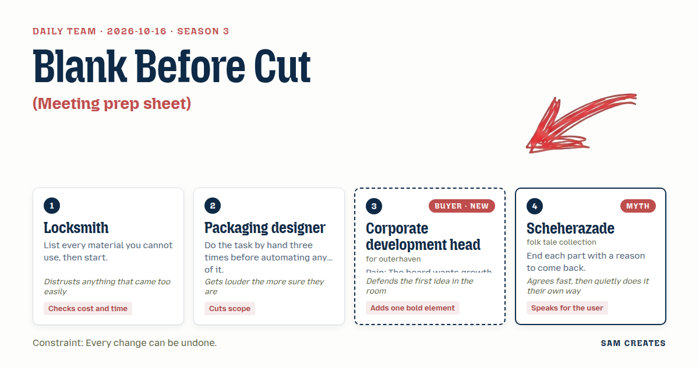
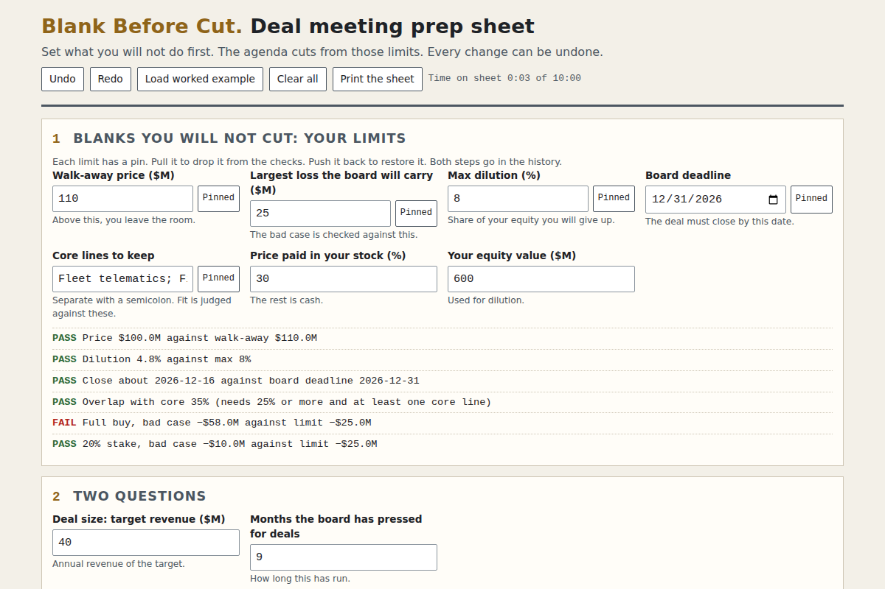

# 2026-10-16: Blank Before Cut

[Today](../../README.md) · [Archive](../../ARCHIVE.md)



**Task:** Meeting prep sheet: the buyer's goal and limits give a one-page agenda and a list of numbers to bring.

**Constraint:** Every change can be undone.

**Season:** 2026-10-07

**Decision:** The page takes the buyer's acquisition goal and limits, and prints a one-page agenda that opens on fit, a list of seven numbers to bring, and a full-buy column next to a stake-with-option column under the same bad case, with every input ...

## Asset

<a href="artifact-1.html"></a>

[artifact-1.html](artifact-1.html), led by Locksmith. Model: claude-opus-5-5.

## The session

### Pitch

**1 · Locksmith: Blank Before Cut**\
Before I cut a key I lay out the blanks I won't use.\
Same here. First screen: what the buyer will not do. Max price. No overlap outside the core lines. No deal that closes after the board date.\
Only then does the agenda print.\
Each limit has a pin. Pull it back out and the agenda re-cuts. Nothing is permanent.\
And I time it. If the sheet takes more than ten minutes to fill, it's picked, not opened.\
A lock that opens on the first try was never locked.

**2 · Packaging designer: One Panel**\
I folded this by hand three times, from three old meeting packs.\
Each time the same thing survived the cut. Four agenda lines. Seven numbers. Nothing else.\
One panel. Letter size. Prints on one side.\
Fit, integration, terms, walk-away. That's the dieline.\
Anything that doesn't fit the panel goes in the bin, not on page two.

**3 · Corporate development head: Fit on Line One**\
My board wants two acquisitions closed by Q4. I hear that every Monday.\
The last three advisors sent me price decks. None said how their sales team folds into mine.\
So line one of the agenda is fit: which of our core lines this target feeds.\
Line two is day 100: who reports to whom, which system dies.\
The bold part: the walk-away price prints at the top, in red, before anyone talks.\
If I walk in knowing my exit, I negotiate better.

**4 · Scheherazade: The Thread Left Hanging**\
Every meeting ends. A good one ends with the other side owing you something.\
So each agenda line closes on one question the target must answer before you meet again.\
Not a threat. A thread. They pick it up or the tale stops.\
The sheet saves each version, so the next meeting starts where this one broke off.\
The user should leave the room wanting the second night.

### Clash

**2 · Packaging designer:** Scheherazade, four threads is four extra lines. I ran it by hand three times and the questions got cut first, every time. Seven numbers, four lines, one panel.

**4 · Scheherazade:** Agreed, Packaging designer. One panel. I'll put a single question in the footer, under the signature line, where they'll read it last.

**3 · Corporate development head:** Locksmith, I like the limits up front. But fit goes before price, or I close the tab. That's what every deck got wrong.

**1 · Locksmith:** Fit goes on line one, Corporate development head. Next to the full buy I'm putting a 20% stake with an option to buy the rest at a fixed multiple within 18 months. Same inputs. You can back out of it.

**3 · Corporate development head:** A 20% stake doesn't consolidate, Locksmith. My board counts revenue on my P&L this year. To them that line reads as no deal.

**2 · Packaging designer:** Locksmith, I timed the hand work too. Pulling the seven numbers out of the data room took four hours each time. The AI reads the contracts and the financials. Counsel only reviews what it flags.

**1 · Locksmith:** Counted it, Packaging designer. Counsel reading 300 contracts is 400 hours at $650. That's $260,000. With an AI first pass for change-of-control and exclusivity clauses, it's 120 hours, or $78,000. The general counsel signs off. If the deal dies, that saved $182,000 is the money we don't lose.

**1 · Locksmith:** Now the bad case, Corporate development head. Target at $40M revenue, full buy at 2.5x is $100M. Revenue halves and it's worth $50M. You've lost $50M plus $8M of integration. The stake costs $20M. It's worth $10M. You lose $10M and you spent nothing on integration.

**4 · Scheherazade:** The board hears whatever story comes first, Corporate development head. Tell them the stake is the first night and the option is the second.

**3 · Corporate development head:** A story doesn't hit a Q4 target, Scheherazade. I'll bring both columns. I'm still leading with the full buy.

### Decision

The page takes the buyer's acquisition goal and limits, and prints a one-page agenda that opens on fit, a list of seven numbers to bring, and a full-buy column next to a stake-with-option column under the same bad case, with every input undoable.

Concept: Blank Before Cut

- Locksmith: the limits screen comes first. Each limit can be pulled and restored from an undo history. The stake column sits next to the full buy, and the AI savings line is shown.
- Packaging designer: the sheet is one printed panel with four agenda lines (fit, integration, terms, walk-away) and seven numbers. There is no page two.
- Corporate development head: fit is line one and day 100 is line two. The walk-away price prints in red at the top. The full buy is the first column.
- Scheherazade: one open question for the target prints in the footer. Saved versions let the next meeting reopen the last sheet.
- Lost: Scheherazade lost four threads to one, because the hand tests cut them every time. The Corporate development head lost a single-column sheet, because the bad case shows the stake losing $10M against $58M. The question of which column the board sees first is still open.
- Bad case: revenue halving on a $40M target was tested. The full buy loses $58M and the stake loses $10M. A collapsed deal saves $182,000 in counsel fees. The page holds, and it shows both columns rather than picking one.

### Build notes

1. Build the inputs as limit fields first: max price, max dilution, core lines that must be kept, board deadline. After those, add two qualifying questions: deal size, and how many months the board has pressed for acquisitions. Store every change in an undo stack with a visible history list.
2. Render the output as one letter-size print panel with CSS `@page` set to a single sheet. Order: walk-away price in red, then four agenda lines, then seven numbers (target revenue, revenue overlap with core, price multiple, integration cost, retained-staff count, change-of-control contracts, months to close), then the footer question.
3. Add the two-column block with full buy and 20% stake plus an 18-month option. Both columns use the same inputs. A toggle halves revenue and shows the loss for each column. Below the columns, print a line with counsel hours with and without the AI first pass, and leave a sign-off field for the general counsel's name.

**Guest:** Scheherazade (myth; folk tale collection). The method is drawn from public-domain history, myth, or literature, or invented. The guest speaks in character in original words, never quoting the source, and nothing here is endorsed by anyone.

## Team

```text
Team for 2026-10-16
Season: 2026-10-07

1. Locksmith
   Method: List every material you cannot use, then start.
   Stance: Checks cost and time.
   Temperament: Distrusts anything that came too easily.
2. Packaging designer
   Method: Do the task by hand three times before automating any of it.
   Stance: Cuts scope.
   Temperament: Gets louder the more sure they are.
3. Corporate development head (buyer; outerhaven) [buyer] [new]
   Method: Pain: The board wants growth by acquisition this year. Walks when: It ignores how the target fits the core business. Opens up when: It speaks to fit and integration, not only price.
   Stance: Adds one bold element.
   Temperament: Defends the first idea in the room.
4. Scheherazade (myth; folk tale collection) [guest]
   Method: End each part with a reason to come back.
   Stance: Speaks for the user.
   Temperament: Agrees fast, then quietly does it their own way.

Constraint: Every change can be undone.
Task: Meeting prep sheet: the buyer's goal and limits give a one-page agenda and a list of numbers to bring.
```

Provider: claude. Model: claude-opus-5-5.
