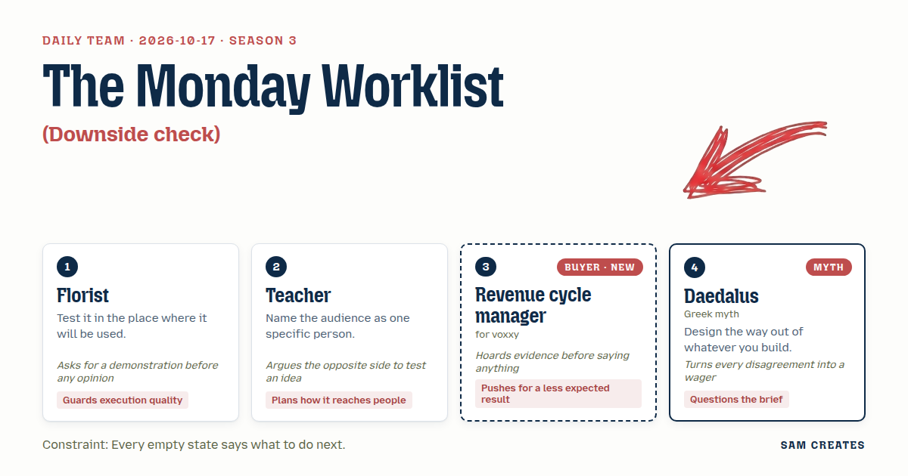
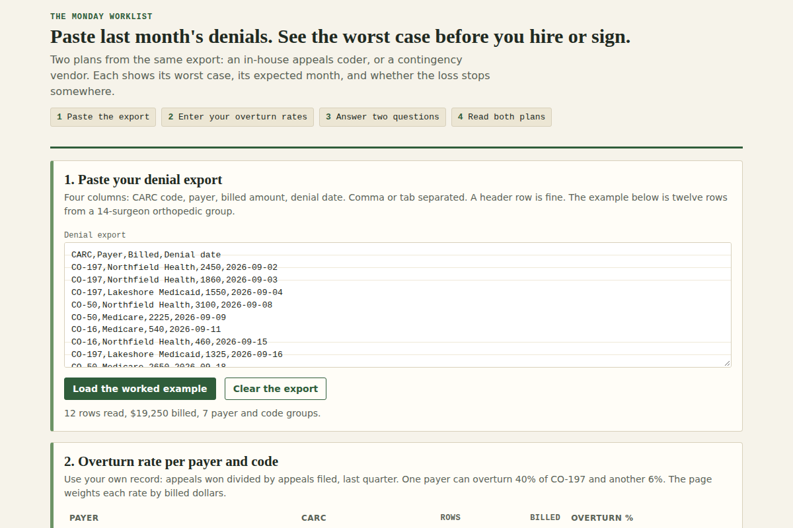

# 2026-10-17: The Monday Worklist

[Today](../../README.md) · [Archive](../../ARCHIVE.md)



**Task:** Downside check: a plan's cost, likely gain, and odds give the worst case, the expected result, and whether the loss is capped.

**Constraint:** Every empty state says what to do next.

**Season:** 2026-10-07

**Decision:** The page reads a pasted denial export and a rework-hours figure, then shows an in-house appeals hire and a contingency vendor side by side, each with its worst case, expected monthly result, and whether the loss is capped.

## Asset

<a href="artifact-1.html"></a>

[artifact-1.html](artifact-1.html), led by Florist. Model: claude-opus-5-5.

## The session

### Pitch

**1 · Florist: The Monday Worklist**\
I don't judge an arrangement in the cooler. I carry it into the room, under that light, and watch it for an hour.\
So this page gets tested on a real denial export, on a Monday, with the backlog already open in the other tab.\
The user pastes last month's denials: reason code, payer, billed amount, date. Nothing typed by hand that already sits in a report.\
Two plans come out side by side: hire an appeals coder, or pay a vendor a share of what they recover.\
A model drafts each appeal letter from the reason code and the payer's policy. A named coder signs every one. That cuts drafting from 45 minutes to about 12.\
Show me it working on twelve real rows before anyone tells me it's good.

**2 · Teacher: One Manager, One Thursday**\
I'm writing for one person. She runs revenue cycle for a 14-surgeon orthopedic group, and she presents to the CFO on Thursday.\
She has one slide and four minutes.\
So the result is that slide: worst case, expected result, and whether the loss stops somewhere.\
Let me argue the other side, too. Maybe appeals are the wrong fight, and the money is in getting the prior auth right before the patient is scheduled.\
If the page can't survive that question, it shouldn't ship.

**3 · Revenue cycle manager: Reason Codes First**\
I'll say this once.\
Start from my denial report. CO-197, CO-50, CO-16. Per payer.\
One payer overturns 40% of my CO-197 appeals on the first try. Another overturns 6%. A single blended rate tells me you've never worked a denial.\
I already track rework hours. Ask for them. Don't estimate them for me.\
And don't write "maximize revenue" anywhere. The last vendor said that and billed me for four months of nothing.

**4 · Daedalus: The Door in the Contract**\
I built a maze once. I knew where the way out was before I laid the first wall.\
Every plan on this page carries its exit: the notice period, and what it costs to walk away in month three.\
A loss is capped only when you can leave before it grows. A salaried hire gives you 30 days of notice. A vendor contract might lock you in for twelve months.\
I'll wager you a feather against a wax seal that the hire loses whenever the overturn rate falls below one line. Draw that line on the page.

### Clash

**1 · Florist:** Revenue cycle manager, show me the actual columns in your export. A page built on columns I made up will fall apart on Monday.

**3 · Revenue cycle manager:** CARC code, payer, billed amount, denial date. Rework hours sit in a separate sheet. The odds have to come per payer, from my own appeals won over appeals filed.

**2 · Teacher:** Revenue cycle manager, I'll take the other side. Skip appeals entirely. Fix prior auth at scheduling, and the denials never happen.

**3 · Revenue cycle manager:** Teacher, that's a nine-month workflow project owned by front desk. I own denials. If the page opens on scheduling, I close the tab.

**4 · Daedalus:** Florist, here's my wager. The vendor beats the hire whenever the overturn rate drops under 25% on $120,000 a month in denials. Put the crossover on the page and let it prove me wrong.

**1 · Florist:** Daedalus, then demonstrate it. Revenue cycle manager, run the bad case on those numbers.

**3 · Revenue cycle manager:** Daedalus, here it is. $120,000 a month, overturn drops from 34% to 17%, payer decisions slip six months. The hire plus drafting tool costs $7,500 a month, so that's $45,000 spent before a dollar comes back. After that it nets $12,900 a month. The vendor at 25% nets $15,300 and costs nothing during the slip. At 34% the hire nets $33,300 and the vendor $30,600. Only the vendor's loss is capped.

**2 · Teacher:** Daedalus, the other side again. At 34%, the vendor's share runs $10,200 a month. Over 36 months that's $367,200, against $270,000 for the hire. The CFO sees a fee that never ends.

**4 · Daedalus:** Teacher, then let's bet on the clause. Start with the vendor on a 90-day out. Switch to the hire once your rate holds above 25% for two quarters. Put the switch on the page as a third column.

**1 · Florist:** Daedalus, I haven't seen that switch work on a real report. Two columns ship. The switch stays on the table.

### Decision

The page reads a pasted denial export and a rework-hours figure, then shows an in-house appeals hire and a contingency vendor side by side, each with its worst case, expected monthly result, and whether the loss is capped.

Concept: The Monday Worklist

Florist: The page takes the four columns from a real denial export and was tested on twelve real rows before layout began.
Teacher: The result renders as one slide for a CFO meeting, with the worst case listed first.
Revenue cycle manager: Overturn odds are entered per payer and per CARC code from the user's own appeals record. Rework hours come from their sheet. The page never says "maximize revenue."
Daedalus: Each plan shows its exit terms and cost to leave, and the page marks the overturn rate where the two plans cross.
Lost: Teacher lost the front-end prior auth argument. The buyer owns denials, not scheduling, and a page that opens there loses her in the first screen. Daedalus's switch column stays open. The team ships two columns until a switch is tested on a real report.
Bad case: At $120,000 a month in denials, overturn halving from 34% to 17%, and a six-month payer slip, the hire spends $45,000 before any return and then nets $12,900 a month. The vendor nets $15,300 a month and spends nothing during the slip. The page holds because it shows the vendor's loss as capped and the hire's as uncapped until notice is given, and it names 25% as the crossover.

### Build notes

1. Parse a pasted CSV with the columns CARC, payer, billed amount, and denial date. Group by payer and code, and ask for one overturn rate per group. Empty table state: "No denials loaded. Export last month's denial report from your billing system and paste it here." Empty rate state: "No overturn rate for this payer. Divide last quarter's appeals won by appeals filed."
2. Ask two qualifying questions: monthly denied dollars and months the backlog has run. Show 12-month write-off at the current rate, and show AI drafting time saved at 33 minutes per appeal. Count the saving separately for appeals that lose. A named coder signs every letter, and the page states this beside the savings figure.
3. Render two columns, in-house hire and contingency vendor, built from the same inputs. Each column gets three rows: worst case, expected monthly result, and loss capped yes or no with exit terms. Add a slider for overturn rate with the crossover line drawn at the point where the two nets are equal. Empty results state: "Enter at least one payer's overturn rate to see both plans."

**Guest:** Daedalus (myth; Greek myth). The method is drawn from public-domain history, myth, or literature, or invented. The guest speaks in character in original words, never quoting the source, and nothing here is endorsed by anyone.

## Team

```text
Team for 2026-10-17
Season: 2026-10-07

1. Florist
   Method: Test it in the place where it will be used.
   Stance: Guards execution quality.
   Temperament: Asks for a demonstration before any opinion.
2. Teacher
   Method: Name the audience as one specific person.
   Stance: Plans how it reaches people.
   Temperament: Argues the opposite side to test an idea.
3. Revenue cycle manager (buyer; voxxy) [buyer] [new]
   Method: Pain: Staff time drains into prior authorisations and denials. Walks when: It ignores how payers behave in practice. Opens up when: It starts from the denial reasons and rework hours they already track.
   Stance: Pushes for a less expected result.
   Temperament: Hoards evidence before saying anything.
4. Daedalus (myth; Greek myth) [guest]
   Method: Design the way out of whatever you build.
   Stance: Questions the brief.
   Temperament: Turns every disagreement into a wager.

Constraint: Every empty state says what to do next.
Task: Downside check: a plan's cost, likely gain, and odds give the worst case, the expected result, and whether the loss is capped.
```

Provider: claude. Model: claude-opus-5-5.
