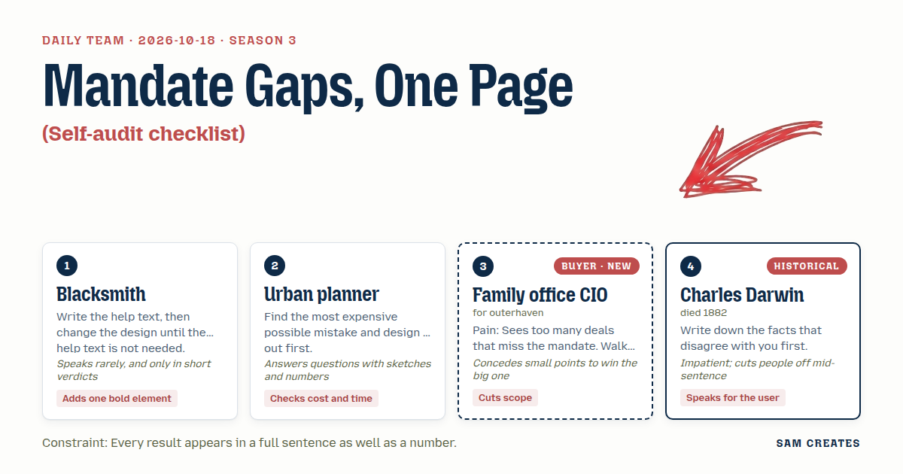

# 2026-10-18: Mandate Gaps, One Page

[Today](../../README.md) · [Archive](../../ARCHIVE.md)



**Task:** Self-audit checklist: a grouped checklist with notes per item gives a printable summary of gaps, saved in the browser.

**Constraint:** Every result appears in a full sentence as well as a number.

**Season:** 2026-10-07

**Decision:** The page lets a family office CIO tick twelve mandate items in three cost-ordered groups, then prints a one-page gap summary that states in sentences and numbers how many off-mandate deals and hours the open items let through each month.

## Asset

<a href="artifact-1.html"></a>

[artifact-1.html](artifact-1.html), led by Blacksmith. Model: claude-opus-5-5.

## The session

### Pitch

**1 · Blacksmith: The Red Bar**\
Help text, first draft: "Tick each item your mandate states in writing."\
Then I cut it. Each item becomes a yes or no with one filled-in example beside it.\
Nobody needs the instruction after that.\
One bold element. A red bar across the top.\
It shows hours lost each month to deals that miss the mandate.\
Sentence under it. Number in it.

**2 · Urban planner: Cost-Ordered Grid**\
Worst mistake: a deal clears screening, legal starts, then it dies on hold period.\
That costs $60,000 in fees and six weeks.\
So items are ordered by what a miss costs, not by topic.\
Top row: geography, hold period, ticket size. Red if blank.\
Three groups. Each group shows its cost if left open.\
Progress saves to the browser after every tick.

**Family office CIO (buyer; outerhaven): Mandate Gaps, One Page**\
I get forty decks a month. Twenty-eight miss.\
Twelve items. Three groups. Done in two minutes or I close it.\
Two questions only: deals seen per month, typical ticket.\
The printout is something I can hand my team on Monday.\
No "opportunity," no "exclusive." I've read those fifty times this week.\
Show me where my own mandate leaks.

**4 · Charles Darwin: Contrary Column**\
Start with the deals that broke your rule.\
The one you passed that returned three times. The one that fit and lost money.\
Write those down before you tick anything.\
Each group gets one note, and the note asks for the exception first.\
Otherwise the gap list only confirms what you already think.\
The user deserves to see where the mandate itself is wrong.

### Clash

**3 · Family office CIO:** Planner, your grid had thirty items in the draft. That reads like a compliance file. Cut to twelve and you can keep the cost column.

**2 · Urban planner:** Twelve, then. Geography, hold period, ticket size go first. A hold-period miss found at legal is $60,000. A geography miss found at the teaser is $0. That's the order.

**1 · Blacksmith:** Agreed. Red if blank.

**3 · Family office CIO:** Darwin, my analysts won't write a note under every item. They'll skip the whole thing and—

**4 · Charles Darwin:** One note per group. Three notes total. First line asks for the deal that broke the rule. Your analysts can write one name.

**2 · Urban planner:** Blacksmith, shortcut beside the usual path, same inputs. Usual: a retained screening analyst at $9,000 a month, $108,000 a year. Shortcut: an AI pass reads each teaser against the twelve items at about $3 a teaser, a named associate signs off, and the screener takes a $2,000 monthly floor plus 0.4% of each closed ticket.

**3 · Family office CIO:** I'll take the AI pass. I won't take the claim until it survives a bad year. Run it.

**2 · Urban planner:** Volume halves to 20 deals. One deal closes at $20M and slips six months into next year. Usual path: you pay $108,000 regardless. Shortcut: you pay $24,000 in year one and the screener earns only the floor. Screening time drops from 2 hours to 25 minutes a deal, so 14 off-mandate deals still save about 22 hours a month.

**4 · Charles Darwin:** Blacksmith, the printed summary needs a second count. Deals that fit the mandate and still failed. Without it the red bar praises a rule that may be—

**1 · Blacksmith:** One bar. Your count goes in the notes.

### Decision

The page lets a family office CIO tick twelve mandate items in three cost-ordered groups, then prints a one-page gap summary that states in sentences and numbers how many off-mandate deals and hours the open items let through each month.

Concept: Mandate Gaps, One Page

- Blacksmith: the red bar at the top showing monthly hours lost, each item written as a yes or no with an example so no instructions are needed.
- Urban planner: items ordered by the cost of a late miss, with geography, hold period, and ticket size first, plus the shortcut panel next to the usual path.
- Family office CIO: twelve items, three groups, two qualifying questions (deals per month, typical ticket), and no broker language anywhere on the page.
- Charles Darwin: one note per group whose first prompt asks for the deal that broke the rule.
- Charles Darwin lost the second count on the summary because a second bar splits attention, and the CIO's test is two minutes. The question of whether the contrary deals belong in the printed result stays open.

Bad case: volume halved to 20 deals, one $20M close slipped six months. The shortcut costs the CIO $24,000 against $108,000 and still saves 22 hours a month, so the page holds. The screener's year-one income falls to the floor, and the page states this.

### Build notes

1. Store each tick and each group note in localStorage under the key `mandate-gaps-v1`. Restore on load. Add a "Clear" button that asks once before wiping.
2. Write every result as a sentence with its number. Example: "You see 40 deals a month. 28 of them miss the mandate. That is 56 hours of screening a month." Use the same pattern for the shortcut and the usual path, side by side in a two-column table, bad-case row included.
3. Add a print stylesheet that hides the inputs and shows the red bar, the open items in cost order, the three group notes, and the two-path table on one A4 page. Footer line: "AI first pass reviewed and signed off by: ____."

**Guest:** Charles Darwin (historical; died 1882). The method is drawn from public-domain history, myth, or literature, or invented. The guest never speaks as the figure, and nothing here is endorsed by anyone.

## Team

```text
Team for 2026-10-18
Season: 2026-10-07

1. Blacksmith
   Method: Write the help text, then change the design until the help text is not needed.
   Stance: Adds one bold element.
   Temperament: Speaks rarely, and only in short verdicts.
2. Urban planner
   Method: Find the most expensive possible mistake and design it out first.
   Stance: Checks cost and time.
   Temperament: Answers questions with sketches and numbers.
3. Family office CIO (buyer; outerhaven) [buyer] [new]
   Method: Pain: Sees too many deals that miss the mandate. Walks when: It reads like a broker blast sent to fifty offices. Opens up when: You know the mandate and bring one deal that fits it.
   Stance: Cuts scope.
   Temperament: Concedes small points to win the big one.
4. Charles Darwin (historical; died 1882) [guest]
   Method: Write down the facts that disagree with you first.
   Stance: Speaks for the user.
   Temperament: Impatient; cuts people off mid-sentence.

Constraint: Every result appears in a full sentence as well as a number.
Task: Self-audit checklist: a grouped checklist with notes per item gives a printable summary of gaps, saved in the browser.
```

Provider: claude. Model: claude-opus-5-5.
