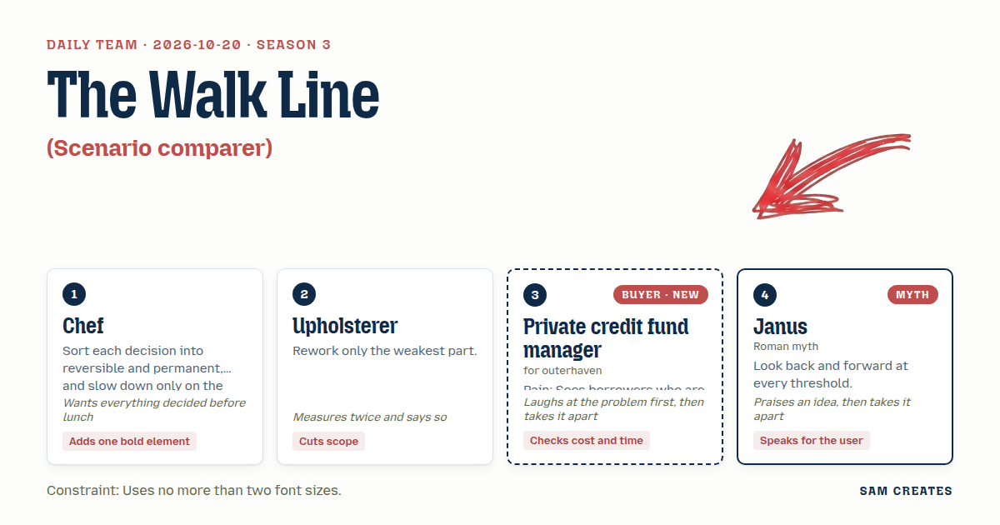

# 2026-10-20: The Walk Line

[Today](../../README.md) · [Archive](../../ARCHIVE.md)



**Task:** Scenario comparer: three versions of a plan with the buyer's own numbers give a side-by-side table of outcomes.

**Constraint:** Uses no more than two font sizes.

**Season:** 2026-10-07

**Decision:** The page takes one borrower's numbers and sets three versions of the loan side by side, downside first: the full ask, a cut-down size, and waiting for audited numbers.

## Asset

<a href="artifact-1.html"></a>

[artifact-1.html](artifact-1.html), led by Chef. Model: claude-opus-5-5.

## The session

### Pitch

**1 · Chef: The Walk Line**\
Three columns in one table, with the downside on the left.\
The bold element is one heavy rule across the table at 1.0x interest cover. Any cell below it turns grey and reads "walk".\
Five inputs: loan size, collateral value, EBITDA, rate, term. Done before lunch.\
Two questions at the end: typical ticket size, and how many deals died in diligence in the last 12 months.\
Colours and labels are reversible. Column order is permanent, so it stays downside first.

**2 · Upholsterer: Repayment Row First**\
The weakest part of every comparer is the top row. It shows returns.\
I rework that row and nothing else. It reads "How it gets repaid": cash flow, refinance, or sale of collateral, with a number on each.\
The rest is a plain table. Body at 15px, headings at 20px. Two sizes. I checked it twice.\
Drop the upside column. Use the base case and two downsides.\
Upside goes in one sentence under the table, or nowhere.

**3 · Private credit fund manager: Ready or Not**\
(laughs) Half the borrowers I meet send a pitch deck and call it a data room.\
I put their numbers in. Before I spend 180k on lawyers and a QoE, the page tells me whether the deal survives a bad year.\
Three versions: lend the full ask, lend a cut-down size, or wait for audited numbers.\
Each column shows collateral cover, interest cover, recovery in a sale, and weeks to close.\
If it takes longer than two minutes, I'm back in my inbox.

**4 · Janus: Two Faces of the Same Deal**\
The fund manager's idea is a good one. Three doors into one room.\
But every door has two faces. Each column should set what the borrower was last quarter beside what they promise next.\
The gap between those two faces is how ready they are.\
Put a step before the threshold. A machine reads the data room first, and a named person signs what it found.\
Then the table compares the costly door with the cheap one, using the same numbers on both.

### Clash

**3 · Private credit fund manager:** Upholsterer, kill the upside column, fine, I don't need the dream. But I need the pre-screen cost on the page. AI reads the data room in two days for about 8k. Full diligence is 180k and 10 weeks. That's the line I'd forward.

**2 · Upholsterer:** Fund manager, then it is a row, not a panel. Diligence spend and weeks to close. I'll fit it into the table we have and measure the row height again.

**4 · Janus:** Chef, your walk line is handsome. It is also a verdict nobody asked for. This user decides when to walk. Show the line and leave out the word.

**1 · Chef:** Janus, the word stays. They decide in two minutes, and a grey cell needs a label. It's reversible. I'll test it, but it ships with "walk".

**2 · Upholsterer:** Chef, I measured the bad case. Ticket 20m, collateral 28m, EBITDA 4m, 11% rate. EBITDA falls 40%, collateral sells at a 35% haircut, close slips six months. Interest cover is 1.09x and recovery is 18.2m against 20m. The full ask fails. At 16m, cover is 1.36x and recovery is 114%. That holds.

**3 · Private credit fund manager:** (laughs) So they asked for 20 and get 16. That's every deal I do. Upholsterer, put the 16 in the middle column, not in a footnote.

**4 · Janus:** Fund manager, now the shortcut. Screen first and run full diligence only on what passes. Say three of eight deals die. On those three, the usual path burns 540k. The pre-screen path burns 24k.

**3 · Private credit fund manager:** Janus, only if a named analyst signs the pre-screen. A model that misses a lien costs me more than 180k.

**1 · Chef:** Upholsterer, the upside comes back as one line under the table. The buyer wants it second, which is not the same as never.

**2 · Upholsterer:** Chef, second, at 15px, with no colour. I would still cut it.

### Decision

The page takes one borrower's numbers and sets three versions of the loan side by side, downside first: the full ask, a cut-down size, and waiting for audited numbers. Each column shows how the loan gets repaid, collateral and interest cover after a 40% EBITDA drop, diligence spend, and weeks to close for both the usual path and the pre-screen path.

Concept: The Walk Line

- Chef: the heavy rule at 1.0x cover with the "walk" label, the downside-first column order, and the two closing questions on ticket size and deals lost in diligence over 12 months.
- Upholsterer: the "How it gets repaid" top row, two font sizes (15px and 20px), and the upside cut to one plain line.
- Private credit fund manager: the three versions of the loan, the cut-down 16m in the middle column, and the diligence cost and weeks row.
- Janus: the pre-screen path beside the usual path on the same inputs, with a named analyst's sign-off on every pre-screen.
- Janus lost the argument over the word "walk" because the buyer reads the page in two minutes and a grey cell needs a label. Upholsterer lost the argument over cutting the upside because the buyer opens up when the upside comes second, and second still means on the page. Both points stay open for the first test.
- Bad case: EBITDA down 40%, a 35% haircut on collateral, and a six-month slip break the 20m full ask at 1.09x cover and 91% recovery. The 16m version holds at 1.36x and 114%. On three dead deals, the pre-screen path sinks 24k against 540k, so the page holds at the smaller size.

### Build notes

1. Build one `index.html` with a five-field form and a three-column table. Set the CSS to two sizes only, `font-size: 15px` for body and `20px` for headings. Use weight and grey fill for emphasis, not size.
2. Make "How it gets repaid" row 1 and "Diligence spend / weeks" row 6. Show the usual path at 180k and 10 weeks next to the pre-screen path at 8k and 2 days. Under them, add an annual line: deals lost in diligence × 180k against × 8k. Add a fixed sign-off field labelled "Reviewed by (named analyst)".
3. Hard-code the bad case as a toggle that is on by default: EBITDA −40%, collateral −35%, close +6 months. Draw the 1.0x walk rule with a 3px top border on the first failing row. Put the two qualifying questions after the table, not before it.

**Guest:** Janus (myth; Roman myth). The method is drawn from public-domain history, myth, or literature, or invented. The guest speaks in character in original words, never quoting the source, and nothing here is endorsed by anyone.

## Team

```text
Team for 2026-10-20
Season: 2026-10-07

1. Chef
   Method: Sort each decision into reversible and permanent, and slow down only on the permanent ones.
   Stance: Adds one bold element.
   Temperament: Wants everything decided before lunch.
2. Upholsterer
   Method: Rework only the weakest part.
   Stance: Cuts scope.
   Temperament: Measures twice and says so.
3. Private credit fund manager (buyer; outerhaven) [buyer] [new]
   Method: Pain: Sees borrowers who are not ready for diligence. Walks when: Nobody has thought about how the loan gets repaid. Opens up when: The downside and collateral come first and the upside second.
   Stance: Checks cost and time.
   Temperament: Laughs at the problem first, then takes it apart.
4. Janus (myth; Roman myth) [guest]
   Method: Look back and forward at every threshold.
   Stance: Speaks for the user.
   Temperament: Praises an idea, then takes it apart.

Constraint: Uses no more than two font sizes.
Task: Scenario comparer: three versions of a plan with the buyer's own numbers give a side-by-side table of outcomes.
```

Provider: claude. Model: claude-opus-5-5.
