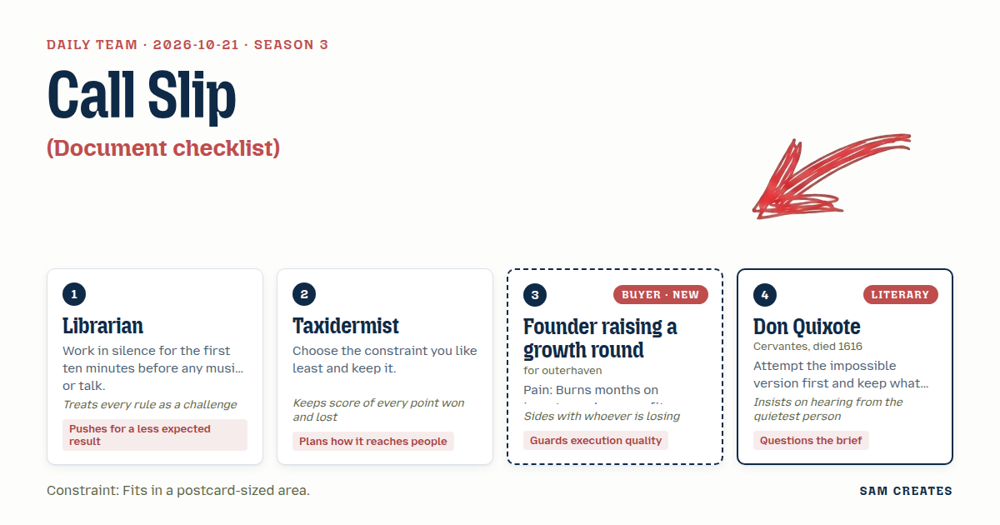

# 2026-10-21: Call Slip

[Today](../../README.md) · [Archive](../../ARCHIVE.md)



**Task:** Document checklist: the buyer's stage gives a list of documents to prepare before a deal or rollout, grouped and ticked off in the browser.

**Constraint:** Fits in a postcard-sized area.

**Season:** 2026-10-07

**Decision:** The page is a two-faced postcard.

## Asset

<a href="artifact-1.html"></a>

[artifact-1.html](artifact-1.html), led by Librarian. Model: claude-opus-5-5.

## The session

### Pitch

**1 · Librarian: Call Slip**\
Ten minutes quiet with the brief. Then one thought.\
Checklists sort by drawer: legal, finance, deck. Funds don't read by drawer.\
So each document gets a shelf mark: the investor types that ask for it before a second meeting.\
Tick the cohort table and the growth-equity shelf lights. Leave it blank and that shelf stays dark.\
The card is 360 by 240. The rule says postcard. A postcard has two faces, and I'll use the back.

**2 · Taxidermist: Mounted Card**\
I'd have picked a scroll. So I keep the postcard, because the postcard is what gets passed around.\
Measure first, then skin, then set the form. Here that means count, then group, then finish.\
Front face: 22 documents in three groups, a score at the top, 14 of 22.\
One button prints it at A6 for the CFO's desk. One link sends it to the co-founder.\
Whatever gets sent has to look finished without a click.

**Founder raising a growth round (buyer; outerhaven): Fit Before Fees**\
Last spring a banker wanted $30k up front to "open doors." I closed the call.\
I spent five months on funds that wanted ARR I didn't have.\
What I need on this card: which funds fit my round, and which paper each one will ask for.\
Two inputs at most. Round size, months I've already spent.\
If the first thing I see is a fee, I'm gone.

**4 · Don Quixote: The Whole Room**\
First I would build the room no founder has: every paper every fund on earth might ask for, all on one card.\
It will not fit. Good. What falls off was never needed.\
And I question the order of the brief. The founder lacks the right listeners. The papers are a smaller problem.\
A full room with the wrong guests is still empty.\
Let the list say who will read each page.

### Clash

**4 · Don Quixote:** Founder, you have said the least about the papers themselves. Tell the Librarian which one cost you the most months.

**Founder raising a growth round (buyer; outerhaven):** The cohort retention table. Three funds asked for it in week eleven, after two partner meetings each. If week one had told me who asks for it, I'd have built it or skipped them. Sort by who asks, Librarian.

**1 · Librarian:** Then shelf marks go on every line. Taxidermist, your 14 of 22 is a count no fund cares about.

**2 · Taxidermist:** Sorting goes to you. Here's what I keep: nobody forwards a card they have to flip to understand. The front carries the groups, the ticks, and the fund shelves that are lit. That's one each.

**2 · Taxidermist:** Founder, the shortcut. Same $20M round. Banker retainer, $30k up front. Success fee, 2% at close, $400k. No close: the retainer costs you $30k, the fee costs you nothing. Both on the card, same inputs.

**Founder raising a growth round (buyer; outerhaven):** Both, yes. On the back. If a fee sits next to my fit list, it reads like an invoice and I close the tab.

**4 · Don Quixote:** Librarian, let a model read the room. It can read 22 files and 300 fund theses in an afternoon for under $50. An analyst would bill two weeks, about $12k.

**1 · Librarian:** It maps fit. It does not sign. Counsel signs the cap table and the SPA checklist. The CFO signs the model. Each line names who signs it.

**Founder raising a growth round (buyer; outerhaven):** Bad case, Quixote. The round slips six months at $350k a month burn. That's $2.1M, and runway drops from 18 months to 12. If the card only cuts unfit meetings in half, I get back about 7 of 26 weeks, roughly $560k of burn. It holds. If the model mismatches, I lose the same weeks I lose now and no more.

**4 · Don Quixote:** Then remove the score, Taxidermist. Twenty-two of 22 ticked with no fund lit is a full room with nobody in it. The count flatters.

### Decision

The page is a two-faced postcard. On the front, the founder ticks 22 growth-round documents in three groups, and each tick lights the investor types that ask for that document. On the back, it shows months already spent, the cost of a six-month slip, and a retainer path next to a success-fee path.

Concept: Call Slip

- Librarian: shelf marks on every document, sorted by which funds ask, and the back face.
- Taxidermist: the front reads finished without a flip, plus A6 print and a forward link. The score stays, shown as lit shelves rather than a raw count.
- Founder raising a growth round (buyer; outerhaven): the two inputs, fit before any fee, and fees only on the back.
- Don Quixote: "who reads this" on every line, and the AI fit map with a named signer per line.

Lost: the Taxidermist lost the fee on the front face, because the founder closes on any fee seen before fit. Don Quixote's objection to any score is still open. The lit-shelf count is the compromise, and he has not accepted it.

Bad case: a six-month slip at $350k burn costs $2.1M. With unfit meetings cut by half, the card returns about $560k of burn. With a model mismatch, the loss equals today's loss. On a failed round, the success-fee path costs $0 against the retainer's $30k. The page holds.

### Build notes

1. Build a 360×240 px card with a CSS 3D flip. Front: Numbers (9), Legal (8), Story (5). Each line has a checkbox, a shelf-mark chip (Growth equity, Crossover, Strategic, Venture debt), and a "signs off" tag (CFO or counsel). Store ticks in localStorage.
2. Two inputs on the back: round size (default $20M) and months already raising. Outputs: burn lost at $350k/month, a six-month slip shown in runway months, a retainer at $30k against a 2% success fee, and the no-close row for both.
3. Add `@media print` at A6 for the front face only, and a share link that encodes ticks and inputs in the URL hash. Mark the AI fit map as "draft, reviewed by" with an editable name field.

**Guest:** Don Quixote (literary; Cervantes, died 1616). The method is drawn from public-domain history, myth, or literature, or invented. The guest speaks in character in original words, never quoting the source, and nothing here is endorsed by anyone.

## Team

```text
Team for 2026-10-21
Season: 2026-10-07

1. Librarian
   Method: Work in silence for the first ten minutes before any music or talk.
   Stance: Pushes for a less expected result.
   Temperament: Treats every rule as a challenge.
2. Taxidermist
   Method: Choose the constraint you like least and keep it.
   Stance: Plans how it reaches people.
   Temperament: Keeps score of every point won and lost.
3. Founder raising a growth round (buyer; outerhaven) [buyer] [new]
   Method: Pain: Burns months on investors who never fit. Walks when: Someone wants a fee up front just to make intros. Opens up when: You show which investors fit and why before asking for anything.
   Stance: Guards execution quality.
   Temperament: Sides with whoever is losing.
4. Don Quixote (literary; Cervantes, died 1616) [guest]
   Method: Attempt the impossible version first and keep what survives.
   Stance: Questions the brief.
   Temperament: Insists on hearing from the quietest person.

Constraint: Fits in a postcard-sized area.
Task: Document checklist: the buyer's stage gives a list of documents to prepare before a deal or rollout, grouped and ticked off in the browser.
```

Provider: claude. Model: claude-opus-5-5.
