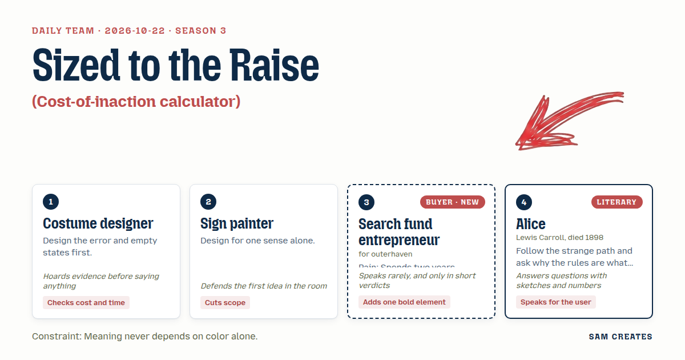

# 2026-10-22: Sized to the Raise

[Today](../../README.md) · [Archive](../../ARCHIVE.md)



**Task:** Cost-of-inaction calculator: the buyer's current volumes and rates give what the problem costs per month and per year, with each step of the sum shown.

**Constraint:** Meaning never depends on color alone.

**Season:** 2026-10-07

**Decision:** The page asks what the searcher and their investors can close and how many months they have searched.

## Asset

<a href="artifact-1.html"></a>

[artifact-1.html](artifact-1.html), led by Costume designer. Model: claude-opus-5-5.

## The session

### Pitch

**1 · Costume designer: The Empty Rack**\
Before anyone types, I want the blank state written.\
Then the error: equity entered is too small for any deal in the feed.\
The page says that plainly, with the number it would take to clear it.\
Two questions only: equity you and your investors can commit, and months searched so far.\
The result runs per month and per year, and adds up what the months already searched have cost.\
Each line of the sum is printed with its unit. No line is hidden behind a total.

**2 · Sign painter: Read It Aloud**\
One sense. The ear.\
If a screen reader reads it top to bottom and it makes sense, it works for the eye too.\
One column. Input, sum, total. No chart, no colour bands, no comparison grid.\
Out-of-range gets the word OUT and a hollow square. It never gets a red cell.\
Cut everything else.

**Search fund entrepreneur (buyer; outerhaven): Sized to the Raise**\
First field: what we can close. Equity plus debt.\
Nothing above that number shows up. Ever.\
Then the cost of the months.\
That's it.

**4 · Alice: The Pile You Never Bought**\
Here is a sketch. 40 summaries arrive each month. 24 are for businesses three times too big.\
Each one takes 3 hours to read before you know.\
Why does the rule say read it first and check the size after?\
I would turn it around. Size first, then read.\
The page counts the hours spent on the 24, and never shows you their names.

### Clash

**4 · Alice:** Search fund entrepreneur, the 24 you can't buy are the cost. 72 hours a month. If the page hides them, it hides the bill.

**Search fund entrepreneur (buyer; outerhaven):** Count them. Don't show them.

**1 · Costume designer:** Alice, I have the figures. 40 summaries a month, 60% outside the range, 3 hours each, $25,000 monthly burn over 160 hours. That is $156.25 an hour and $11,250 a month spent on deals that were never possible. One dead letter of intent every 4 months at a $45,000 diligence fee adds $11,250. The total is $22,500 a month and $270,000 a year. The page shows a count and an hours figure. No deal names.

**2 · Sign painter:** Costume designer, then cut the shortcut column. Two paths side by side is a grid. A grid read aloud is noise.

**1 · Costume designer:** Sign painter, it stays. Same inputs, both paths. The usual path pays $45,000 per letter of intent, win or lose. The shortcut has AI read each summary at $40 and clean the trailing financials. A named CPA reviews for $2,500, and the diligence firm takes 0.25% of equity at close instead of a flat fee. If a deal dies, the shortcut has cost $2,900 and the usual path $45,000. That works out to $4,200 a month against $22,500.

**Search fund entrepreneur (buyer; outerhaven):** Keep it. My investors ask that question first.

**4 · Alice:** Costume designer, now make it worse. Volume halves to 20 summaries a month. The diligence fee doubles to $90,000. The deal slips 6 months.

**1 · Costume designer:** Usual path: 36 wasted hours is $5,625, plus $22,500 in dead diligence, so $28,125 a month and $337,500 a year. The 6-month slip adds $168,750. Shortcut: $937.50 in reading, $1,450 in dead review, $800 in AI reads, so $3,187.50 a month. It holds.

**2 · Sign painter:** It holds on paper. Read aloud, two sums back to back still lose the listener by the second line. I would print them one after the other, never side by side.

### Decision

The page asks what the searcher and their investors can close and how many months they have searched. It shows the monthly and yearly cost of reading out-of-range deals and paying for dead diligence, step by step, with the usual path and the AI-plus-share shortcut printed one after the other and a bad case for each.

Concept: Sized to the Raise

- Costume designer: the empty state, the too-small-equity error with the figure needed to clear it, the two qualifying questions, and the cost-to-date line.
- Sign painter: single column, a reading order that works through a screen reader, the word OUT with a hollow square for out-of-range, and no colour carrying meaning.
- Search fund entrepreneur (buyer; outerhaven): the first field is closable capital, and nothing above it appears.
- Alice: size checked before reading, out-of-range deals counted in hours and dollars, and never named.
- Sign painter lost the cut of the shortcut, because the buyer's investors ask for it first and the duty requires it. The layout argument stays open: the lead accepts sequential sums for now, and the sign painter still holds that two sums lose a listener.
- Bad case: summaries halved to 20 a month, diligence fee doubled to $90,000, a 6-month slip. Usual path is $28,125 a month, $337,500 a year, and $168,750 for the slip. Shortcut is $3,187.50 a month. The page holds.

### Build notes

1. Build the form with two fields, closable capital (equity plus debt, in USD) and months searched. Add four editable rates prefilled with $25,000 burn, 40 summaries, 60% out of range, and $45,000 diligence. Write the empty state and the too-small error before the result block.
2. Render each sum as an ordered list. Each line carries a value, a unit, and an operator, such as "24 summaries × 3 hours × $156.25 = $11,250". Mark out-of-range with the text OUT and a hollow square glyph. Test it with a screen reader and with greyscale display.
3. Print the usual path, then the shortcut, then the bad case for each, in that order. Label the shortcut's AI steps with their cost per deal. Name the reviewing CPA as the sign-off on the financials.

**Guest:** Alice (literary; Lewis Carroll, died 1898). The method is drawn from public-domain history, myth, or literature, or invented. The guest speaks in character in original words, never quoting the source, and nothing here is endorsed by anyone.

## Team

```text
Team for 2026-10-22
Season: 2026-10-07

1. Costume designer
   Method: Design the error and empty states first.
   Stance: Checks cost and time.
   Temperament: Hoards evidence before saying anything.
2. Sign painter
   Method: Design for one sense alone.
   Stance: Cuts scope.
   Temperament: Defends the first idea in the room.
3. Search fund entrepreneur (buyer; outerhaven) [buyer] [new]
   Method: Pain: Spends two years looking for one business to buy. Walks when: It shows deals they could never finance. Opens up when: Deals are sized to what they and their investors can close.
   Stance: Adds one bold element.
   Temperament: Speaks rarely, and only in short verdicts.
4. Alice (literary; Lewis Carroll, died 1898) [guest]
   Method: Follow the strange path and ask why the rules are what they are.
   Stance: Speaks for the user.
   Temperament: Answers questions with sketches and numbers.

Constraint: Meaning never depends on color alone.
Task: Cost-of-inaction calculator: the buyer's current volumes and rates give what the problem costs per month and per year, with each step of the sum shown.
```

Provider: claude. Model: claude-opus-5-5.
