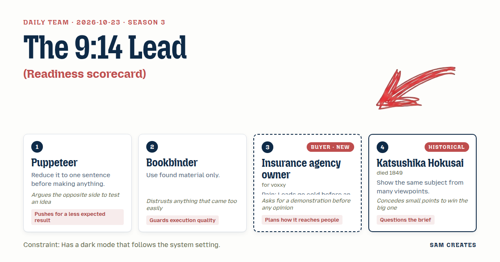
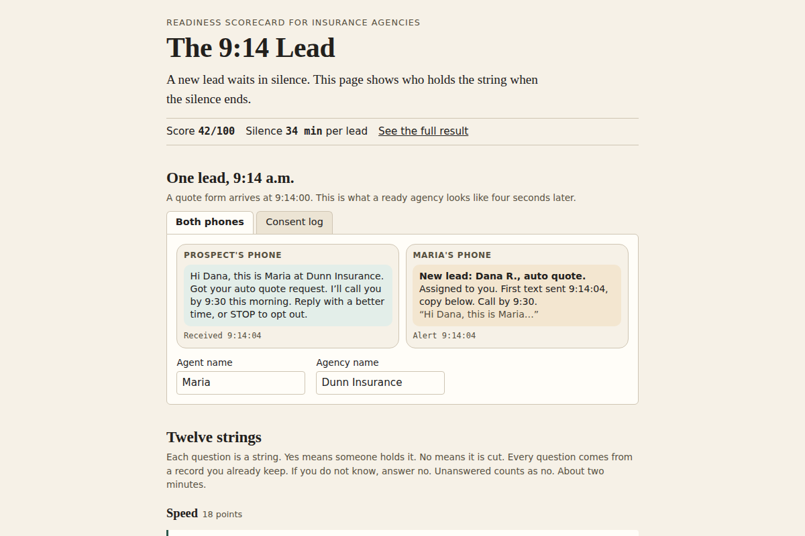

# 2026-10-23: The 9:14 Lead

[Today](../../README.md) · [Archive](../../ARCHIVE.md)



**Task:** Readiness scorecard: twelve yes-or-no questions give a score out of 100, the three weakest areas, and one next step for each.

**Constraint:** Has a dark mode that follows the system setting.

**Season:** 2026-10-07

**Decision:** The page asks twelve yes-or-no questions in six areas and two numbers, then shows a score out of 100, the three weakest areas with one next step each, and a 9:14 demo lead traced through the prospect's text, the agent's alert, and the co...

## Asset

<a href="artifact-1.html"></a>

[artifact-1.html](artifact-1.html), led by Puppeteer. Model: claude-opus-5-5.

## The session

### Pitch

**1 · Puppeteer: Who Holds the String**\
One sentence first: a new lead waits in silence, and the page shows who is holding the string when the silence ends.\
Twelve yes-or-no questions, each one a string. "Yes" means someone is holding it. "No" means it is cut.\
The score out of 100 sits small. The big number is minutes of silence per lead.\
Less expected: the result reads like a timeline of one lead's first hour, not a report card.\
Dark mode follows the system. The silence shows as a gray bar on either background.

**2 · Bookbinder: Bound From Your Own Logs**\
Nothing invented. Every question comes from a field the agency already has: form timestamp, first-call timestamp, consent checkbox, assigned agent.\
"Does your CRM record the minute a lead arrives." Yes or no. If they don't know, that is a no.\
Twelve questions, two per area, six areas. Each "no" costs points by a fixed weight, shown in plain text.\
Dark mode reads `prefers-color-scheme`. No white flash on load. Contrast checked at 4.5:1 in both themes.\
I don't trust a score that comes out high on the first try. The defaults lean toward "no".

**Insurance agency owner (buyer; voxxy): Show Me One Lead**\
Don't tell me I'm slow. Show me a form coming in at 9:14 and what happens next.\
My leads cost $28 each. Half are dead by the time someone dials.\
If the page says "automated outreach," I'm gone. I've had two vendors get me a TCPA letter.\
What I want to see: the prospect gets a text in seconds, with my agent's name, and my agent sees it too.\
Twelve questions is fine if I finish in two minutes.

**4 · Katsushika Hokusai: Three Phones, One Lead**\
Hokusai worked by drawing one subject from many positions until its shape was clear.\
Applied here: the same 9:14 lead, shown from the prospect's phone, the agent's phone, and the consent log.\
He questions the brief. "Readiness" assumes speed is the gap. Often the gap is the handoff between the first reply and the agent.\
The scorecard should let the weak area show up wherever it actually sits.

### Clash

**3 · Insurance agency owner:** Puppeteer, before your twelve strings, show me one lead. Form fills at 9:14. What does the person get, what does my agent see, how fast.

**1 · Puppeteer:** I'll argue the other side of your own ask. A reply in four seconds reads like a bot, and that's the exact thing that makes you walk. Maybe slow is safer.

**3 · Insurance agency owner:** Slow is what I have. Forty minutes average. A text in four seconds is fine if it says "Maria from Dunn Insurance will call you by 9:30." A robocall is a voice reading a script at 8 p.m.

**4 · Katsushika Hokusai:** Then show the 9:14 lead three times: the prospect's phone, Maria's phone, the consent log. Most agencies that fail this fail at the handoff, not the first reply.

**2 · Bookbinder:** Hokusai, three panels on a phone is three places to break. Keep the consent log as its own view. Fold the prospect and agent views into one strip. All of it has to hold in dark mode.

**4 · Katsushika Hokusai:** I'll give up a panel if the consent log stays. That is where this owner's fear lives.

**1 · Puppeteer:** Shortcut. Each weak area's next step shows two paths with the same inputs. A flat $600 a month answering service, or $3 per lead where AI sends the first text and hands off to an agent in under a minute. At 200 leads both cost $600. Owner, which one?

**3 · Insurance agency owner:** Per lead. AI writes the first text, my agent is copied every time, and my compliance manager signs the script before it goes live. Now run the bad case.

**2 · Bookbinder:** Leads halve to 100. Contact rate goes from 22% to 30% instead of 45%. That's 8 more contacts, 1 in 4 binds, 2 policies at $160 is $320. Per-lead costs $300 and clears. Flat costs $600 and loses $280. And the headline stays a score out of 100. The task says so.

**1 · Puppeteer:** The score can sit on the page. I still think the headline should be minutes of silence, because "62 out of 100" won't make anyone forward this.

### Decision

The page asks twelve yes-or-no questions in six areas and two numbers, then shows a score out of 100, the three weakest areas with one next step each, and a 9:14 demo lead traced through the prospect's text, the agent's alert, and the consent log, all in a theme that follows the system's light or dark setting.

Concept: The 9:14 Lead

- Puppeteer: the cut-string framing for each "no", a one-sentence summary at the top, and minutes of silence shown as a second line under the score.
- Bookbinder: questions taken from fields the agency already records, fixed visible weights, defaults set to "no", and `prefers-color-scheme` with no flash and 4.5:1 contrast.
- Insurance agency owner: the demo strip runs before the results, uses the agent's name, never uses "automated outreach" or "dialer", and the page takes under two minutes.
- Katsushika Hokusai: the consent log is its own view, and "Handoff" is one of the six scored areas, kept apart from "Speed".
- Lost: Puppeteer lost the headline. The score out of 100 leads because the task requires it. Minutes of silence moves to the line below. This stays open for the build review. Hokusai lost the third panel because a third panel breaks on a 375px screen.
- Bad case: at 100 leads and a contact rate that only reaches 30%, the per-lead path nets $20 in month one plus renewals. The flat path loses $280. AI writes the first text at about $0.04 per lead against $15 an hour for a person, so a low-volume month costs almost nothing. The page holds for the per-lead path and shows the flat path's loss next to it.

### Build notes

1. Six areas, two questions each: Speed, Handoff, After hours, Consent, Follow-up, Visibility. Each "no" costs 8 or 9 points to total 100. The two qualifiers come after the twelve: leads per month, and months the callback gap has run. The result line reads "At 200 leads a month for 9 months, about 170 leads went cold before a call."
2. The demo strip has two columns at 375px: the prospect's SMS on the left and the agent's alert on the right, each stamped 9:14:04. A "Consent log" tab shows checkbox text, timestamp, and the signing compliance manager's name field. No audio and no autoplay.
3. For each of the three weakest areas, show the flat and per-lead paths side by side with the user's lead count, then the same table at half volume. Theme colors are CSS custom properties under `@media (prefers-color-scheme: dark)`, and an inline `color-scheme` meta tag prevents the white flash.

**Guest:** Katsushika Hokusai (historical; died 1849). The method is drawn from public-domain history, myth, or literature, or invented. The guest never speaks as the figure, and nothing here is endorsed by anyone.

## Team

```text
Team for 2026-10-23
Season: 2026-10-07

1. Puppeteer
   Method: Reduce it to one sentence before making anything.
   Stance: Pushes for a less expected result.
   Temperament: Argues the opposite side to test an idea.
2. Bookbinder
   Method: Use found material only.
   Stance: Guards execution quality.
   Temperament: Distrusts anything that came too easily.
3. Insurance agency owner (buyer; voxxy) [buyer] [new]
   Method: Pain: Leads go cold before an agent calls back. Walks when: It sounds like a robocaller or a compliance risk. Opens up when: Agents stay in the loop and new leads hear back in seconds.
   Stance: Plans how it reaches people.
   Temperament: Asks for a demonstration before any opinion.
4. Katsushika Hokusai (historical; died 1849) [guest]
   Method: Show the same subject from many viewpoints.
   Stance: Questions the brief.
   Temperament: Concedes small points to win the big one.

Constraint: Has a dark mode that follows the system setting.
Task: Readiness scorecard: twelve yes-or-no questions give a score out of 100, the three weakest areas, and one next step for each.
```

Provider: claude. Model: claude-opus-5-5.
