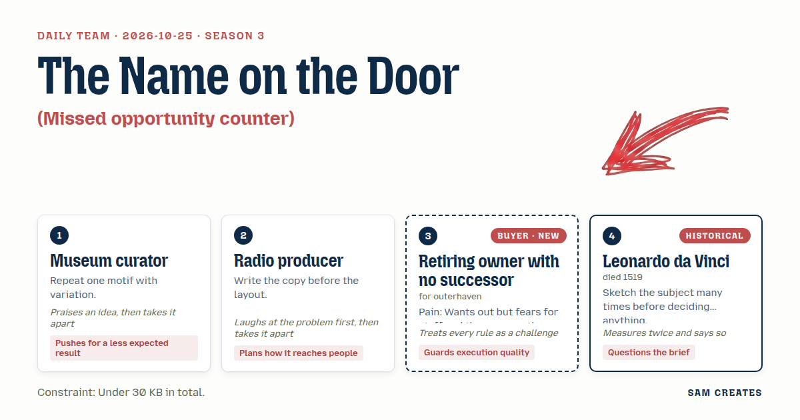
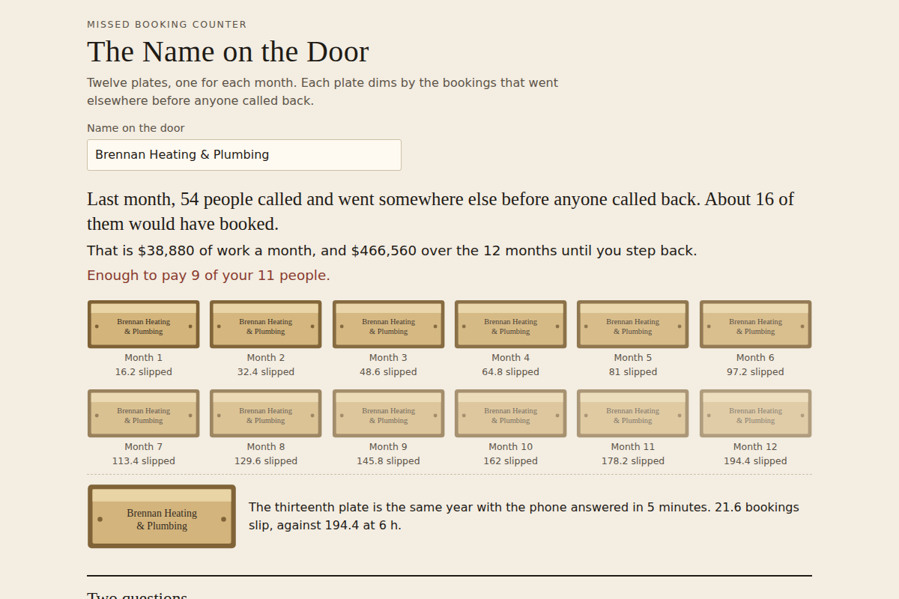

# 2026-10-25: The Name on the Door

[Today](../../README.md) · [Archive](../../ARCHIVE.md)



**Task:** Missed opportunity counter: inbound volume, response time, and close rate give how many deals or bookings slip away each month.

**Constraint:** Under 30 KB in total.

**Season:** 2026-10-07

**Decision:** The page turns inbound calls, reply time, close rate and job value into the bookings that slip away each month, shows what that costs the staff over the months before a handover, and sets the usual sale next to a share-based handover wit...

## Asset

<a href="artifact-1.html"></a>

[artifact-1.html](artifact-1.html), led by Museum curator. Model: claude-opus-5-5.

## The session

### Pitch

**1 · Museum curator: The Name on the Door**\
One brass nameplate, drawn twelve times, one for each month.\
Each plate carries the same name and a little less shine, scaled to the bookings that slipped that month.\
The owner enters inbound calls, hours to reply, close rate and job value. The plates do the arithmetic.\
The motif changes once: a thirteenth plate, polished, showing the same year with the phone answered in five minutes.\
Then two questions: how many people work for you, and how many months until you step back.\
The result reads as a year of the name wearing down, which only a handover fixes.

**2 · Radio producer: Who Picks Up**\
Ha. The owner doesn't need a chart. They need one sentence they can read out at the kitchen table.\
So the copy comes first: "Last month, 16 people called and went somewhere else before anyone called back."\
The second line names the money. The third line names the staff it could pay.\
Layout gets built under the sentence. A big number, then a small table, then nothing else.\
The link goes to the owner's accountant, who forwards it. That means it has to make sense with no voice-over.

**Retiring owner with no successor (buyer; outerhaven): What Gets Missed After Four**\
After four o'clock it's just my office manager and the voicemail.\
I know the number from the book: 120 calls a month, about 30 percent turn into jobs.\
Show me what goes missing when I'm not the one picking up, and what that means for the eleven people who work here.\
Don't show me a "value" figure. The last man who came by talked about value for an hour, and by the end he meant headcount.\
If it fits on one screen and my accountant can check it, I'll send it to him.

**4 · Leonardo da Vinci: One Month, Drawn Six Ways**\
I would draw the same month six times before choosing a single picture.\
One at a five-minute reply, one at an hour, then four hours, eight, a day, and no reply.\
Lay the six side by side. The owner can see where the line bends.\
I would also measure the close rate twice: once as the owner remembers it, once from the booking ledger.\
If the two figures differ, the page should show both. That gap is a finding in itself.

### Clash

**1 · Museum curator:** Da Vinci, six versions of one month is honest work, and it is exactly how you find where the curve bends. But it's a workbench. The owner sees six panels and closes the tab. One plate per month, one motif, and your bend shows up as the plates dimming.

**4 · Leonardo da Vinci:** Owner, before the plates, a question about the brief. Is the pain lost bookings, or the fact that every booking still runs through you? And your 30 percent: did you count it, or does it feel right?

**Retiring owner with no successor (buyer; outerhaven):** I counted it. It's in the book, every job since 2009. And yes, it runs through me, that's the whole problem. You want two questions on this thing? Fine, but the staff one goes first, and it goes beside the money. If it doesn't, I'm gone.

**2 · Radio producer:** Curator, I laughed at the plates, because twelve fading nameplates read like a cemetery wall. Put my sentence on top, "16 people called and went elsewhere," and then the plates. The sentence carries the page. The plates prove it.

**1 · Museum curator:** I'll take the sentence on top, because the accountant reads words before pictures. Here is the shortcut, though. Both handover paths use the same inputs. The usual path is a price paid at signing, on today's earnings. The other path pays less at signing, plus 20 percent of profit for three years. The owner keeps a share of the bookings the team wins back.

**Retiring owner with no successor (buyer; outerhaven):** I've heard "share of the upside" before. My brother-in-law got one, and it came to nothing. Put the floor in writing on the page, a minimum per year whatever happens, or take that path off.

**2 · Radio producer:** Fine, floor goes in the table. Now the phone. An AI front desk answers the first call in under two minutes and books the slot. It costs $400 a month, against $3,800 for an evening hire. Your office manager reviews every booking at nine the next morning, and your accountant signs off the handover figures.

**Retiring owner with no successor (buyer; outerhaven):** My customers know my voice. A machine answering with my name on it is not carrying on what I built. If it says up front what it is, and a person calls back by nine, maybe. I'm not agreeing yet.

**4 · Leonardo da Vinci:** I'll measure the bad case twice. At the base case: 120 calls, 45 percent lost at a six-hour reply, 30 percent close, $2,400 a job. That's 16.2 bookings, or $38,880 slipping each month. Halve the calls to 60 and push the handover back six months: 8.1 bookings, $19,440 a month, $349,920 across 18 months. The front desk still recovers about $17,280 a month against $400. The floor payment holds in both paths.

**1 · Museum curator:** Then it holds, and we keep the bold version: the plates, the share path, and the front desk. Da Vinci, your six panels stay out of the main view. I know you think the page lies without them.

### Decision

The page turns inbound calls, reply time, close rate and job value into the bookings that slip away each month, shows what that costs the staff over the months before a handover, and sets the usual sale next to a share-based handover with the same inputs and the bad case for both.

Concept: The Name on the Door

- Museum curator: twelve monthly nameplates that dim by bookings lost, a thirteenth plate for the answered year, and the two-path handover table with a 20 percent profit share.
- Radio producer: the opening sentence written before the layout, the $400 AI front desk line, and a result short enough for the accountant to forward without explanation.
- Retiring owner with no successor (buyer; outerhaven): staff count asked first and shown beside the money, a written floor payment on the share path, and the front desk must say it is automated and hand to a person by 9:00.
- Leonardo da Vinci: the bad-case row with calls halved and handover six months late, plus a field for the ledger close rate next to the remembered one.
- Da Vinci lost the six-panel view because six panels on one screen fail the two-minute test. The buyer's objection to an AI answering under their name stays open, so the front desk ships as an optional toggle that is off by default.

Bad case: calls halved from 120 to 60 and handover delayed six months gives 8.1 slipped bookings and $19,440 a month, $349,920 over 18 months. The $400 front desk still recovers about $17,280 a month, and the floor payment covers the share path. The page holds.

### Build notes

1. Build one file, `outerhaven-counter.html`, under 30 KB, with inline CSS and JS and no external libraries. Nameplates are 12 inline SVG rects. Plate opacity is 1 minus (slipped bookings ÷ inbound × close rate), and the minimum opacity is 0.25.
2. Loss by reply time comes from a fixed table: 5 min 5%, 1 h 20%, 4 h 40%, 6 h 45%, 8 h+ 55%. Slipped bookings equal inbound × loss × close rate. Show the opening sentence first, then the staff line in the form "enough to pay N of your X people", then the plates.
3. The two-path table uses the same inputs. Usual path: 3× annual profit paid at signing. Share path: 2× at signing, plus 20% of profit for 3 years, with a floor of 0.25× profit per year. Each path gets a base row and a bad-case row (calls ÷ 2, handover +6 months). The AI front desk toggle ($400/month) is off by default. The footer reads: "Bookings reviewed by your office manager. Handover figures signed off by your accountant."

**Guest:** Leonardo da Vinci (historical; died 1519). The method is drawn from public-domain history, myth, or literature, or invented. The guest never speaks as the figure, and nothing here is endorsed by anyone.

## Team

```text
Team for 2026-10-25
Season: 2026-10-07

1. Museum curator
   Method: Repeat one motif with variation.
   Stance: Pushes for a less expected result.
   Temperament: Praises an idea, then takes it apart.
2. Radio producer
   Method: Write the copy before the layout.
   Stance: Plans how it reaches people.
   Temperament: Laughs at the problem first, then takes it apart.
3. Retiring owner with no successor (buyer; outerhaven) [buyer] [new]
   Method: Pain: Wants out but fears for staff and the name on the door. Walks when: It sounds like private equity buying to strip and flip. Opens up when: You talk about carrying on what they built and keeping the team.
   Stance: Guards execution quality.
   Temperament: Treats every rule as a challenge.
4. Leonardo da Vinci (historical; died 1519) [guest]
   Method: Sketch the subject many times before deciding anything.
   Stance: Questions the brief.
   Temperament: Measures twice and says so.

Constraint: Under 30 KB in total.
Task: Missed opportunity counter: inbound volume, response time, and close rate give how many deals or bookings slip away each month.
```

Provider: claude. Model: claude-opus-5-5.
