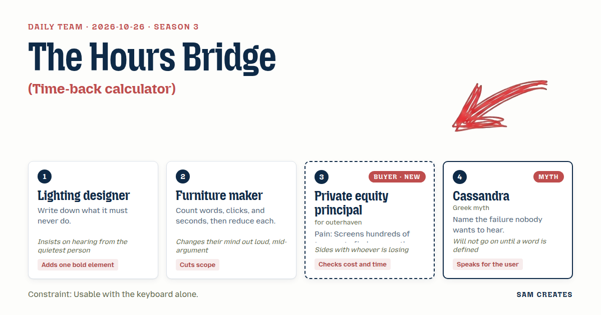
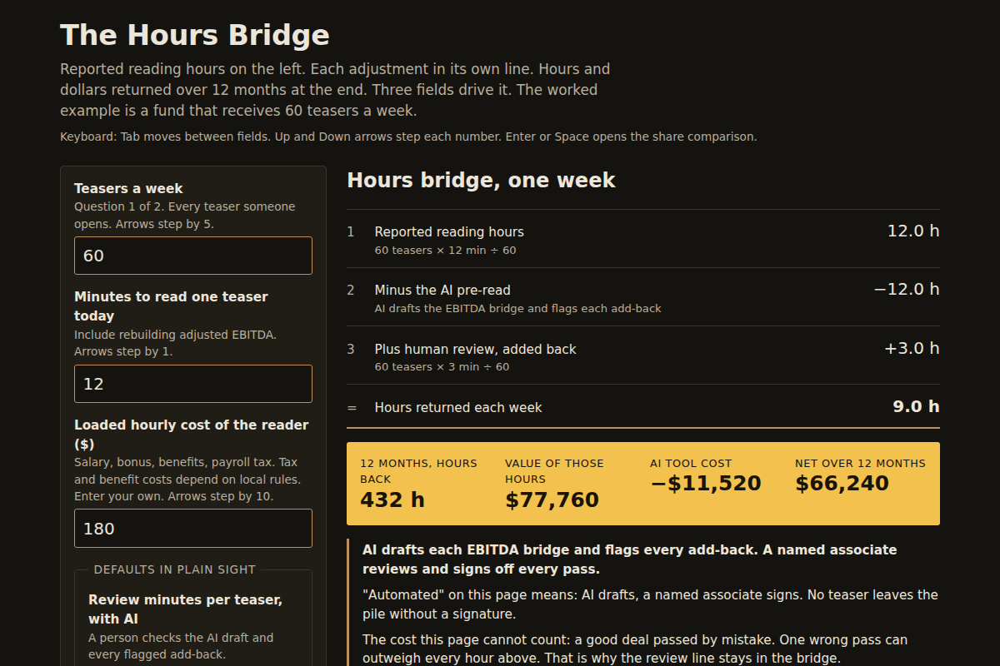

# 2026-10-26: The Hours Bridge

[Today](../../README.md) · [Archive](../../ARCHIVE.md)



**Task:** Time-back calculator: weekly hours on manual tasks and an hourly cost give the hours and money an automated step would return.

**Constraint:** Usable with the keyboard alone.

**Season:** 2026-10-07

**Decision:** The page asks for teasers a week, minutes per teaser, and the reader's hourly cost, then lays out an hours bridge from reported hours to hours and dollars returned over twelve months, with every adjustment and its bad case shown.

## Asset

<a href="artifact-1.html"></a>

[artifact-1.html](artifact-1.html), led by Lighting designer. Model: claude-opus-5-5.

## The session

### Pitch

**1 · Lighting designer: The Hours Bridge**\
I start with the cue sheet of what this page must never do.\
Never show a total without the lines that build it.\
Never need a mouse. Tab, arrows, Enter, nothing else.\
Never hide a default. Every number the page assumes sits in plain sight.\
The page lays out an hours bridge, like an earnings bridge: reported hours, each adjustment, hours returned.\
My one bold element is a single row under the bridge, lit and full width, that shows twelve months of it.

**2 · Furniture maker: Three Fields**\
I counted the version in my head. Six fields, two dropdowns, a button. Forty seconds before a number.\
Cut it to three fields: teasers a week, minutes per teaser, hourly cost of the reader.\
Tab moves through them in that order. The result updates on each keystroke. No button.\
Twelve seconds from landing to a number. That is the target I will measure.\
Offcuts go in the bin. That means the methodology popup and the email gate.

**Private equity principal (buyer; outerhaven): The Pile**\
Sixty teasers a week land in our inbox. One gets a call.\
My associates read each one for about twelve minutes, mostly to rebuild the EBITDA the banker dressed up.\
That reading is the real cost. I need it in hours and dollars, at our loaded rate.\
If the tool claims to save time, show me the review time it adds back. I have been sold "minutes saved" that turned into a second read.\
Two minutes of my time, and I forward it to my partner. That is the bar.

**4 · Cassandra: The One You Pass Over**\
Here is what nobody wants said. The fast screen throws out the deal that would have made the fund.\
The page has to name that cost, beside the hours.\
And before I go further, I need one word defined: "automated."\
Does the machine decide, or does it prepare the decision for a person?\
I speak for the associate at eleven at night, who will be blamed for the miss.

### Clash

**2 · Furniture maker:** Lighting designer, your twelve-month row is a fourth output line. That is four more seconds of reading. Cut it and put the annual figure inside the weekly line.

**1 · Lighting designer:** Furniture maker, hold that. Cassandra has spoken once and asked a question nobody answered. Cassandra, go on.

**4 · Cassandra:** Principal, I will not go on until we define "screened." Read to the bridge, or read to the bin?

**Private equity principal (buyer; outerhaven):** Read to an adjusted EBITDA my associate trusts enough to decide on a call. The bin stays with a person. A vendor once auto-rejected a carve-out for us because the add-backs looked heavy. It sold eighteen months later at nine times to another fund.

**4 · Cassandra:** Lighting designer, then the page has one line under the result: the AI drafts the bridge and flags each add-back with its reason, and a named associate signs off every pass. No teaser leaves the pile without a signature.

**2 · Furniture maker:** Cassandra, that is another line, so another four seconds. No, wait. It replaces the methodology popup I was cutting anyway. I take it back. The line stays, and the popup goes.

**Private equity principal (buyer; outerhaven):** Lighting designer, here is the bad case. Sixty teasers at twelve minutes is twelve hours a week. At one-eighty an hour over forty-eight weeks that is $103,680. With AI pre-reads and three minutes of review, you get nine hours back. Now halve the volume to thirty and double the review to six minutes. You get three hours back, $25,920 a year, minus a $4 per-teaser fee of $5,760. That nets $20,160. It still holds.

**1 · Lighting designer:** Principal, then the shortcut sits next to it. Same inputs, two prices: $4 per teaser, or 0.1% of the equity check on deals that close. Each price shows its bad case. That means zero closes in a year, and a slow year at thirty teasers.

**2 · Furniture maker:** Lighting designer, two price columns double the reading. The share column is a sales pitch. Cut it.

**Private equity principal (buyer; outerhaven):** Furniture maker, I am with you on this. A success fee on a screening tool makes me ask what it is steering me toward. But I want to see it argued before it goes.

### Decision

The page asks for teasers a week, minutes per teaser, and the reader's hourly cost, then lays out an hours bridge from reported hours to hours and dollars returned over twelve months, with every adjustment and its bad case shown.

Concept: The Hours Bridge

- Lighting designer: the bridge layout, the never-do list as build rules, and the lit twelve-month row.
- Furniture maker: three fields, live update with no button, tab order fixed, no popup, no email gate.
- Private equity principal: loaded hourly rate, review time added back as its own bridge line, and the halved-volume bad case on the page.
- Cassandra: "automated" defined on the page as "AI drafts, a named associate signs," and a line that names the cost of a wrong pass.
- Furniture maker and the Principal lost on cutting the success-share column. It stays, collapsed under one keyboard toggle, because the bad case for a share (zero closes, $0 owed) is the strongest line on the page for a buyer who fears paying for nothing.
- Bad case: thirty teasers a week, six minutes of review, $4 fee. The page returns three hours a week and nets $20,160 a year. The share path costs $0 with no closes and $20,000 on one close of a $20M check. The page holds.

### Build notes

1. Build three `<input type="number">` fields in tab order: teasers/week (default 60), minutes/teaser (default 12), hourly cost (default 180). Arrow keys step them by 5, 1, and 10. Recalculate on `input`. Give every element a visible 3px focus outline.
2. Render the bridge as an ordered list with one line each: reported hours, minus the AI pre-read, plus review minutes (default 3), equals hours returned. Below it, the 48-week row in full width, and the fee line at $4 per teaser. The two qualifying questions are teasers/week and typical equity check ($M). They sit in the same tab sequence. The check size feeds only the share column.
3. Add a `<details>` toggle, opened with Enter or Space, for the 0.1% share column. Show the same inputs with two bad cases: half volume with double review, and zero closes in 12 months. Fix one sentence under the result: "AI drafts each EBITDA bridge and flags every add-back. A named associate reviews and signs off every pass."

**Guest:** Cassandra (myth; Greek myth). The method is drawn from public-domain history, myth, or literature, or invented. The guest speaks in character in original words, never quoting the source, and nothing here is endorsed by anyone.

## Team

```text
Team for 2026-10-26
Season: 2026-10-07

1. Lighting designer
   Method: Write down what it must never do.
   Stance: Adds one bold element.
   Temperament: Insists on hearing from the quietest person.
2. Furniture maker
   Method: Count words, clicks, and seconds, then reduce each.
   Stance: Cuts scope.
   Temperament: Changes their mind out loud, mid-argument.
3. Private equity principal (buyer; outerhaven) [buyer] [new]
   Method: Pain: Screens hundreds of teasers to find one worth a call. Walks when: The teaser hides the real earnings. Opens up when: Earnings are shown clean with every adjustment explained.
   Stance: Checks cost and time.
   Temperament: Sides with whoever is losing.
4. Cassandra (myth; Greek myth) [guest]
   Method: Name the failure nobody wants to hear.
   Stance: Speaks for the user.
   Temperament: Will not go on until a word is defined.

Constraint: Usable with the keyboard alone.
Task: Time-back calculator: weekly hours on manual tasks and an hourly cost give the hours and money an automated step would return.
```

Provider: claude. Model: claude-opus-5-5.
