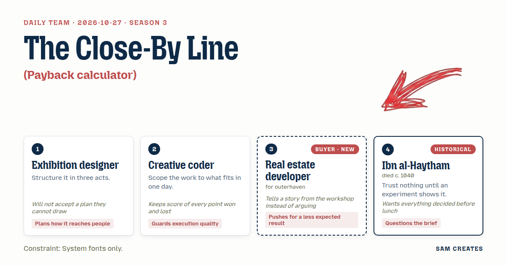
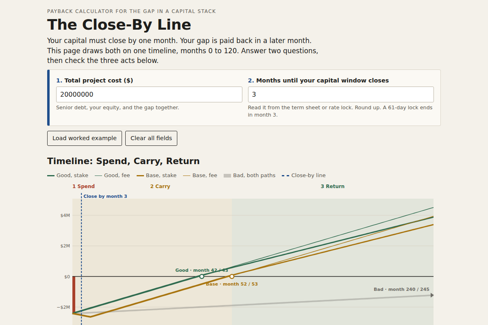

# 2026-10-27: The Close-By Line

[Today](../../README.md) · [Archive](../../ARCHIVE.md)



**Task:** Payback calculator: setup cost, monthly cost, and monthly gain give the month the buyer breaks even, shown on a timeline.

**Constraint:** System fonts only.

**Season:** 2026-10-07

**Decision:** The page takes the gap amount, monthly carry, and monthly gain, and draws the month the gap is paid back on a 0 to 120 month timeline next to the closing window, for a fee path and a stake path, under a delay case and a halved case.

## Asset

<a href="artifact-1.html"></a>

[artifact-1.html](artifact-1.html), led by Exhibition designer. Model: claude-opus-5-5.

## The session

### Pitch

**1 · Exhibition designer: Three Rooms to Month Zero**\
I draw it first, then we build it. One horizontal line, months 0 to 120.\
Act one, Spend: a block at month 0, the setup cost, full height, below the line.\
Act two, Carry: the line sinks each month by the carry until the gain arrives.\
Act three, Return: the line crosses zero and a pin drops with the month number.\
Two questions sit above the line: total project cost, and months until your capital window closes. Those two tell us who to call.

**2 · Creative coder: One SVG, Three Fields**\
Three number inputs, one SVG, no library. It fits in a day.\
Font stack: system-ui, -apple-system, Segoe UI, Roboto, sans-serif. Nothing to load.\
The math is one loop. Cumulative equals minus setup plus month times gain minus cost. The first month it goes positive is the answer.\
If gain is less than cost, the page says "No break-even" in words. No infinite loop, no blank chart.\
Every number on screen rounds the same way. Whole dollars, whole months.

**3 · Real estate developer: The Close-By Line**\
Last year a lender sent me a term sheet that said "flexible timing." The rate lock ran out on day 61. I paid 90 basis points more for five years.\
So put my window on the chart. A vertical line that says capital must close by here.\
Under it, the stack in dollars: senior debt, my equity, the gap.\
Break-even is fine. The less expected part: show that the gap partner gets paid from the break-even month, not from month 1.\
If I see that, I know someone thought about my side of the table.

**4 · Ibn al-Haytham: Three Runs Before Lunch**\
A break-even month from one set of inputs is a claim. I want it tested.\
Run the same inputs three ways: as entered, gain cut in half, gain delayed six months.\
Draw all three on one timeline, same scale. The user sees which one survives.\
I also question the brief. The pain is the closing window. Break-even comes years after it. Show both, or the page answers the wrong question.\
Decide the stack layout before noon, then build.

### Clash

**3 · Real estate developer:** Exhibition designer, your act one is one block. My setup isn't one block. It's $14M senior, $3.6M my equity, $2.4M gap. The last broker who rolled that into one number lost me at slide two.

**1 · Exhibition designer:** Then the block splits into three stacked bands with a dollar label on each. I can draw three. I can't draw five, so the stack stops at three.

**4 · Ibn al-Haytham:** Designer, the stack is settled. My question isn't. The gap closes before the window, and break-even lands at month 42. Which date does the developer act on? Put it in front of one before you assume.

**3 · Real estate developer:** Ibn al-Haytham, I act on the window and I sign on the break-even. Both. Now the shortcut. Fee path: 2% placement, $48,000 at close, gone even if the deal dies. Stake path: no fee, the gap partner takes 15% of net after break-even. Same inputs, both on the chart.

**2 · Creative coder:** Developer, that's a second loop and a second line. Still fits the day. And a model reads the rent roll and the trailing twelve months to fill gain and cost. Analyst diligence runs about $18,000. The model pass runs about $600 plus two hours of your CPA, who signs off. If the deal dies after diligence, you're out $1,400 instead of $18,000. Score so far: one to you, one to the model.

**1 · Exhibition designer:** Coder, the model fills the fields, but they stay editable and carry a line: "Filled from rent roll. Reviewed by ___." If I can't see who signed, I won't hang it.

**4 · Ibn al-Haytham:** Developer, here's the bad case. Gain $96,000, cost $38,000, gap $2,400,000. Base: month 42 on stake, 43 on fee. Gain delayed six months: month 52 and 53. Gain halved to $48,000: net $10,000, month 240 and 245. Twenty years. That doesn't hold.

**3 · Real estate developer:** Then don't offer me the stake on the halved case. On the Bayview job, lease-up sat at 60% for nine months. We survived because nobody had promised a year. Headline the delay case. Show the halved case in grey, plainly.

**2 · Creative coder:** Ibn al-Haytham, three runs times two paths is six lines. At 360px wide that's noise. I want two lines and a toggle. That point I hold.

**4 · Ibn al-Haytham:** Coder, a toggle hides the test. The user should not have to opt in to see the failure. It's eleven. Settle it.

### Decision

The page takes the gap amount, monthly carry, and monthly gain, and draws the month the gap is paid back on a 0 to 120 month timeline next to the closing window, for a fee path and a stake path, under a delay case and a halved case.

Concept: The Close-By Line

- Exhibition designer: the three acts (Spend, Carry, Return), the three-band stack at month 0, and the two qualifying questions, project cost and months to the window.
- Creative coder: one SVG, one loop, the system font stack, the "No break-even" message, and the model-filled fields with the cost saving shown.
- Real estate developer: the window line, the stack in dollars, and the stake path beside the fee path with the $48,000 fee loss shown when a deal dies.
- Ibn al-Haytham: every result runs three ways on the same scale, and the window and break-even dates both sit on the chart.
- The coder lost the toggle. A hidden failure case reads as a promise. The halved case is one grey band, because its two paths sit 5 months apart and draw as one shape.
- Bad case: gain halved puts break-even at month 240 on stake and 245 on fee. The page holds as a tool because it shows this case in grey. The stake offer does not hold in that case, so the stake path appears only when the delay case breaks even by month 84. On the default inputs the delay case is month 52, so the stake path shows.

### Build notes

1. Build one HTML file with `font-family: system-ui, -apple-system, "Segoe UI", Roboto, sans-serif`. It has three task inputs, defaulting to 2,400,000, 38,000, and 96,000, and two qualifiers: project cost and months until the window closes.
2. Write one function, `breakEven(setup, cost, gain, delayMonths)`, that returns a month or null. Call it for fee and stake under base, six-month delay, and halved gain. Draw base and delay as solid lines and the halved case as one grey band. Any line past month 120 ends in an arrow labelled with its month.
3. Mark model-filled fields "Filled from rent roll and T-12. Reviewed by:" with a name field. Show diligence at $18,000 against $1,400. Hide the stake path, with a one-line reason, when the delay case breaks even after month 84.

**Guest:** Ibn al-Haytham (historical; died c. 1040). The method is drawn from public-domain history, myth, or literature, or invented. The guest never speaks as the figure, and nothing here is endorsed by anyone.

## Team

```text
Team for 2026-10-27
Season: 2026-10-07

1. Exhibition designer
   Method: Structure it in three acts.
   Stance: Plans how it reaches people.
   Temperament: Will not accept a plan they cannot draw.
2. Creative coder
   Method: Scope the work to what fits in one day.
   Stance: Guards execution quality.
   Temperament: Keeps score of every point won and lost.
3. Real estate developer (buyer; outerhaven) [buyer] [new]
   Method: Pain: Needs project capital before the window closes. Walks when: The numbers are vague or the timeline slips. Opens up when: The capital stack and timeline are laid out in plain numbers.
   Stance: Pushes for a less expected result.
   Temperament: Tells a story from the workshop instead of arguing.
4. Ibn al-Haytham (historical; died c. 1040) [guest]
   Method: Trust nothing until an experiment shows it.
   Stance: Questions the brief.
   Temperament: Wants everything decided before lunch.

Constraint: System fonts only.
Task: Payback calculator: setup cost, monthly cost, and monthly gain give the month the buyer breaks even, shown on a timeline.
```

Provider: claude. Model: claude-opus-5-5.
