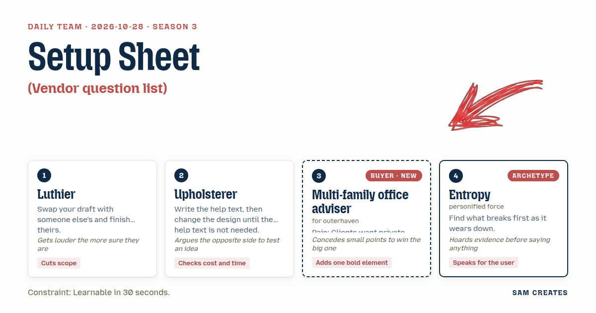
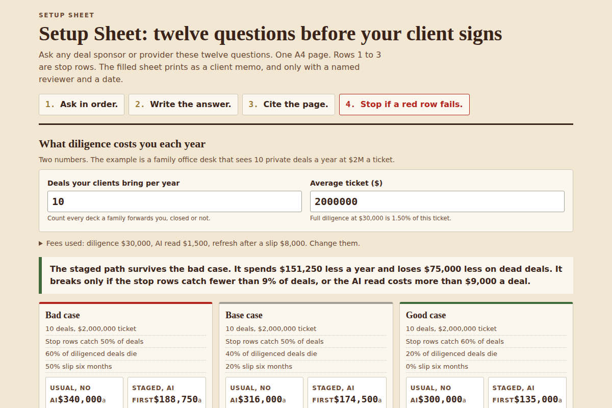

# 2026-10-28: Setup Sheet

[Today](../../README.md) · [Archive](../../ARCHIVE.md)



**Task:** Vendor question list: the buyer's priorities give a printable list of questions to ask before signing with any provider.

**Constraint:** Learnable in 30 seconds.

**Season:** 2026-10-07

**Decision:** The page takes two numbers, deals the clients bring per year and the average ticket, and returns a one-sheet list of twelve questions to ask any deal sponsor before signing, three of them stop rows, which prints as a signed and dated cli...

## Asset

<a href="artifact-1.html"></a>

[artifact-1.html](artifact-1.html), led by Luthier. Model: claude-opus-5-5.

## The session

### Pitch

**1 · Luthier: Setup Sheet**\
I took Entropy's draft and finished it. Forty questions, sorted by decade. Good wood, far too thick.\
I planed it to twelve. One A4 sheet that prints on the office machine.\
Each row has the question, what a sound answer sounds like, and a blank for what the sponsor actually said.\
The top three rows are stops. A wrong answer there and you close the folder.\
If a guitar needs a manual before you can play it, the setup is wrong. The same goes for this sheet.

**2 · Upholsterer: Cover Without Instructions**\
First I wrote the help text: "Ask in order. Write the answer. Cite the page. Stop if a red row fails." Four sentences.\
Then I changed the sheet until it said all of that alone: numbered rows, a red rule under row 3, and a box headed "Source: doc, page."\
Cost check: one sponsor call, 25 minutes, twelve rows. Two minutes a row is the ceiling.\
For the other side: maybe twelve is too many and the adviser only wants six.\
Foam that is too soft bottoms out in a year. Too firm and nobody sits on it. Start at twelve, then test.

**Multi-family office adviser (buyer; outerhaven): The File I Hand the Client**\
A family forwards me a deck on Friday and wants an answer on Monday. I cannot vet that fast.\
I do not need more questions. I need answers I can put my name under.\
So here is the bold part: the filled sheet prints as a client memo. Each line shows the question, the answer, the source, and who checked it.\
At the bottom is a "Reviewed by" line with a real name and a date. If nobody signs, the memo does not print.\
If this has me doing diligence myself for free, I close the tab.

**4 · Entropy: Where It Wears First**\
I have kept the record. Deals rarely fail at signing.\
They fail at the first capital call, at the first audit, or when the founder's partner leaves.\
I see the same causes again and again: key-person clauses nobody read, valuation marks that never move, quarterly reports that arrive later each time.\
So every question carries a tag: Day 1, Year 1, or Year 3.\
The client signs on Day 1 and lives with Year 3.

### Clash

**1 · Luthier:** Entropy, the tags are cut. Three time columns on a sheet someone has to learn in 30 seconds is a fretboard with no frets. Twelve rows. One re-ask date at the bottom. Done.

**4 · Entropy:** Luthier, I counted before I spoke. Of the twelve rows you kept, seven go stale by month 18: reporting cadence, key person, fund size, fee offsets, the auditor, the valuation policy, and the side letters. A single date at the bottom hides which seven.

**2 · Upholsterer:** Adviser, here is the shortcut. On the usual path, outside diligence costs $30,000 a deal, paid whether the deal closes or not. On the other path, the diligence firm takes 0.5% of the ticket at close. That is $10,000 on a $2M ticket and nothing on deals that die.

**3 · Multi-family office adviser:** Upholsterer, a firm paid only when the deal closes wants it to close. I cannot defend that to a family. Keep the fee math on the page if you like. But the memo cannot come from someone paid to say yes.

**2 · Upholsterer:** Fine, I'll argue the cheap side instead. AI reads the offering memo and the data room first, at $1,500 a deal, and answers the three stop rows with page cites. Full diligence happens only on deals that pass. The fixed fee stays, but you pay it less often.

**1 · Luthier:** Here is the bad case, and I am sure of it. Ten deals a year. Usual path: $300,000, and if six die after diligence, $180,000 is gone. Staged path: $15,000 on AI reads, the stop rows kill five, $150,000 goes on the other five, three of those die, and $105,000 is gone. If a deal slips six months, the read reruns at $1,500 and the diligence refresh costs $8,000. The staged path still comes out ahead.

**3 · Multi-family office adviser:** Luthier, I'll give you twelve rows and no tags. I'll give you the AI read. But the "Reviewed by" line is required and must carry a named person. The AI does not sign. That line is the only thing my clients read.

**4 · Entropy:** Adviser, a signature dates the file. Eighteen months later it is still vouching for answers that are no longer true. Put an expiry next to the name.

**1 · Luthier:** Entropy, yes to the expiry. One cell, next to the signature. Per-row tags, NO. The sheet stays twelve rows.

**4 · Entropy:** Then I keep the list of seven rows. You will want it by the second quarter of 2028.

### Decision

The page takes two numbers, deals the clients bring per year and the average ticket, and returns a one-sheet list of twelve questions to ask any deal sponsor before signing, three of them stop rows, which prints as a signed and dated client memo with the yearly cost of diligence on the usual path next to the staged AI-first path.

Concept: Setup Sheet

- Luthier: twelve rows on one A4 sheet, three stop rows at the top, a "sound answer" column on each row.
- Upholsterer: the red rule under row 3, the "Source: doc, page" box, the 25-minute call budget, and the staged AI-first path as the shortcut.
- Multi-family office adviser: the filled sheet prints as a client memo, and it will not print without a named reviewer and a date.
- Entropy: an expiry date beside the signature, set by default to 18 months after review.
- Upholsterer lost the success-fee path, because a diligence firm paid on close cannot write a memo the adviser can defend. Entropy lost the per-row tags, because three time columns break the 30-second rule. The second argument is still open.
- Bad case: at ten deals a year and $30,000 per diligence, the usual path loses $180,000 when six deals die. The staged path loses $105,000 when three of the five survivors die, and stays ahead with a six-month slip added ($1,500 rerun plus $8,000 refresh per deal). The page holds.

### Build notes

1. Build `vendor-questions.html` with two inputs, "Deals your clients bring per year" (default 10) and "Average ticket" (default $2M). Below them, put a two-column cost panel, Usual and Staged, each showing the yearly spend and the loss if 60% of diligenced deals die.
2. Add a print stylesheet that lays the twelve rows on one A4 page. Each row has four columns: Question, Sound answer, Their answer, Source. Draw a red 2px rule under row 3. Disable the print button until the "Reviewed by" name and date fields are filled, and set expiry to the date plus 18 months.
3. Under the cost panel, write one line: "AI reads the offering memo and data room for the three stop rows, about $1,500 a deal. A named reviewer signs the memo." Save Entropy's seven stale rows in a comment block in the file for the 2028 revision.

**Guest:** Entropy (archetype; personified force). The method is drawn from public-domain history, myth, or literature, or invented. The guest speaks in character in original words, never quoting the source, and nothing here is endorsed by anyone.

## Team

```text
Team for 2026-10-28
Season: 2026-10-07

1. Luthier
   Method: Swap your draft with someone else's and finish theirs.
   Stance: Cuts scope.
   Temperament: Gets louder the more sure they are.
2. Upholsterer
   Method: Write the help text, then change the design until the help text is not needed.
   Stance: Checks cost and time.
   Temperament: Argues the opposite side to test an idea.
3. Multi-family office adviser (buyer; outerhaven) [buyer] [new]
   Method: Pain: Clients want private deals the adviser cannot vet fast. Walks when: It adds unpaid work or puts their reputation at risk. Opens up when: Diligence is done and written up so they can defend it to clients.
   Stance: Adds one bold element.
   Temperament: Concedes small points to win the big one.
4. Entropy (archetype; personified force) [guest]
   Method: Find what breaks first as it wears down.
   Stance: Speaks for the user.
   Temperament: Hoards evidence before saying anything.

Constraint: Learnable in 30 seconds.
Task: Vendor question list: the buyer's priorities give a printable list of questions to ask before signing with any provider.
```

Provider: claude. Model: claude-opus-5-5.
