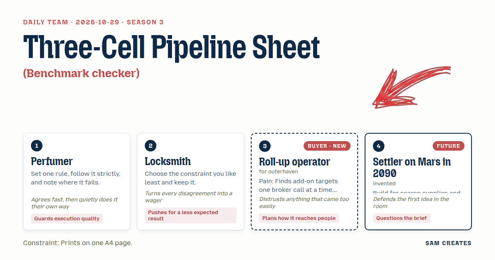
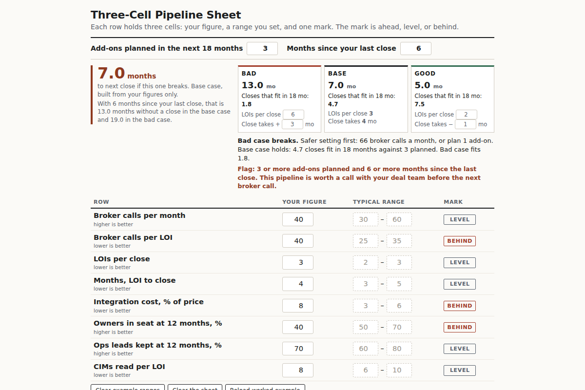

# 2026-10-29: Three-Cell Pipeline Sheet

[Today](../../README.md) · [Archive](../../ARCHIVE.md)



**Task:** Benchmark checker: the buyer's own figures sit next to typical ranges they can edit, with each gap marked ahead, level, or behind.

**Constraint:** Prints on one A4 page.

**Season:** 2026-10-07

**Decision:** The page puts the operator's add-on pipeline figures next to ranges they type themselves, marks each gap ahead, level, or behind, and lists each target owner by name as stay, out, or unclear.

## Asset

<a href="artifact-1.html"></a>

[artifact-1.html](artifact-1.html), led by Perfumer. Model: claude-opus-5-5.

## The session

### Pitch

**1 · Perfumer: Three-Cell Accord**\
One rule. Every row is three cells: your figure, the typical range, the mark.\
Ahead, level, behind. No fourth column. No notes.\
Eight rows at 11pt fit A4 with room for a header and a footer.\
Where it fails: owner intent. "Wants to stay" has no range.\
I keep the rule and log that failure in the footer.\
The range cells stay editable. The operator knows the trade better than any survey does.

**2 · Locksmith: Owner Pins**\
The one-page limit is the constraint I like least. So I keep it and spend half of it on owners.\
Top half: your deal numbers against the range. Bottom half: each target owner as a pin.\
Stay, leave, or not set. Set pins sit in a line. Unset ones hang loose and grey.\
I'll bet you the bottom half gets read first.\
The owner rows are what make the sheet odd. Behind there means you don't know yet.

**Roll-up operator (buyer; outerhaven): Add-On Pipeline Check**\
Forty broker calls to get one LOI worth reading. Then one in three closes.\
Put that next to what other platforms see. Calls per LOI, LOI to close, months to close.\
Integration cost as a share of price. Mine ran 8% on the last one. Nobody warned me.\
And who stays. The last owner said two years. He was gone in five months and took his ops lead.\
If the ranges arrive pre-filled and tidy, I'll assume someone made them up. Let me type mine.

**4 · Settler on Mars in 2090: Resupply Window**\
Your averages come from places where the next ship always comes.\
Mine don't. The gap I'd measure is time: how long until the next close if this one breaks.\
Every row carries a delay, the months that gap costs you.\
Behind on integration cost is cheap. Behind on owner stays costs a year.\
Months go on the page in big type. Everything else is supply.

### Clash

**2 · Locksmith:** Perfumer, your rule breaks on the owners. I'll wager the footer log ends up the most-read line on the sheet.

**1 · Perfumer:** Locksmith, agreed, it breaks. Owners still get rows with the same three cells: stays out of targets, range 50–70%, mark.

**3 · Roll-up operator:** Perfumer, where does 50–70 come from? Blank it and let me fill it. And I want the owners by name, not as a percentage.

**4 · Settler on Mars in 2090:** Operator, names are a supply list. The page should say how long you're stranded when the leaver walks. Months, at the top.

**3 · Roll-up operator:** Settler, I'd look at months. But only if they're built from my numbers. Delay math on a template is a stranger's guess.

**2 · Locksmith:** Operator, here's a bet. A sourcing partner on a 1.5% success share beats your broker retainer. Same forty calls. The $60k retainer is gone if the deal dies. The share costs nothing.

**3 · Roll-up operator:** Locksmith, share partners chase whatever closes, including owners who want out on day one. Show the bad case for both or I close the tab.

**1 · Perfumer:** Operator, a model reads each CIM and your call notes, then tags owner intent as stay, out, or unclear, with the line it read quoted. First pass drops from 6 hours to 20 minutes per target. Your deal lead signs off every tag.

**4 · Settler on Mars in 2090:** Here's the bad case. Close rate halves to 6 LOIs per close and the deal slips six months. Diligence spent before the break is $120k without the pre-read and $35k with it. The retainer path loses $95k. The share path loses $35k. The gap to the next close goes from 7 months to 13. The page holds if those months are printed on it.

**2 · Locksmith:** Settler, it holds. You still want months above the owners. I'll take the other side: they read owners first.

### Decision

The page puts the operator's add-on pipeline figures next to ranges they type themselves, marks each gap ahead, level, or behind, and lists each target owner by name as stay, out, or unclear.

Concept: Three-Cell Pipeline Sheet

- Perfumer: every row is three cells, your figure, the range, the mark. The footer logs the one place the rule fails, where an owner is still "unclear".
- Locksmith: the bottom half of the A4 sheet is owner pins by name. The shortcut panel shows a 1.5% success share next to the $60k retainer.
- Roll-up operator: the rows are calls per LOI, LOIs per close, months to close, integration cost as % of price, and owner stays. Range cells ship empty with a grey example and stay unmarked until the user types a value.
- Settler on Mars in 2090: one total in 24pt above the table reads "months to next close if this one breaks", built only from the user's figures.
- The Settler lost the per-row delay column. It adds a fourth cell and pushes the sheet past one page. The Operator lost on pre-filled ranges for the example rows: a blank sheet reads as unfinished, so the grey examples stay. Order is still open. The months total prints above the owners and the Locksmith's wager stands.
- Bad case: close rate halved to 6 LOIs per close, a six-month slip, and $120k of diligence spent before a break. The retainer path loses $95k and the share path loses $35k with the AI pre-read. The gap to the next close goes from 7 to 13 months. The page holds, so the shortcut panel stays.

### Build notes

1. Build one HTML file with `@page { size: A4; margin: 12mm }`. Use 8 table rows at 11pt and an owner block of up to 10 pins. Test print from Chrome and Firefox and confirm both fit one page.
2. Ask two questions only, above the table: "Add-ons planned in the next 18 months" and "Months since your last close". Feed both into the months total and the shortcut panel. Treat 3 or more add-ons with 6 or more months since the last close as worth a call.
3. Each owner pin has an intent field with a "quoted line" box and a "signed off by" box. A pin stays grey until both are filled. The footer prints the count of unclear owners as the logged rule failure.

**Guest:** Settler on Mars in 2090 (future; invented). The method is drawn from public-domain history, myth, or literature, or invented. The guest speaks in character in original words, never quoting the source, and nothing here is endorsed by anyone.

## Team

```text
Team for 2026-10-29
Season: 2026-10-07

1. Perfumer
   Method: Set one rule, follow it strictly, and note where it fails.
   Stance: Guards execution quality.
   Temperament: Agrees fast, then quietly does it their own way.
2. Locksmith
   Method: Choose the constraint you like least and keep it.
   Stance: Pushes for a less expected result.
   Temperament: Turns every disagreement into a wager.
3. Roll-up operator (buyer; outerhaven) [buyer] [new]
   Method: Pain: Finds add-on targets one broker call at a time. Walks when: It ignores integration cost and whether owners stay. Opens up when: It shows which owners want to stay on and which want out.
   Stance: Plans how it reaches people.
   Temperament: Distrusts anything that came too easily.
4. Settler on Mars in 2090 (future; invented) [guest]
   Method: Build for scarce supplies and long delays.
   Stance: Questions the brief.
   Temperament: Defends the first idea in the room.

Constraint: Prints on one A4 page.
Task: Benchmark checker: the buyer's own figures sit next to typical ranges they can edit, with each gap marked ahead, level, or behind.
```

Provider: claude. Model: claude-opus-5-5.
