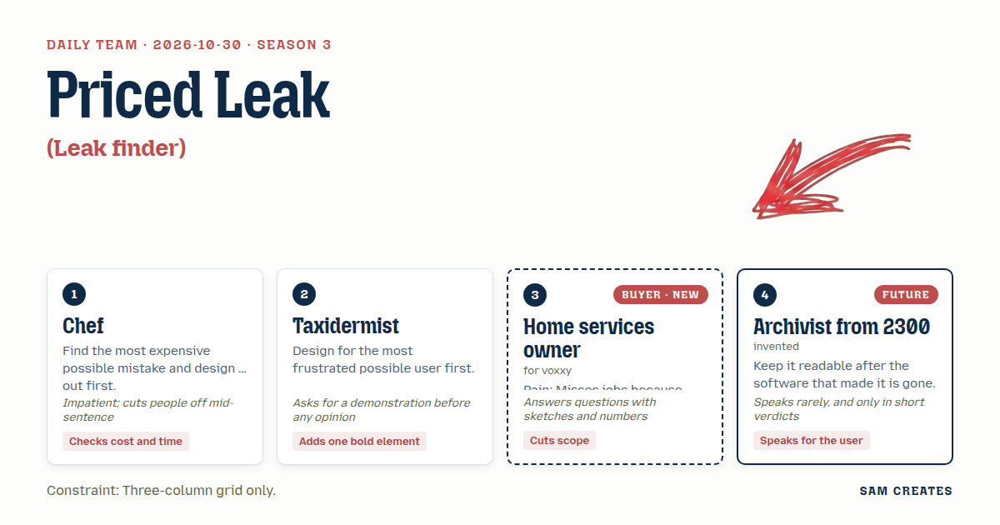
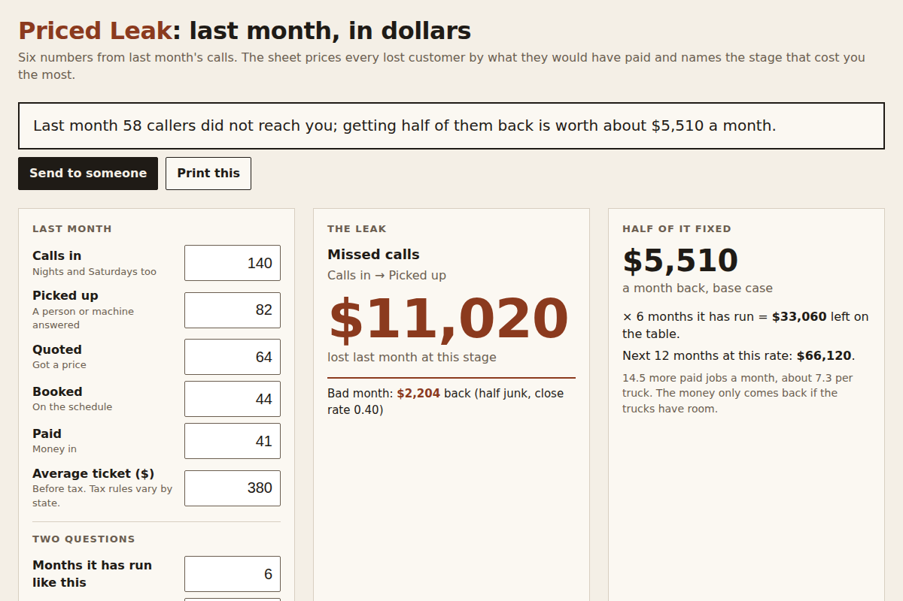

# 2026-10-30: Priced Leak

[Today](../../README.md) · [Archive](../../ARCHIVE.md)



**Task:** Leak finder: a funnel of stages with counts gives the stage that loses the most and what fixing half of that loss would be worth.

**Constraint:** Three-column grid only.

**Season:** 2026-10-07

**Decision:** The page takes six numbers from last month's calls, prices each stage's loss by what it would have paid, names the stage that lost the most dollars, and shows what fixing half of it is worth per month and over the months the problem has ...

## Asset

<a href="artifact-1.html"></a>

[artifact-1.html](artifact-1.html), led by Chef. Model: claude-opus-5-5.

## The session

### Pitch

**1 · Chef: Priced Leak**\
Biggest mistake on the table: we name the wrong stage.\
Raw drop-off counts lie. Twenty lost at quote can cost more than forty lost at the phone.\
So every loss gets priced by what it would have become: lost count, times the rest of the funnel, times ticket.\
Left column takes the counts. Middle shows the leak in dollars. Right shows half of it fixed, per month, times months.\
Two questions only: how many months it has run like this, and how many trucks.\
Six months of this, and it's a contract.

**2 · Taxidermist: Nine at Night**\
Picture who opens this. He's in the truck, phone in one hand, and he's already angry about a voicemail.\
Five boxes, 48px tall, number keypad, example month pre-filled so he sees it work before he types.\
Then one loud thing: the leak column holds a single figure, 72px, rust red, and nothing else.\
No chart he has to read. No legend.\
Show me the form with a real month in it before anyone argues about colour.

**3 · Home services owner: Last Month in Dollars**\
Calls in. Picked up. Quoted. Booked. Paid. Average ticket. That's six boxes, and I already have five of those numbers in my head.\
Answer is one line: what last month cost me.\
If it says "funnel optimization" I'm gone.\
If fixing it means a new app, I'm gone.\
Forward my after-hours line somewhere, done in five minutes, fine.

**4 · Archivist from 2300: The Ledger Line**\
The tool will die.\
The sentence must outlive it.\
One line, plain words, printable.

### Clash

**2 · Taxidermist:** Owner, show me last month. Fill the boxes.

**3 · Home services owner:** 140 calls. 82 picked up. 64 quoted. 44 booked. 41 paid. Ticket's 380. Nights and Saturdays are the 58 I missed.

**1 · Chef:** Good, so the leak is pickup, 58 gone, half of what gets answered ends up paid, that's 29 jobs, $11,020. Quote-to-book loses 20, worth $7,080. Same answer this month. Next month it might flip, which is why we price it and don't just count it.

**2 · Taxidermist:** Then the rust number reads $11,020 and the right column reads $5,510 a month back. I want it on his phone at that size before we add anything else.

**3 · Home services owner:** Cut the right column's three-way comparison. Answering service, AI, revenue share. I'm not shopping today, I'm counting.

**1 · Chef:** No, that's where we get paid, and you'll want it the morning after. Bad case: half those 58 were robocalls and wrong numbers, and close rate slips to 0.4. That's 29 real, half fixed is 14.5, times 0.4 is 5.8 jobs, $2,204 back. Human service flat $450 leaves $1,754. AI answers the call for about $60 in costs, and we take 10% of recovered jobs, $220, leaving $1,984. Shortcut still wins in the bad month.

**4 · Archivist from 2300:** Vendor prices rot. The sentence stays. Print the sentence first.

**3 · Home services owner:** If the sentence says what I lost, I'll forward it to my brother-in-law. He runs HVAC two towns over. Keep your comparison, two rows, no sign-up.

**2 · Taxidermist:** Then I want a junk-call slider in the left column, so the angry guy can say "half were spam" and watch the number drop. He trusts it more if he can argue with it.

### Decision

The page takes six numbers from last month's calls, prices each stage's loss by what it would have paid, names the stage that lost the most dollars, and shows what fixing half of it is worth per month and over the months the problem has run.

Concept: Priced Leak

- Chef: each stage's loss is valued downstream (lost count × later conversion × ticket), and the two questions are months running and number of trucks.
- Taxidermist: a pre-filled example month, 48px number fields, and the leak column carrying one 72px rust figure.
- Home services owner: six inputs, no sign-up, and setup described as forwarding one phone line in under ten minutes.
- Archivist from 2300: the result opens with one printable sentence, for example "Last month 58 callers did not reach you; getting half of them back is worth about $5,510 a month."
- The owner lost the cut of the comparison rows, because the share-versus-fee rows are the commercial ask. The Taxidermist lost the junk-call slider, because the bad-case row already shows the spam scenario without a seventh control.
- Bad case: tested with half the missed calls as junk and the close rate at 0.4. Recovery is $2,204 a month. The flat service leaves $1,754 and the AI-plus-10%-share path leaves $1,984. The page holds and shows this row by default under the main figure.

### Build notes

1. Build a three-column CSS grid in one HTML file with inline JS and no external requests. Left column: six inputs plus the two questions. Middle column: the leak stage name and its dollar figure at 72px in #8B3A1E. Right column: half-fix per month, times months running, then two rows (human service $450 flat; AI answering plus 10% of recovered jobs), each showing the normal case and the bad case.
2. Compute the loss at each stage as `lost × (paid / count at that stage) × ticket`. Pick the maximum, and break ties toward the earliest stage. Pre-fill 140 / 82 / 64 / 44 / 41 / $380 so the page shows $11,020 and $5,510 on load.
3. Render the result sentence as the first element of the output in plain text. Add a print stylesheet that drops the grid to one column and prints the sentence, the stage table, and the bad-case row. Add a "Send to someone" mailto link that carries the sentence in the body.

**Guest:** Archivist from 2300 (future; invented). The method is drawn from public-domain history, myth, or literature, or invented. The guest speaks in character in original words, never quoting the source, and nothing here is endorsed by anyone.

## Team

```text
Team for 2026-10-30
Season: 2026-10-07

1. Chef
   Method: Find the most expensive possible mistake and design it out first.
   Stance: Checks cost and time.
   Temperament: Impatient; cuts people off mid-sentence.
2. Taxidermist
   Method: Design for the most frustrated possible user first.
   Stance: Adds one bold element.
   Temperament: Asks for a demonstration before any opinion.
3. Home services owner (buyer; voxxy) [buyer] [new]
   Method: Pain: Misses jobs because nobody answers after hours. Walks when: Setup takes more than ten minutes or needs new software. Opens up when: It counts the jobs they lost last month in money.
   Stance: Cuts scope.
   Temperament: Answers questions with sketches and numbers.
4. Archivist from 2300 (future; invented) [guest]
   Method: Keep it readable after the software that made it is gone.
   Stance: Speaks for the user.
   Temperament: Speaks rarely, and only in short verdicts.

Constraint: Three-column grid only.
Task: Leak finder: a funnel of stages with counts gives the stage that loses the most and what fixing half of that loss would be worth.
```

Provider: claude. Model: claude-opus-5-5.
