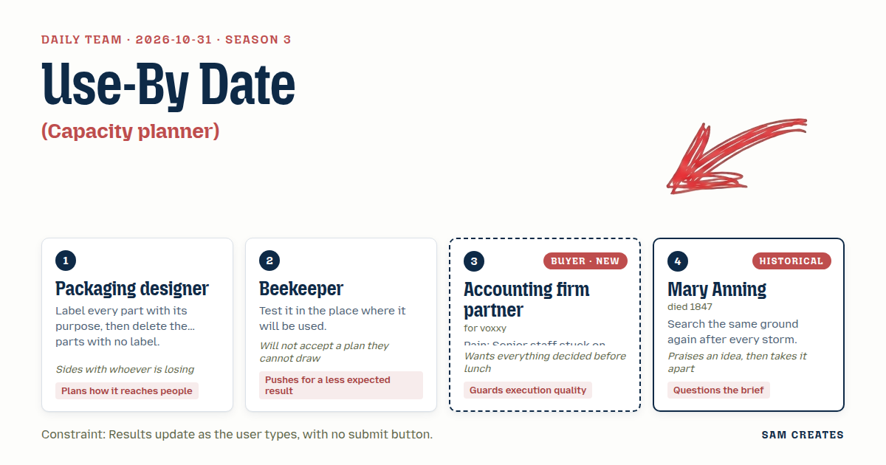
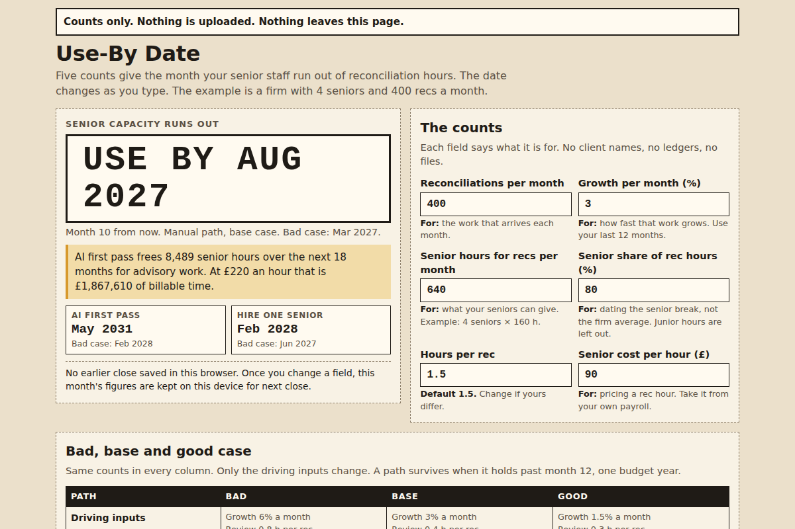

# 2026-10-31: Use-By Date

[Today](../../README.md) · [Archive](../../ARCHIVE.md)



**Task:** Capacity planner: current volume, growth rate, and staff hours give the month the buyer's team runs out of capacity.

**Constraint:** Results update as the user types, with no submit button.

**Season:** 2026-10-07

**Decision:** The page takes four counts, never client data, and shows live the month senior staff run out of reconciliation hours on the manual path, the hire path, and an AI first-pass path with a named senior signing off, each with its bad case alo...

## Asset

<a href="artifact-1.html"></a>

[artifact-1.html](artifact-1.html), led by Packaging designer. Model: claude-opus-5-5.

## The session

### Pitch

**1 · Packaging designer: Use-By Date**\
Four fields on the front. Each one carries a small label saying why it is there.\
Anything I can't label comes off. No logo strip, no quote carousel, no "book a demo" banner.\
The result prints like the date on a carton: "Senior capacity runs out: August 2027."\
Next to it, a second date for the same inputs with a machine doing the first pass.\
Both dates move as you type. There's no button to hide behind.

**2 · Beekeeper: Twelve Frames**\
Test it where it gets opened. A phone, in a corridor, between two client meetings.\
Here's the drawing: a row of frames, one per month, each filling as volume grows.\
The frame that spills goes dark. That's the month.\
What I care about is the other row, the empty frames. Those are advisory hours.\
So don't lead with when you drown. Lead with when you get your Thursdays back.

**Accounting firm partner (buyer; voxxy): Before Lunch**\
My two best seniors spend the first week of every month ticking bank lines.\
I've been sold this before. The last vendor wanted read access to our ledger before showing me a price.\
So no upload, no client names, counts only. Say that in one line, at the top.\
Show me hours. Hours I bill at 220 for advisory instead of burning at 90 on recs.\
If it takes longer than my coffee, I close it.

**4 · Mary Anning: Same Ground**\
Run the numbers again after every month-end close. Each close shifts the ground.\
The page should keep last month's answer beside this month's, so you see what moved.\
The brief says "the month you run out." I'd ask whose hours run out first.\
Senior hours and junior hours don't break in the same month.\
One date for the whole firm can hide the people who are already over.

### Clash

**2 · Beekeeper:** Packaging designer, your carton date is clean and I can draw it. But it's a date of doom. Flip it: headline the month advisory hours open up.

**3 · Accounting firm partner:** Beekeeper, no. I don't buy hope. I buy a deadline I can put in front of the other partners. A deadline gets a meeting booked.

**4 · Mary Anning:** Partner, the deadline is a good find. It's also one number for a firm with two kinds of staff. If your seniors carry most of the recs, they go over months before the firm does, and one date tells them they're fine.

**3 · Accounting firm partner:** Then one field, senior share of rec hours. One. Not a staffing model. I want this settled before lunch.

**1 · Packaging designer:** Partner, then a field comes off to make room. Hours per reconciliation gets a default of 1.5 and a label saying "change if yours differ." And the two paths go side by side. Hiring is a salary you pay even if volume halves. AI first pass is priced per reconciliation, so the cost falls with volume and the freed hours stay yours to bill.

**2 · Beekeeper:** Packaging designer, run the bad case on both, or that second date is a sales sticker. 400 recs a month, 3% growth, 800 senior hours. Manual runs out in month 10. AI first pass with 0.4 hours of review each: month 55. Now double growth to 6% and say the AI matches worse, so review takes 0.8 hours. Manual: month 5. Hire one senior, four months to find them: month 8. AI path: month 16.

**3 · Accounting firm partner:** Beekeeper, sixteen on the bad case I can work with. But who signs the lines the machine matched. If nobody's named, that's my audit file with a hole in it.

**1 · Packaging designer:** Partner, a named reviewer on every rec. Every unmatched line goes to that person. The label says it plainly: "AI matches. Your senior signs."

**4 · Mary Anning:** Beekeeper, your frames are the best idea on the table, and twelve is the wrong count. The bad case breaks in month 5 and the good case in year five. Twelve frames show neither of them properly.

**2 · Beekeeper:** Mary Anning, twelve fits a phone. I'll go to eighteen. Past eighteen, the last frame just reads "clear." I won't draw fifty-five.

### Decision

The page takes four counts, never client data, and shows live the month senior staff run out of reconciliation hours on the manual path, the hire path, and an AI first-pass path with a named senior signing off, each with its bad case alongside.

Concept: Use-By Date

- Packaging designer: every field carries a purpose label. The result reads like a carton date. Unlabelled elements such as the logo strip and the demo banner are removed.
- Beekeeper: an 18-frame month strip under each path. The spill month is shaded dark. Empty frames on the AI path are labelled as advisory hours at the user's rate. The page is tested on a 375px-wide phone screen.
- Accounting firm partner: a line at the top reads "Counts only. Nothing is uploaded. Nothing leaves this page." A named-reviewer field sits on the AI path. The deadline date is the headline.
- Mary Anning: a senior-share field, so the date is the senior break month. A "last close" figure is saved in the browser and shown beside the current date.
- Beekeeper lost the headline. The lead backed the beekeeper on frames but gave the headline to the partner, because the partner said a date gets a meeting booked and hope does not. Advisory hours sit directly under the date. Mary Anning and the beekeeper are still split on frame count: 18 shows the bad case but not the good one.
- Bad case: growth doubled from 3% to 6% and AI review time doubled from 0.4 to 0.8 hours. Manual breaks in month 5, the hire path in month 8, and the AI path in month 16. The AI path still holds, so the side-by-side stays. If volume halves, the hire path shows the idle salary hours and the AI path shows cost falling with volume.

### Build notes

1. Build one `index.html` with five inputs: monthly reconciliations, monthly growth %, senior hours per month, senior share of rec hours, and hours per rec (default 1.5). Bind each input to `input` events so the three dates and the three 18-frame strips recalculate on every keystroke. Each path's break month is `ceil(ln(capacity/load)/ln(1+growth))`.
2. Below the result, add two optional qualifying fields: advisory billing rate per hour, and number of months recs have closed late. When both are filled, show "Advisory revenue held up over 18 months: £X" and one contact link. The figure is the freed hours times the rate.
3. Store the last-close inputs in `localStorage` only and display them as "Last close: <month>". Add a 0.8-hour bad-case toggle on each path. Place the labels "AI matches. Your senior signs." and the reviewer-name field on the AI path. Ship no analytics and no network calls.

**Guest:** Mary Anning (historical; died 1847). The method is drawn from public-domain history, myth, or literature, or invented. The guest never speaks as the figure, and nothing here is endorsed by anyone.

## Team

```text
Team for 2026-10-31
Season: 2026-10-07

1. Packaging designer
   Method: Label every part with its purpose, then delete the parts with no label.
   Stance: Plans how it reaches people.
   Temperament: Sides with whoever is losing.
2. Beekeeper
   Method: Test it in the place where it will be used.
   Stance: Pushes for a less expected result.
   Temperament: Will not accept a plan they cannot draw.
3. Accounting firm partner (buyer; voxxy) [buyer] [new]
   Method: Pain: Senior staff stuck on manual reconciliations. Walks when: It creates audit risk or handles client data carelessly. Opens up when: It frees senior hours for advisory work clients pay more for.
   Stance: Guards execution quality.
   Temperament: Wants everything decided before lunch.
4. Mary Anning (historical; died 1847) [guest]
   Method: Search the same ground again after every storm.
   Stance: Questions the brief.
   Temperament: Praises an idea, then takes it apart.

Constraint: Results update as the user types, with no submit button.
Task: Capacity planner: current volume, growth rate, and staff hours give the month the buyer's team runs out of capacity.
```

Provider: claude. Model: claude-opus-5-5.
