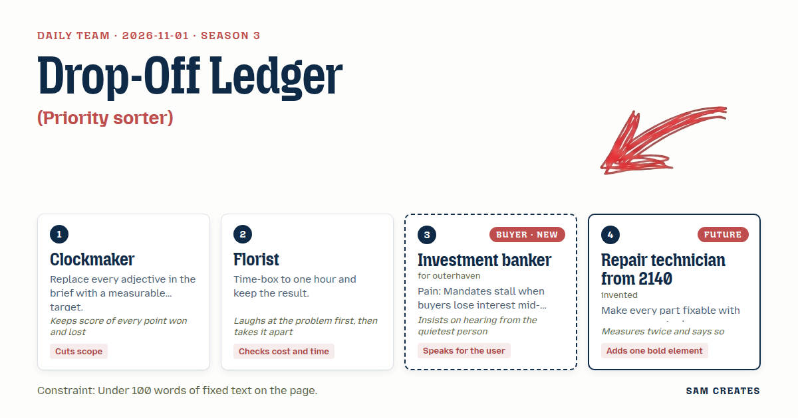
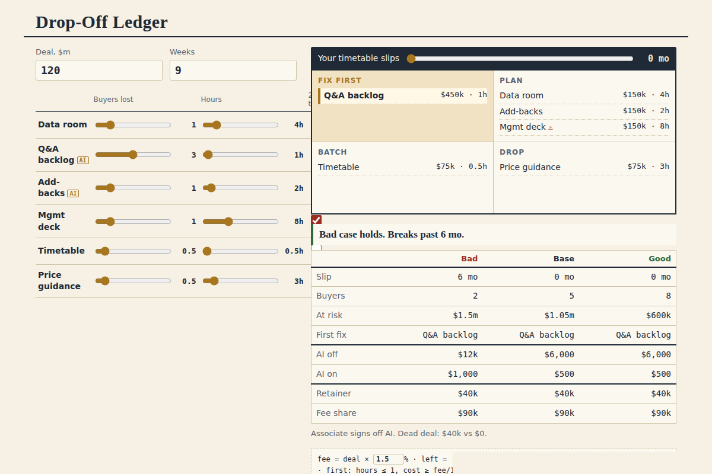

# 2026-11-01: Drop-Off Ledger

[Today](../../README.md) · [Archive](../../ARCHIVE.md)



**Task:** Priority sorter: a list of problems rated by cost and effort gives a two-by-two grid and the first one to tackle.

**Constraint:** Under 100 words of fixed text on the page.

**Season:** 2026-10-07

**Decision:** The page takes deal size, weeks since launch, and six stall causes rated by fee at risk and hours to fix.

## Asset

<a href="artifact-1.html"></a>

[artifact-1.html](artifact-1.html), led by Clockmaker. Model: claude-opus-5-5.

## The session

### Pitch

**1 · Clockmaker: Drop-Off Ledger**\
"Slow" is not a rating. "Lost buyers" is.\
Six stall causes, preset: data room gaps, Q&A backlog, messy add-backs, late management deck, unclear timetable, no price guidance.\
Each one gets two numbers. Percent of the buyer list it costs you. Days to fix.\
Two questions up top: deal size, weeks since launch.\
Grid out. Top-left box wins. One cause named first.\
Nothing else on the page. Every extra word is a point I lose.

**2 · Florist: One-Hour Bench**\
Ha. Six causes and a banker who has nine minutes between calls. Fine.\
Effort goes in hours, not days. Anything over one hour drops a box.\
Cost goes in fee dollars. A percent of buyers means nothing until it has a price tag.\
The first fix has to fit on the bench in one hour. If it can't, it isn't first.\
The page tells you what that hour buys back.

**Investment banker (buyer; outerhaven): Buyer Heat Board**\
Every vendor who has pitched me wanted to "reach buyers." They meant around me.\
So the words are "your process," "your buyer list," "your timetable." Every time.\
The problems are the reasons my buyers go quiet in week six. That's my pain.\
The output is mine. I take it into my Monday call. The client never sees it unless I send it.\
Would I give this two minutes? If it names the one thing keeping buyer four warm, yes.\
Would I forward it? To my VP, if it fits in a screenshot.

**4 · Repair technician from 2140: Slip Dial**\
One control. A dial, zero to six months of slip.\
Turn it and the grid redraws. Buyers drain, the fee drops, boxes swap.\
I measured the slip twice. Interest falls off in steps, not a smooth line. The dial shows the steps.\
Every fix on the list should take one common tool to do. A spreadsheet. A call. A document.\
If a fix needs a special tool, mark it. That one breaks first.

### Clash

**2 · Florist:** Clockmaker, percent of buyers is clean, but a banker with twelve names on the list does the math to dollars in their head anyway. Do it for them. Deal size times 1.5 percent, split by buyer.

**1 · Clockmaker:** Point to you. Fee per buyer replaces the percent. Still two questions, no third. Score is one-nil, Florist.

**Investment banker (buyer; outerhaven):** Technician, you've said the least. Who turns that dial? If my client can read it as "your banker is six months late," it never leaves my laptop.

**4 · Repair technician from 2140:** You turn it. The label reads "your timetable slips," never anything about blame. Measured twice: $120m deal, $1.8m fee, 12 buyers at launch, 5 left at week 9. Six months of slip and the halving rule leaves 2 or 3. Fee at risk goes from $1.05m to $1.5m.

**2 · Florist:** Then there's the shortcut. Fixing the Q&A backlog the usual way is a $40k vendor retainer, paid even if the deal dies. The shortcut is 5 percent of your success fee, paid only at close. That's $90k on a close and $0 on a dead deal. Same six inputs, both rows on the page.

**Investment banker (buyer; outerhaven):** My MD will ask why a vendor eats from our success fee. Show both rows. Don't put the share path on top.

**1 · Clockmaker:** Score: Florist two, the banker one. AI drafts the 60 open Q&A answers and reconciles the add-backs. That takes 2 hours instead of 3 analyst days, about $6k, and your associate signs every line. Dead deal or not, the $6k is never spent.

**4 · Repair technician from 2140:** Then mark AI as the one common tool on those two fixes. And give the dial its own box. It is the bold piece.

**2 · Florist:** A full box for the dial costs a day of build. That fails my hour. Put it inside the grid header.

**Investment banker (buyer; outerhaven):** Share path and fee path side by side, equal weight, or I don't forward it. That one is still open.

### Decision

The page takes deal size, weeks since launch, and six stall causes rated by fee at risk and hours to fix. It returns a two-by-two grid, the first fix, and a slip dial that redraws both.

Concept: Drop-Off Ledger

- Clockmaker: six preset causes, two qualifying questions, under 100 words of fixed text.
- Florist: effort in hours, cost in fee dollars per buyer, the one-hour rule for the first fix, and the shortcut rows.
- Investment banker (buyer; outerhaven): the words "your process," "your buyer list," "your timetable." The output belongs to the banker and nothing goes to the client.
- Repair technician from 2140: the 0 to 6 month slip dial in the grid header, plus a mark on any fix that needs more than one common tool.
- The Technician lost the separate dial box because it cost a day of build for one control. The banker's demand for equal weight on fee and share paths stays open. The rows sit side by side, fee path first, and a referee settles the weighting.
- Bad case: $120m deal, 12 buyers at launch, 5 at week 9, slipped six months to 2 buyers. Fee at risk rises to $1.5m. The fee path loses $40k and the share path loses $0. AI drafting saves $6k on either path. The page holds, and the first fix stays the Q&A backlog at 1 hour.

### Build notes

1. Build `priority-sorter.html` as one file with no libraries. Two number inputs, six rows with two sliders each, and a CSS grid of 2x2 boxes that sort on input. Keep fixed text at 95 words or fewer and count it in a test script.
2. Add a range input from 0 to 6 in the grid header. Each step halves active buyers once per 3 months, recomputes fee at risk, and re-sorts the boxes.
3. Under the grid, add a two-column table: fee path ($40k retainer) and share path (5% of fee at close). Show the base case and the bad case in both columns, at equal font size. Tag the Q&A and add-back fixes "AI draft, associate signs off".

**Guest:** Repair technician from 2140 (future; invented). The method is drawn from public-domain history, myth, or literature, or invented. The guest speaks in character in original words, never quoting the source, and nothing here is endorsed by anyone.

## Team

```text
Team for 2026-11-01
Season: 2026-10-07

1. Clockmaker
   Method: Replace every adjective in the brief with a measurable target.
   Stance: Cuts scope.
   Temperament: Keeps score of every point won and lost.
2. Florist
   Method: Time-box to one hour and keep the result.
   Stance: Checks cost and time.
   Temperament: Laughs at the problem first, then takes it apart.
3. Investment banker (buyer; outerhaven) [buyer] [new]
   Method: Pain: Mandates stall when buyers lose interest mid-process. Walks when: It competes with their process or goes around them to the client. Opens up when: It brings buyers into their process and keeps them as the lead.
   Stance: Speaks for the user.
   Temperament: Insists on hearing from the quietest person.
4. Repair technician from 2140 (future; invented) [guest]
   Method: Make every part fixable with one common tool.
   Stance: Adds one bold element.
   Temperament: Measures twice and says so.

Constraint: Under 100 words of fixed text on the page.
Task: Priority sorter: a list of problems rated by cost and effort gives a two-by-two grid and the first one to tackle.
```

Provider: claude. Model: claude-opus-5-5.
