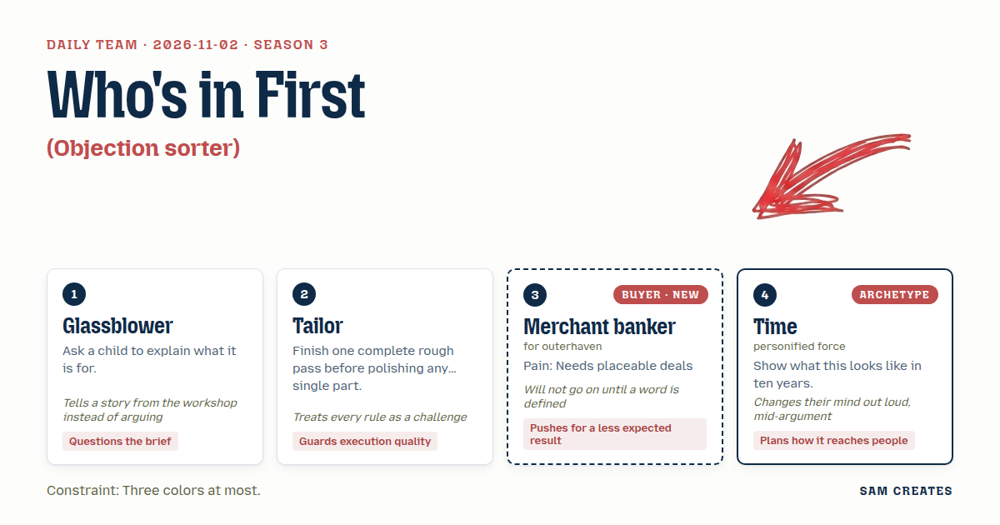
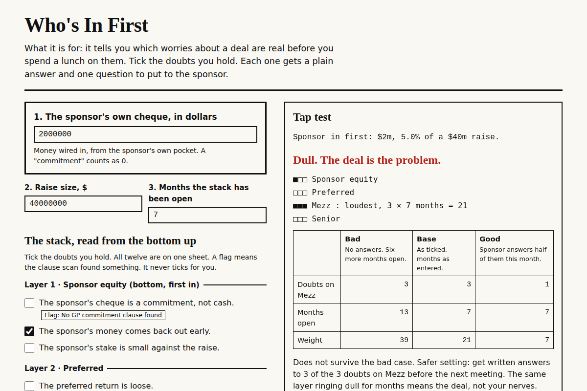

# 2026-11-02: Who's In First

[Today](../../README.md) · [Archive](../../ARCHIVE.md)



**Task:** Objection sorter: the buyer ticks the doubts they have and gets a plain answer and one question to ask any provider for each.

**Constraint:** Three colors at most.

**Season:** 2026-10-07

**Decision:** The page lets a merchant banker tick the doubts they hold about a deal, sorted onto the capital stack.

## Asset

<a href="artifact-1.html"></a>

[artifact-1.html](artifact-1.html), led by Glassblower. Model: claude-opus-5-5.

## The session

### Pitch

**1 · Glassblower: Tap Test**\
I asked my niece what this is for. She said it tells you which worries are real before you waste lunch on them.\
That is the page.\
In the shop we tap a cooled piece with a fingernail before it goes on the shelf. A clear ring means it's sound. A dull one means a crack you can't see yet.\
Each doubt you tick gets tapped: one plain answer, one question to put to the sponsor.\
The result counts how many dull notes point at the same layer of the deal. Same layer, months running, means it's the deal, not your nerves.\
Two questions only, up front: raise size, and months the stack has been open.

**2 · Tailor: Basted Seam**\
All twelve objections go in first, one line each, ugly, before any one of them gets polished.\
Then we see where the seams pull.\
Three colors. Fine. Black, paper, and one red for "walk."\
But is gray a color, or is it black on a diet? I'll use it until someone stops me.\
Answers sit at 60 characters wide, set like a fitting card. No accordions. A buyer should see the whole garment at once.

**Merchant banker (buyer; outerhaven): Who's In First**\
Stop. "Objection." Whose? Mine, or my investors'? They aren't the same list.\
Mine: is the sponsor in, how much, and where in the stack.\
So the page opens with one box. Sponsor's own cheque, in dollars. Not "commitment." Dollars.\
Then the stack, bottom to top: sponsor equity, preferred, mezz, senior.\
Every doubt I tick lands on a layer. The question for each one is some form of "show me the wire."\
If the sponsor box is empty, the page says so in red and stops. That's where I'd stop anyway.

**4 · Time: The Ten-Year Ledger**\
Each doubt left unasked has a cost that grows.\
Year one, a delay. Year three, a recap. Year ten, the name on the tombstone ad that people remember for the wrong reason.\
So each answer carries a small line: what this looks like in ten years if nobody asked.\
Reach: the ticked questions print as one card a banker can hand a colleague.\
No. A card gets lost. A link to the same ticked state, so the colleague sees what you saw.

### Clash

**3 · Merchant banker:** Glassblower, you said "sponsor" and "provider" in the same breath. The task says provider. I won't go on until that's pinned. A provider sells me a service. A sponsor brings me a deal. The questions are different.

**1 · Glassblower:** Merchant banker, a buyer once sent back six goblets because I'd called them "tumblers" on the invoice. Same glass. He was right anyway, because he was stacking them by the word. Sponsor it is. Provider shows up once, in small type, for the lawyers and data-room vendors.

**4 · Time:** Merchant banker, then let the machine read the term sheet. You upload it, it pre-ticks the doubts it finds: no GP commitment clause, mezz with a springing lien. In ten years nobody ticks by hand. Actually, no. If it pre-ticks, you stop reading. It should flag, and you tick.

**3 · Merchant banker:** Time, agreed on flag-not-tick. Put the number on it. Analyst first read of a data room is 30 hours. Machine first pass is 20 minutes, and our counsel still signs the summary. Write counsel's name on the page.

**2 · Tailor:** Time, rough pass of the deal math, all of it, before anyone polishes a word. $40m raise. Usual path: 2% placement fee, $800k at close. Share path: 1% fee, $400k, plus 10% of the sponsor's promote, about $600k at plan.

**3 · Merchant banker:** Tailor, show both against the dead deal, not just the live one. Deal slips six months, then dies. Diligence spent: $150k with analysts and outside counsel. With the machine doing first read, $45k. That's the saving I'd forward.

**2 · Tailor:** Merchant banker, now the bad case on the share side. Volume halves to $20m: fee path $400k, share path $200k plus about $300k promote. Share still wins. Rate doubles: promote drops near zero, so share path is $200k against $400k. It doesn't hold there.

**1 · Glassblower:** Tailor, then it rings dull and we say so. The share path stays on the page, but it carries a red line reading "loses if rates double," shown at the same size as its upside.

**4 · Time:** Tailor, I want gray for the ten-year lines so they read as the future, quieter. Earlier I said all three colors were spent. I've changed that. Gray is the fourth.

**2 · Tailor:** Time, gray is black at 55%. I've been arguing that from the start and I'll keep doing it. If the referee counts it, the ten-year lines go italic black instead.

### Decision

The page lets a merchant banker tick the doubts they hold about a deal, sorted onto the capital stack. Each doubt returns a plain answer and one question to put to the sponsor. Up front sits the sponsor's own cheque in dollars, and at the foot the fee path and the share path are shown side by side, with the bad case for both.

Concept: Who's In First

- Glassblower: the tap-test result line. It counts how many ticked doubts land on one stack layer, multiplied by months open, so the problem reads as one that has run for months.
- Tailor: all twelve objections are visible at once on one page. The fee-versus-share table and its bad-case rows come from the Tailor's rough pass.
- Merchant banker: the sponsor-cheque box comes first, and an empty box ends the page in red. The stack is ordered bottom to top. "Sponsor" replaces "provider." Each question ends in a request for documents or a wire.
- Time: each answer carries a one-line ten-year cost. The ticked state is shared by link. The machine flags clauses from an uploaded term sheet and does not pre-tick them.
- Lost: Time lost the pre-tick, because a pre-ticked box stops the reader reading. Time lost the printed card, by Time's own reversal. Glassblower lost "provider" as the headline word, because the buyer stacks by the word and that word is wrong for a sponsor. The gray question is open and goes to the referee.
- Bad case: tested on a $40m raise. The page tested a deal that dies after six months, volume that halves, and a rate that doubles. The dead deal costs $150k in diligence, or $45k with a machine first read signed by counsel, on both paths. Halved volume still favors the share path, $500k against $400k. A doubled rate breaks it, $200k against $400k. The page holds because it shows that loss in red and does not recommend the share path by default.

### Build notes

1. Build one HTML file with these inputs in order: the sponsor's cheque in dollars, the raise size, the months the stack has been open, and twelve checkboxes in four stack groups (sponsor equity, preferred, mezz, senior). Leave the sponsor cheque at 0 and the result panel shows only the red line "No sponsor money in the deal" and stops.
2. Write the twelve answers and twelve questions as one rough pass in a JS array before any styling. Cap each answer at 60 characters per line. Each answer gets one ten-year line in italic black, which switches to gray if the referee allows a fourth tone. Colors are #111, #FAF8F3, and #B3261E.
3. Add a term-sheet upload that sends text to a model with a fixed clause list (GP commitment, springing lien, PIK toggle, key-person). It returns flags beside the boxes and never ticks them. Show "First read: ~20 min vs 30 analyst hours. Reviewed and signed by: [counsel name]." Under the fee and share table, show the dead-deal row: $150k vs $45k diligence.

**Guest:** Time (archetype; personified force). The method is drawn from public-domain history, myth, or literature, or invented. The guest speaks in character in original words, never quoting the source, and nothing here is endorsed by anyone.

## Team

```text
Team for 2026-11-02
Season: 2026-10-07

1. Glassblower
   Method: Ask a child to explain what it is for.
   Stance: Questions the brief.
   Temperament: Tells a story from the workshop instead of arguing.
2. Tailor
   Method: Finish one complete rough pass before polishing any single part.
   Stance: Guards execution quality.
   Temperament: Treats every rule as a challenge.
3. Merchant banker (buyer; outerhaven) [buyer] [new]
   Method: Pain: Needs placeable deals with a clear capital stack. Walks when: The sponsor has no money of their own in the deal. Opens up when: The sponsor has skin in the game and the stack is laid out.
   Stance: Pushes for a less expected result.
   Temperament: Will not go on until a word is defined.
4. Time (archetype; personified force) [guest]
   Method: Show what this looks like in ten years.
   Stance: Plans how it reaches people.
   Temperament: Changes their mind out loud, mid-argument.

Constraint: Three colors at most.
Task: Objection sorter: the buyer ticks the doubts they have and gets a plain answer and one question to ask any provider for each.
```

Provider: claude. Model: claude-opus-5-5.
