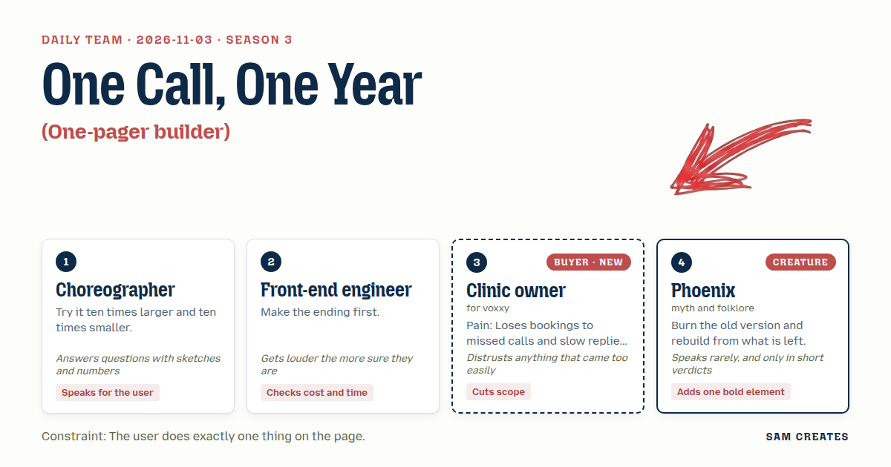
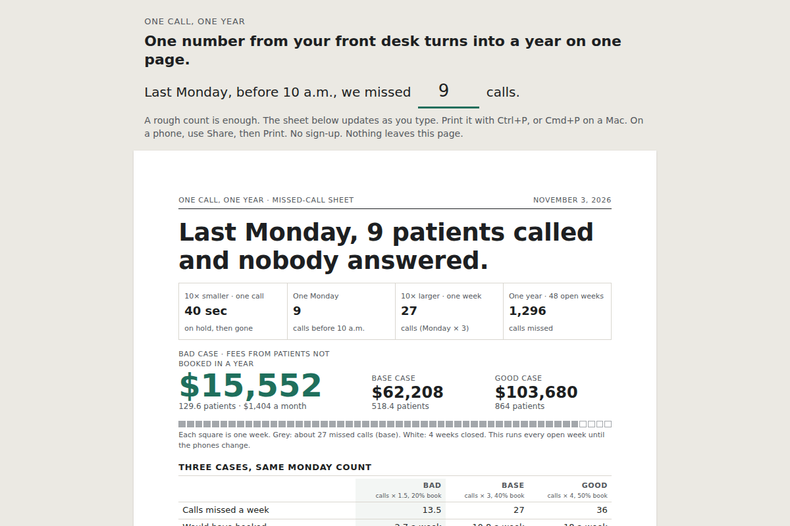

# 2026-11-03: One Call, One Year

[Today](../../README.md) · [Archive](../../ARCHIVE.md)



**Task:** One-pager builder: a few fields about the buyer's opportunity give a clean printable one-page summary they can send on.

**Constraint:** The user does exactly one thing on the page.

**Season:** 2026-10-07

**Decision:** The page asks one number, the calls missed before 10 a.m.

## Asset

<a href="artifact-1.html"></a>

[artifact-1.html](artifact-1.html), led by Choreographer. Model: claude-opus-5-5.

## The session

### Pitch

**1 · Choreographer: One Call, One Year**\
Start at one missed call: 7:52 on a Monday, a patient with a sore back, no answer.\
Ten times larger is a week of them, around 30. Ten times smaller is the 40 seconds they waited before hanging up.\
The user fills one sentence: "Last week we missed __ calls, and it has been like this for about __ months."\
The sheet scales that up to the week, the months already lost, and the next 12.\
Sketch: 52 small squares across the bottom, one per week, with the weeks already lost shaded grey.

**2 · Front-end engineer: Sheet First**\
I build the printed A4 before any input exists: 210 by 297 mm, 18 mm margins, one column.\
If it reads cold on a practice manager's desk, the form above it doesn't matter.\
Top is the cost. Middle is two ways to fix it, run on the same numbers. Bottom is what happens if we're wrong.\
The input sits above the sheet and updates it live. Print uses the browser's own Ctrl+P. No PDF library, no server.\
ONE file, under 40 KB, zero dependencies. That's a day of work, not a week.

**3 · Clinic owner: The Monday Count**\
I don't know my missed calls. Nobody does. I know Monday mornings are bad.\
So ask me about Monday: how many calls did we miss before 10 a.m.? My front desk can tell me that by lunch.\
Show it in patients, not "leads". Show me the hours Dana at the desk gets back.\
The last vendor played me a demo voice. I hung up on it.\
If the number comes out big and easy, I won't believe it. Show the low end.

**4 · Phoenix: Ash Line**\
Burn the form.\
Keep one sentence, in the owner's own number, 28 point, at the top.\
"Last Monday, 9 patients called and nobody answered."\
That is the page. The rest is ash beneath it.

### Clash

**3 · Clinic owner:** Choreographer, two blanks is two things. And I'll guess the months, and you'll build a year on my guess.

**1 · Choreographer:** Then one blank, your Monday count. Nine on Monday times 3 is about 27 a week, and the sheet prints that assumption. The months go on the paper as a pen line: "Like this since ______."

**2 · Front-end engineer:** A pen line I never see QUALIFIES NOTHING. Keep it typed, Choreographer.

**1 · Choreographer:** Engineer, nine on a Monday already tells you the size. How long it has run is a question for the first phone call.

**4 · Phoenix:** One blank. The Choreographer holds.

**2 · Front-end engineer:** Fine. But the sheet says AI answers the first call, Clinic owner. Hide that and patients find out on the phone, and you look WORSE.

**3 · Clinic owner:** Then say who looks after them. "Answered in the clinic's name, booked into your diary, Dana confirms by 11." I'll read that. "AI receptionist" I close.

**1 · Choreographer:** Same 27 calls, two columns. Flat service at $400 a month, or $6 per booking it actually makes. Base case: 40% become bookings at $120, so $1,296 a week. Bad case: half the calls and half the rate gives 2.7 bookings, $324 a week, about $1,400 a month. Flat still clears. Per-booking costs about $70. If nothing books, flat loses $400 and per-booking loses $0.

**3 · Clinic owner:** $1,400 a month I believe. Put the low number first, in bigger type than the high one.

**2 · Front-end engineer:** Low number first, yes. And THE WORD "AI" GOES ON THE SHEET, footer, 8 point. That one I'm not giving up.

### Decision

The page asks one number, the calls missed before 10 a.m. last Monday, and turns it into a printable A4 sheet that shows a year of lost patients, low case first, with two ways to recover them on the same numbers.

Concept: One Call, One Year

- Choreographer: the scaling from one Monday to 27 a week to 48 weeks, and the 52-square strip with lost weeks shaded.
- Front-end engineer: the sheet built first at 210 by 297 mm, a single file under 40 KB, print through Ctrl+P, and "AI" in an 8-point footer line.
- Clinic owner: the Monday count as the only field, "patients" in place of "leads", Dana's hours shown, and the low case printed first at 36 point against 18 point for the high case.
- Phoenix: the owner's own sentence in 28 point at the top of the sheet.
- The Front-end engineer lost the typed months field. One clear number qualifies the call, and a second field breaks the one-thing rule. The Clinic owner lost on keeping "AI" off the sheet, because a patient who finds out on the phone costs more trust than one line in the footer.

Bad case: halving both calls and booking rate leaves 2.7 bookings and $324 a week, $15,552 over 48 weeks against $62,208 in the base case. The flat $400 a month is still covered. Per-booking pays $0 when nothing books. A part-time cover receptionist at $22 an hour for 20 hours costs $1,900 a month in every case, so the AI first answer saves the most when volume drops. Dana reviews every booking before 11, which returns about 1.8 hours a week of callbacks at 4 minutes each. The page holds.

### Build notes

1. Write the `@media print` A4 layout first, with the 28-point sentence, the 36/18-point low and high figures, the two-column comparison, and the 52-square strip. Then add one `<input type="number">` that is hidden in print.
2. Hard-code and print every assumption on the sheet: Monday × 3, 40% and 20% booking rates, $120 per visit, 48 weeks, $400 flat, $6 per booking, $22 an hour cover, and 4 minutes per callback.
3. Add the pen line "Like this since ______" and the footer "First call answered by AI in the clinic's name. Every booking confirmed by your front desk." Keep the file under 40 KB with no external requests.

**Guest:** Phoenix (creature; myth and folklore). The method is drawn from public-domain history, myth, or literature, or invented. The guest speaks in character in original words, never quoting the source, and nothing here is endorsed by anyone.

## Team

```text
Team for 2026-11-03
Season: 2026-10-07

1. Choreographer
   Method: Try it ten times larger and ten times smaller.
   Stance: Speaks for the user.
   Temperament: Answers questions with sketches and numbers.
2. Front-end engineer
   Method: Make the ending first.
   Stance: Checks cost and time.
   Temperament: Gets louder the more sure they are.
3. Clinic owner (buyer; voxxy) [buyer] [new]
   Method: Pain: Loses bookings to missed calls and slow replies. Walks when: It feels like a robot will annoy patients. Opens up when: Patients still feel looked after and staff get time back.
   Stance: Cuts scope.
   Temperament: Distrusts anything that came too easily.
4. Phoenix (creature; myth and folklore) [guest]
   Method: Burn the old version and rebuild from what is left.
   Stance: Adds one bold element.
   Temperament: Speaks rarely, and only in short verdicts.

Constraint: The user does exactly one thing on the page.
Task: One-pager builder: a few fields about the buyer's opportunity give a clean printable one-page summary they can send on.
```

Provider: claude. Model: claude-opus-5-5.
