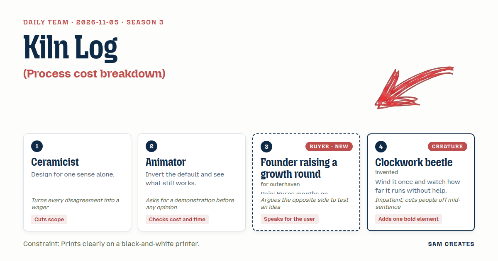
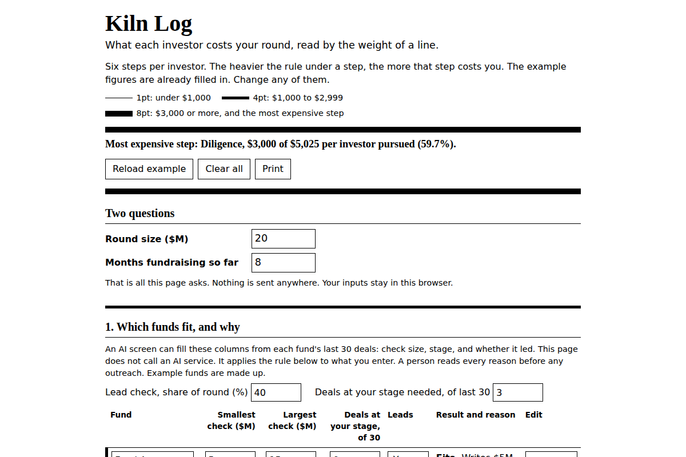

# 2026-11-05: Kiln Log

[Today](../../README.md) · [Archive](../../ARCHIVE.md)



**Task:** Process cost breakdown: each step of a workflow with time and wage gives the cost per case and the most expensive step.

**Constraint:** Prints clearly on a black-and-white printer.

**Season:** 2026-10-07

**Decision:** The page takes six fundraising steps with hours and hourly value, gives the founder's cost per investor pursued, prints the most expensive step as the heaviest rule, shows an AI fit screen of named funds with reasons before any fee appea...

## Asset

<a href="artifact-1.html"></a>

[artifact-1.html](artifact-1.html), led by Ceramicist. Model: claude-opus-5-5.

## The session

### Pitch

**1 · Ceramicist: Kiln Log**\
One sense. Sight, and only the weight of a line.\
No color, no gray fill. Toner smears gray on a cheap laser, same as glaze runs thin on a cold shelf.\
Each fundraising step is a row. The hours set how thick its rule prints: 1pt, 4pt, 8pt.\
The founder sees which step costs most from across the desk, before reading a number.\
Six steps. Hours and hourly value per step. Cost per investor pursued at the bottom. That is the whole pot.\
I'll bet anyone a firing that a seventh step makes it worse.

**2 · Animator: Run It Backwards**\
Default is first email to term sheet. Flip it.\
Start at the last frame: the investor who passed after diligence.\
Play the steps in reverse and count the hours back to the first call.\
Every frame in that reel was wasted, so they all go in the waste column.\
If the reel reads backward, it reads forward too. If it doesn't, the order was hiding something.\
Before anyone argues, print one at 600dpi and hold it up.

**Founder raising a growth round (buyer; outerhaven): No-Fit Ledger**\
Eight months on my last round. Most of it went to firms that were never going to lead.\
So let me argue against my own pain. Maybe diligence isn't the expensive step. Maybe it's the first call that never should have happened.\
The page shows me which investors fit, and why, before it asks me for anything.\
Two questions, tops: round size and how many months I've been at it.\
The word "retainer" in the first screen and I close the tab.

**4 · Clockwork beetle: One Wind**\
Wind once. Then hands off.\
One number in: what an hour of the founder is worth. Everything else runs on defaults.\
Bold part: one heavy bar at the bottom. Months of founder time burned on investors who never fit.\
The bar keeps running until the round closes or the spring gives out.\
Tick, tick, stop. The page goes as far as it goes.

### Clash

**2 · Animator:** Ceramicist, show me the 1pt and the 4pt side by side off the office printer before I believe the weights read apart.

**1 · Ceramicist:** Printed it this morning on the HP in the hall. 1pt, 4pt and 8pt stay distinct at arm's length, and I cut every shaded cell to get there. I'll bet you lunch the founder names the heaviest row in three seconds.

**4 · Clockwork beetle:** Six steps is too many winds. One rate, defaults for the rest, let it—

**Founder raising a growth round (buyer; outerhaven):** Your defaults are someone else's round. My diligence ran 40 hours, not 20. Let me edit every row, but only ask me round size and months in.

**2 · Animator:** Founder, here's the cost of your fit question. An AI screen reads each fund's last 30 deals, check size and stage, and replaces the research and intro chase. That is 3.5 hours down to 0.5 per investor. Across 40 investors at $150 an hour, that's 120 hours, or $18,000, saved before a single call.

**Founder raising a growth round (buyer; outerhaven):** Then show me that fit list first, with the reason next to each fund. Ceramicist, put a retainer column above it and I walk.

**1 · Ceramicist:** The retainer goes second, beside a success-only column, same inputs, bad case under both. Bet you the success column wins once the bad case prints.

**4 · Clockwork beetle:** Bad case. Fit rate halves from 25% to 12.5%, round slips six months, target stays 10 fitting funds. Full pass is 33.5 hours, $5,025 per investor. Usual path: 80 pursued, 70 non-fits, $351,750 of founder time. With the AI screen catching 70% of non-fits at $75 each, 49 cost $3,675 and 21 still cost $105,525. Total $109,200. If the round fails, the retainer loses $25,000 cash and success-only loses $0. It holds.

**2 · Animator:** It holds when the round fails. When it works, a $20M round at 4% success-only is $800,000, against $25,000 plus 2%, which is $425,000. The good case is $375,000 worse and the page has to print that line too.

**Founder raising a growth round (buyer; outerhaven):** Arguing the other side: I'd pay $375,000 to never lose another eight months. I'd forward this only if both columns are honest. Don't tell me which one to pick.

### Decision

The page takes six fundraising steps with hours and hourly value, gives the founder's cost per investor pursued, prints the most expensive step as the heaviest rule, shows an AI fit screen of named funds with reasons before any fee appears, and sets a retainer path beside a success-only path with the same inputs and the bad case under each.

Concept: Kiln Log

- Ceramicist: six rows, line weight as the only visual signal (1pt, 4pt, 8pt), no fills, built for black-and-white print.
- Animator: a "passed at diligence" reel that totals the hours back to the first call. The AI screen and its saving, 120 hours or $18,000 per 40 investors, are printed as a line item.
- Founder raising a growth round (buyer; outerhaven): fit list with reasons comes first. Only two questions are asked: round size and months fundraising. All defaults can be edited. No fee appears until the fit list has shown.
- Clockwork beetle: the page runs on one required input, hourly value. The heavy bottom bar shows months of founder time spent on non-fit investors.
- Lost: the Clockwork beetle lost "one input only" because the founder's diligence hours were double the default. The Ceramicist lost the recommendation line because the Animator showed success-only costs $375,000 more in the good case, so the page prints both cases and recommends neither. Whether the page should lean toward one path stays open.
- Bad case: fit rate halved and a six-month slip. Founder time on non-fits drops from $351,750 to $109,200 with the AI screen, and success-only costs $0 if the round fails. The page holds, and the good-case gap of $800,000 against $425,000 prints beside it.

### Build notes

1. Build `kiln-log.html` with a print stylesheet. Set step rules at 1pt, 4pt and 8pt by thresholds on step cost: under $1,000, $1,000 to $2,999, and $3,000 or more. Drop all background fills. Mark the most expensive step with an 8pt rule and a text label, "Most expensive step". Test on a 600dpi mono laser.
2. Order the page as follows: two questions (round size, months fundraising), fit list with one-line reasons, the six-step table with cost per investor, then the retainer and success-only columns with good case and bad case rows. Defaults are research 2h, intro chase 1.5h, first call 1h, follow-up materials 3h, partner prep 6h, diligence 20h, all at $150/h.
3. Add a footer line under the fee columns: "Fee terms and any term sheet are reviewed and signed off by your CFO or counsel before you commit." Keep the word "retainer" out of the first screen.

**Guest:** Clockwork beetle (creature; invented). The method is drawn from public-domain history, myth, or literature, or invented. The guest speaks in character in original words, never quoting the source, and nothing here is endorsed by anyone.

## Team

```text
Team for 2026-11-05
Season: 2026-10-07

1. Ceramicist
   Method: Design for one sense alone.
   Stance: Cuts scope.
   Temperament: Turns every disagreement into a wager.
2. Animator
   Method: Invert the default and see what still works.
   Stance: Checks cost and time.
   Temperament: Asks for a demonstration before any opinion.
3. Founder raising a growth round (buyer; outerhaven) [buyer] [new]
   Method: Pain: Burns months on investors who never fit. Walks when: Someone wants a fee up front just to make intros. Opens up when: You show which investors fit and why before asking for anything.
   Stance: Speaks for the user.
   Temperament: Argues the opposite side to test an idea.
4. Clockwork beetle (creature; invented) [guest]
   Method: Wind it once and watch how far it runs without help.
   Stance: Adds one bold element.
   Temperament: Impatient; cuts people off mid-sentence.

Constraint: Prints clearly on a black-and-white printer.
Task: Process cost breakdown: each step of a workflow with time and wage gives the cost per case and the most expensive step.
```

Provider: claude. Model: claude-opus-5-5.
