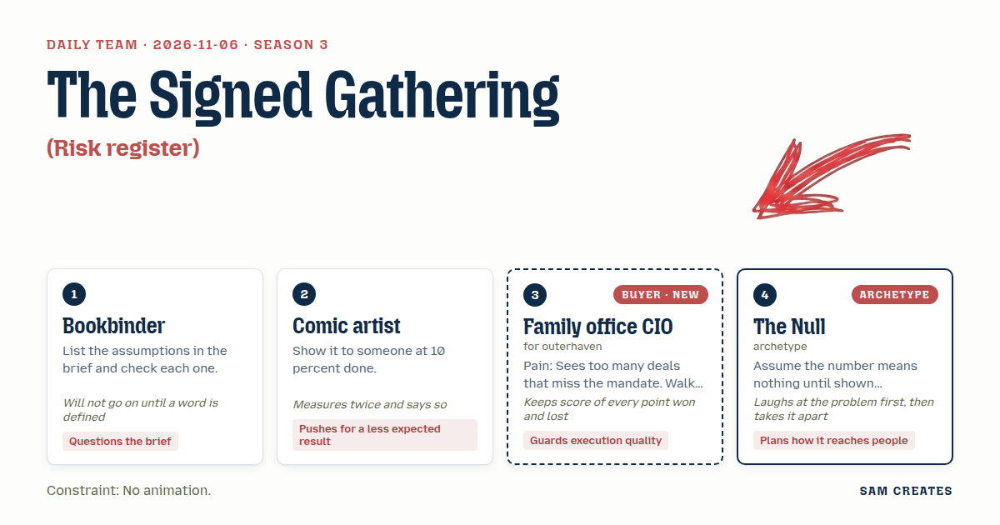
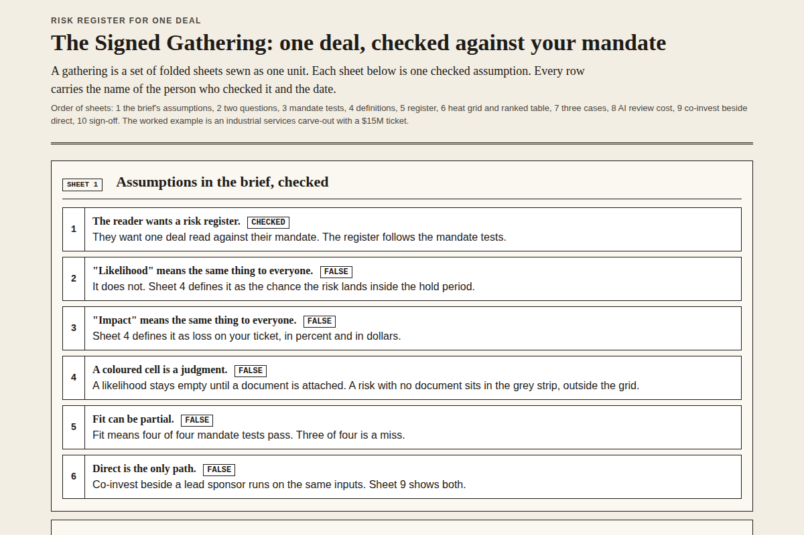

# 2026-11-06: The Signed Gathering

[Today](../../README.md) · [Archive](../../ARCHIVE.md)



**Task:** Risk register: risks with likelihood and impact give a ranked table and a three-by-three heat grid.

**Constraint:** No animation.

**Season:** 2026-10-07

**Decision:** The page shows a family office one deal checked against its own four-test mandate, then a ranked risk table and a three-by-three heat grid, with the co-invest path beside the direct path and the bad case for each.

## Asset

<a href="artifact-1.html"></a>

[artifact-1.html](artifact-1.html), led by Bookbinder. Model: claude-opus-5-5.

## The session

### Pitch

**1 · Bookbinder: The Signed Gathering**\
Before anyone draws a grid, I want the brief's assumptions laid out flat.\
First assumption: the CIO wants a register. I think they want a register of one deal, read against their mandate.\
Second: everyone means the same thing by "likelihood." They don't. On this page it means the chance the risk lands inside the hold period: Low under 20 percent, Medium 20 to 50, High over 50.\
"Impact" means loss on their ticket: under 5 percent, 5 to 25, over 25.\
Each risk row is a checked assumption from the deal memo, with who checked it and the date.

**2 · Comic artist: Nine Panels**\
The heat grid is a page of nine panels. Each cell is one panel, and it contains risk names, not a colour wash.\
Read order runs from the top right, high and high, and ends bottom left. Your eye lands where the trouble is.\
No motion. Static ink. Every panel has a hard border and the same gutter width, and I'll measure them twice.\
The ranked table sits under it like the caption strip.\
I want to show it to an analyst at ten percent done, before we pick the colours.

**Family office CIO (buyer; outerhaven): One Deal, Scored Against My Paper**\
I get forty decks a month. Thirty-one miss the mandate on page one.\
Show me one deal. First section: where it breaks my mandate. That means ticket size, hold period, sector, and control rights.\
Then the operating risks. Ranked. One table.\
If I see "exciting opportunity" or a logo strip of other offices, I close it.\
Ask me two things at most. I'll answer if they're the right two.

**4 · The Null: Zero Until Proven**\
Ha. A heat grid. Somebody colours nine squares and calls it judgment.\
Every likelihood on this page starts empty. It is not Low and it is not Medium. It stays empty until a document is attached to it.\
A risk with no evidence sits in a grey strip beside the grid, outside it.\
Reach: this goes to one office, with their mandate already typed in. One file, one email, one deal. Fifty offices get nothing.

### Clash

**3 · Family office CIO:** Null, if half your grid is grey on open, I read that as a sponsor who hasn't done the work. That's a point against you, and I'm counting it.

**4 · The Null:** That's fair, and it's funny, because the broker version shows you all green and you believe it for a week. Grey says what was checked. Green says what someone hoped.

**1 · Bookbinder:** Comic artist, your panels carry risk names, so where does the definition of "High" live? I won't sign a grid where the reader guesses the scale.

**2 · Comic artist:** In the border. Each axis label prints its range: "High: over 50 percent in hold." I showed a 10 percent mockup to a junior analyst. She read panel nine first, so that confirmed the read order. She missed the scale, and that's why it now sits in the border.

**4 · The Null:** Bookbinder, the shortcut. A direct deal carries about $420k of diligence, and $150k of that is first-pass document review. An AI read of the data room does that pass for about $20k, with named counsel signing off. Or the office co-invests beside the lead sponsor, takes a 15 percent equity share, and carries roughly $60k of broken-deal cost. Put both paths on the page with the same inputs.

**3 · Family office CIO:** Then run the bad case for both. The deal slips six months, EBITDA comes in 20 percent under plan, and the rate rises 200 basis points. On a $15M ticket, base is 2.4x and bad is 1.3x on either path. If the deal breaks, direct with the AI pass loses $290k, down from $420k without it. Co-invest loses $60k. Co-invest wins that one. Mark it.

**1 · Bookbinder:** Agreed, it holds. One more definition: "fit." It means passing all four mandate tests. Three of four is a miss, and the page says "miss."

**2 · Comic artist:** CIO, then the mandate breaks get their own panel row above the grid, in red outline only, no fill. They're binary, so they don't belong in a likelihood scale.

**4 · The Null:** Comic artist, my grey strip stays outside the grid. The CIO wants unproven risks pushed into High, and that's a guess dressed as a number. We haven't settled that.

### Decision

The page shows a family office one deal checked against its own four-test mandate, then a ranked risk table and a three-by-three heat grid, with the co-invest path beside the direct path and the bad case for each.

Concept: The Signed Gathering

- Bookbinder: defined scales for likelihood and impact, a binary definition of "fit," and a checker name and date on every row.
- Comic artist: nine bordered panels read from top right, axis ranges printed in the border, and the mandate-break row above the grid in red outline.
- Family office CIO: the mandate tests come first, one deal only, at most two questions, and no logos or sales language.
- The Null: empty likelihoods until evidence is attached, a grey strip for unproven risks, the AI data-room pass and co-invest comparison, and distribution to one office per file.
- The CIO lost the push to drop the grey strip, because an unproven risk scored as High is a guess. The placement of grey risks stays open: the CIO still wants a count of them printed in the High row.
- Bad case: the deal slips 6 months, EBITDA falls 20 percent, and the rate rises 200 bps. Both paths fall from 2.4x to 1.3x. A broken deal costs $290k direct with the AI pass and $60k co-invest. The page holds and leads with co-invest.

### Build notes

1. Build the heat grid as a static CSS grid of nine cells, 1px borders, and a 12px gutter. Print the ranges on the axis labels. Use no transitions or hover motion. Rank table rows by likelihood band times impact band, and break ties by impact.
2. Add two inputs only: ticket size, from $5M to $50M in a select, and "deals in the last quarter that missed mandate," as a number. The results line states the months of screening time those misses cost, at 3 analyst hours per deck.
3. Add a two-column comparison block with the same inputs for direct and co-invest: diligence cost, AI review saving, broken-deal loss, base MOIC, and bad-case MOIC. Under it, add a sign-off line naming the reviewing counsel and the CFO.

**Guest:** The Null (archetype; archetype). The method is drawn from public-domain history, myth, or literature, or invented. The guest speaks in character in original words, never quoting the source, and nothing here is endorsed by anyone.

## Team

```text
Team for 2026-11-06
Season: 2026-10-07

1. Bookbinder
   Method: List the assumptions in the brief and check each one.
   Stance: Questions the brief.
   Temperament: Will not go on until a word is defined.
2. Comic artist
   Method: Show it to someone at 10 percent done.
   Stance: Pushes for a less expected result.
   Temperament: Measures twice and says so.
3. Family office CIO (buyer; outerhaven) [buyer] [new]
   Method: Pain: Sees too many deals that miss the mandate. Walks when: It reads like a broker blast sent to fifty offices. Opens up when: You know the mandate and bring one deal that fits it.
   Stance: Guards execution quality.
   Temperament: Keeps score of every point won and lost.
4. The Null (archetype; archetype) [guest]
   Method: Assume the number means nothing until shown otherwise.
   Stance: Plans how it reaches people.
   Temperament: Laughs at the problem first, then takes it apart.

Constraint: No animation.
Task: Risk register: risks with likelihood and impact give a ranked table and a three-by-three heat grid.
```

Provider: claude. Model: claude-opus-5-5.
