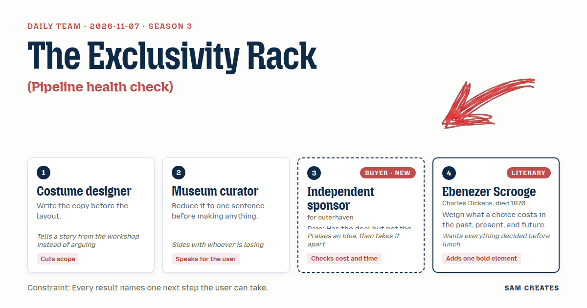
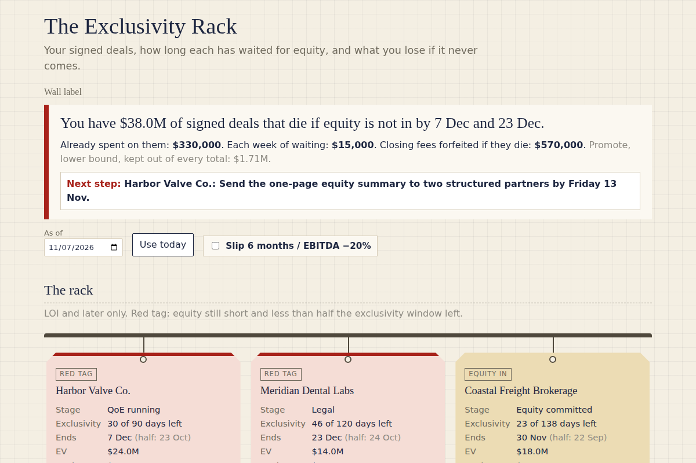

# 2026-11-07: The Exclusivity Rack

[Today](../../README.md) · [Archive](../../ARCHIVE.md)



**Task:** Pipeline health check: deals by stage and age give a list of stalled deals and the total value at risk.

**Constraint:** Every result names one next step the user can take.

**Season:** 2026-10-07

**Decision:** The page takes a sponsor's signed deals, flags each one stalled by days left on exclusivity against its equity gap, totals the EV at risk and the money already spent, and shows a control path and a sponsor-held path side by side, each wi...

## Asset

<a href="artifact-1.html"></a>

[artifact-1.html](artifact-1.html), led by Costume designer. Model: claude-opus-5-5.

## The session

### Pitch

**1 · Costume designer: The Exclusivity Rack**\
Copy first, before any grid: "Your signed deals, how long each has waited for equity, and what you lose if it never comes."\
Cut the rack to LOI and later. Teasers and first calls stay in the back room.\
Each deal hangs with one tag: stage, days in stage, equity gap, exclusivity end date.\
Red tag when equity is short and exclusivity has under 21 days left.\
Two questions decide if we call: the EV of your largest deal under LOI, and how many months you have been raising for it.\
Every tag ends in one action. No tag says "monitor."

**2 · Museum curator: One Wall Label**\
The sentence: "You have $X of signed deals that die if equity is not in by these dates."\
That sentence is the top of the page. Everything below it is the object list.\
The visitor is a person with a signed LOI, an anxious seller, and their own savings in the legal bills.\
They do not want a dashboard. They want to know which deal to call about first.\
One label per deal, read in five seconds.

**Independent sponsor (buyer; outerhaven): Days Until the Seller Walks**\
Stages I actually live in: LOI signed, QoE running, legal, equity committed, closed.\
Age means days left on exclusivity. Days since sourcing means nothing to me.\
Value at risk is the EV of every deal with an equity gap and under 30 days of exclusivity.\
Show me what I have already spent on each one. That is my money.\
Keep my name on the deal and on the board seat. Ask about anything else.

**4 · Ebenezer Scrooge: The Three-Column Ledger**\
Every deal gets three columns, and I will hear no argument against them.\
What is already spent and cannot be recovered: the accountants, the lawyers, the flights.\
What each week of waiting costs now: the seller cooling, the price creeping.\
What is forfeited if it dies: the closing fee, and the share of the gain that was to be yours.\
My bold addition is that last column, totalled across the whole rack, in large figures.\
Settle it by noon.

### Clash

**3 · Independent sponsor:** Costume designer, the rack is the right picture, and cutting at LOI is the first thing anyone has done that matches my week. But a red tag at 21 days is too late. My last two sellers started taking other calls at day 45 of 90.

**1 · Costume designer:** Independent sponsor, at the shop we stopped pinning the hem on the dress rehearsal and started pinning it at the first fitting, because the alteration queue was the real deadline. So the red tag moves to half the exclusivity window left. And the plotter cuts the pattern before I touch fabric: AI reads the LOI for the exclusivity date and break terms, and puts the seller's trailing twelve months in order before the $40,000 QoE bill. If the deal dies in week three, that $40,000 is never spent. Your accountant still signs off on the numbers.

**4 · Ebenezer Scrooge:** Independent sponsor, put two rows on every deal with the same inputs. In the first, a control fund writes all the equity, takes the board, and pays you a closing fee once. In the second, structured minority equity fills the gap and you keep the seat and the stake. One payment against a share that lasts. And the forfeited column stays in the total.

**3 · Independent sponsor:** The two rows are good. That is the comparison nobody shows me before they ask for control. The forfeited promote, though, is a five-year guess dressed as a number. The last platform that showed me "$4.2M carry at risk" also called me a broker in the same email. I closed the tab on both.

**2 · Museum curator:** Independent sponsor, I am with Scrooge on this one. The visitor came to feel what waiting costs. Show the promote as a lower bound only, under each row, kept out of the main total.

**3 · Independent sponsor:** Then here is the bad case. The $24M deal: $9M equity gap, $120,000 already spent, equity slips six months, and EBITDA falls 20% from $4.0M to $3.2M. Control path: I take a 1.5% fee, $360,000, and I am done. Structured path: a 12% pref on $9M is $1.08M a year, and $3.2M of EBITDA covers it 2.9 times. If the deal dies outright, the $120,000 is gone on both paths, and the page has to say that.

**4 · Ebenezer Scrooge:** Costume designer, you hold the shears. The promote goes in the total, and you decide before lunch.

**1 · Costume designer:** Scrooge, a director once took an unpriced sketch to the producer as the budget, and we built from it for a month. A lower bound under the row tells the truth. A lower bound inside the total starts to look like a promise.

**2 · Museum curator:** Costume designer, keep "one action" literal. "Send the equity summary to two partners by Friday" counts as an action. "Review pipeline" does not.

### Decision

The page takes a sponsor's signed deals, flags each one stalled by days left on exclusivity against its equity gap, totals the EV at risk and the money already spent, and shows a control path and a sponsor-held path side by side, each with one next step.

Concept: The Exclusivity Rack

- Costume designer: the rack of LOI-and-later deals, one tag per deal, the copy-first headline, the two qualifying questions, and AI reading the LOI and cleaning the trailing twelve months before the QoE.
- Museum curator: the one-sentence top line with the dollar figure and dates, and a literal next action on every tag.
- Independent sponsor: the real stages, age measured as exclusivity days left, the red tag at half the window, and the bad case on the $24M deal.
- Ebenezer Scrooge: the three-column ledger of spent, weekly cost, and forfeited, plus the two-row comparison of control fund against structured minority equity.
- Lost: Scrooge and the Curator lost on putting the promote in the headline total. The sponsor named that exact number as the moment he closes a tab. The promote shows as a lower bound under each row. Scrooge still holds that it belongs in the total, and the question stays open.
- Bad case: equity six months late and EBITDA down 20% on a $24M deal. The structured path still covers a 12% pref 2.9 times. The control path pays $360,000 once. A dead deal shows the $120,000 loss on both rows. The page holds, so the two-row comparison ships at full size.

### Build notes

1. Build the input table with one row per deal: name, stage (LOI, QoE, legal, equity committed), EV, equity gap, exclusivity end date, spent to date. Flag a row stalled when the gap is above zero and less than half the window remains. Sum the EV of stalled rows into the top sentence.
2. Under each stalled row, add a two-row panel. Control fund: closing fee at 1.5% of EV, no board seat. Structured minority: 12% pref on the gap, EBITDA coverage ratio, sponsor keeps the seat. Add a "slip 6 months / EBITDA −20%" toggle that recalculates both paths. Show the promote as a grey lower bound, excluded from the total.
3. Write the next-step rules as plain strings, keyed to state. Red with gap over $5M: "Send the one-page equity summary to two structured partners by Friday." QoE not started: "Upload the LOI and trailing twelve months for AI pre-read before engaging accountants; your accountant signs off." End the page with the two questions, EV and months raising, and a booking link.

**Guest:** Ebenezer Scrooge (literary; Charles Dickens, died 1870). The method is drawn from public-domain history, myth, or literature, or invented. The guest speaks in character in original words, never quoting the source, and nothing here is endorsed by anyone.

## Team

```text
Team for 2026-11-07
Season: 2026-10-07

1. Costume designer
   Method: Write the copy before the layout.
   Stance: Cuts scope.
   Temperament: Tells a story from the workshop instead of arguing.
2. Museum curator
   Method: Reduce it to one sentence before making anything.
   Stance: Speaks for the user.
   Temperament: Sides with whoever is losing.
3. Independent sponsor (buyer; outerhaven) [buyer] [new]
   Method: Pain: Has the deal but not the equity to close it. Walks when: It treats them like a broker or tries to take the deal. Opens up when: You respect their deal and bring capital that keeps them in control.
   Stance: Checks cost and time.
   Temperament: Praises an idea, then takes it apart.
4. Ebenezer Scrooge (literary; Charles Dickens, died 1870) [guest]
   Method: Weigh what a choice costs in the past, present, and future.
   Stance: Adds one bold element.
   Temperament: Wants everything decided before lunch.

Constraint: Every result names one next step the user can take.
Task: Pipeline health check: deals by stage and age give a list of stalled deals and the total value at risk.
```

Provider: claude. Model: claude-opus-5-5.
