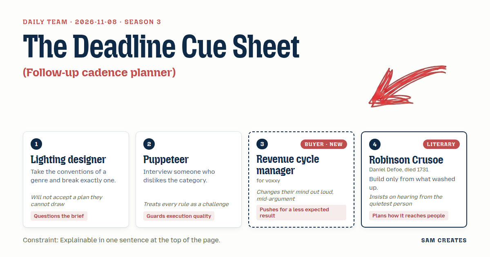
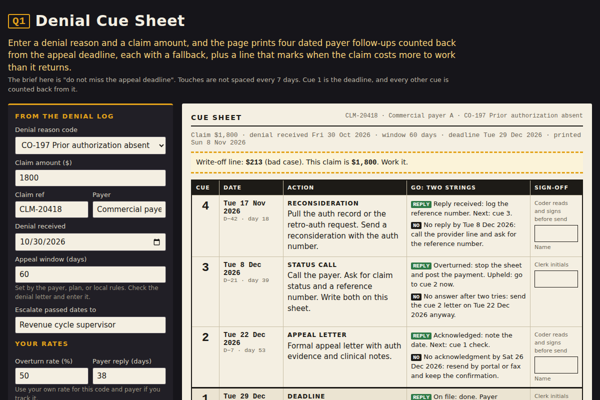

# 2026-11-08: The Deadline Cue Sheet

[Today](../../README.md) · [Archive](../../ARCHIVE.md)



**Task:** Follow-up cadence planner: a lead source and deal size give a dated sequence of follow-up touches, printable.

**Constraint:** Explainable in one sentence at the top of the page.

**Season:** 2026-10-07

**Decision:** The page takes a denial reason and a claim amount and prints a dated sequence of payer follow-ups counted back from the appeal deadline, each with a fallback, and a line marking where the claim costs more to work than it returns.

## Asset

<a href="artifact-1.html"></a>

[artifact-1.html](artifact-1.html), led by Lighting designer. Model: claude-opus-5-5.

## The session

### Pitch

**1 · Lighting designer: The Deadline Cue Sheet**\
Every follow-up planner spaces touches evenly. Day 3, day 7, day 14.\
I break that one rule and keep the rest.\
Cue 1 is the appeal deadline. Every other cue is counted back from it.\
The sheet prints like a cue sheet: number, date, action, the go condition.\
If I can't draw it on one A4 page, it isn't a plan.\
But first: is "follow-up" even the brief, or is it really "stop missing deadlines"?

**2 · Puppeteer: Strings With a Fallback**\
I talked to a biller who hates every follow-up tool she's been given.\
Her words, more or less: they schedule a call to a payer that never picks up, then schedule another.\
So each touch on my sheet has two strings. If the payer replies, take this one. If not by this date, take that one.\
A dated list is fine. A dated list with no fallback breaks on day 30.\
I'll build it so a tired person can't misread it at 4:40 on a Friday.

**3 · Revenue cycle manager: Start From My Denial Log**\
I already track denial reason codes and rework hours by payer. Start there or lose me.\
Two inputs: the denial reason and the claim amount. That's what's on my screen.\
Give me the dated touches. Then tell me something I don't expect.\
For example: this claim costs more to chase than it returns. Write it off.\
Nobody's tool has ever told me to stop working a claim.

**4 · Robinson Crusoe: What the Tide Left on the Desk**\
I make nothing from what is not already on the shore.\
On this desk the tide has left a remittance, a denial letter, a payer's appeal window. That is the timber.\
The page asks for nothing the clerk does not already hold in her hand.\
And the sheet must reach the one who makes the calls. She is not in this room.\
I would pin it beside her phone, not send it to her inbox.

### Clash

**3 · Revenue cycle manager:** Lighting designer, our slowest commercial payer takes 38 days just to acknowledge a reconsideration. Your evenly spaced touches were never real for us anyway, so I'm with you on breaking that rule.

**1 · Lighting designer:** Then the rule I break is the whole sheet, Revenue cycle manager. The deadline sits at the bottom of the page and every cue climbs up from it. I've drawn it. Four cues fit on half a page, and the write-off line runs across the top.

**2 · Puppeteer:** Lighting designer, half a page works only if each cue has its fallback printed beside it. "No acknowledgment by the 14th, call the provider line, ask for the reference number." Without that, the clerk improvises, and improvising is where claims die.

**4 · Robinson Crusoe:** Revenue cycle manager, you have spoken for yourself. The woman on hold with the payer has not spoken. What does she do when the date on the sheet has already passed?

**3 · Revenue cycle manager:** She flags it and moves on. Actually, no. That's exactly how we lose them. I've changed my mind. The sheet has to say "date passed, escalate to the supervisor today" in plain words. The flag goes to me, not to her queue.

**2 · Puppeteer:** Revenue cycle manager, I'll accept the AI drafting the appeal letter from the denial reason code. It cuts drafting from 20 minutes to about 5. I won't accept it going out unread. The sheet prints a sign-off box for a named coder on every letter cue.

**4 · Robinson Crusoe:** Let us run the worst weather. Claim of $1,800, four touches at 25 minutes each, staff at $32 an hour, so $53 to work it. Overturn rate falls from 50 percent to 25 percent, and the payer slips 45 days. Expected recovery is $450. The claim still pays for the work. A $150 claim does not, because anything under $212 loses money at that rate.

**1 · Lighting designer:** That gives us the shortcut, Revenue cycle manager. Below $212 the page shows a recovery partner on a 25 percent share next to in-house work, with the same inputs. In the bad case the partner costs nothing on a lost claim and the in-house team still spends $53.

**3 · Revenue cycle manager:** Lighting designer, the last contingency vendor took 30 percent of claims that would have paid on resubmission anyway. I'll forward a page that tells me to write off. I won't forward one that sells me a vendor.

**2 · Puppeteer:** Then label it honestly, Revenue cycle manager. It's a comparison with your numbers in it, not a recommendation. Whether it stays on the printed sheet is still open, and I'd leave it off the clerk's copy.

### Decision

The page takes a denial reason and a claim amount and prints a dated sequence of payer follow-ups counted back from the appeal deadline, each with a fallback, and a line marking where the claim costs more to work than it returns.

Concept: The Deadline Cue Sheet

- Lighting designer: cues counted back from the appeal deadline, the cue-sheet layout on one A4 page, and the write-off line across the top.
- Puppeteer: a fallback action printed beside every cue, and a named-coder sign-off box on every AI-drafted letter.
- Revenue cycle manager: the two inputs from the denial log, the write-off verdict, the "date passed, escalate today" line routed to the supervisor, and the two qualifying questions (denials per month, months the backlog has run).
- Robinson Crusoe: no input the clerk does not already hold, the bad-case run, and a clerk's copy built to pin beside the phone.
- Lost: the Revenue cycle manager lost the argument to drop the recovery-partner comparison. It stays on the manager's copy below $212 because it covers the bad case for small claims. It is labelled as a comparison and stays off the clerk's copy. Whether it belongs on the printed sheet at all is still open between the Puppeteer and the Lighting designer.
- Bad case: overturn rate halved to 25 percent and payer response slipped 45 days. A $1,800 claim still returns $450 against $53 of work. Claims under $212 do not hold in-house, so the page marks them write-off or partner rather than claiming every denial is worth working.

### Build notes

1. Inputs: a denial reason dropdown keyed to standard reason codes, a claim amount, a payer appeal window in days (default 60, editable), and the two qualifying fields. Output: four cues dated backward from the deadline. Any cue already in the past turns into "escalate to supervisor today."
2. Result block: per-claim work cost (touches × minutes × hourly rate), expected recovery at the base overturn rate and at half of it, and the write-off threshold. Below the result, a monthly figure: denials per month × months running × rework hours, so the manager sees the size of the backlog.
3. Print CSS: two layouts. The clerk's copy fits one A4 page with cues, fallbacks, and coder sign-off boxes. The manager's copy adds the in-house versus 25 percent share comparison and the AI drafting saving of 15 minutes per letter cue. The one-sentence summary prints at the top of both copies.

**Guest:** Robinson Crusoe (literary; Daniel Defoe, died 1731). The method is drawn from public-domain history, myth, or literature, or invented. The guest speaks in character in original words, never quoting the source, and nothing here is endorsed by anyone.

## Team

```text
Team for 2026-11-08
Season: 2026-10-07

1. Lighting designer
   Method: Take the conventions of a genre and break exactly one.
   Stance: Questions the brief.
   Temperament: Will not accept a plan they cannot draw.
2. Puppeteer
   Method: Interview someone who dislikes the category.
   Stance: Guards execution quality.
   Temperament: Treats every rule as a challenge.
3. Revenue cycle manager (buyer; voxxy) [buyer] [new]
   Method: Pain: Staff time drains into prior authorisations and denials. Walks when: It ignores how payers behave in practice. Opens up when: It starts from the denial reasons and rework hours they already track.
   Stance: Pushes for a less expected result.
   Temperament: Changes their mind out loud, mid-argument.
4. Robinson Crusoe (literary; Daniel Defoe, died 1731) [guest]
   Method: Build only from what washed up.
   Stance: Plans how it reaches people.
   Temperament: Insists on hearing from the quietest person.

Constraint: Explainable in one sentence at the top of the page.
Task: Follow-up cadence planner: a lead source and deal size give a dated sequence of follow-up touches, printable.
```

Provider: claude. Model: claude-opus-5-5.
