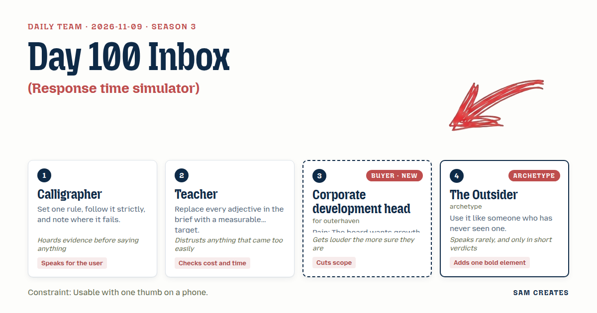
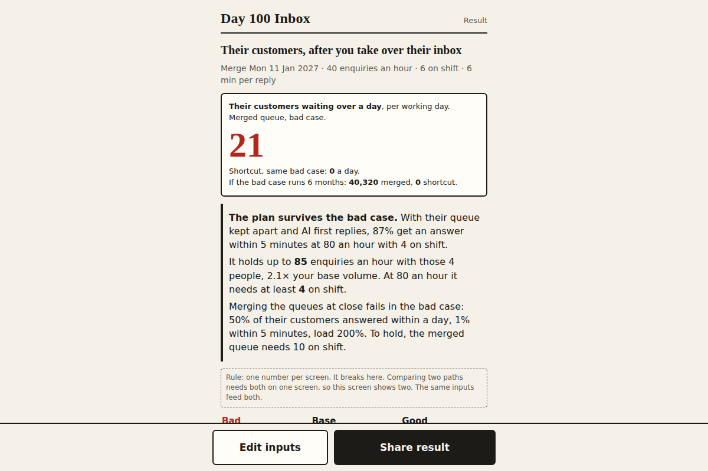

# 2026-11-09: Day 100 Inbox

[Today](../../README.md) · [Archive](../../ARCHIVE.md)



**Task:** Response time simulator: enquiries per hour and reply delays give the share answered within five minutes, one hour, and one day.

**Constraint:** Usable with one thumb on a phone.

**Season:** 2026-10-07

**Decision:** The page takes a target's enquiries per hour, the staff answering them, and minutes per reply, and shows on a phone what share of the target's customers get an answer within five minutes, one hour, and one day under two integration paths.

## Asset

<a href="artifact-1.html"></a>

[artifact-1.html](artifact-1.html), led by Calligrapher. Model: claude-opus-5-5.

## The session

### Pitch

**1 · Calligrapher: One Stroke Per Screen**\
One rule. Each screen asks for one number, set with a stepper the size of a thumb pad.\
Three screens: enquiries per hour, people answering, minutes per reply.\
The fourth screen draws three bars. Five minutes. One hour. One day.\
I will follow the rule until it breaks. I expect it to break at the result, where the user wants to compare two cases.\
I will note that break on the page and keep it.

**2 · Teacher: Measured Queue**\
The brief says "response time." I want the target in numbers: 80% answered inside five minutes, 95% inside one hour, 100% inside one day.\
Each bar shows the target as a tick mark. The user sees the gap.\
Then add cost: staff hours per week needed to close the gap.\
A result with no cost attached is a result nobody has checked.\
And the queue maths has to be Erlang C. An average delay alone looks right and misleads.

**3 · Corporate development head: Day 100 Inbox**\
My board wants two acquisitions this year. I have seen what kills them, and price is rarely it.\
It's month three, when the target's customers email and nobody answers because we merged their support into ours.\
So the inputs are theirs, after close. Their enquiries, our people, the week we merge the queues.\
Show me how many of their customers wait a day. That's the revenue I paid for walking out.\
Two screens. Not six. If I have to scroll, I'm gone.

**4 · The Outsider: The Ringing Phone**\
A counter. Customers waiting. It climbs while you look.\
Make it climb.

### Clash

**3 · Corporate development head:** Teacher, cut the cost screen. I don't staff support. I need the waiting customers, and that's all.

**2 · Teacher:** Then you get a number with no price on it. Your integration lead will ask what fixing it costs, and you will not have the answer.

**1 · Calligrapher:** I have watched three people use the draft on a phone. All three asked "what do I do about it" after the bars. Teacher is right. The cost stays, as one line under the bars, not a screen.

**3 · Corporate development head:** One line. Fine. But the first question is the merge date, not enquiries per hour. My week starts with the close calendar, not a queue.

**4 · The Outsider:** Show two paths. Merge now. Merge later.

**1 · Calligrapher:** That is where my rule breaks. Two paths means two results on one screen. I will allow it once, side by side, same inputs. Usual path: merge queues at close. Shortcut: target keeps its own queue for six months, and AI drafts every first reply and closes routine ones like "does my contract change."

**2 · Teacher:** That came too easily. Bad case: announcement week, enquiries double from 40 to 80 an hour, attrition takes staff from 6 to 4, and replies take 6 minutes. Usual path: capacity 40 an hour against 80 arriving. The backlog grows by 40 an hour, reaches 320 by day's end, and about half are answered inside a day. Shortcut: AI closes 40%, so 48 an hour reach 4 people at 4 minutes each. That is 80% load, 78% of the human queue inside five minutes, and 87% overall. Nearly 100% inside an hour. The shortcut holds. The usual path fails.

**3 · Corporate development head:** Now put that half in money. Lost customers times contract value. My board reads pounds, not people.

**1 · Calligrapher:** No. Your users guess contract value badly, and a wrong pound figure gets the page dismissed. Customers waiting a day is a number they entered themselves. It stays a count.

### Decision

The page takes a target's enquiries per hour, the staff answering them, and minutes per reply, and shows on a phone what share of the target's customers get an answer within five minutes, one hour, and one day under two integration paths.

Concept: Day 100 Inbox

- Calligrapher: one input per screen with thumb-sized steppers, and the single noted break where two paths share the result screen.
- Teacher: target ticks at 80%, 95%, and 100%, Erlang C queue maths, and one cost line in staff hours per week.
- Corporate development head: merge date as the first question, customers of the acquired business as the subject, and two qualifying questions: deal size and months until the queues merge.
- The Outsider: a counter of customers waiting more than one day that climbs on the result screen, plus the side-by-side two paths.
- Lost: Corporate development head lost the cut of the cost line, because the integration lead needs a price. The argument over showing money or customer counts is still open. The page ships with counts.
- Bad case: enquiries double to 80 an hour, staff fall from 6 to 4, and replies take 6 minutes. The merged queue answers about 50% inside a day. The separate queue with AI first replies answers 87% inside five minutes. The page holds and shows both results. A named support lead signs off any AI reply that touches contract terms.

### Build notes

1. Write `index.html` with four screens of one stepper each: merge date, enquiries per hour (default 40), staff (default 6), minutes per reply (default 6). Each stepper is at least 56px tall and sits in the bottom third of the viewport.
2. Compute each path with Erlang C, P(wait > t) = P(wait) × e^(−(cμ − λ)t). When load is 100% or higher, switch to a backlog model over an 8-hour day. The AI path removes 40% of volume and sets handling to 4 minutes. Draw three bars per path with target ticks, a cost line in staff hours per week, and a counter that counts up to the number of customers waiting over one day.
3. Under the result, ask two questions: deal size in four bands and months until the queues merge. Add one button to share the result as a URL with the inputs in the query string, so the user can forward it to the integration lead.

**Guest:** The Outsider (archetype; archetype). The method is drawn from public-domain history, myth, or literature, or invented. The guest speaks in character in original words, never quoting the source, and nothing here is endorsed by anyone.

## Team

```text
Team for 2026-11-09
Season: 2026-10-07

1. Calligrapher
   Method: Set one rule, follow it strictly, and note where it fails.
   Stance: Speaks for the user.
   Temperament: Hoards evidence before saying anything.
2. Teacher
   Method: Replace every adjective in the brief with a measurable target.
   Stance: Checks cost and time.
   Temperament: Distrusts anything that came too easily.
3. Corporate development head (buyer; outerhaven) [buyer] [new]
   Method: Pain: The board wants growth by acquisition this year. Walks when: It ignores how the target fits the core business. Opens up when: It speaks to fit and integration, not only price.
   Stance: Cuts scope.
   Temperament: Gets louder the more sure they are.
4. The Outsider (archetype; archetype) [guest]
   Method: Use it like someone who has never seen one.
   Stance: Adds one bold element.
   Temperament: Speaks rarely, and only in short verdicts.

Constraint: Usable with one thumb on a phone.
Task: Response time simulator: enquiries per hour and reply delays give the share answered within five minutes, one hour, and one day.
```

Provider: claude. Model: claude-opus-5-5.
