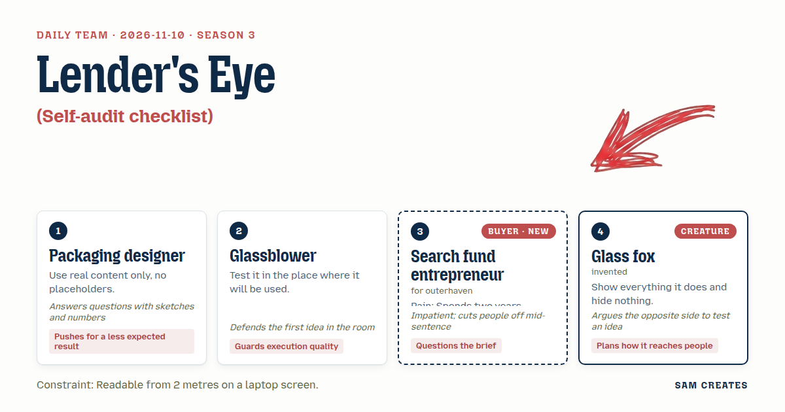
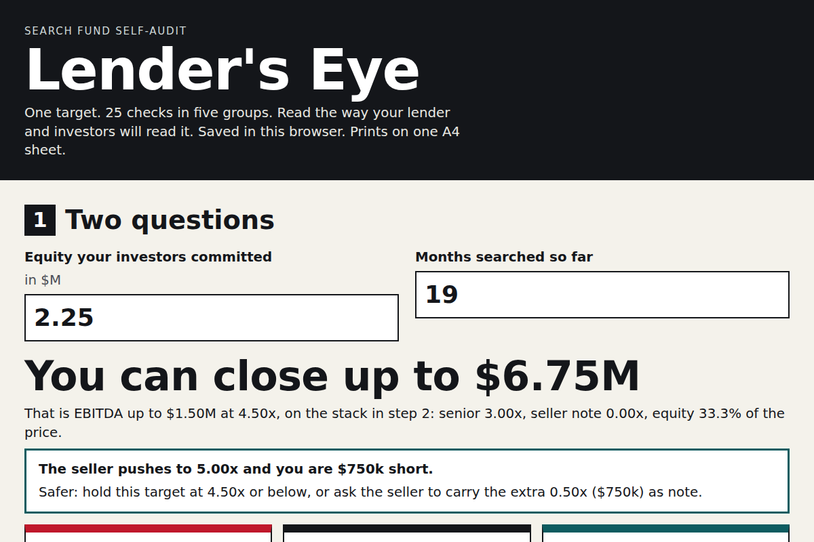

# 2026-11-10: Lender's Eye

[Today](../../README.md) · [Archive](../../ARCHIVE.md)



**Task:** Self-audit checklist: a grouped checklist with notes per item gives a printable summary of gaps, saved in the browser.

**Constraint:** Readable from 2 metres on a laptop screen.

**Season:** 2026-10-07

**Decision:** The page asks for committed equity and months searched, sizes the deals the searcher can close, takes one target through 25 grouped checklist items with notes, and prints a one-page gap summary for investors that includes the minus-25% E...

## Asset

<a href="artifact-1.html"></a>

[artifact-1.html](artifact-1.html), led by Packaging designer. Model: claude-opus-5-5.

## The session

### Pitch

**1 · Packaging designer: Lender's Eye**\
Five groups. Five items each. 25 lines at 28px.\
Every item is a real line from a real term sheet: "Debt service coverage at 1.25x or above on trailing twelve months."\
No "Item 1". No lorem. No sample company called Acme.\
Gap summary prints on one A4 sheet, with a 6mm red bar beside each open gap.\
The less expected part: the sheet is written for the lender's eyes, not yours.\
First question on screen: equity committed. Second: months searched. Nothing else asked.

**2 · Glassblower: Screen-Share Test**\
Try it on the call where it gets used. Monday investor update, laptop on a desk, three people two metres back.\
One group per screen. 32px items. The notes field opens under the item. No popups.\
Checkbox 40px square. A trackpad misses anything smaller on a live call.\
Save to localStorage on every keystroke. If the tab dies mid-call, nothing is lost.\
That is the piece. Get it right before anything clever goes on top.

**Search fund entrepreneur (buyer; outerhaven): Can I Close It**\
Month nineteen. Three LOIs. All three died at the lender.\
Ask what my investors committed. Then tell me the deal size I can close. In that order.\
Anything above that size, I don't want to see it.\
The checklist is this deal against my numbers. Not a generic diligence list off a blog.\
If I can't forward it to my lead investor in one click, I won't open it twice.

**4 · Glass fox: Clear Case**\
Every gap shows. The ones that hurt show first.\
Each item has three states: met, open, unknown. Unknown prints too. Hidden unknowns are how deals die in week ten.\
The summary goes to investors as is. They see what you see, no softer version.\
And I'll take the other side: maybe the seller should get a copy.\
Reach is the forward. One sheet, one email, three readers who each pass it on.

### Clash

**4 · Glass fox:** Search fund entrepreneur, you want oversized deals hidden. I'd show them struck through, with the number that kills each one.

**3 · Search fund entrepreneur:** No. The last broker sent me a deck with a $30M plant on page one and I closed the tab before page two. Hide them.

**1 · Packaging designer:** Glass fox, here's a sketch. One line under the size cap: "Out of range: 2 listings, equity gap $1.4M." A count with no detail. Entrepreneur, that line costs you one second.

**3 · Search fund entrepreneur:** Fine, a count. Now the money. Every LOI I sign, I pay $40k for quality of earnings and $25k for legal before I know whether the lender will lend.

**4 · Glass fox:** Then flip the order. AI reads the seller's P&L and three years of tax returns first, about $300 a deal, and flags add-backs that don't tie to the returns. The full QoE only runs on deals that pass. Your CPA still signs the QoE.

**1 · Packaging designer:** Both paths go side by side on the printout with the same deal. Usual path: $65k spent, then the lender says no. Screen-first path: $300, and the $65k only after the debt test passes. If the deal dies at screening, you lose $300 against $65k. If it dies after, both paths lose about $65k.

**2 · Glassblower:** Packaging designer, run the bad case on the deal she'd sign. $1.5M EBITDA at 4.5x, with $4.5M senior debt at 10% over seven years. That's a $924k annual payment and 1.62x coverage. If EBITDA drops 25% to $1.125M, coverage falls to 1.22x. That's under the 1.25x lenders ask for.

**3 · Search fund entrepreneur:** So the deal I'd put in my investor update fails its own test.

**1 · Packaging designer:** Then the page runs the minus-25% case on every deal and prints it. Cap senior debt at 2.75x, which is $4.125M and $847k a year, and coverage holds at 1.33x in the bad case. A seller note carries the $375k difference.

**2 · Glassblower:** And the seller never sees this sheet. Glass fox, this is where I stop you. It has one audience, and that audience is the investors.

### Decision

The page asks for committed equity and months searched, sizes the deals the searcher can close, takes one target through 25 grouped checklist items with notes, and prints a one-page gap summary for investors that includes the minus-25% EBITDA case and the screen-first diligence path.

Concept: Lender's Eye

- Packaging designer: real term-sheet wording on all 25 items, the two opening questions, the one-page A4 summary with red gap bars, and the two paths printed side by side.
- Glassblower: 32px items, 40px checkboxes, one group per screen, notes inline under each item, a save to localStorage on every keystroke, and a test on a laptop at 2 metres before release.
- Search fund entrepreneur: deal size set from committed equity before any item appears, oversized listings reduced to a single count line, and a one-click forward to the lead investor.
- Glass fox: the three states (met, open, unknown) with unknowns printed, a $300 AI read of the P&L and tax returns ahead of the $65k QoE and legal spend, and CPA sign-off on the QoE.
- Lost: Glass fox lost the struck-through oversized listings, because showing deals the searcher cannot finance is what makes this buyer close the tab. The seller copy is still open between Glass fox and Glassblower, and v1 ships without it.
- Bad case: tested a 25% EBITDA drop on a $1.5M deal. At 3x senior debt, coverage falls to 1.22x and the deal fails. At the 2.75x cap plus a $375k seller note, coverage is 1.33x and the page holds. If diligence fails after screening, both paths lose about $65k. If it fails at screening, the shortcut loses $300 against $65k.

### Build notes

1. Write all 25 items in five groups: Financing fit, Earnings quality, Customer concentration, Owner transition, Legal and lease. Each item gets one line of term-sheet wording and a 400-character notes field. Store each item as `{id, state, note}` in localStorage under the key `lendersEye.v1`.
2. Build the debt test as a fixed block. Inputs are EBITDA, multiple, senior debt multiple, rate, and term. Output is the annual payment and coverage at actual EBITDA and at minus 25%. Coverage below 1.25x turns the row red, and the senior debt cap is solved down in 0.25x steps.
3. Add an `@media print` sheet on one A4 page in 14pt. It holds the open and unknown items first, the debt test, the two diligence paths ($300 then $65k, against $65k) with loss figures for both failure points, and "Months searched" in the header. Before release, check the screen version at 32px on a 13-inch laptop from 2 metres.

**Guest:** Glass fox (creature; invented). The method is drawn from public-domain history, myth, or literature, or invented. The guest speaks in character in original words, never quoting the source, and nothing here is endorsed by anyone.

## Team

```text
Team for 2026-11-10
Season: 2026-10-07

1. Packaging designer
   Method: Use real content only, no placeholders.
   Stance: Pushes for a less expected result.
   Temperament: Answers questions with sketches and numbers.
2. Glassblower
   Method: Test it in the place where it will be used.
   Stance: Guards execution quality.
   Temperament: Defends the first idea in the room.
3. Search fund entrepreneur (buyer; outerhaven) [buyer] [new]
   Method: Pain: Spends two years looking for one business to buy. Walks when: It shows deals they could never finance. Opens up when: Deals are sized to what they and their investors can close.
   Stance: Questions the brief.
   Temperament: Impatient; cuts people off mid-sentence.
4. Glass fox (creature; invented) [guest]
   Method: Show everything it does and hide nothing.
   Stance: Plans how it reaches people.
   Temperament: Argues the opposite side to test an idea.

Constraint: Readable from 2 metres on a laptop screen.
Task: Self-audit checklist: a grouped checklist with notes per item gives a printable summary of gaps, saved in the browser.
```

Provider: claude. Model: claude-opus-5-5.
