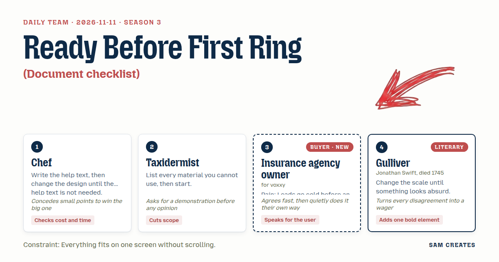
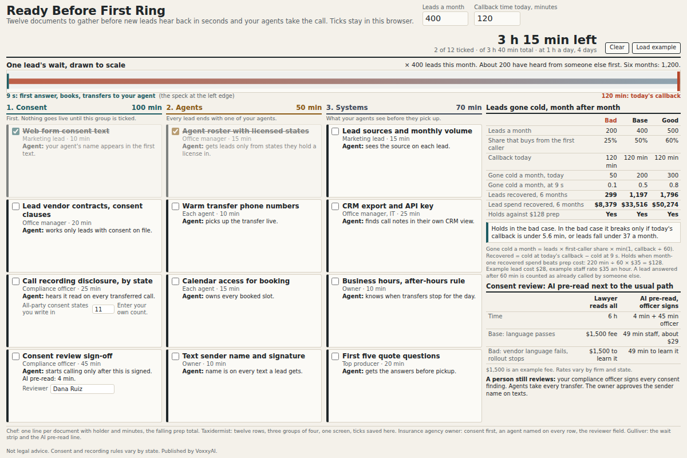

# 2026-11-11: Ready Before First Ring

[Today](../../README.md) · [Archive](../../ARCHIVE.md)



**Task:** Document checklist: the buyer's stage gives a list of documents to prepare before a deal or rollout, grouped and ticked off in the browser.

**Constraint:** Everything fits on one screen without scrolling.

**Season:** 2026-10-07

**Decision:** The page lists twelve documents an insurance agency needs before Voxxy goes live, grouped as Consent, Agents and Systems, ticked and saved in the browser, under a strip that shows one lead's wait at today's callback time against nine sec...

## Asset

<a href="artifact-1.html"></a>

[artifact-1.html](artifact-1.html), led by Chef. Model: claude-opus-5-5.

## The session

### Pitch

**1 · Chef: Ready Before First Ring**\
I wrote the help text first. It ran to nine lines. Too many.\
So each document gets one line: what it is, who holds it, minutes to pull it.\
"Consent text from your web form. Your marketing person. 10 minutes." No help needed after that.\
The top of the screen shows the two numbers that matter: leads a month and your callback time today.\
The bottom shows the total prep time, 3 hours 40 minutes, falling as you tick.\
If prep runs past a week, the rollout costs more than the software does.

**2 · Taxidermist: Twelve, Mounted Flat**\
What I can't use: no scroll, no accordions, no PDF download, no login, no second page, no "learn more."\
That leaves twelve items in three groups. Four each. Consent, Agents, Systems.\
Anything else is a skin that won't take the form. Cut it.\
Ticks live in the browser. Close the tab, come back, still ticked.\
I don't vote on the layout until I see twelve rows fit on a 768-pixel laptop screen.\
Show me the screen first.

**Insurance agency owner (buyer; voxxy): Seconds, With My Agents On**\
My leads cost me $28 each. Half of them buy from whoever calls first.\
The last voice vendor never asked about consent. My E&O carrier did.\
So consent goes first, at the top, before anything about speed.\
Every item should say where my agent comes in. Who takes the warm transfer. Whose name is on the text.\
Don't call it a bot. Don't say "automated outreach." I hear those and I'm gone.\
Show me that a new lead hears from us in seconds and my agent picks up the call.

**4 · Gulliver: The Lead's Hour, Enlarged**\
Take one lead. Give it a clock the width of the screen.\
At the left edge, the form is sent. At nine seconds, the first answer. At two hours, the agency's usual callback.\
Draw both marks on the same line. The two-hour mark sits so far off that the nine-second one looks like a speck.\
Then stack the month's leads behind it, 400 of them, each one cooling on that long bar.\
One thin strip across the top. That is my addition, and I will defend it.\
I'll wager the owner looks at the strip before reading a single item.

### Clash

**2 · Taxidermist:** Gulliver, your strip costs a row. Twelve items and two input fields already fill 768 pixels. Show me it fits or it goes.

**4 · Gulliver:** Then I'll wager my strip against your fourth Systems item. Put both on the screen and let the owner choose which one gets read. I say "API key" loses.

**3 · Insurance agency owner:** Fine, keep the strip. But the nine-second mark needs an agent on it. If it's just a voice and a clock, my compliance person will read it as a dialer.

**1 · Chef:** Agreed. The nine-second mark reads "Voxxy answers, books, transfers to your agent." I give Gulliver the strip at 40 pixels high. Taxidermist, the twelve stay twelve. I merge the API key and CRM export into one line.

**2 · Taxidermist:** Merging is cheating the count. Two items with two owners in one row means nobody ticks it. Split them, cut the call recording script instead.

**3 · Insurance agency owner:** You can't cut the recording disclosure. Eleven of the states I write in need two-party consent. That item stays. Cut something else, I'll sort it out with my office manager anyway.

**1 · Chef:** Then the pricing comes in. Flat fee is $900 a month. The other path is $12 per booked appointment, capped at $1,200. At 400 leads and 30 percent booked, that's 120 appointments and the cap, $1,200. We keep more of the upside.

**2 · Taxidermist:** Run it at half. 200 leads, 15 percent booked, 30 appointments, $360. The flat fee still bills $900. The owner pays $540 more on the usual path in a bad month.

**4 · Gulliver:** And the consent review. AI reads the lead vendors' contracts and the form text in 4 minutes. A lawyer bills 6 hours, $1,500. If the vendor's consent language fails, the rollout stops, and the owner has paid $1,500 to learn it. With AI, they paid four minutes. I'll wager that line sells more than the strip.

**3 · Insurance agency owner:** AI flags it. My compliance officer signs it. Put her name field on that row or I won't forward this to anyone.

### Decision

The page lists twelve documents an insurance agency needs before Voxxy goes live, grouped as Consent, Agents and Systems, ticked and saved in the browser, under a strip that shows one lead's wait at today's callback time against nine seconds.

Concept: Ready Before First Ring

- Chef: one-line items with owner and minutes, falling total prep time, two inputs (leads per month, current callback time), the flat versus per-appointment comparison.
- Taxidermist: twelve items in three groups of four, no scroll at 768 pixels, ticks saved in localStorage, no login or download.
- Insurance agency owner: Consent group first, each item names where the agent comes in, a reviewer name field on the consent review row, no "bot" or "automated outreach" anywhere.
- Gulliver: the 40-pixel wait strip with the nine-second and callback marks, the AI consent review line with its saved cost.
- Taxidermist lost the merge argument. The API key and CRM export share one row because the owner held the recording disclosure and the count stays at twelve. The split-owner objection is still open, and the build will test whether people tick that row.

Bad case: at 200 leads a month and 15 percent booked, per-appointment pricing costs $360 against $900 flat. A failed consent review costs 4 minutes of AI time instead of $1,500 in legal fees. Months unreached at a 2-hour callback show 6 x 200 = 1,200 leads in half a year. The page holds with this case, and it leads with the per-appointment path.

### Build notes

1. Build a single HTML file with a CSS grid of three columns of four rows. Set the body to `height: 100vh; overflow: hidden` and check it at 1366x768 and 1280x720 before adding the strip.
2. Store ticks and the reviewer name in `localStorage` under one key, `voxxy-checklist-v1`. Recompute the remaining prep minutes and the six-month count of leads gone cold on every input change.
3. Draw the wait strip as an inline SVG 40 pixels high. Scale it to the entered callback time, label the nine-second mark "Voxxy answers, books, transfers to your agent," and put the pricing comparison for base and bad case in a two-row table under it.

**Guest:** Gulliver (literary; Jonathan Swift, died 1745). The method is drawn from public-domain history, myth, or literature, or invented. The guest speaks in character in original words, never quoting the source, and nothing here is endorsed by anyone.

## Team

```text
Team for 2026-11-11
Season: 2026-10-07

1. Chef
   Method: Write the help text, then change the design until the help text is not needed.
   Stance: Checks cost and time.
   Temperament: Concedes small points to win the big one.
2. Taxidermist
   Method: List every material you cannot use, then start.
   Stance: Cuts scope.
   Temperament: Asks for a demonstration before any opinion.
3. Insurance agency owner (buyer; voxxy) [buyer] [new]
   Method: Pain: Leads go cold before an agent calls back. Walks when: It sounds like a robocaller or a compliance risk. Opens up when: Agents stay in the loop and new leads hear back in seconds.
   Stance: Speaks for the user.
   Temperament: Agrees fast, then quietly does it their own way.
4. Gulliver (literary; Jonathan Swift, died 1745) [guest]
   Method: Change the scale until something looks absurd.
   Stance: Adds one bold element.
   Temperament: Turns every disagreement into a wager.

Constraint: Everything fits on one screen without scrolling.
Task: Document checklist: the buyer's stage gives a list of documents to prepare before a deal or rollout, grouped and ticked off in the browser.
```

Provider: claude. Model: claude-opus-5-5.
