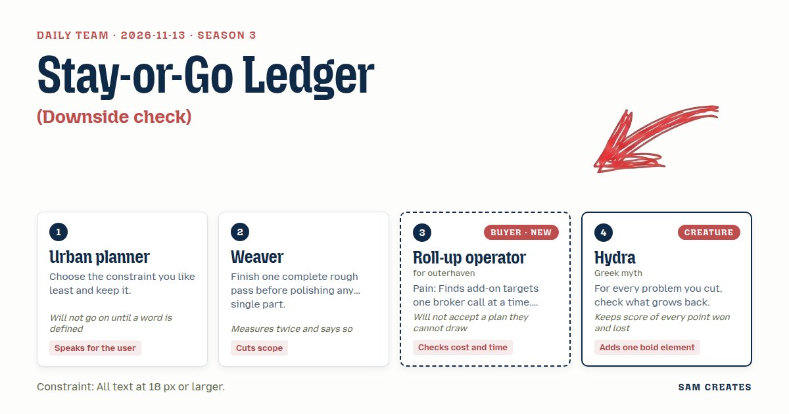
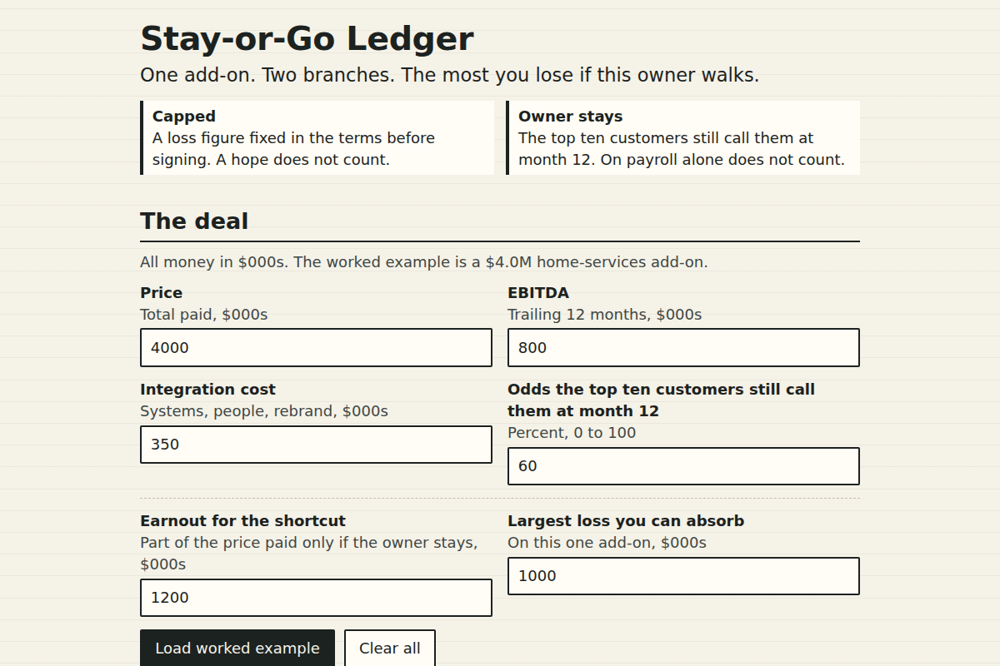

# 2026-11-13: Stay-or-Go Ledger

[Today](../../README.md) · [Archive](../../ARCHIVE.md)



**Task:** Downside check: a plan's cost, likely gain, and odds give the worst case, the expected result, and whether the loss is capped.

**Constraint:** All text at 18 px or larger.

**Season:** 2026-10-07

**Decision:** The page takes one add-on's price, EBITDA, integration cost, and odds the owner stays, then shows the worst case, the expected result, and whether the loss is capped for all-cash and earnout side by side.

## Asset

<a href="artifact-1.html"></a>

[artifact-1.html](artifact-1.html), led by Urban planner. Model: claude-opus-5-5.

## The session

### Pitch

**1 · Urban planner: Stay-or-Go Ledger**\
I keep the 18 px rule. I like it least, and it is the one that will save this page.\
At 18 px only four inputs fit above the fold, so four is what we get.\
First word to pin down: "capped." Capped means a dollar figure written down before signing. A hope does not count.\
The user is an operator with a broker on hold. The page answers one thing: if this owner walks, what is the most I lose.\
Two questions at the end: add-ons closed per year, and deals that died after diligence.\
That second number is the one that runs for months.

**2 · Weaver: One Rough Pass**\
Whole cloth first. Four inputs, three outputs, one verdict line, all ugly, all working.\
Then we polish. Not before.\
I measured the screen twice. At 18 px, a 1280 px wide laptop holds two columns of about 34 characters each.\
That fits two deal structures side by side and nothing else.\
Cut the portfolio view. Cut the sliders. One deal per page.

**3 · Roll-up operator: The Owner Fork**\
Draw it as a fork. Left branch, owner stays. Right branch, owner leaves.\
Each branch shows the price, the integration bill, and what the business is worth afterwards.\
The last three tools I tried treated the owner as a line item. Owners are the deal.\
The broker never tells me who wants out. If the page asks me to rate that, I'll use it.\
Integration cost goes on the fork. I won't read it in a footnote.

**4 · Hydra: What Grows Back**\
You cut a risk and you feel clever. I have felt that blade.\
Pay with an earnout and the loss shrinks. Good. Now look at the stump.\
The owner who is paid only to stay will stay, and sit, and sell nothing.\
My bold piece: under each fix, one row that names what grows back.\
Earnout, retention bonus, rollover stake. Each one gets its new head printed beside it.

### Clash

**1 · Urban planner:** Operator, before we draw anything, "owner stays" needs a definition. On payroll? In the truck? Or still taking calls from the top ten customers?

**3 · Roll-up operator:** The top ten customers still call them at month 12. That is the only kind of staying that pays. Put it in the input label word for word, or I won't trust the odds I type in.

**2 · Weaver:** Hydra, I measured your regrowth row twice. It adds a third line under each column, and at 18 px that pushes the verdict below the fold. I'd cut it in this pass.

**4 · Hydra:** Cut it and watch. The earnout caps the loss at $1.1M, and in the same stroke it breeds an owner who stays and coasts. That counts as one point to me and none to the loom.

**3 · Roll-up operator:** Weaver, he's right. I've paid that earnout. The guy sat in the office for 24 months. Keep one row. I can draw one row.

**2 · Weaver:** Then I'll give ground on the row and take it back on cost. AI reads the CIM and cleans the trailing financials. A dead deal's diligence drops from $180k to $60k. Your controller still signs the quality-of-earnings summary.

**3 · Roll-up operator:** Run my bad case on that. Price $4.0M, integration $350k, odds 60%. The owner leaves, revenue drops 30%, integration doubles. All cash, I'm down $2.3M. On an earnout of $2.8M cash plus $1.2M, I'm down $1.1M, and that figure is on paper before I sign. That holds.

**4 · Hydra:** Then add a third column, the rollover stake. The owner keeps 20% and grows with you instead of waiting out a clock. Two to me.

**2 · Weaver:** No. A third column breaks the 18 px grid. One shortcut beside the usual path, the same inputs, the same bad case. Rollover goes in the next pass, or never.

**1 · Urban planner:** Hydra, define "grows with you" in dollars at month 24 and I'll consider it. Until then it stays out of the page. It does not stay out of the argument.

### Decision

The page takes one add-on's price, EBITDA, integration cost, and odds the owner stays, then shows the worst case, the expected result, and whether the loss is capped for all-cash and earnout side by side.

Concept: Stay-or-Go Ledger

- Urban planner: "Capped" is defined on the page as a loss figure fixed before signing. The 18 px rule sets four inputs. Two closing questions ask for add-ons closed per year and deals that died after diligence.
- Weaver: One rough pass, two columns, a 34-character line length, no portfolio view. AI reads the CIM and cleans the financials, and the page counts the saving per dead deal.
- Roll-up operator: The fork layout with owner-stays and owner-leaves branches, integration cost on each branch, and "top ten customers still call them at month 12" as the input label.
- Hydra: One "what grows back" row under each column. Under all-cash: no lever if the owner leaves. Under earnout: owner stays for pay, not output.
- Lost: Weaver lost the cut of the regrowth row, because the operator confirmed from a past deal that the earnout's new risk is real. Hydra lost the rollover column for now, because "grows with you" has no dollar figure yet. That argument stays open.
- Bad case: the owner leaves, revenue drops 30%, integration doubles to $700k, and the close slips six months. All-cash loses $2.3M and is marked uncapped. Earnout loses $1.1M and is marked capped. Dead-deal diligence at 4 deals a year falls from $720k to $240k with AI review and controller sign-off. The page holds, and at 60% odds it tells the user that all-cash has a negative expected result of minus $0.39M against plus $0.09M for the earnout.

### Build notes

1. Set `html { font-size: 18px; }` and use `rem` everywhere with no value below `1rem`. This covers labels, footnotes, and table cells. Lay out two columns with `max-width: 34ch` each, and stack them below 760 px.
2. Compute in plain JS. Stays value = EBITDA × 1.25 × 5. Leaves value = EBITDA × 0.7 × 5. Net = value − cash paid − integration. Expected = p × stays net + (1 − p) × leaves net. Run the bad case at 2× integration. Show "Capped at $X" only when the leaves-branch loss is fixed by deal terms, otherwise "Not capped".
3. Below the fork, add the two qualifying inputs: add-ons closed per year and deals that died after diligence. Output the annual dead-deal spend at $180k against $60k per deal, with the line "AI draft. Your controller signs." and a contact button that shows only when the dead-deal count is 2 or more.

**Guest:** Hydra (creature; Greek myth). The method is drawn from public-domain history, myth, or literature, or invented. The guest speaks in character in original words, never quoting the source, and nothing here is endorsed by anyone.

## Team

```text
Team for 2026-11-13
Season: 2026-10-07

1. Urban planner
   Method: Choose the constraint you like least and keep it.
   Stance: Speaks for the user.
   Temperament: Will not go on until a word is defined.
2. Weaver
   Method: Finish one complete rough pass before polishing any single part.
   Stance: Cuts scope.
   Temperament: Measures twice and says so.
3. Roll-up operator (buyer; outerhaven) [buyer] [new]
   Method: Pain: Finds add-on targets one broker call at a time. Walks when: It ignores integration cost and whether owners stay. Opens up when: It shows which owners want to stay on and which want out.
   Stance: Checks cost and time.
   Temperament: Will not accept a plan they cannot draw.
4. Hydra (creature; Greek myth) [guest]
   Method: For every problem you cut, check what grows back.
   Stance: Adds one bold element.
   Temperament: Keeps score of every point won and lost.

Constraint: All text at 18 px or larger.
Task: Downside check: a plan's cost, likely gain, and odds give the worst case, the expected result, and whether the loss is capped.
```

Provider: claude. Model: claude-opus-5-5.
