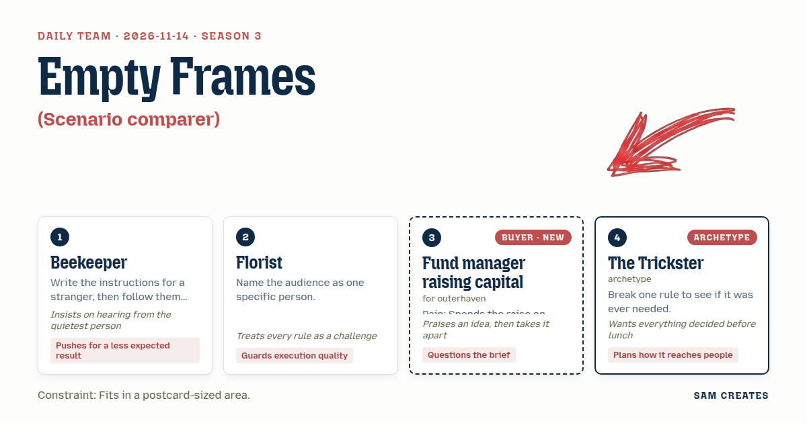
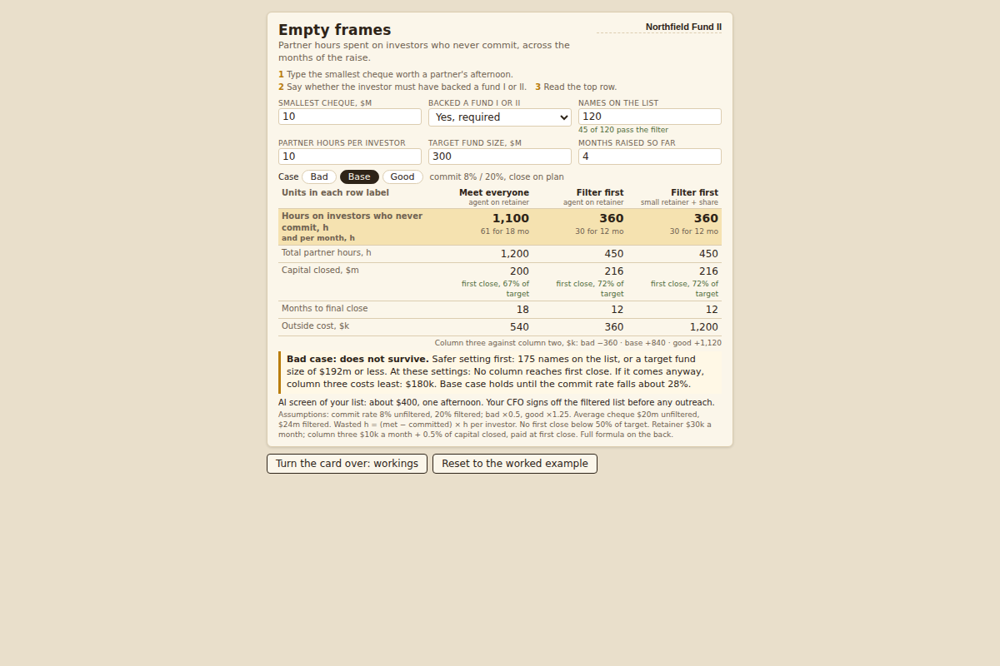

# 2026-11-14: Empty frames

[Today](../../README.md) · [Archive](../../ARCHIVE.md)



**Task:** Scenario comparer: three versions of a plan with the buyer's own numbers give a side-by-side table of outcomes.

**Constraint:** Fits in a postcard-sized area.

**Season:** 2026-10-07

**Decision:** The page asks a fund manager for their smallest worthwhile cheque, a fund I or II track-record filter, list size, partner hours per investor, target fund size, and months raised so far, and shows three fundraising plans side by side on a...

## Asset

<a href="artifact-1.html"></a>

[artifact-1.html](artifact-1.html), led by Beekeeper. Model: claude-opus-5-5.

## The session

### Pitch

**1 · Beekeeper: Empty frames**\
I wrote it for a stranger first. Step one: type the smallest cheque worth a partner's afternoon. Step two: say whether the investor must have backed a fund I or II. Step three: read the top row.\
Then I followed it myself, word for word. The top row wasn't capital raised. It was hours spent on investors who will never write.\
That's the frame you lift every week and find empty. Count it in partner hours, month after month, for as long as the raise stays open.\
Three columns. Meet everyone. Filter first, agent on retainer. Filter first, agent on a small retainer plus a share of what closes.

**2 · Florist: The Tuesday card**\
One person. The managing partner at Outerhaven, Tuesday, 7:40, phone in one hand, between two LP calls.\
A6 is 148 by 105 millimetres. That's the card I tuck into a bouquet, and here it is the whole page.\
Rule says three plans side by side. On a phone that leaves about 110 pixels a column. So the labels go in a left margin and units live in the header, never in the cells.\
Anything that droops at that size gets cut before it reaches her.

**Fund manager: Cheque first**\
Three plans is fine. The brief has the plans wrong.\
I don't need three ways to meet people. I need to see who I stop meeting.\
Last raise: 140 first meetings, 11 cheques. Two partners lost most of a year to it.\
First field is minimum cheque. Second is whether they've backed a fund I or II, yes or no. If anything asks about my "pipeline" before that, I close the tab.\
You get two questions to decide if I'm worth a call. Target size, and how many months I'm already in.

**4 · The Trickster: Rain first**\
Every planner shows the sunny field first. I'll show the storm and see if anyone misses the sun.\
The card opens on the bad case: commit rate halved, close six months late. The good case is one tap away.\
This card travels by thumb. One partner screenshots it and sends it to the other partner before lunch.\
So the whole verdict fits in one image, fund name in the corner, readable with no link.\
Settle the order now and I'll have it drawn by noon.

### Clash

**Fund manager:** Beekeeper, the hours row is the first thing on one of these I'd read twice. Then it falls over. Six hours an investor is low. With the data room and two follow-ups it's closer to ten, and if the page guesses low I stop trusting every number under it.

**1 · Beekeeper:** Fair. Hours becomes an input, default ten. Florist, you've said the least. Where did the stranger trip on my instructions?

**2 · Florist:** Step two. "Enter your list." A partner doesn't have a list. They have a spreadsheet with 300 names and four tabs. Put the cheque filter above the count so the 300 gets cut first. And Trickster, a card that opens on the storm gets sent back. Nobody keeps a postcard of wilted stems.

**4 · The Trickster:** Then I break your rule and keep mine. Every deck shows the good case. A partner forwards the one that frightens the other partner. Fund manager, which would you forward?

**Fund manager:** The bad one, if the numbers are mine. Column three is where you lose me, though. Half a percent on $216m is $1.08m. The last agent who pitched me that put eleven family offices in front of us, and not one had ever written above $5m.

**1 · Beekeeper:** Then the agent works only from the screened list. AI reads the pension filings and Form Ds for all 120 names in an afternoon, about $400. An analyst takes three weeks at about $9k. Your CFO signs off the 45 before the agent sends a single email.

**4 · The Trickster:** Bad case, before anyone eats. Commit rate halves and close slips six months. Meet everyone: 5 commit, $100m, 1,150 hours on investors who never write, 24 months, $720k of retainer, and no first close under $150m. Filter first on retainer: 4 commit, $96m, 410 wasted hours, $540k paid for no close. Filter first on the small retainer plus share: same $96m, $180k paid.

**2 · Florist:** Those three columns only fit 148 by 105 at 12 point if we drop to five rows. I'm cutting "investors met" and "commitments." And Trickster, you still don't get the first view.

**Fund manager:** Trickster, column three holds in your storm, I'll give you that. In the good case it costs $840k more than the retainer, and I'd still pay that before I paid $540k for nothing. Print the $840k under the column, plainly, or I'll assume it's hidden somewhere.

### Decision

The page asks a fund manager for their smallest worthwhile cheque, a fund I or II track-record filter, list size, partner hours per investor, target fund size, and months raised so far, and shows three fundraising plans side by side on a postcard-sized card, with partner hours spent on investors who never commit as the top row and the bad case one tap away.

Concept: Empty frames

Beekeeper: the three-step instructions printed above the inputs, the hours-on-non-committers top row counted across months, and the AI screen of 120 names for about $400 against $9k of analyst time, with the CFO signing off the filtered list.
Florist: the A6 card at 148 × 105 mm, five rows, labels in the left margin, units in the header, written for the managing partner reading on a phone.
Fund manager: the cheque-size and track-record filter as the first two fields, target size and months raised as the only two qualifying questions, and the $840k good-case premium printed under column three.
The Trickster: the bad-case tap on the card face, a card that screenshots whole with the fund name in the corner, and the "no first close" line kept visible in both views.
The Trickster lost the default view: the card opens on the good case, because the buyer has to recognise their own numbers before a halved commit rate means anything to them. The Fund manager lost the push against column three, because it is the only column whose cost falls when the fund misses first close.
Bad case: commit rate halved and close slipped six months on a $300m target with 120 names. Meet everyone wastes 1,150 hours and $720k with no first close. Filter first on retainer wastes 410 hours and $540k with no first close. Filter first on a small retainer plus share wastes 410 hours and $180k. The page holds, and column three is the only plan whose cost shrinks with the result.

### Build notes

1. Build `empty-frames.html` as one file with a 560 × 400 px card, which is A6 at 96 dpi. Order the inputs as follows: smallest cheque, backed a fund I or II (yes/no), names on the list, partner hours per investor (default 10), target fund size (default $300m), months raised so far. Below the inputs, show five rows: hours on investors who never commit, total partner hours, capital closed, months to final close, outside cost.
2. Hard-code the formulas and print the assumptions in a 9 px footer. Commit rate is 8% unfiltered and 20% filtered, halved in the bad case. Average cheque is $20m unfiltered and $24m filtered. Wasted hours equal (met minus committed) × hours per investor. "No first close" shows when capital falls below 50% of target. The retainer is $30k a month. Column three is $10k a month plus 0.5% of capital closed, with the good-case difference against column two printed under it.
3. Add a one-line note under the table: "AI screen of your list: about $400, one afternoon. Your CFO signs off the filtered list before any outreach." Test that the card renders as one screenshot at 375 px phone width with the fund name in the top-right corner. In the bad-case view, the "no first close" line must stay visible without scrolling.

**Guest:** The Trickster (archetype; archetype). The method is drawn from public-domain history, myth, or literature, or invented. The guest speaks in character in original words, never quoting the source, and nothing here is endorsed by anyone.

## Team

```text
Team for 2026-11-14
Season: 2026-10-07

1. Beekeeper
   Method: Write the instructions for a stranger, then follow them exactly yourself.
   Stance: Pushes for a less expected result.
   Temperament: Insists on hearing from the quietest person.
2. Florist
   Method: Name the audience as one specific person.
   Stance: Guards execution quality.
   Temperament: Treats every rule as a challenge.
3. Fund manager raising capital (buyer; outerhaven) [buyer] [new]
   Method: Pain: Spends the raise on investors who will never commit. Walks when: It wastes partner time on people who will not write a cheque. Opens up when: Investors are filtered by cheque size and track record first.
   Stance: Questions the brief.
   Temperament: Praises an idea, then takes it apart.
4. The Trickster (archetype; archetype) [guest]
   Method: Break one rule to see if it was ever needed.
   Stance: Plans how it reaches people.
   Temperament: Wants everything decided before lunch.

Constraint: Fits in a postcard-sized area.
Task: Scenario comparer: three versions of a plan with the buyer's own numbers give a side-by-side table of outcomes.
```

Provider: claude. Model: claude-opus-5-5.
