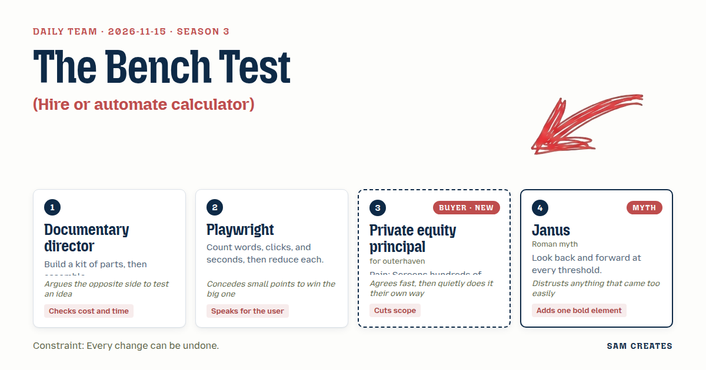
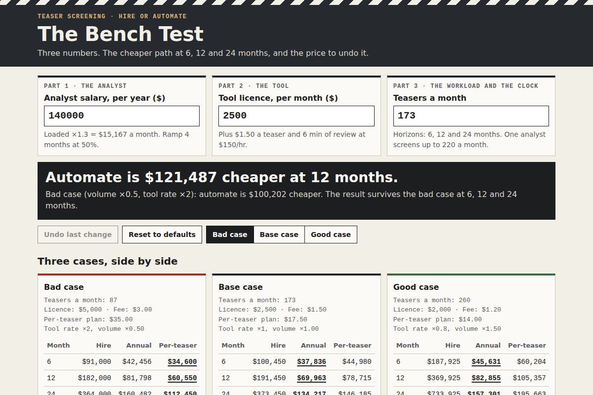

# 2026-11-15: The Bench Test

[Today](../../README.md) · [Archive](../../ARCHIVE.md)



**Task:** Hire or automate calculator: a role's salary, ramp time, and workload against a tool's cost give the cheaper path at 6, 12, and 24 months.

**Constraint:** Every change can be undone.

**Season:** 2026-10-07

**Decision:** The page takes three inputs and returns the cheaper of hire or automate at 6, 12 and 24 months for teaser screening, with every assumption listed, an undo cost for each path, and the bad case beside the base case.

## Asset

<a href="artifact-1.html"></a>

[artifact-1.html](artifact-1.html), led by Documentary director. Model: claude-opus-5-5.

## The session

### Pitch

**1 · Documentary director: The Bench Test**\
Shoot every part separately, then cut.\
Part one: the analyst. Salary, loaded cost, ramp months.\
Part two: the tool. Licence, per-teaser fee, review minutes.\
Part three: the clock. 6, 12, 24 months, side by side.\
Devil's advocate: maybe the hire wins. A good associate finds the deal the tool never flags. The page has to let that happen.

**2 · Playwright: Three Fields**\
Count it. A principal gives this ninety seconds, maybe.\
So three inputs on screen: teasers a month, analyst salary, tool cost per month.\
Everything else defaults, visible, one click to change.\
Result in one line: "Automate is $X cheaper at 12 months."\
Under 40 words above the fold. No login. No email gate before the number.

**Private equity principal (buyer; outerhaven): Show Me the Add-Backs**\
I read 300 teasers a quarter. Maybe four get a call.\
The ones I bin hide what EBITDA really is. "Adjusted" with no list.\
Your calculator does the same thing if it hides the loaded salary or the review hours.\
Every number on the result gets a line: where it came from, what you assumed.\
Two minutes, clean, and I forward it to my partner. Otherwise I close it.

**4 · Janus: The Door Both Ways**\
Every path through a door can be walked back. What does walking back cost.\
At 6, 12, 24 months, show two prices: the price to stay, the price to undo.\
Undoing a hire is severance and a lost season of knowledge. Undoing a tool is a notice period.\
That is my bold piece: an undo column beside every result.\
And I mistrust a tool that wins by too wide a margin. Make it show what it misses.

### Clash

**2 · Playwright:** Janus, an undo column doubles the table. Twelve cells become twenty-four. The principal reads half and leaves.

**4 · Janus:** Then cut something else. The constraint says every change can be undone. A page that hides the undo price is lying about the choice.

**3 · Private equity principal:** I'll take the undo column. Severance is a real line in every hire I've signed. But put it under the result, collapsed. Same as an add-back schedule.

**1 · Documentary director:** I'll argue the hire. The tool reads 300 teasers for $1.50 each. Fine. Who catches the founder who buried a customer concentration in a footnote? The analyst does. Price the miss.

**3 · Private equity principal:** Agreed, price it. I'll use my own number. One missed deal a year that we'd have bid on. I won't put a dollar figure on it. I'll mark it as a count.

**2 · Playwright:** Small point to you, Director: the miss gets a line. Big point to me: it stays out of the headline number. Guessed upside in the main figure is exactly the hidden adjustment the principal walks from.

**4 · Janus:** You both settle too quickly. The tool's 24-month win came easily. Run it with volume halved and the rate doubled before anyone believes it.

**1 · Documentary director:** Running it. Base case: 40 teasers a week, about 173 a month. Analyst at $140,000, loaded 1.3, is $15,167 a month, with a 4-month ramp at half output. Tool at $2,500 a month plus $1.50 a teaser is $2,760. Review is 6 minutes a teaser at $150 an hour, so $2,600. Automate totals $5,360 a month. Bad case: volume halves to 87 a month, tool rate doubles to $5,000 plus $3.00. That gives $5,260 for the tool and $1,300 for review, so $6,560 a month. Hire still costs $15,167. Automate holds at 6, 12 and 24 months.

**3 · Private equity principal:** Then here's the shortcut. Per-teaser pricing with no annual contract, next to the usual annual licence. When volume halves, my cost halves. Undo is 30 days' notice, not 12 months.

**4 · Janus:** That covers the bad case for the tool. It does not answer what the tool misses. The director's analyst still finds the buried footnote, and your count of one does not decide it.

### Decision

The page takes three inputs and returns the cheaper of hire or automate at 6, 12 and 24 months for teaser screening, with every assumption listed, an undo cost for each path, and the bad case beside the base case.

Concept: The Bench Test

- Documentary director: separate parts for analyst, tool and clock, assembled into one table, plus a "deals missed" count on the hire side.
- Playwright: three visible fields, one-line headline, under 40 words above the fold, no gate before the result.
- Private equity principal: a collapsed assumptions schedule under every number, and the per-teaser shortcut column shown next to the annual licence.
- Janus: an undo-cost row at 6, 12 and 24 months for both paths, and a bad-case toggle on by default for the first view.
- Lost: Playwright lost the argument to keep the undo column off the page, because the constraint requires reversibility and the buyer treats severance as a real line. Janus's question about what the tool misses stays open. The page shows it as a count only, not in dollars.
- Bad case: volume halved, tool rate doubled. Automate costs $6,560 a month against $15,167 for the hire. Automate holds at all three horizons, and the per-teaser shortcut cuts the undo cost to one month.

### Build notes

1. Build one HTML file with three inputs: teasers per month, analyst salary and tool cost per month. Add two qualifying questions below the result: fund size, and how many months the screening backlog has run. The backlog figure feeds a cumulative cost line from month 1 to month 24.
2. Under each result cell, add a collapsed "How this was calculated" list: loading factor 1.3, ramp 4 months at 50 percent, review 6 minutes at $150 an hour, severance 2 months, tool notice 30 days. Every value can be edited, and one "Reset to defaults" button undoes all edits.
3. Add a note that the AI pass extracts reported and adjusted EBITDA and flags each add-back. A named associate reviews and signs off every teaser that moves to a call. The bad-case toggle (volume ×0.5, tool rate ×2) appears beside the base case, with the per-teaser and annual-licence columns on the same inputs.

**Guest:** Janus (myth; Roman myth). The method is drawn from public-domain history, myth, or literature, or invented. The guest speaks in character in original words, never quoting the source, and nothing here is endorsed by anyone.

## Team

```text
Team for 2026-11-15
Season: 2026-10-07

1. Documentary director
   Method: Build a kit of parts, then assemble.
   Stance: Checks cost and time.
   Temperament: Argues the opposite side to test an idea.
2. Playwright
   Method: Count words, clicks, and seconds, then reduce each.
   Stance: Speaks for the user.
   Temperament: Concedes small points to win the big one.
3. Private equity principal (buyer; outerhaven) [buyer] [new]
   Method: Pain: Screens hundreds of teasers to find one worth a call. Walks when: The teaser hides the real earnings. Opens up when: Earnings are shown clean with every adjustment explained.
   Stance: Cuts scope.
   Temperament: Agrees fast, then quietly does it their own way.
4. Janus (myth; Roman myth) [guest]
   Method: Look back and forward at every threshold.
   Stance: Adds one bold element.
   Temperament: Distrusts anything that came too easily.

Constraint: Every change can be undone.
Task: Hire or automate calculator: a role's salary, ramp time, and workload against a tool's cost give the cheaper path at 6, 12, and 24 months.
```

Provider: claude. Model: claude-opus-5-5.
