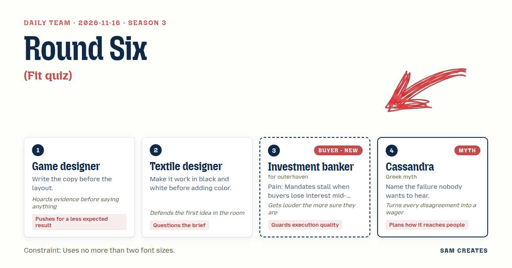
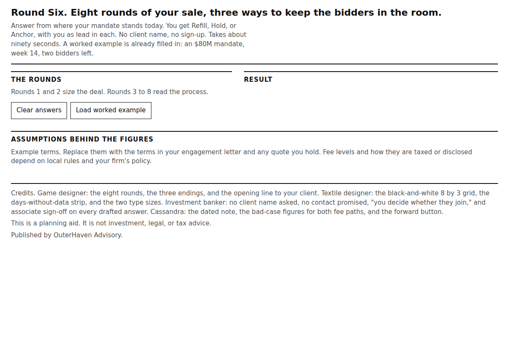

# 2026-11-16: Round Six

[Today](../../README.md) · [Archive](../../ARCHIVE.md)



**Task:** Fit quiz: eight multiple-choice questions give which of three approaches suits the buyer and why.

**Constraint:** Uses no more than two font sizes.

**Season:** 2026-10-07

**Decision:** The page asks a sell-side banker eight questions about a live mandate.

## Asset

<a href="artifact-1.html"></a>

[artifact-1.html](artifact-1.html), led by Game designer. Model: claude-opus-5-5.

## The session

### Pitch

**1 · Game designer: Round Six**\
I wrote the eight questions before I drew a single box. Each question is one round of a sale: teaser, NDA, IOI, management meeting, LOI, confirmatory.\
The banker reports what is left in the hand: the stage, the bidders still live, the ones gone quiet.\
There are three endings. Refill adds bidders from an AI-mapped long list, sent under the banker's name. Hold keeps current bidders warm with diligence answers drafted in 24 hours. Anchor brings a backstop buyer into the banker's process.\
Most players will guess Refill. On the runs I tested, Anchor came up for the post-IOI mandates, and those are the ones that stall.\
Every result opens with the sentence the banker would say to the client.

**2 · Textile designer: Broken Thread**\
Before color: a black grid on white, eight rows, three columns. Each answer fills one cell.\
Where the filled cells stop running in a line, that is where the process frays. The fray is the result.\
I'd question the brief. Buyers don't lose interest out of nowhere. They lose it in the gaps, the two weeks with nothing new in the data room.\
So measure the gaps in days. Feelings make a poor unit.\
One size for questions, one for the result. Nothing else goes in the cloth.

**Investment banker (buyer; outerhaven): Still in the Room**\
Three vendors pitched me "buyer engagement" this year. Two of them emailed my client's CFO directly. Both gone.\
So nothing on this page asks for the client's name, and nothing promises to contact anyone.\
Ask me my stage, how many bidders are live, when I last heard from the quiet ones. I can answer that in ninety seconds.\
Then tell me which fix keeps my name on every email. That's the result.\
Useful, I forward it to my MD. Smells like a competing process, I close the tab.

**4 · Cassandra: The Last Bidder's Note**\
I see the note before it arrives. "We have decided not to proceed at this time." Week nineteen, a Friday.\
Open the result with that note, dated to their own process, so they read it before it is written.\
Then show the way out: which of three paths, and what each costs if the note comes anyway.\
It travels banker to banker. An MD sends it to the deal team, and the deal team sends it to friends at the next shop.\
I wager a month that everyone who takes this quiz is already past week twelve.

### Clash

**2 · Textile designer:** Cassandra, put the rejection note at the top and the banker reads a eulogy for a deal that is still alive. My grid shows the fray without burying anything.

**4 · Cassandra:** Banker, you choose between us. I wager one month's retainer the note keeps you on the page longer than her grid does.

**3 · Investment banker:** Neither one is my problem. Anchor is. A backstop buyer who shows up through you is a second process. My client hears about it and I'm finished. That buyer comes in through me, signs my NDA, bids on my timeline, or doesn't exist.

**1 · Game designer:** Then it comes in through you. I checked the Anchor copy against your line four times and changed one sentence: "We introduce the buyer to you. You decide whether they join." Usual path: a fixed $60k for re-engagement work. Shortcut: 10% of your success fee, paid at close. Both use the same inputs.

**3 · Investment banker:** A share at close I can sell to my MD. A fixed $60k on a deal that might die, I can't. And the AI-drafted diligence answers go out only after my associate signs each one. Otherwise they come off the page.

**2 · Textile designer:** I'll give you the sign-off line. I won't give up the grid. The brief says "interest" and the cells say "days since new data." The second one is the real thread.

**4 · Cassandra:** The bad case. An $80M mandate at 2% pays $1.6M. The deal slips six months and half the IOIs drop. On the usual path the banker has paid $60k and gets nothing. On the share path the banker pays nothing, and we spend $4k a month on AI mapping and drafts plus $6k on a reviewer. That is $90k over nine months, all lost. The share path breaks for us.

**1 · Game designer:** It breaks. Scale back: Anchor carries a $5k monthly floor, credited against the share at close. In Cassandra's case our loss falls to $45k, and the banker's downside is $45k against $60k on the usual path. An analyst doing the same mapping by hand costs $18k a month. The AI saves $8k a month, and the saving counts most in the months the deal is dying.

**3 · Investment banker:** The floor is fine. But I'm telling you, the note at the top kills it. I do not forward a page that tells my MD the deal is dead.

**4 · Cassandra:** Then I wager the note at the bottom gets read by nobody. Put it where you like. It is still true.

### Decision

The page asks a sell-side banker eight questions about a live mandate. It returns Refill, Hold, or Anchor with the banker named as lead. It shows a grid of days without new data, and it sets the usual fee next to the share-at-close path under the same bad case.

Concept: Round Six

- Game designer: the eight questions written as process rounds, the three endings, and the result's opening sentence addressed to the client.
- Textile designer: the black-on-white 8×3 grid scored in days since new data, and the two-size type rule. The page uses 15px for questions and 22px for the result line.
- Investment banker: no client name requested, no contact promised, "You decide whether they join" in the Anchor copy, and an associate sign-off line on every AI-drafted answer.
- Cassandra: the dated "not proceeding" note, the bad-case figures for both fee paths, and the forward-to-a-colleague button.
- Cassandra lost the placement of the note. It sits under the fee comparison, dated to the week the gap reaches 21 days. The banker's forward test decides whether the page travels, and a note at the top fails that test.
- Bad case: an $80M mandate slips six months and loses half its IOIs. On the usual path the banker loses $60k. On the share path with the floor, the banker loses $45k and we lose $45k against a $90k cost. The page holds with the floor and does not hold without it.

### Build notes

1. Write `fit-quiz.html` copy-first. Q1 is enterprise value band and Q2 is weeks since launch, and these are the only two qualifiers. Q3 through Q8 cover stage, live bidder count, days since new data, why the last bidder went quiet, who drafts diligence answers now, and what the banker won't hand over.
2. Scoring rules. Refill applies when the stage is pre-IOI and 2 or fewer bidders are live. Hold applies when 3 or more bidders are live and the data gap is over 10 days. Anchor applies when the stage is post-IOI, 2 or fewer bidders are live, and EV is $50M or more. Render the 8×3 grid in black and white only, using two font sizes: 15px and 22px.
3. The fee table takes the user's EV band and weeks since launch. It shows the usual $60k fixed fee next to the 10% share with a $5k monthly floor, plus a six-month-slip row for each. A footer line says every AI-drafted buyer answer is reviewed and signed by the banker's named associate before it is sent.

**Guest:** Cassandra (myth; Greek myth). The method is drawn from public-domain history, myth, or literature, or invented. The guest speaks in character in original words, never quoting the source, and nothing here is endorsed by anyone.

## Team

```text
Team for 2026-11-16
Season: 2026-10-07

1. Game designer
   Method: Write the copy before the layout.
   Stance: Pushes for a less expected result.
   Temperament: Hoards evidence before saying anything.
2. Textile designer
   Method: Make it work in black and white before adding color.
   Stance: Questions the brief.
   Temperament: Defends the first idea in the room.
3. Investment banker (buyer; outerhaven) [buyer] [new]
   Method: Pain: Mandates stall when buyers lose interest mid-process. Walks when: It competes with their process or goes around them to the client. Opens up when: It brings buyers into their process and keeps them as the lead.
   Stance: Guards execution quality.
   Temperament: Gets louder the more sure they are.
4. Cassandra (myth; Greek myth) [guest]
   Method: Name the failure nobody wants to hear.
   Stance: Plans how it reaches people.
   Temperament: Turns every disagreement into a wager.

Constraint: Uses no more than two font sizes.
Task: Fit quiz: eight multiple-choice questions give which of three approaches suits the buyer and why.
```

Provider: claude. Model: claude-opus-5-5.
