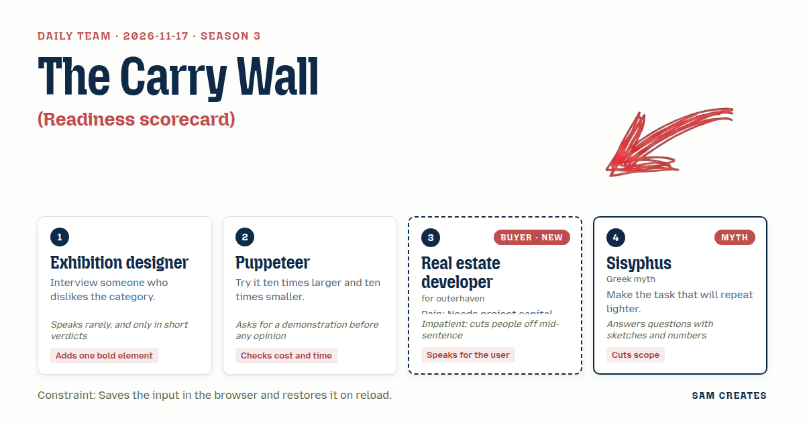
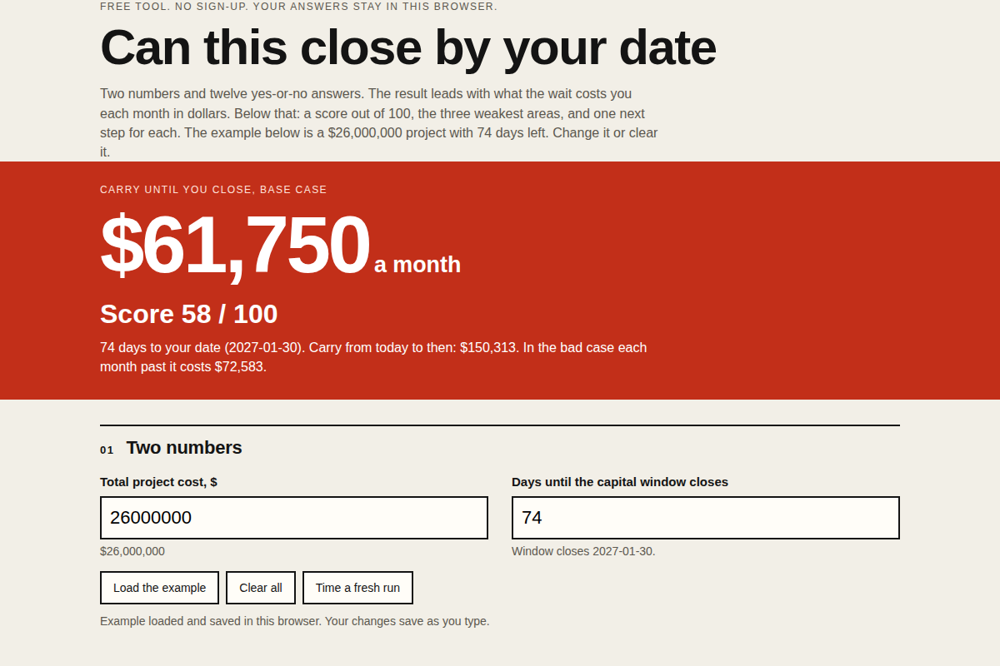

# 2026-11-17: The Carry Wall

[Today](../../README.md) · [Archive](../../ARCHIVE.md)



**Task:** Readiness scorecard: twelve yes-or-no questions give a score out of 100, the three weakest areas, and one next step for each.

**Constraint:** Saves the input in the browser and restores it on reload.

**Season:** 2026-10-07

**Decision:** The page asks for project cost, days until the capital window closes, and twelve yes-or-no questions, then shows monthly carry in dollars, a score out of 100, the three weakest areas with one next step each, a fee path and a share path c...

## Asset

<a href="artifact-1.html"></a>

[artifact-1.html](artifact-1.html), led by Exhibition designer. Model: claude-opus-5-5.

## The session

### Pitch

**1 · Exhibition designer: The Carry Wall**\
I asked a developer what he hates about scorecards.\
"A number with no dollar sign."\
So the first thing on the result is a dollar figure per month, 72 point type, full width.\
The score out of 100 sits under it, small.\
Three weak areas below that, each with one step.\
Two qualifying fields first: project cost, days until the window closes.

**2 · Puppeteer: Strings on the Stack**\
I tried it ten times larger. 120 questions. Nobody finishes.\
Ten times smaller. One question. It tells you nothing.\
Twelve holds. Each yes pulls one layer of the capital stack into place on a drawn bar: senior, mezz, equity, land.\
Every no leaves a visible hole in the bar.\
Time to complete: under 90 seconds, or I cut a question.\
Show me someone filling it in before anyone tells me it works.

**3 · Real estate developer: Close By The Date**\
Don't call it readiness. Every advisor says readiness.\
Ask me: can this close by my date.\
Twelve questions, fine. At least four of them about the stack: senior term sheet, equity committed, gap sized, lender conditions cleared.\
Result in plain numbers. What I'm short, what it costs me per month, how many days I have.\
If a single question says "vision" I'm gone.

**4 · Sisyphus: The Packet You Fill Once**\
The stone he pushes is the lender packet. Eight lenders, eight packets, same answers.\
Sketch: 12 answers + cost + date → saved in the browser → one-page summary, printed eight times.\
Reload the page on day 40, the answers are there. Change two, the summary updates.\
Cut the sliders. Cut the free text. Yes, no, two numbers.\
Make the push lighter. That is all.

### Clash

**2 · Puppeteer:** Real estate developer, before I trust any score, fill it in for me. Your current deal. If it takes over two minutes the strings are too long and we—

**3 · Real estate developer:** Puppeteer, $26 million project, 74 days left, twelve answers in 70 seconds. Now the result. "Score 58" means nothing to me. "$62,000 a month in carry until you close" makes me read the next line.

**1 · Exhibition designer:** Developer, agreed. Carry on the wall. Score underneath.

**4 · Sisyphus:** Puppeteer, where a model carries part of the stone. Eight packets at 6 analyst hours each is 48 hours. At $90 an hour, $4,320. A model drafts each from the saved answers and the pro forma in 20 minutes: $240. The CFO reads and signs each one before it goes out. If the deal dies on day 70, he has paid $240 to learn it, not $4,320.

**2 · Puppeteer:** Sisyphus, run it at ten times smaller. A $2.6 million fourplex. Two lenders, not eight. Saving: about $1,000. Carry: $6,200 a month. Nobody books a call over that.

**3 · Real estate developer:** Then the page tells the fourplex owner his three steps and stops there. Don't waste his — and the fee. Last placement shop took a $30,000 retainer plus 2%. Deal died. I paid the thirty.

**2 · Puppeteer:** Developer, same inputs, both paths. Usual: $30,000 retainer plus 2% of a $3.9 million raise, $108,000. Other path: outerhaven takes 6% of profit at sale, nothing up front. On $9 million profit, $540,000. Deal dies: $0.

**3 · Real estate developer:** $540,000 is five times the fee. I keep the upside, I pay the fee. Take that path off the page.

**1 · Exhibition designer:** No. Both paths, side by side. He chooses.

**4 · Sisyphus:** Bad case. Six month slip, land loan rate 9% to 11%. Carry goes from $62,000 to $73,000 a month, $438,000 over six months. Profit falls from $9 million to $4.1 million. Fee path: $108,000 regardless. Share path: $246,000. Deal dies: fee path costs $30,000, share path $0. The share still costs more if it closes. It costs nothing if it doesn't.

### Decision

The page asks for project cost, days until the capital window closes, and twelve yes-or-no questions, then shows monthly carry in dollars, a score out of 100, the three weakest areas with one next step each, a fee path and a share path compared on the same numbers, and a lender summary built from the saved answers.

Concept: The Carry Wall

- Exhibition designer: monthly carry at 72 pt across the top of the result. Score under it at 24 pt. Two qualifying fields before the twelve questions.
- Puppeteer: capital stack bar that fills one layer per yes. Under-90-second test. Fee path and share path table. Below $5 million project cost, the page gives the three steps and no call offer.
- Real estate developer: "Can this close by your date" as the page title. Four of twelve questions on the stack. No word "readiness" anywhere on the page. Plain dollar figures throughout.
- Sisyphus: answers saved in localStorage and restored on reload. One-page lender summary printed from the saved answers. Model drafting step counted on the page: $4,320 by hand, $240 drafted, CFO sign-off required.
- Lost: the Real estate developer lost the argument to remove the share path. The page shows its cost in the bad case and the dead-deal case, so he can reject it with the numbers in front of him. Still open: he holds that $540,000 against $108,000 makes the share path a bad offer at any profit above $2 million.
- Bad case: six month slip, rate 9% to 11%, profit $9 million to $4.1 million. Carry rises to $73,000 a month and the page shows it. The fee path costs $108,000 and the share path $246,000. If the deal dies, the fee path costs $30,000 and the share path $0. The page holds. Both paths show all three cases in the same table.

### Build notes

1. Store all 14 inputs under one localStorage key, `carrywall.v1`, as JSON. Write on every change. Read on load and redraw the result immediately when all inputs are present.
2. Group the twelve questions into six areas of two: Site control, Entitlements, Budget, Senior debt, Equity, Timeline. Senior debt and Equity questions are worth 10 points each. The other eight are worth 7.5 each. Total is 100. Rank areas by percent of points earned. Break ties in the order listed. Show the bottom three, each with one fixed next step.
3. Carry formula, shown on the page in plain text: land at 25% of project cost × 9% ÷ 12, plus 0.05% of project cost per month. Raise assumed at 15% of project cost. Build the two-path table from these values with three rows: base, six month slip at 11%, deal dies. Add a print stylesheet that renders the lender summary on one A4 page.

**Guest:** Sisyphus (myth; Greek myth). The method is drawn from public-domain history, myth, or literature, or invented. The guest speaks in character in original words, never quoting the source, and nothing here is endorsed by anyone.

## Team

```text
Team for 2026-11-17
Season: 2026-10-07

1. Exhibition designer
   Method: Interview someone who dislikes the category.
   Stance: Adds one bold element.
   Temperament: Speaks rarely, and only in short verdicts.
2. Puppeteer
   Method: Try it ten times larger and ten times smaller.
   Stance: Checks cost and time.
   Temperament: Asks for a demonstration before any opinion.
3. Real estate developer (buyer; outerhaven) [buyer] [new]
   Method: Pain: Needs project capital before the window closes. Walks when: The numbers are vague or the timeline slips. Opens up when: The capital stack and timeline are laid out in plain numbers.
   Stance: Speaks for the user.
   Temperament: Impatient; cuts people off mid-sentence.
4. Sisyphus (myth; Greek myth) [guest]
   Method: Make the task that will repeat lighter.
   Stance: Cuts scope.
   Temperament: Answers questions with sketches and numbers.

Constraint: Saves the input in the browser and restores it on reload.
Task: Readiness scorecard: twelve yes-or-no questions give a score out of 100, the three weakest areas, and one next step for each.
```

Provider: claude. Model: claude-opus-5-5.
