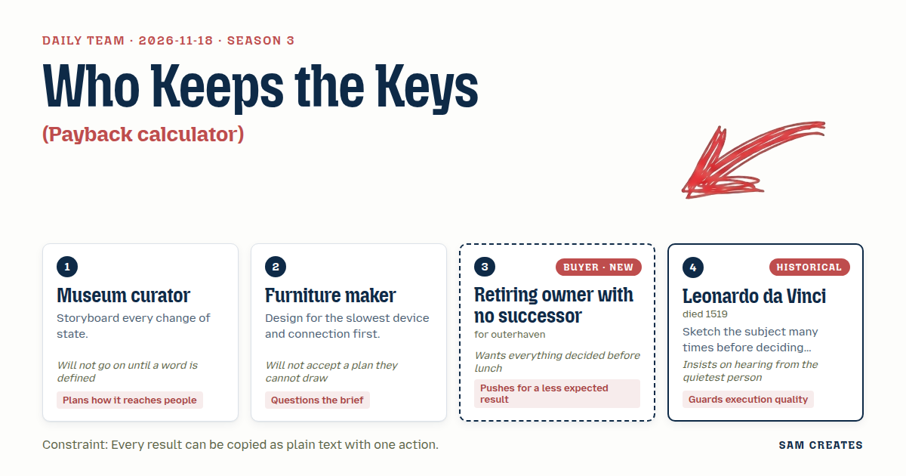
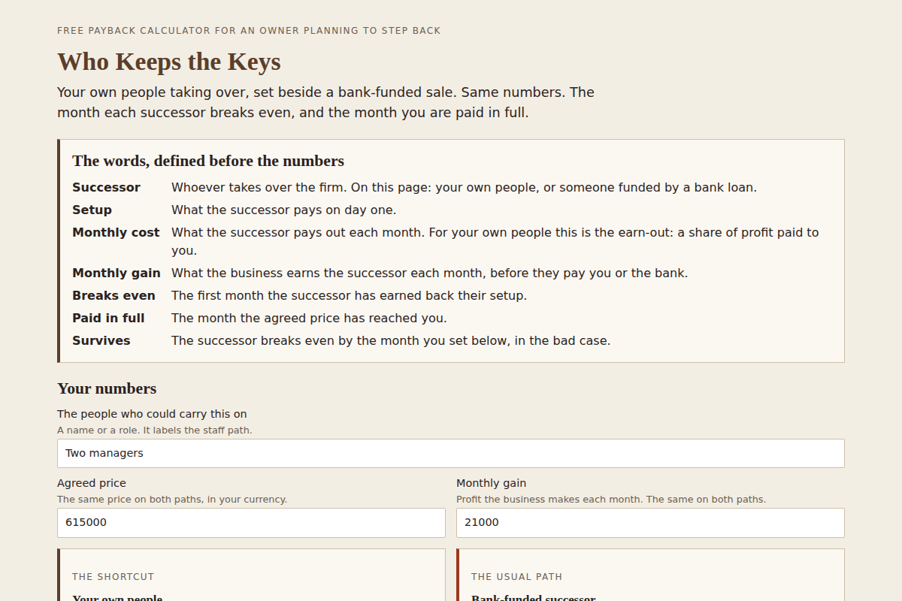

# 2026-11-18: Who Keeps the Keys

[Today](../../README.md) · [Archive](../../ARCHIVE.md)



**Task:** Payback calculator: setup cost, monthly cost, and monthly gain give the month the buyer breaks even, shown on a timeline.

**Constraint:** Every result can be copied as plain text with one action.

**Season:** 2026-10-07

**Decision:** The page shows a retiring owner, side by side, when a staff successor and a bank-funded successor each break even on the same inputs, and when the owner is paid in full under each.

## Asset

<a href="artifact-1.html"></a>

[artifact-1.html](artifact-1.html), led by Museum curator. Model: claude-opus-5-5.

## The session

### Pitch

**1 · Museum curator: The Hand-Over Room**\
Five states, storyboarded before any code: empty, typing, paid back, never pays back, copied.\
The page opens with one question: who on your team could carry this on.\
Three words get defined before any number. Setup: what the successor pays on day one. Monthly cost: what they pay out each month. Monthly gain: what the business earns them each month.\
The result names the month the successor breaks even. It also counts the months the owner has already spent looking.\
Two questions only: how many people work for you, and how long you have been looking.\
We take a share of the earn-out instead of a fee. Every result has its own Copy button.

**2 · Furniture maker: Joint Before Glue**\
I'll question the brief first. Breakeven is the successor's number. The owner's worry is whether the people stay.\
I drew it on paper first. One row of squares, one square per month, filled up to breakeven.\
It has to work on a five-year-old phone on a bad signal. So no chart library, one HTML file, under 40 KB.\
The timeline is text characters, so it copies clean into an email.\
If I can't draw a state with a pencil, it doesn't go on the page.

**Retiring owner with no successor (buyer; outerhaven): Who Keeps the Keys**\
Thirty-one years, nine staff, my name over the door.\
Every offer so far came from someone who wanted the client list and none of the people.\
Show me my two managers buying it. Small deposit, and they pay me out of profit over time.\
Put that next to a normal sale with the same numbers, and let me see which one keeps the team.\
I want this sorted today. I've had four advisers take six months each to say nothing.

**4 · Leonardo da Vinci: Twelve Sketches**\
I'll draw the timeline many ways before we pick one: bars, boxes, a ruler, a calendar.\
The one we keep is the one a tired person can read at 6 p.m. without help.\
Every number on it gets checked by hand against a worked example before release.\
Squares stay square at every width. Labels never overlap.\
And before we finish, someone who hasn't spoken yet gets asked what they'd change.

### Clash

**3 · Retiring owner with no successor:** Curator, I'll be plain. Three people approached me last year and every one of them called my firm "a platform." Put the staff buyout next to the bank sale, same numbers. Can we settle that before lunch?

**1 · Museum curator:** Owner, not yet. Define "buyer" first. Does it mean your managers, or anyone with a cheque? The timeline means something different for each.

**3 · Retiring owner with no successor:** Curator, it means whoever keeps my nine people. Call them "successor" on the page. I don't want the word "buyer" anywhere near my staff.

**2 · Furniture maker:** Owner, then draw me the earn-out. Say you take 40% of profit each month instead of a fixed payment. What does the row look like the month profit halves? I won't build a line I can't draw.

**4 · Leonardo da Vinci:** Furniture maker, I've drawn it four ways this morning. The one that reads is a row of boxes per path, filled to the breakeven month. Owner, who in your shop hasn't been asked about any of this?

**3 · Retiring owner with no successor:** Leonardo, my bookkeeper. Twenty-two years with me. She'll be the one who reads this. The last adviser billed us 30,000 for diligence on a sale that fell through, and she paid that invoice.

**1 · Museum curator:** Leonardo, that's where AI does the work. A model reads the contracts, the leases, and three years of books for about 6,000. Then a named accountant reviews it and signs for 4,000. If the deal dies, she's out 10,000 instead of 30,000. That goes on the timeline as month zero for both paths.

**2 · Furniture maker:** Curator, here's the bad case. Bank sale: setup 180,000, loan 7,500 a month, gain 21,000, breakeven month 14. Staff buyout: setup 60,000, earn-out 40% of profit, breakeven month 5. Halve the gain to 10,500. The bank successor nets 3,000 and breaks even in month 60. The staff successor nets 6,300 and breaks even in month 10. If the deal slips six months, both shift by six. The staff path holds. But 60 boxes won't fit on a 320-pixel screen as one row.

**4 · Leonardo da Vinci:** Furniture maker, then stack them. Twelve to a line, one line per year. The quality is in the boxes staying square at that width. Fitting one row matters less.

**3 · Retiring owner with no successor:** Curator, stacked is fine. But you keep dodging my number: the month I'm paid in full. Their breakeven isn't my exit. Show both, or I'm not forwarding it to anyone.

### Decision

The page shows a retiring owner, side by side, when a staff successor and a bank-funded successor each break even on the same inputs, and when the owner is paid in full under each.

Concept: Who Keeps the Keys

- Museum curator: the five storyboarded states, the opening question about who could carry it on, defined terms above the inputs, the two qualifying questions (staff count, months spent looking), and a share of the earn-out in place of a fee.
- Furniture maker: a single file under 40 KB with no libraries, a text-character timeline that copies clean, and the bad-case numbers drawn as rows.
- Retiring owner with no successor: the staff buyout set beside the bank sale, the word "successor" throughout, and a second result for the month the owner is paid in full.
- Leonardo da Vinci: stacked rows of twelve square boxes per year, the bookkeeper as the test reader, and hand-checked worked examples.
- The curator lost the argument for one result per screen. The owner's exit runs on a different clock from the successor's breakeven, and a page without it would not get forwarded.
- Bad case: with gain halved from 21,000 to 10,500, the staff successor breaks even in month 10 and the bank successor in month 60, so the staff path holds for the successor. The owner's full payout on the staff path moves from month 67 to month 133. The page states this in its own row and does not hide it. A failed deal costs 10,000 with AI-read diligence against 30,000 without, and the page shows that loss as month zero on both paths.

### Build notes

1. Build one HTML file with inline CSS and under 60 lines of JavaScript. Use three inputs (setup, monthly cost, monthly gain) for each path, plus an earn-out percentage for the staff path. Render each timeline as rows of 12 `■` and `□` characters inside a `<pre>`, so one Copy button per result copies the exact text shown.
2. Hard-code the worked example (180,000 / 7,500 / 21,000 against 60,000 / 40% / 21,000) as the default state. Add a "Halve the gain" toggle that redraws both paths and the owner's payout row. Check months 14, 5, 60, 10, 67, and 133 by hand before release.
3. Add the diligence line as month zero with two figures: 6,000 for the AI read plus 4,000 for a named accountant's sign-off, against a 30,000 conventional quote. Under the results, place the two qualifying questions and a "Send this to your accountant" Copy button. Keep the words "buyer," "platform," and "exit multiple" out of all page text.

**Guest:** Leonardo da Vinci (historical; died 1519). The method is drawn from public-domain history, myth, or literature, or invented. The guest never speaks as the figure, and nothing here is endorsed by anyone.

## Team

```text
Team for 2026-11-18
Season: 2026-10-07

1. Museum curator
   Method: Storyboard every change of state.
   Stance: Plans how it reaches people.
   Temperament: Will not go on until a word is defined.
2. Furniture maker
   Method: Design for the slowest device and connection first.
   Stance: Questions the brief.
   Temperament: Will not accept a plan they cannot draw.
3. Retiring owner with no successor (buyer; outerhaven) [buyer] [new]
   Method: Pain: Wants out but fears for staff and the name on the door. Walks when: It sounds like private equity buying to strip and flip. Opens up when: You talk about carrying on what they built and keeping the team.
   Stance: Pushes for a less expected result.
   Temperament: Wants everything decided before lunch.
4. Leonardo da Vinci (historical; died 1519) [guest]
   Method: Sketch the subject many times before deciding anything.
   Stance: Guards execution quality.
   Temperament: Insists on hearing from the quietest person.

Constraint: Every result can be copied as plain text with one action.
Task: Payback calculator: setup cost, monthly cost, and monthly gain give the month the buyer breaks even, shown on a timeline.
```

Provider: claude. Model: claude-opus-5-5.
