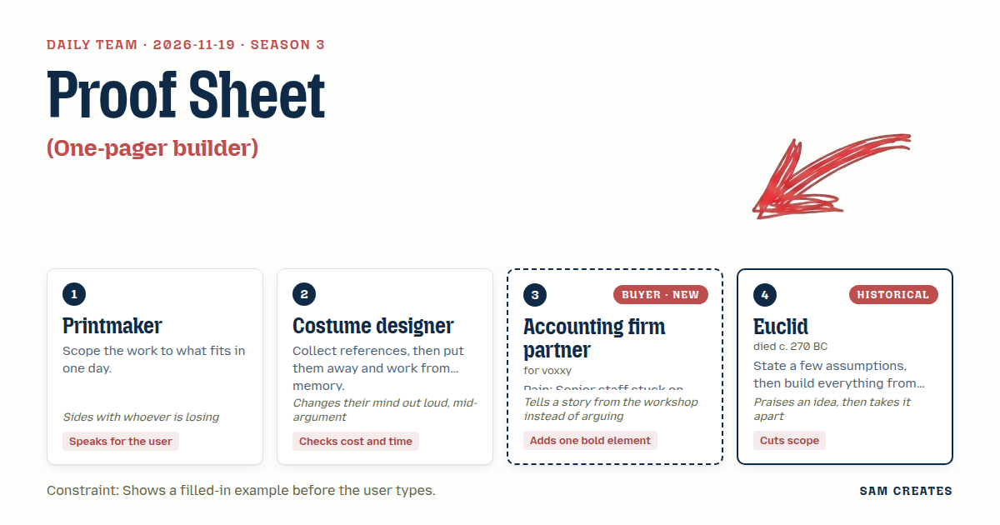
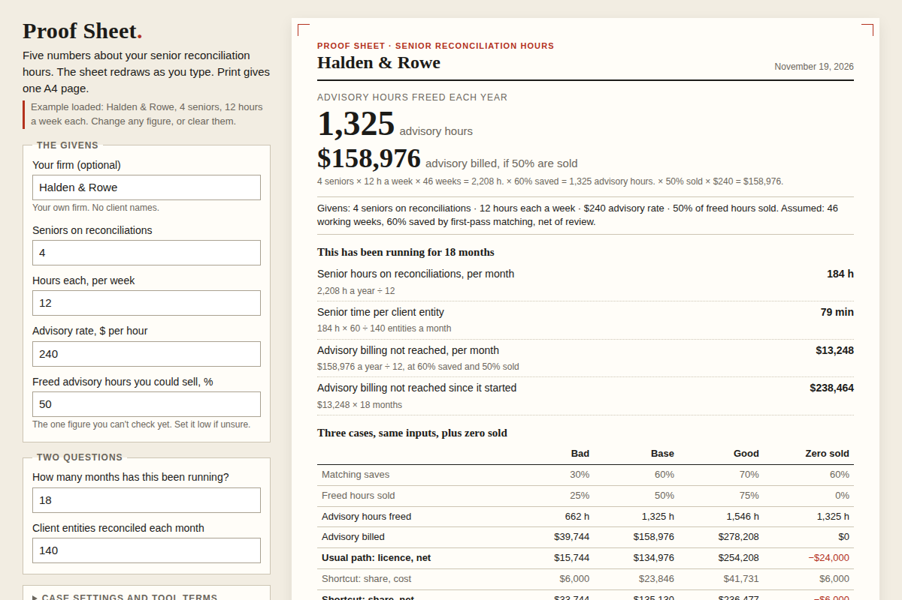

# 2026-11-19: Proof Sheet

[Today](../../README.md) · [Archive](../../ARCHIVE.md)



**Task:** One-pager builder: a few fields about the buyer's opportunity give a clean printable one-page summary they can send on.

**Constraint:** Shows a filled-in example before the user types.

**Season:** 2026-10-07

**Decision:** The page takes five numbers about a firm's senior reconciliation hours and prints one A4 sheet showing the hours lost each year, the advisory revenue those hours could bill, and a licence-versus-share comparison with its bad case, all pr...

## Asset

<a href="artifact-1.html"></a>

[artifact-1.html](artifact-1.html), led by Printmaker. Model: claude-opus-5-5.

## The session

### Pitch

**1 · Printmaker: Proof Sheet**\
One plate, one pull, one sheet.\
The page opens already inked: an example firm, Halden & Rowe, 4 seniors, 12 hours a week each on reconciliations.\
Fields on the left, the sheet on the right, and the sheet redraws as they type.\
Two questions at the bottom: how many months this has run, how many client entities get reconciled each month.\
Print gives one A4 with nothing bleeding off the edge.\
If a panel can't be cut and proofed by tonight, it stays off the plate.

**2 · Costume designer: Fitting Notes**\
I pinned up ten vendor one-pagers, then took them all down.\
What I still remember is three things: the hourly cost, the time it takes, and the line that says who pays.\
So: senior hours times senior cost rate is what reconciliations cost the firm each month.\
Next to that, the tool's fee, in the same units.\
Then a running total across every month it's already been going on.\
That's the bill they've been paying without an invoice.

**Accounting firm partner (buyer; voxxy): The Busy Season Line**\
Last January two of my managers spent the last ten days tying out bank accounts.\
That same week a client asked one of them about restructuring and got "after the 15th."\
The client took the work to another firm.\
So the bold element is one number at the top: advisory revenue those senior hours could have billed this year.\
Say "advisory hours." Don't say "automate" or "replace," because my seniors read these too.\
And no field asks me for a client name. Ever.

**4 · Euclid: Three Givens**\
I'd start from three numbers the partner already knows without looking anything up.\
Seniors on reconciliations. Hours each per week. The advisory rate.\
Every other line on the sheet gets derived from those three, with the formula shown in small type.\
If a line can't be traced back to them, it comes off.\
That rules out benchmarks, industry averages, and testimonials.\
The page gets shorter and harder to argue with.

### Clash

**4 · Euclid:** Partner, "senior hours into advisory" is the right thing to build on, and it's clean. But your top number assumes those freed hours get sold. That's a fourth given nobody can check. If it's wrong, the headline is wrong.

**3 · Accounting firm partner:** In January my manager didn't lack the skill. She lacked the week. The client asked, she said "after the 15th," and he went elsewhere. Hours on their own don't get a partner meeting to move. Dollars do.

**2 · Costume designer:** Cost first. Example firm: 4 seniors, 12 hours a week, 46 weeks, so 2,208 hours a year. AI does first-pass matching of bank lines to ledger, a named senior reviews the exceptions, and that cuts 60 percent net of review. That's 1,325 hours freed. Half sold at $240 is $158,976. Licence is $24,000 a year.

**1 · Printmaker:** The user also has to know who pays what. Put the usual licence next to a share: 15 percent of the advisory billed from freed hours for 12 months, with a $6,000 floor. Same inputs on both. Two rows, no more.

**2 · Costume designer:** I was about to say the share is too fiddly for one sheet. No. With the floor it's two lines. Bad case: matching only saves 30 percent and a quarter of freed hours sell. That's 166 hours, $39,744. Licence nets the firm $15,744. Share costs the $6,000 floor and nets $33,744. At zero sold, the licence loses $24,000 and the share loses $6,000.

**4 · Euclid:** Then the share row survives the bad case and the licence row only just does. Print both bad-case numbers at the same size as the base case. Nothing in smaller type.

**3 · Accounting firm partner:** One more thing or I close the tab. Under the AI line: "No client names or ledger data entered. Nothing leaves this browser." Under the result: "Reviewed and signed: ____." My audit partner reads that line before anything else.

**1 · Printmaker:** Euclid's losing on the headline, so I'll take his side. Hours go large at the top. The dollars go directly beneath, labelled "if half are sold," with the conversion rate as an editable field.

**3 · Accounting firm partner:** Then you've printed a timesheet. My managing partner will skim right past 2,208 hours. She'll stop at $158,976.

### Decision

The page takes five numbers about a firm's senior reconciliation hours and prints one A4 sheet showing the hours lost each year, the advisory revenue those hours could bill, and a licence-versus-share comparison with its bad case, all pre-filled with an example firm before the user types.

Concept: Proof Sheet

Printmaker: the opening example firm, the live redraw, the one-A4 print layout, and the two qualifying questions on months running and entities reconciled.
Costume designer: the cost-per-month line, the running total since the problem started, and the licence row against the share row.
Accounting firm partner: the dollar figure set large and directly under the hours, the "no client names" line, the signed-reviewer line, and the wording "advisory hours."
Euclid: three givens plus one editable conversion rate, a small-type formula under every derived line, and bad-case numbers printed at full size.
The partner lost the headline argument. Hours sit on top because the dollar figure depends on a conversion rate the partner sets but can't verify yet, and the hours figure does not. The partner's objection that hours won't move a managing partner is still open, so the dollar line is 80 percent of the hours line's size.
Bad case: matching saves 30 percent instead of 60, a quarter of freed hours sell instead of half, and zero sold. The share path nets $33,744 and loses only the $6,000 floor at zero. The licence path nets $15,744 and loses $24,000 at zero. The page holds and shows both rows.

### Build notes

1. Build `proof-sheet.html` as one file. Five inputs: seniors (4), hours per week each (12), advisory rate ($240), share of freed hours sold (50%), and months running. Add one qualifier, entities reconciled monthly. Pre-fill Halden & Rowe on load. Compute freed hours as seniors × hours × 46 × 0.60, and show each formula in 9pt grey under its line.
2. Add a two-row table with columns for licence ($24,000/yr) and share (15%, $6,000 floor). It has base, bad case (30% saved, 25% sold), and zero-sold columns, all in the same type size.
3. Write an `@media print` stylesheet that fits one A4 portrait page and hides the input panel. Print the two fixed lines: "No client names or ledger data entered. Nothing leaves this browser." and "Reviewed and signed: ____". No network calls in the file.

**Guest:** Euclid (historical; died c. 270 BC). The method is drawn from public-domain history, myth, or literature, or invented. The guest never speaks as the figure, and nothing here is endorsed by anyone.

## Team

```text
Team for 2026-11-19
Season: 2026-10-07

1. Printmaker
   Method: Scope the work to what fits in one day.
   Stance: Speaks for the user.
   Temperament: Sides with whoever is losing.
2. Costume designer
   Method: Collect references, then put them away and work from memory.
   Stance: Checks cost and time.
   Temperament: Changes their mind out loud, mid-argument.
3. Accounting firm partner (buyer; voxxy) [buyer] [new]
   Method: Pain: Senior staff stuck on manual reconciliations. Walks when: It creates audit risk or handles client data carelessly. Opens up when: It frees senior hours for advisory work clients pay more for.
   Stance: Adds one bold element.
   Temperament: Tells a story from the workshop instead of arguing.
4. Euclid (historical; died c. 270 BC) [guest]
   Method: State a few assumptions, then build everything from them.
   Stance: Cuts scope.
   Temperament: Praises an idea, then takes it apart.

Constraint: Shows a filled-in example before the user types.
Task: One-pager builder: a few fields about the buyer's opportunity give a clean printable one-page summary they can send on.
```

Provider: claude. Model: claude-opus-5-5.
