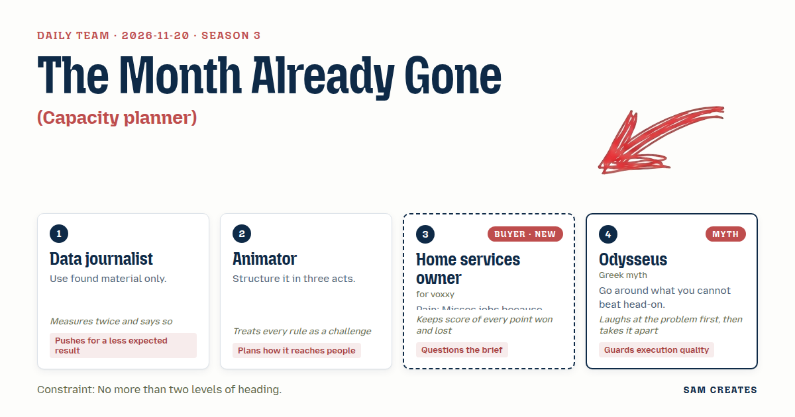
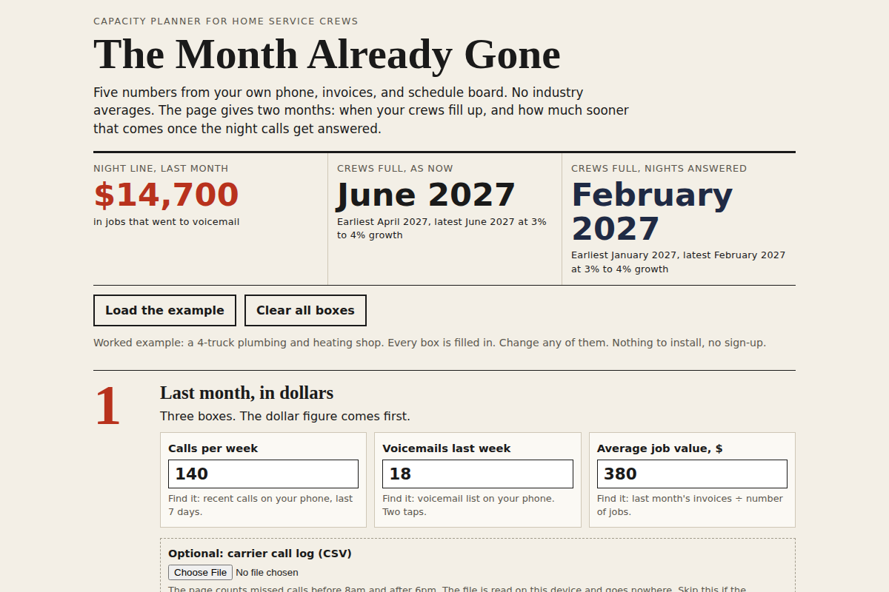

# 2026-11-20: The Month Already Gone

[Today](../../README.md) · [Archive](../../ARCHIVE.md)



**Task:** Capacity planner: current volume, growth rate, and staff hours give the month the buyer's team runs out of capacity.

**Constraint:** No more than two levels of heading.

**Season:** 2026-10-07

**Decision:** The page turns last month's missed after-hours calls into dollars, then shows the month his crews fill up with and without those calls answered, and compares a night hire against pay-per-booked-job answering under the same bad case.

## Asset

<a href="artifact-1.html"></a>

[artifact-1.html](artifact-1.html), led by Data journalist. Model: claude-opus-5-5.

## The session

### Pitch

**1 · Data journalist: The Month Already Gone**\
Every number on the page comes from something he already has. The voicemail count on his phone, last month's invoices, the hours on the schedule board. No industry averages.\
Most planners say "you run out in June." I checked his figures twice. The night line ran out months ago.\
So the result is two months: when the trucks fill up, and how much sooner that comes once the night calls get answered.\
Answering the phone brings capacity trouble forward. That is the result he won't expect.\
Two qualifying questions: how many trucks, and how long the night line has gone to voicemail.

**2 · Animator: Three Screens to Saturday**\
Act one: last month, in dollars, before he types anything else.\
Act two: a bar for each month, his crew hours as a ceiling, and the jobs climbing to meet it. The bar that hits the ceiling turns red.\
Act three: two paths side by side, with the bad case under each.\
The ending is a card sized for a phone. He texts it to whoever splits the work with him.\
Two heading levels is tight. Fine. The acts get big numerals, not headings.

**Home services owner (buyer; voxxy): What Did Last Month Cost Me**\
You keep saying capacity. I don't run out of capacity. I run out of somebody picking up at 9pm.\
Last vendor gave me a "dashboard." Three logins, a webinar, never opened it again.\
Show me last month in money. If it's a real number, I'll keep going.\
Five boxes, tops. Nothing to install. If my phone needs an app, I'm gone.\
Then tell me the month I'm stuck turning down daytime work too.

**4 · Odysseus: The Side Door**\
Ha. A man who loses money because his own phone rings. Good.\
You cannot hire a second dispatcher to sit awake. So don't fight the night head-on. Go around it.\
Forward the after-hours line with a code he dials once. Something on the other end answers and books into the calendar he already uses.\
My charge is that the month we name holds up. If it moves by three when he changes one box, he stops trusting every number.\
Round toward the earlier month, and say on the page that you did.

### Clash

**3 · Home services owner:** Data journalist, you want my call log. That's the carrier portal, and my wife has the password. Ten minutes gone right there. Drop it and that's a point for me.

**1 · Data journalist:** Then the page runs on a guess, and I'll label it a guess. I measured the other route twice: voicemails from last week are on his phone screen in two taps. That's found, and it's under a minute. The log upload stays optional.

**4 · Odysseus:** Ha, the man's own phone is the witness. Good. But Animator, your red bar names one month. Change growth from 3% to 4% and June becomes April. Show a span, earliest and latest.

**2 · Animator:** A span doesn't fit on the card. "Sometime between April and June" never gets texted to anyone. One month, big. Put the span in the small print under it.

**4 · Odysseus:** The small print is where a careful man looks first. If it disagrees with the big number, you've lost him.

**3 · Home services owner:** Answering the phone at night. Last outfit's bot told a woman her water heater could wait till Monday. She called my competitor. Who signs off on what it says?

**4 · Odysseus:** It books, and it never diagnoses. Anything about price or "can it wait" goes to your phone as a text, and you approve it. You stay the name on every quote.

**1 · Data journalist:** Bad case, with his numbers. 140 calls a week, 22% after hours, 60% of those missed, half would book, $380 a job. That's $15,100 lost last month. Volume halves: $7,550. A night dispatcher still costs $3,800 a month either way. Pay-per-booked-job at $25 drops to about $500. Growth doubles to 6%: trucks fill in March 2027 instead of June, and in December if nights get answered. The page still holds.

**3 · Home services owner:** Fine, that's your point. But the December number scares me more than the $15,100. You're telling me fixing the phone breaks my schedule.

**2 · Animator:** That's act two doing its job. He forwards that card because it scares him.

### Decision

The page turns last month's missed after-hours calls into dollars, then shows the month his crews fill up with and without those calls answered, and compares a night hire against pay-per-booked-job answering under the same bad case.

Concept: The Month Already Gone

- Data journalist: every input comes from his own phone, invoices, and schedule. Optional log upload. The two-month result. The two qualifying questions: trucks, and months the night line has gone to voicemail.
- Animator: three acts marked by numerals with no added heading levels, a monthly bar chart with a crew-hour ceiling, and a 1080×1350 share card.
- Home services owner: five inputs, no install, dollar figure first, and no use of the words "dashboard," "platform," or "onboarding."
- Odysseus: call-forward setup by dial code, bookings with no diagnosis, owner text approval on price and urgency, and rounding toward the earlier month.
- Animator lost the span argument. One month stays large, with "earliest April, latest June at your growth range" printed directly under it in the same size as the label. A span placed in small print would contradict the headline.
- Bad case: tested volume at half and growth at double. At half volume, pay-per-job costs about $500 against a fixed $3,800 hire. At 6% growth the run-out month moves from June 2027 to March 2027, and to December 2026 with nights answered. The page holds, and it states the December case plainly.

### Build notes

1. Build `capacity-planner.html` with five inputs: weekly calls, after-hours share, voicemails last week, average job value, and weekly crew hours. Add the two qualifying questions below the result. Compute months to capacity as ln(capacity ÷ jobs) ÷ ln(1 + growth), round down, and convert to a calendar month from today.
2. Render act three as two equal columns: "Night dispatcher, $3,800/month fixed" and "Answering service, $25 per booked job." Use the same inputs in both and show a bad-case row under each for half volume and double growth. Add the line "Owner approves every price and urgency text" and show the forward code setup at 2 minutes.
3. Generate the share card in a `<canvas>` with two numbers: last month's lost dollars and the run-out month. Add a "Text this" button that uses the Web Share API, with copy-to-clipboard as the fallback.

**Guest:** Odysseus (myth; Greek myth). The method is drawn from public-domain history, myth, or literature, or invented. The guest speaks in character in original words, never quoting the source, and nothing here is endorsed by anyone.

## Team

```text
Team for 2026-11-20
Season: 2026-10-07

1. Data journalist
   Method: Use found material only.
   Stance: Pushes for a less expected result.
   Temperament: Measures twice and says so.
2. Animator
   Method: Structure it in three acts.
   Stance: Plans how it reaches people.
   Temperament: Treats every rule as a challenge.
3. Home services owner (buyer; voxxy) [buyer] [new]
   Method: Pain: Misses jobs because nobody answers after hours. Walks when: Setup takes more than ten minutes or needs new software. Opens up when: It counts the jobs they lost last month in money.
   Stance: Questions the brief.
   Temperament: Keeps score of every point won and lost.
4. Odysseus (myth; Greek myth) [guest]
   Method: Go around what you cannot beat head-on.
   Stance: Guards execution quality.
   Temperament: Laughs at the problem first, then takes it apart.

Constraint: No more than two levels of heading.
Task: Capacity planner: current volume, growth rate, and staff hours give the month the buyer's team runs out of capacity.
```

Provider: claude. Model: claude-opus-5-5.
