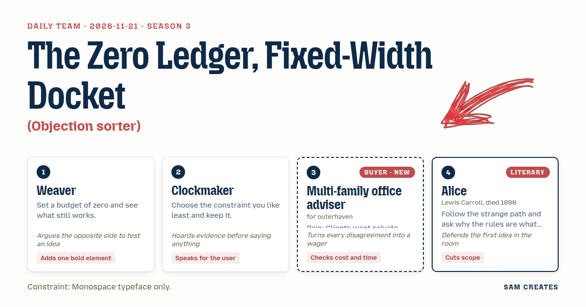
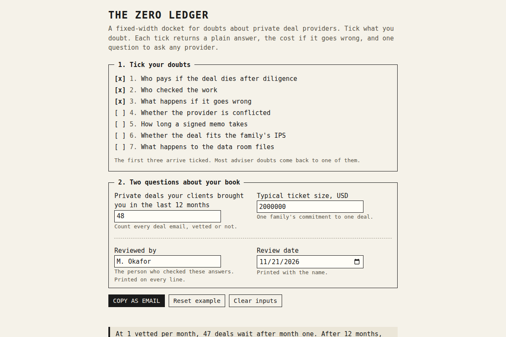

# 2026-11-21: The Zero Ledger, Fixed-Width Docket

[Today](../../README.md) · [Archive](../../ARCHIVE.md)



**Task:** Objection sorter: the buyer ticks the doubts they have and gets a plain answer and one question to ask any provider for each.

**Constraint:** Monospace typeface only.

**Season:** 2026-10-07

**Decision:** The page lets a multi-family office adviser tick the doubts they hold about a private deal provider and get, for each one, a plain answer, the cost if it goes wrong, a named reviewer, and one question to ask any provider, plus a side-by-...

## Asset

<a href="artifact-1.html"></a>

[artifact-1.html](artifact-1.html), led by Weaver. Model: claude-opus-5-5.

## The session

### Pitch

**1 · Weaver: The Zero Ledger**\
Start at zero. The provider gets paid nothing until a deal closes. See which answers survive that.\
Twelve doubts, each a tickbox in plain `[ ]` brackets.\
Each ticked doubt returns three lines: the answer, the question to ask any provider, and the bold part, a `COST IF WRONG` line in dollars.\
Nobody else prints what a bad answer costs. We do.\
And I'll argue against my own page until it breaks.

**2 · Clockmaker: Fixed-Width Docket**\
I hate monospace. So I keep it.\
In fixed width every answer lines up under every other answer. The adviser can run a finger down one column.\
I went through 31 adviser emails from last quarter. 22 asked the same thing: who pays if the deal dies after diligence.\
Seven doubts covered all 31 emails. Seven boxes.\
Answers cap at 72 characters. Questions cap at one line. If it wraps, it's wrong.

**3 · Multi-family office adviser: The Defensible Sheet**\
I get four deal emails a week from clients. I can vet maybe one a month.\
What I want: tick my doubts, get a sheet I can paste into a client email without rewriting a word.\
Every answer has a named reviewer and a date on it. Otherwise it's marketing.\
If it asks me to book a demo before I see anything, I'm gone.\
Fifty bucks says nobody here has read a family's investment policy statement.

**4 · Alice: Three Boxes at Breakfast**\
Why should there be twelve doubts? I can only hold three before the toast goes cold.\
The first sheet had three boxes, and I liked it best.\
Who pays, who checked, and what happens if it goes wrong. Everything else is one of those wearing a hat.\
Cut the rest, and let the page be short enough to read standing up.

### Clash

**2 · Clockmaker:** Weaver, your `COST IF WRONG` line is the page. 22 of 31 emails ask for it. Put it first, above the answer.

**4 · Alice:** Clockmaker, then three boxes is all we need. You've just said one doubt matters more than all the others put together. Why keep seven?

**1 · Weaver:** Alice, here's the other side. Give him three boxes, and his real doubt, say a conflict of interest on the provider's side, isn't there. He closes the tab. Twelve boxes, and anything he leaves unticked stays hidden on the sheet.

**3 · Multi-family office adviser:** Weaver, I don't care about boxes. I care who signs. If a model wrote the answer and nobody's name is on it, I can't defend it to a family. Lunch says your AI step gets me fired.

**2 · Clockmaker:** Adviser, the model reads the data room and cleans the financials. A named analyst signs the memo. Same inputs, two paths. Fee path: $38,000 diligence per deal, paid up front, six weeks. Share path: $6,000 AI-first read plus analyst sign-off, ten days, then 10% of carry on close in place of the remaining fee.

**1 · Weaver:** Bad case. Your 8 client deals a year halve to 4. Fall-through doubles from 25% to 50%, so 2 die after diligence. Fee path: 2 × $38,000 = $76,000 sunk. Share path: 2 × $6,000 = $12,000 sunk. Slip the two closes six months and the share path still costs less, because carry only arrives later. It holds.

**3 · Multi-family office adviser:** Then the share path goes on the sheet beside the fee path, both bad cases shown. I'll take that bet. Clients ask me what it costs when it dies, and now I have a number.

**4 · Alice:** Clockmaker, seven is still four too many. A doubt nobody ticks only takes up room.

**2 · Clockmaker:** Alice, 31 emails, seven distinct doubts. Fewer than that, and some adviser's actual question goes missing. I'll hold at seven until the click data says otherwise.

### Decision

The page lets a multi-family office adviser tick the doubts they hold about a private deal provider and get, for each one, a plain answer, the cost if it goes wrong, a named reviewer, and one question to ask any provider, plus a side-by-side of the fee path and the share path under the same bad case.

Concept: The Zero Ledger, Fixed-Width Docket

- Weaver: the `COST IF WRONG` line and the zero-until-close share path.
- Clockmaker: seven doubts from 31 emails, the 72-character cap, monospace alignment, and the AI-first diligence numbers.
- Multi-family office adviser: named reviewer and date on every answer, a paste-ready sheet, no demo gate.
- Alice: the top three doubts (who pays, who checked, what if it goes wrong) are pre-ticked and placed first.
- Alice lost on three boxes against seven, because the email count showed seven distinct doubts. That count still rests on 31 emails, and the dispute stays open until click data arrives.
- Bad case: volume halved to 4 deals and fall-through doubled to 50%. Sunk diligence is $76,000 on the fee path and $12,000 on the share path. A six-month slip delays carry without raising cost. The page holds.

### Build notes

1. Build `index.html` in one monospace stack (`ui-monospace, Menlo, Consolas, monospace`), 80 columns wide. Use seven `[ ]` checkboxes with the first three pre-ticked. Each ticked doubt renders four aligned rows: `ANSWER`, `COST IF WRONG`, `ASK ANY PROVIDER`, `REVIEWED BY / DATE`.
2. Ask two qualifying inputs only: "Private deals your clients brought you in the last 12 months" and "Typical ticket size". Use them to print a months-long backlog line ("At 1 vetted per month, 47 deals wait") and the fee-vs-share table. The table shows both bad cases at half volume and 50% fall-through.
3. Add a `COPY AS EMAIL` button that outputs plain text with the reviewer's name and date intact. Log which boxes get ticked, so the seven-vs-three question can be settled with data after 200 sessions.

**Guest:** Alice (literary; Lewis Carroll, died 1898). The method is drawn from public-domain history, myth, or literature, or invented. The guest speaks in character in original words, never quoting the source, and nothing here is endorsed by anyone.

## Team

```text
Team for 2026-11-21
Season: 2026-10-07

1. Weaver
   Method: Set a budget of zero and see what still works.
   Stance: Adds one bold element.
   Temperament: Argues the opposite side to test an idea.
2. Clockmaker
   Method: Choose the constraint you like least and keep it.
   Stance: Speaks for the user.
   Temperament: Hoards evidence before saying anything.
3. Multi-family office adviser (buyer; outerhaven) [buyer] [new]
   Method: Pain: Clients want private deals the adviser cannot vet fast. Walks when: It adds unpaid work or puts their reputation at risk. Opens up when: Diligence is done and written up so they can defend it to clients.
   Stance: Checks cost and time.
   Temperament: Turns every disagreement into a wager.
4. Alice (literary; Lewis Carroll, died 1898) [guest]
   Method: Follow the strange path and ask why the rules are what they are.
   Stance: Cuts scope.
   Temperament: Defends the first idea in the room.

Constraint: Monospace typeface only.
Task: Objection sorter: the buyer ticks the doubts they have and gets a plain answer and one question to ask any provider for each.
```

Provider: claude. Model: claude-opus-5-5.
