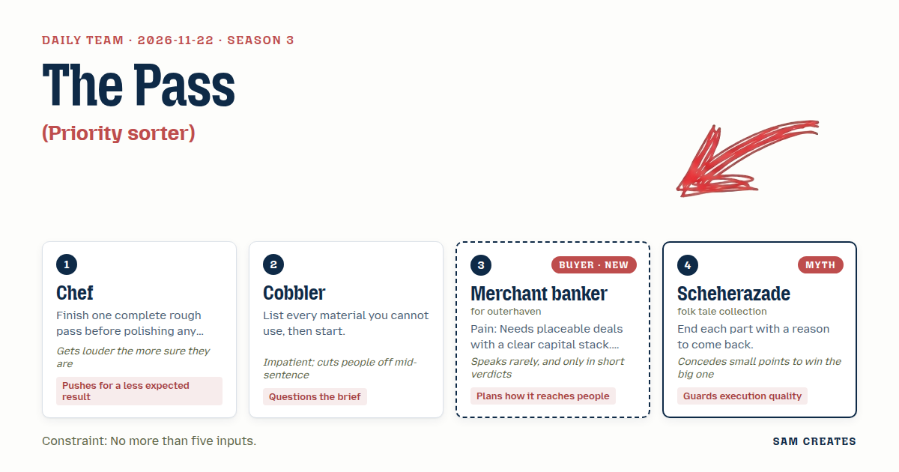
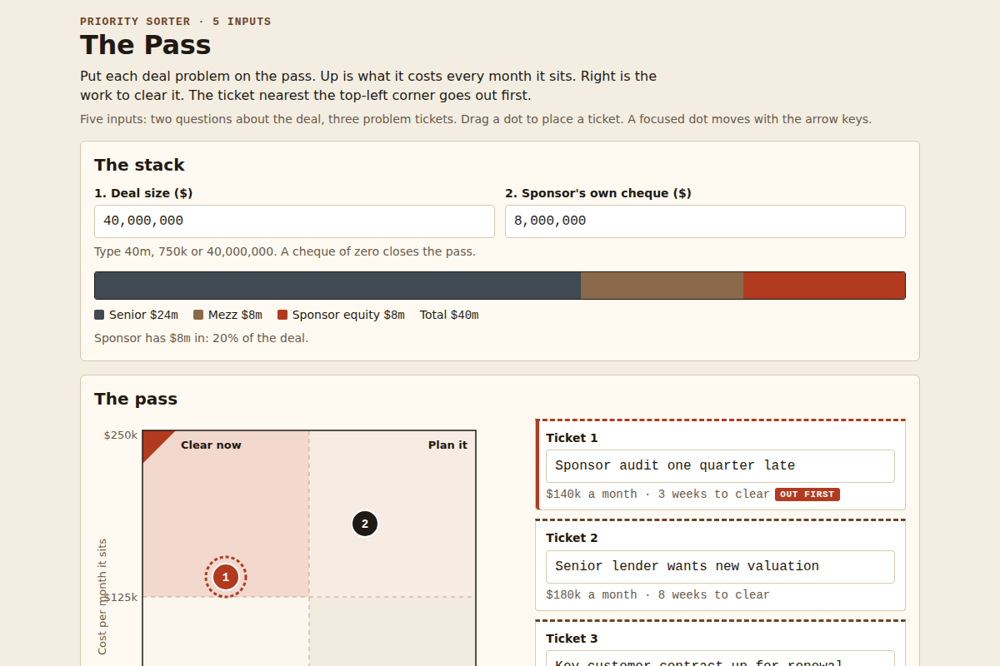

# 2026-11-22: The Pass

[Today](../../README.md) · [Archive](../../ARCHIVE.md)



**Task:** Priority sorter: a list of problems rated by cost and effort gives a two-by-two grid and the first one to tackle.

**Constraint:** No more than five inputs.

**Season:** 2026-10-07

**Decision:** The page takes a deal's size, the sponsor's own equity, and up to three problems placed by drag on a cost-by-effort grid, then draws the capital stack, names the first problem to clear with its six-month cost, and keeps the next problem ...

## Asset

<a href="artifact-1.html"></a>

[artifact-1.html](artifact-1.html), led by Chef. Model: claude-opus-5-5.

## The session

### Pitch

**1 · Chef: The Pass**\
Rough pass first. The whole grid goes on the page before a single label gets nice.\
Five tickets, no more. Each problem is a ticket you slide onto the pass.\
Left to right is effort. Bottom to top is what it costs every month it sits.\
No sliders, no 1-to-5 scores. You put the plate where it belongs.\
The ticket nearest the top-left corner goes out first. Everything else waits.\
That's the dish. Fix the garnish later.

**2 · Cobbler: Last Fitting**\
What I won't use: sliders, star ratings, an open text box, a sixth field, the word "priority."\
Five inputs is the whole hide. Cut the pattern to fit it.\
Two of them are the deal: its size, and the sponsor's own cheque.\
Three are problems. A deal with eight problems isn't a deal yet.\
And does the banker even want a ranking? Maybe they want to know which deal to stop walking on.

**Merchant banker (buyer; outerhaven): Stack First**\
Show me the stack before the problems.\
Senior, mezz, sponsor equity. In dollars.\
Sponsor at zero, I'm out. Grid or no grid.

**4 · Scheherazade: The Third Door**\
A grid that answers everything at once is finished before the reader leaves it.\
Show the first problem in full: its cost per month, and the one action that clears it.\
The second stays shaded. Its cost shows. Its fix does not.\
When the first is marked done, the second opens.\
They come back because a door is still shut, and they already know what sits behind it.

### Clash

**2 · Cobbler:** Chef, a dragged dot is two inputs per problem, effort and cost. Three problems is six, plus the deal, that's —

**1 · Chef:** It's ONE gesture. One drop, one ticket. The rule counts what the user enters, and they enter a place.

**Merchant banker (buyer; outerhaven):** Fine. Equity first.

**2 · Cobbler:** Second field. If it reads zero, the grid doesn't render. That's the walk, built into the page.

**4 · Scheherazade:** I'll give you the hard stop, Cobbler. But a blank screen teaches nothing. Draw the stack with a gap where the equity should be, and one line under it: this deal will not place.

**1 · Chef:** Now the share. The usual path is 1.5% on $40m, $600k at close. The other path is 0.75% plus warrants on 3% of the equity. Same work. Put them side by side.

**Merchant banker (buyer; outerhaven):** Run a six-month slip.

**4 · Scheherazade:** Fee path: $600k, six months late, if it closes. Share path: $300k at close, and the warrants go to zero if exit value halves. A dead deal burns $120k of diligence on either path. An AI first read of the term sheet and sponsor accounts cuts that to $30k, and outerhaven's counsel signs off before anything is relied on.

**1 · Chef:** The share keeps a $300k floor and the upside. Show it LOUDER than the fee.

**2 · Cobbler:** Louder is selling. Same weight on both, or the banker smells a pitch and —

### Decision

The page takes a deal's size, the sponsor's own equity, and up to three problems placed by drag on a cost-by-effort grid, then draws the capital stack, names the first problem to clear with its six-month cost, and keeps the next problem locked until the first is marked done.

Concept: The Pass

- Chef: the drag-to-place grid, with cost per month on the vertical axis and effort on the horizontal, and the ticket nearest the top-left corner chosen first.
- Cobbler: the five-input cut (deal size, sponsor equity, three problems) and the rule that zero sponsor equity stops the grid from rendering.
- Merchant banker (buyer; outerhaven): the stack in dollars sits above the grid, and deal size and sponsor equity are the two questions that show whether the deal is worth a call.
- Scheherazade: the gap drawn where missing equity should be, the shaded second problem with its cost visible, and the bad-case numbers.
- Cobbler lost the count argument because one drag is one entry for the user. The display-weight argument stays open: Chef wants the share path bigger, Cobbler wants equal weight. The build uses equal weight until outerhaven reviews it.
- Bad case: with a six-month slip and exit value halved, the fee path pays $600k late and the share path pays a $300k floor with warrants at zero. A dead deal costs $120k of diligence on either path, or $30k with an AI first read and counsel sign-off. The page holds because both paths and the dead-deal cost appear on screen with the same inputs.

### Build notes

1. Build `index.html` with five inputs: deal size ($), sponsor equity ($), and three problem tickets. Each ticket is a 40-character text field plus a draggable dot on a 400×400 SVG grid. If sponsor equity is 0, replace the grid with the stack bar and the line "This deal will not place."
2. Render the stack as one horizontal bar in dollars (senior, mezz, sponsor equity) above the grid. Under the first-pick ticket, show monthly cost × 6 as the slip figure. Show ticket two shaded, with its cost visible and its fix hidden, until a "Done" button on ticket one is pressed. Store that state in `localStorage`.
3. Add a two-column panel at equal type size. The left column is "Fee: 1.5% at close." The right column is "Share: 0.75% + warrants on 3% of equity." Each column shows three rows: closes on time, six-month slip with exit value halved, and deal dies ($120k diligence, or $30k with an AI first read). The footer reads: "AI first read; reviewed and signed by outerhaven counsel."

**Guest:** Scheherazade (myth; folk tale collection). The method is drawn from public-domain history, myth, or literature, or invented. The guest speaks in character in original words, never quoting the source, and nothing here is endorsed by anyone.

## Team

```text
Team for 2026-11-22
Season: 2026-10-07

1. Chef
   Method: Finish one complete rough pass before polishing any single part.
   Stance: Pushes for a less expected result.
   Temperament: Gets louder the more sure they are.
2. Cobbler
   Method: List every material you cannot use, then start.
   Stance: Questions the brief.
   Temperament: Impatient; cuts people off mid-sentence.
3. Merchant banker (buyer; outerhaven) [buyer] [new]
   Method: Pain: Needs placeable deals with a clear capital stack. Walks when: The sponsor has no money of their own in the deal. Opens up when: The sponsor has skin in the game and the stack is laid out.
   Stance: Plans how it reaches people.
   Temperament: Speaks rarely, and only in short verdicts.
4. Scheherazade (myth; folk tale collection) [guest]
   Method: End each part with a reason to come back.
   Stance: Guards execution quality.
   Temperament: Concedes small points to win the big one.

Constraint: No more than five inputs.
Task: Priority sorter: a list of problems rated by cost and effort gives a two-by-two grid and the first one to tackle.
```

Provider: claude. Model: claude-opus-5-5.
