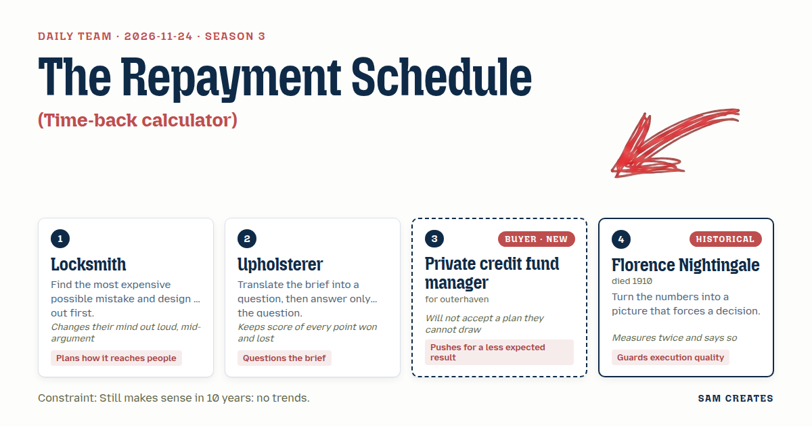
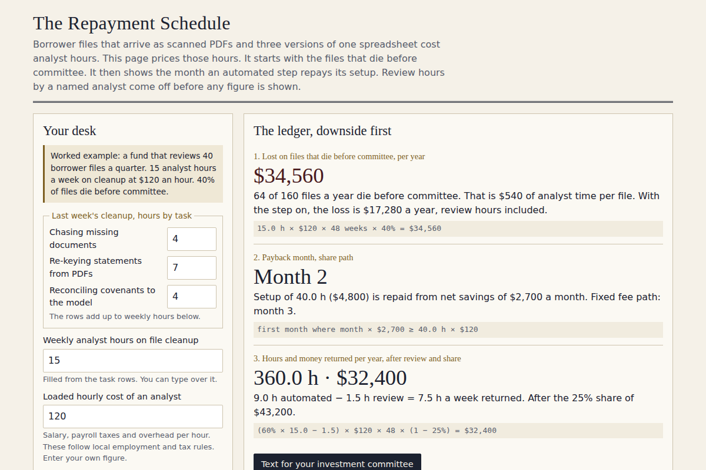

# 2026-11-24: The Repayment Schedule

[Today](../../README.md) · [Archive](../../ARCHIVE.md)



**Task:** Time-back calculator: weekly hours on manual tasks and an hourly cost give the hours and money an automated step would return.

**Constraint:** Still makes sense in 10 years: no trends.

**Season:** 2026-10-07

**Decision:** The page takes a fund's weekly analyst hours on borrower-file cleanup and an hourly cost, shows the money lost on files that die before committee first, and then shows the net hours, money, and payback month an automated step returns und...

## Asset

<a href="artifact-1.html"></a>

[artifact-1.html](artifact-1.html), led by Locksmith. Model: claude-opus-5-5.

## The session

### Pitch

**1 · Locksmith: The Honest Ledger**\
The costly mistake here is a number that lies.\
A calculator that promises 15 hours back when 4 come back. The fund manager catches it in one look and never returns.\
So the review time goes in before anything else. A named analyst still checks every cleaned file, and that hour is subtracted on screen.\
Weekly hours in, hourly cost in, review hours out, net shown in bold.\
I'd rather show a small true number than a big one they have to discount for me.

**2 · Upholsterer: Which Hours, Whose Desk**\
The brief says "hours back." The question underneath is: back to whom, and from what?\
For a credit fund it's analyst hours spent rebuilding a borrower's financials because the borrower sent a scanned PDF and three versions of the same spreadsheet.\
So I answer only that. One input row per task: chasing documents, re-keying statements, reconciling covenants.\
Each row gets its own hours. The total is the sum of things they recognise from last Tuesday.\
Nothing on the page that isn't on their desk.

**Private credit fund manager (buyer; outerhaven): The Repayment Schedule**\
I see forty borrowers a quarter. Half of them hand me a mess and call it a data room.\
Don't show me savings first. Show me what I lose on the files that die before committee. I paid for that work and got nothing back.\
Then treat the automated step like a loan. What it costs, when it pays back, what happens if my volume drops.\
If there's no payback month, I don't trust it.\
Give me a schedule I could put in front of my own investment committee.

**4 · Florence Nightingale: The Preventable Wedge**\
One chart, built so the reader cannot look past the waste.\
A circle cut into 12 monthly wedges. Each wedge splits into hours that produced a decision and hours lost to files that died.\
The lost part sits in a darker shade on the outer ring, where the eye lands first.\
I would check every figure against the inputs twice before it draws. I would say on the page that I did.\
The picture's job is to make the reader decide.

### Clash

**Private credit fund manager (buyer; outerhaven):** Locksmith, your ledger is honest but it starts with the upside. Downside first or I'm gone. Dead files, then payback, then savings.

**1 · Locksmith:** Fair, but the review hours still have to come off before any savings line. No, wait. If dead files lead, the review subtraction belongs there too, because we still reviewed the files that died. So yes, downside first. I'm moving.

**2 · Upholsterer:** That's one to the fund manager. Locksmith, the dead-file line only works if they enter what share of files die. That's a third input, and the brief gave us two.

**4 · Florence Nightingale:** Upholsterer, then make it a qualifying question rather than an input. Share of files that die before committee. I ran the base case twice: 15 hours a week at $120, 40 percent dead, 48 weeks. That's $34,560 a year on files that never close.

**Private credit fund manager (buyer; outerhaven):** That number I would forward. Nightingale, draw the payback, though. Your wheel shows waste. It doesn't show when the step repays.

**4 · Florence Nightingale:** A second picture splits the reader's attention. I'd mark the payback month as a single bold wedge on the same circle. Measure it, don't add a chart.

**2 · Upholsterer:** Two to the fund manager, one to Nightingale. My point stands. The task rows carry the credibility. A single "weekly hours" box tells them we never sat at their desk.

**1 · Locksmith:** Here's the bad case. Volume halves to 7.5 hours. 60 percent automated is 4.5, minus 1.5 review is 3 net hours. That's $17,280 a year. A fixed fee of $1,500 a month is $18,000. It loses $720. A 25 percent share of measured savings costs $4,320 and nets $12,960. The share holds. The fee does not.

**Private credit fund manager (buyer; outerhaven):** Then the share is the default path and the fee sits next to it showing its loss. I still want the wheel replaced by a plain amortisation table. I can't sign a circle.

### Decision

The page takes a fund's weekly analyst hours on borrower-file cleanup and an hourly cost, shows the money lost on files that die before committee first, and then shows the net hours, money, and payback month an automated step returns under a fixed fee and under a revenue share.

Concept: The Repayment Schedule

- Locksmith: review hours by a named analyst are subtracted before any figure is shown, including on dead files.
- Upholsterer: three task rows (chasing documents, re-keying statements, reconciling covenants) sum into the weekly hours input.
- Private credit fund manager (buyer; outerhaven): order of the page is downside, payback, savings. The share path is the default. Two qualifying questions: files reviewed per quarter, and share of files that die before committee.
- Florence Nightingale: the 12-wedge circle with lost hours in the dark outer ring and the payback month marked. Every figure is checked against the inputs before it draws, and a line says so.
- Lost: the fund manager lost the table-instead-of-wheel argument, because the wheel carries the dead-file cost and a table gives it the same weight as every other row. A plain table sits below the wheel as a fallback, and the fund manager still objects to leading with the circle. Upholsterer lost the separate-inputs-per-task argument at the brief level. The rows stay as a helper, and the two required inputs remain the only fields that drive the result.
- Bad case: volume halved to 7.5 hours a week. The fixed fee nets −$720 a year and the share nets $12,960. The page holds on the share path and shows the fee path's loss in the same table.

### Build notes

1. Inputs: weekly hours (filled from three optional task rows), hourly cost, files per quarter, percent of files that die. Constants shown and editable: 60 percent automated, 1.5 review hours a week, 48 working weeks, $1,500 monthly fee, 25 percent share.
2. Output order in one column: dead-file cost per year, then payback month, then net hours and money per year. Below that, a two-column table of fixed fee and share, with a half-volume row for each.
3. Draw the 12-wedge circle in inline SVG from the same computed values as the table. Run an assertion that wedge totals equal the table totals before rendering, and print "Figures checked against inputs" under the chart.

**Guest:** Florence Nightingale (historical; died 1910). The method is drawn from public-domain history, myth, or literature, or invented. The guest never speaks as the figure, and nothing here is endorsed by anyone.

## Team

```text
Team for 2026-11-24
Season: 2026-10-07

1. Locksmith
   Method: Find the most expensive possible mistake and design it out first.
   Stance: Plans how it reaches people.
   Temperament: Changes their mind out loud, mid-argument.
2. Upholsterer
   Method: Translate the brief into a question, then answer only the question.
   Stance: Questions the brief.
   Temperament: Keeps score of every point won and lost.
3. Private credit fund manager (buyer; outerhaven) [buyer] [new]
   Method: Pain: Sees borrowers who are not ready for diligence. Walks when: Nobody has thought about how the loan gets repaid. Opens up when: The downside and collateral come first and the upside second.
   Stance: Pushes for a less expected result.
   Temperament: Will not accept a plan they cannot draw.
4. Florence Nightingale (historical; died 1910) [guest]
   Method: Turn the numbers into a picture that forces a decision.
   Stance: Guards execution quality.
   Temperament: Measures twice and says so.

Constraint: Still makes sense in 10 years: no trends.
Task: Time-back calculator: weekly hours on manual tasks and an hourly cost give the hours and money an automated step would return.
```

Provider: claude. Model: claude-opus-5-5.
