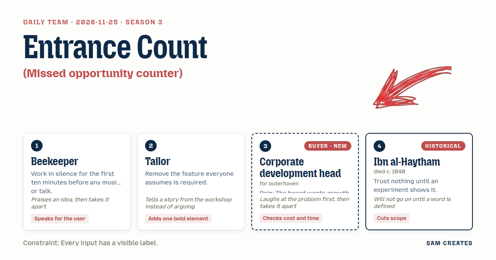
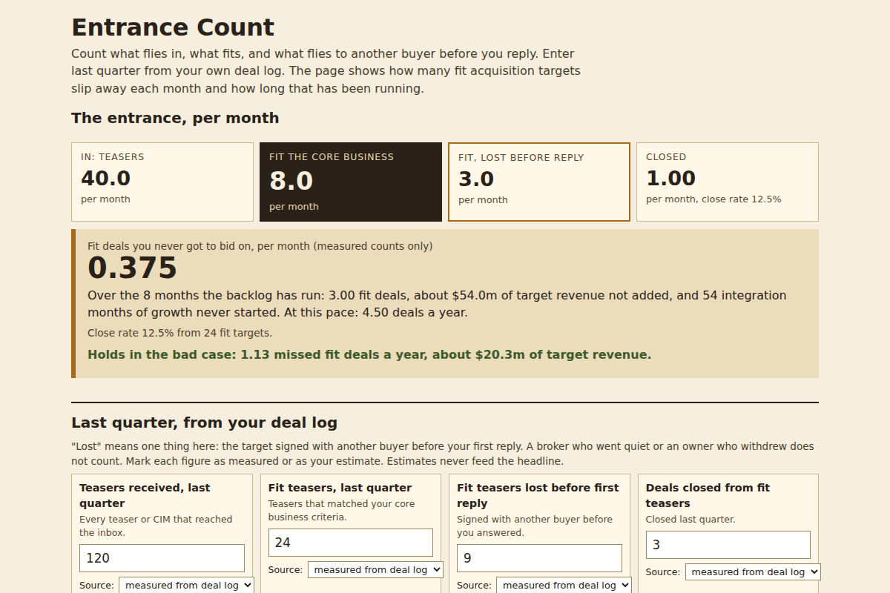

# 2026-11-25: Entrance Count

[Today](../../README.md) · [Archive](../../ARCHIVE.md)



**Task:** Missed opportunity counter: inbound volume, response time, and close rate give how many deals or bookings slip away each month.

**Constraint:** Every input has a visible label.

**Season:** 2026-10-07

**Decision:** The page takes last quarter's teaser counts, reply time, and close rate, and shows how many fit acquisition targets slip away each month and how long that has been running.

## Asset

<a href="artifact-1.html"></a>

[artifact-1.html](artifact-1.html), led by Beekeeper. Model: claude-opus-5-5.

## The session

### Pitch

**1 · Beekeeper: Entrance Count**\
Ten minutes with no talk, and I watched the entrance of the hive in my head.\
You count what flies in. You count what comes back. The gap tells you more than opening the box.\
This user counts teasers in, replies out, deals closed. Three labelled boxes.\
Then one line: the fit targets that flew to another hive before you answered.\
Two questions after that. Typical target revenue. How many months the backlog has run.\
That turns one bad month into a slow loss that has run since spring.

**2 · Tailor: No Price Tag**\
A client once came in with a jacket and a price he wanted it to cost. I cut the price off the order slip.\
We talked about how he moves. He drives, he lifts a child, he sits in long meetings.\
The jacket fit because nobody argued about the number first.\
I take the price field out. Every deal tool has one, and it pulls the eye.\
In its place, one bold column: fit to the core business, scored by the user, labelled in plain words.\
Each missed deal shows as a target that fit, before it shows as money.

**Corporate development head (buyer; outerhaven): Pipeline Leak**\
Honestly, it's funny. The board wants growth by acquisition, and our inbox is the bottleneck.\
Forty teasers a month. We answer in twelve days. The good ones are gone by day five.\
Show me the leak per month, and tie each leak to fit and to the integration months it would have taken.\
Price without fit is the deck I bin every week.\
Two minutes, then I forward it to my CFO. That's the bar.

**4 · Ibn al-Haytham: One Measured Quarter**\
His method was to accept a claim only after a test showed it. The same rule applies to this page.\
The user does not guess a rate. They enter last quarter's counts from their own deal log.\
Teasers received. Teasers that fit. Fit teasers lost before first reply. Deals closed.\
Cut everything else. No industry benchmarks, no default curves.\
The page shows only what that quarter shows.

### Clash

**3 · Corporate development head:** Beekeeper, I laughed reading my own numbers into yours. Eight fit targets a month, three gone before we reply, one in eight closes. That's 0.375 deals a month we never got to bid on.

**4 · Ibn al-Haytham:** Corporate development head, before that number stands, define "gone." The target signed with another buyer, the broker stopped answering, and the owner withdrew are three different events. The count can include only one of them.

**1 · Beekeeper:** Ibn al-Haytham, the definition is right and it makes the count honest. It also leaves the box empty. Almost no team logs when a broker went elsewhere. Give two labelled fields, "measured from deal log" and "your estimate," and let the user say which one they have.

**4 · Ibn al-Haytham:** Beekeeper, then an estimate never feeds the headline. It can sit beside it, in grey, labelled as an estimate. The headline uses measured counts only.

**2 · Tailor:** Corporate development head, about the price field. A man once wanted the cloth that cost the most, and that cloth would have split at the shoulder in a month. I don't want your page to start with what the target costs.

**3 · Corporate development head:** Tailor, fine, kill price. I still need cost and time. Add integration months as a labelled input. And add an earn-out next to the full-payment path: 60 percent at close, 40 percent tied to integration milestones over 24 months. If the target fits, we get the same company and pay later.

**1 · Beekeeper:** Corporate development head, the twelve days is the leak, so AI reads every teaser against your fit criteria within 24 hours. That is 120 analyst hours a month cut to 40 hours of review. On a deal that dies in diligence, an AI first pass on the CIM and financials cuts outside fees from $900k to $350k. Your corp dev director signs off on fit. General counsel signs off on anything legal.

**3 · Corporate development head:** Bad case. Volume halves to 20 teasers, 4 fit, 1.5 lost, and the close rate halves to 6 percent. That's 0.09 deals a month, about one a year, or $20m of target revenue we never added. If integration slips six months, the full-payment path has paid 100 percent and is waiting. The earn-out path has paid 60 percent and still holds 40.

**2 · Tailor:** Beekeeper, put both paths on one row with the same inputs and the same bad case under each. If the earn-out sits on a second screen, nobody will scroll to it.

**4 · Ibn al-Haytham:** Corporate development head, your one deal a year still rests on a close rate taken from a quarter that had five fit targets. Five targets are too few to call that a rate. I would not print it as one.

### Decision

The page takes last quarter's teaser counts, reply time, and close rate, and shows how many fit acquisition targets slip away each month and how long that has been running.

Concept: Entrance Count

- Beekeeper: the in, out, and lost count, plus two qualifying questions on target revenue and months the backlog has run.
- Tailor: no price field, a bold fit column, and both deal paths on one row.
- Corporate development head: integration months as a labelled input, the earn-out shortcut beside full payment, and the two-minute forward test.
- Ibn al-Haytham: "lost" defined as signed with another buyer before first reply, and the headline built from measured counts only.
- Lost: the Tailor lost the case for a fit score with no money anywhere, because the buyer needs a cost and a timeline to forward the page to a CFO. The disagreement over whether a close rate from five targets counts as a rate stays open. The page shows sample size beside the rate.
- Bad case: halved volume, a halved close rate, and a six-month integration slip still leave about one missed deal a year worth $20m in target revenue, and the earn-out still holds 40 percent back. The page holds.

### Build notes

1. Build seven inputs, each with a visible label and a "measured" or "estimate" tag: teasers per month, fit teasers per month, fit teasers lost before first reply, days to first reply, deals closed, integration months, and typical target revenue. Only measured inputs feed the headline.
2. Show the result as missed fit targets per month, multiplied by the months the backlog has run. Under it, put one row with full payment and the earn-out at 60/40 side by side. Each column shows the normal case and the bad case: halved volume, a halved close rate, and a six-month slip.
3. Add an AI-screening line that shows reply time falling from 12 days to 1, analyst hours falling from 120 to 40, and failed-deal diligence falling from $900k to $350k. Name the corp dev director and general counsel as the people who sign off.

**Guest:** Ibn al-Haytham (historical; died c. 1040). The method is drawn from public-domain history, myth, or literature, or invented. The guest never speaks as the figure, and nothing here is endorsed by anyone.

## Team

```text
Team for 2026-11-25
Season: 2026-10-07

1. Beekeeper
   Method: Work in silence for the first ten minutes before any music or talk.
   Stance: Speaks for the user.
   Temperament: Praises an idea, then takes it apart.
2. Tailor
   Method: Remove the feature everyone assumes is required.
   Stance: Adds one bold element.
   Temperament: Tells a story from the workshop instead of arguing.
3. Corporate development head (buyer; outerhaven) [buyer] [new]
   Method: Pain: The board wants growth by acquisition this year. Walks when: It ignores how the target fits the core business. Opens up when: It speaks to fit and integration, not only price.
   Stance: Checks cost and time.
   Temperament: Laughs at the problem first, then takes it apart.
4. Ibn al-Haytham (historical; died c. 1040) [guest]
   Method: Trust nothing until an experiment shows it.
   Stance: Cuts scope.
   Temperament: Will not go on until a word is defined.

Constraint: Every input has a visible label.
Task: Missed opportunity counter: inbound volume, response time, and close rate give how many deals or bookings slip away each month.
```

Provider: claude. Model: claude-opus-5-5.
