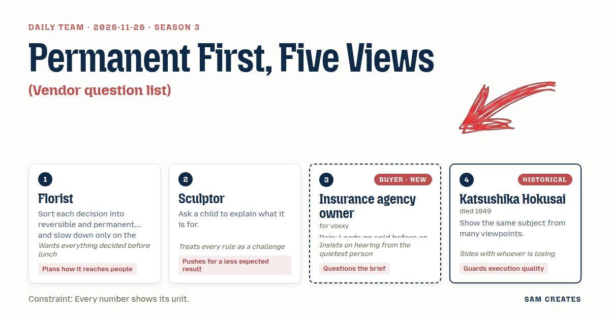
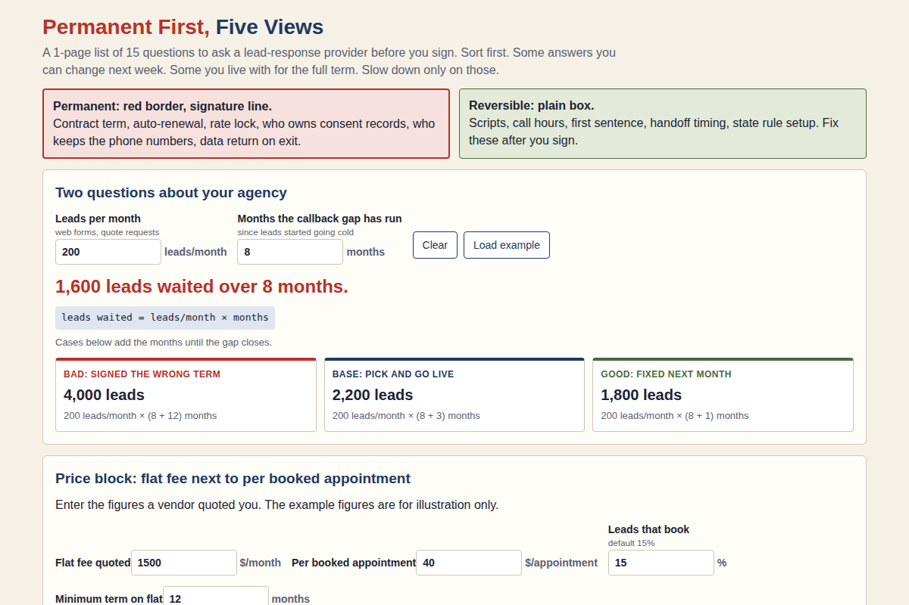

# 2026-11-26: Permanent First, Five Views

[Today](../../README.md) · [Archive](../../ARCHIVE.md)



**Task:** Vendor question list: the buyer's priorities give a printable list of questions to ask before signing with any provider.

**Constraint:** Every number shows its unit.

**Season:** 2026-10-07

**Decision:** The page takes an agency owner's leads per month and months of slow callbacks, shows how many leads have waited, and prints a 1-page list of 15 questions in 5 views, with permanent commitments marked for signature, a phone-response test ...

## Asset

<a href="artifact-1.html"></a>

[artifact-1.html](artifact-1.html), led by Florist. Model: claude-opus-5-5.

## The session

### Pitch

**1 · Florist: Permanent First**\
Two kinds of stems in every order. Ones you can swap tomorrow, ones that are cut for good.\
Scripts, call hours, voice tone: you can change those next week. Contract term, who owns the consent records, number porting: those you can't.\
The sheet splits that way. Permanent questions get a red border and a signature line.\
Up top, two boxes only: leads per month, and months the callback gap has run.\
The result reads as a running total: 200 leads/month for 8 months is 1,600 leads that waited.\
Decide the split before lunch. The wording can move after.

**2 · Sculptor: One Sentence a Kid Gets**\
I asked my niece what a lead-response vendor is for. She said: "So the person who asked gets called before they forget."\
Every question on the sheet carries that test. The vendor answers in one sentence she would follow, or it's marked a fail.\
Blank line under each question. A box for seconds-to-answer.\
And the price block breaks the usual rule. Flat fee next to a per-booked-appointment rate, same inputs.\
They earn when your agent gets a meeting. Otherwise they don't.

**Insurance agency owner (buyer; voxxy): Call Me First**\
Before any question, I fill out their web form from my own phone as a fake lead.\
I count seconds until a call comes. Over 60 seconds, the meeting is over.\
Then: does my agent get handed the live call, or a transcript an hour later?\
Then: show me the consent record for that call, and who keeps it.\
I've had 4 vendor demos this year. A question list is what they all have a slide for already. So the list has to make them show, not tell.

**4 · Katsushika Hokusai: Same Lead, Five Views**\
One subject drawn from many places. Here the subject is one inbound lead.\
View 1: the prospect hearing the first voice. View 2: the agent taking the handoff. View 3: the compliance file. View 4: the owner's ledger. View 5: the carrier who sees the policy.\
3 questions per view. 15 questions in total.\
1 printed sheet, Letter size, 11 pt type, margins of 0.5 in. Nothing runs to a second page where it gets skipped.\
If a view has no good question, the sheet shows the gap.

### Clash

**3 · Insurance agency owner:** Florist, I've sat through 4 of these demos this year. Every rep has an answer for every question you'll print. What stops this from being their FAQ in my handwriting?

**1 · Florist:** The split does. Scripts and hours you can fix next week. A 12-month minimum term and consent records held on their servers you can't. Permanent questions get the red border and need a name signed beside them. Can we lock that much before lunch?

**2 · Sculptor:** Lock it and it's a checklist. The rule says ask questions. I say they answer in one sentence a kid follows, in your office, with a timer running. And price it at $40/booked appointment next to the $1,500/month flat fee. That way they get paid only when your agent gets a meeting.

**3 · Insurance agency owner:** Per appointment, yes. The timer in my office is theater. The real test is my phone and their web form, counted in seconds. Hokusai, you haven't said much. Go.

**4 · Katsushika Hokusai:** Your phone test is one view of the lead. The agent's handoff, the compliance file, your ledger, and the carrier each see it differently. 3 questions per view, 15 questions on 1 sheet at 11 pt, so a vendor can't pass on the view it practiced.

**1 · Florist:** 15 questions fits. Second thing: the page sends the vendor's contract draft to an AI reader that checks it against the permanent column for auto-renewal, term length, data ownership, and consent language. That saves about 2 hours of attorney time at $300/hour, or $600/vendor. Review 3 vendors and sign none, and that's $1,800 you didn't spend. Your E&O counsel still reads the flagged clauses and signs.

**2 · Sculptor:** Bad case. 200 leads/month, 15% booked, 30 appointments/month. Per appointment that's $1,200/month against $1,500/month flat. Volume halves to 100 leads/month: $600/month against $1,500/month. Rate doubles to $80/appointment at half volume: $1,200/month, still under flat. Flat on a 12-month minimum is $18,000 committed whatever happens.

**3 · Insurance agency owner:** That holds. But once they see me booking, they raise the per-appointment rate at renewal. Put a rate-lock question in the permanent column, or the shortcut turns into the trap.

**4 · Katsushika Hokusai:** Florist, the in-room timer is losing, so I'll stand with it. A vendor answering slowly across your desk is a different view of the same company than its web form. Give it one box on the sheet.

**1 · Florist:** No room. 1 sheet, 15 questions. The phone test stays. The in-room timer goes.

### Decision

The page takes an agency owner's leads per month and months of slow callbacks, shows how many leads have waited, and prints a 1-page list of 15 questions in 5 views, with permanent commitments marked for signature, a phone-response test in seconds, and a flat-fee versus per-appointment price block with its bad case.

Concept: Permanent First, Five Views

- Florist: the reversible/permanent split with red borders and signature lines, the two input boxes, the running total of leads that waited, and the AI contract read against the permanent column.
- Sculptor: the one-sentence answer rule printed under each question, and the per-appointment price block shown next to the flat fee.
- Insurance agency owner: the phone test as the first item on the sheet with a 60-second cutoff, the live-handoff and consent-record questions, and the rate-lock question in the permanent column.
- Katsushika Hokusai: the 5 views of one lead at 3 questions each, and the 1-sheet layout at 11 pt with 0.5 in margins.
- Lost: the Sculptor and Hokusai lost the in-room timer, because the sheet holds 15 questions on 1 page and the phone test already measures response speed in seconds. Hokusai still holds that the vendor in the room is a separate view. That point stays open.
- Bad case: tested at 100 leads/month and $80/appointment. Per-appointment pricing comes to $1,200/month against $1,500/month flat, and the flat path commits $18,000 over a 12-month minimum term. The page holds, and the rate-lock question covers the renewal risk.

### Build notes

1. Build the input block with two fields only, leads/month and months the gap has run, and print the result as "N leads waited over M months". Add a price block with three rows: flat at $1,500/month, per appointment at $40, and the bad case at 100 leads/month and $80/appointment. The 15% booking rate can be edited and defaults to 15%.
2. Lay out the 15 questions in a 5-column grid, one column per view. Put a 2 px red border on permanent questions, with a signature line 2 in wide. The page copy says "your agent takes the live call" and "seconds to first call". It does not use dialer or replacement language.
3. Add a print stylesheet set to Letter size, 11 pt, and 0.5 in margins, with a check that fails the build if the sheet runs past 1 page. Add an upload field that sends the contract draft to the AI reader and returns flagged clauses beside the permanent questions. The footer reads "Reviewed and signed by: ______ (E&O counsel)".

**Guest:** Katsushika Hokusai (historical; died 1849). The method is drawn from public-domain history, myth, or literature, or invented. The guest never speaks as the figure, and nothing here is endorsed by anyone.

## Team

```text
Team for 2026-11-26
Season: 2026-10-07

1. Florist
   Method: Sort each decision into reversible and permanent, and slow down only on the permanent ones.
   Stance: Plans how it reaches people.
   Temperament: Wants everything decided before lunch.
2. Sculptor
   Method: Ask a child to explain what it is for.
   Stance: Pushes for a less expected result.
   Temperament: Treats every rule as a challenge.
3. Insurance agency owner (buyer; voxxy) [buyer] [new]
   Method: Pain: Leads go cold before an agent calls back. Walks when: It sounds like a robocaller or a compliance risk. Opens up when: Agents stay in the loop and new leads hear back in seconds.
   Stance: Questions the brief.
   Temperament: Insists on hearing from the quietest person.
4. Katsushika Hokusai (historical; died 1849) [guest]
   Method: Show the same subject from many viewpoints.
   Stance: Guards execution quality.
   Temperament: Sides with whoever is losing.

Constraint: Every number shows its unit.
Task: Vendor question list: the buyer's priorities give a printable list of questions to ask before signing with any provider.
```

Provider: claude. Model: claude-opus-5-5.
