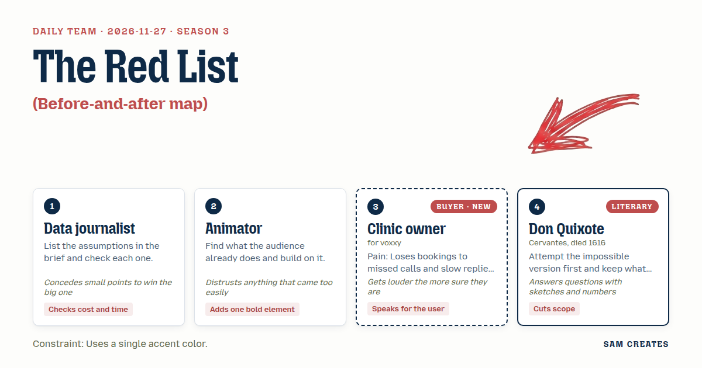
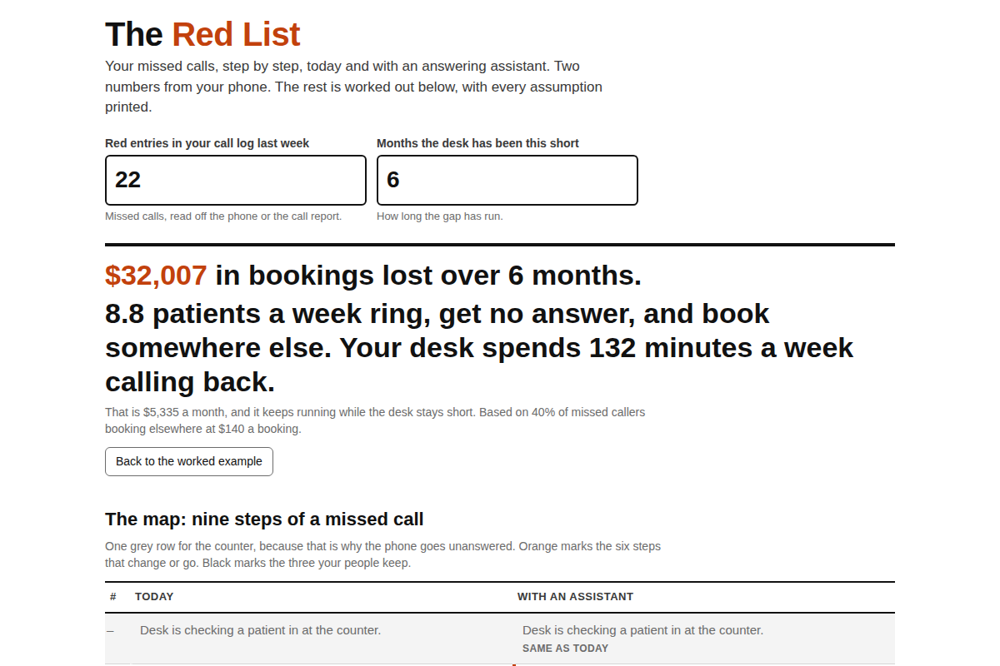

# 2026-11-27: The Red List

[Today](../../README.md) · [Archive](../../ARCHIVE.md)



**Task:** Before-and-after map: today's process as a list of steps becomes a side-by-side view marking the steps that could be removed or automated.

**Constraint:** Uses a single accent color.

**Season:** 2026-10-07

**Decision:** The page turns two numbers from the owner's phone into a side-by-side map of the nine steps a missed call goes through, marks in one orange the six steps that change, and shows what the gap has cost over the months it has run.

## Asset

<a href="artifact-1.html"></a>

[artifact-1.html](artifact-1.html), led by Data journalist. Model: claude-opus-5-5.

## The session

### Pitch

**1 · Data journalist: The Red List**\
Three assumptions sit in this brief. First, the owner knows how many calls they miss. They do, because it's in the phone log. Second, a missed caller books somewhere else. Some do. I set it at 40% and print that number on the page so nobody has to trust me blind. Third, callbacks are free. They aren't. Four minutes a try, one and a half tries a call.\
Before column: the nine steps a missed call goes through today. After column: the same nine, with the changed ones marked in one orange.\
Result line in months: lost bookings times $140 times how long it has run.

**2 · Animator: Recent Calls**\
Every owner already does this at lunch. They open the phone, scroll the recent calls, wince at the red ones.\
So the "before" is that list. Twenty-two red entries, timestamps, no names.\
The "after" is the same list. The red entries now read "Booked Tue 2:15" or "Rang through to desk."\
One bold element: a single Monday, 8:00 to 9:00, drawn as a bar with the rings stacked on it. That's where the red comes from.\
The accent orange is the only colour on screen. It marks every entry that changed.

**Clinic owner (buyer; voxxy): Who Picks Up**\
Monday 8am. Thirty calls in the first hour. Two people at the desk, one of them checking someone in.\
I've sat through a demo where the voice said "I didn't catch that" three times to a 70-year-old. I closed the laptop.\
Show me which calls my people still take. Show me the hour they get back.\
If the page says "robot" or "AI agent" anywhere, I'm gone.\
Patients first. Then the money. I already know I'm losing money.

**4 · Don Quixote: Every Step Struck**\
First I strike all nine steps. A clinic with no telephone at all, patients arriving as if summoned.\
Then I see which strikes draw blood. Three do. The voice that meets a frightened caller. The hand that checks the insurer. The one who decides what counts as frightened.\
Sketch: nine boxes, six crossed in orange, three left standing in black.\
Keep only the path of the missed call. The rest of the clinic is another windmill for another day.

### Clash

**3 · Clinic owner:** Data journalist, your draft says "automate step 3." I read that and I hear Mrs. Okafor shouting at a menu. Change the word.

**1 · Data journalist:** Done, the word goes. The column says "the assistant answers, your desk sees it." The 8.8 lost bookings a week stays as the number at the top.

**2 · Animator:** Don Quixote, if you cut everything but the missed call, the map lies. The call gets missed because someone is at the counter. Take the counter out and step 2 makes no sense.

**4 · Don Quixote:** Then one row for the counter, drawn grey, and no more. Sketch: counter row, nine call rows beneath it. Ten boxes. I will not have twelve.

**3 · Clinic owner:** And when a mother rings after a bad lab result and the assistant says "how can I help"? I lose that family for good. It doesn't take the worried ones. Ever.

**4 · Don Quixote:** Of a hundred calls: sixty to book or move, twenty-five questions, fifteen worried. The assistant takes the sixty. The fifteen ring straight through to a person, marked. Your practice manager writes the list of what counts as worried and signs it.

**2 · Animator:** Data journalist, your two questions should be things they can read off the phone. "Red entries last week" and "months the desk has been this short." No guessing at rates.

**1 · Data journalist:** Agreed. Now the bad case. Halve the red entries to 11. That's 4.4 lost a week, $2,668 a month. Flat fee $400, or $9 per recovered booking. At 70% recovery that's 13 bookings a month, so $120. Both still cover cost. The per-booking line protects the owner when it's slow.

**3 · Clinic owner:** Fine, the numbers hold. But you're still putting dollars at the top. I told you, I know I'm losing money. Lead with my patients getting answered and my staff getting their lunch back.

**1 · Data journalist:** The headline stays dollars over months. A one-off number gets ignored, and six months of it gets a call. Your line about patients sits directly under it, same size.

### Decision

The page turns two numbers from the owner's phone into a side-by-side map of the nine steps a missed call goes through, marks in one orange the six steps that change, and shows what the gap has cost over the months it has run.

Concept: The Red List

- Data journalist: the nine-step map, the 40% assumption printed on the page, and the result line of lost bookings × $140 × months.
- Animator: the before column styled as the phone's recent-calls list, the two inputs read off the phone, and the 8:00 to 9:00 Monday bar.
- Clinic owner: no "robot" or "AI agent" on the page, the 15-of-100 worried calls ringing through to a person, and staff minutes saved shown next to dollars.
- Don Quixote: scope cut to the missed-call path plus one grey counter row, and the three steps left standing in black with the practice manager's sign-off.
- Lost: Don Quixote lost the cut to the counter row, because without it step 2 has no cause. The Clinic owner's push for a patient-first headline stays open. The lead kept dollars over months on top, because that is the figure that leads to a call.
- Bad case: with missed calls halved to 11 a week, the clinic still loses $2,668 a month. The per-booking path costs $120 a month against $1,867 recovered, and the flat path costs $400. Callback time saved drops from 132 to 66 minutes a week. The page holds at half volume.

### Build notes

1. Build `red-list.html` with two inputs: "Red entries in your call log last week" (default 22) and "Months the desk has been this short" (default 6). Compute lost = 0.4 × entries, monthly = lost × 140 × 4.33, total = monthly × months, and minutes saved = entries × 1.5 × 4.
2. Render two columns of ten rows: the grey counter row plus nine call steps. Use one accent, `#C2410C`, for the six changed steps and the "Booked" entries. Use black for the three kept steps, labelled "Your desk keeps this," and greys for everything else. Check that "robot," "AI agent," and "automate" do not appear anywhere in the copy.
3. Under the result, add a pricing strip that shows flat $400/month and $9 per recovered booking side by side. Both use the same inputs and both show a "half the calls" row. Add one line: "Your practice manager approves the list of calls that always go to a person."

**Guest:** Don Quixote (literary; Cervantes, died 1616). The method is drawn from public-domain history, myth, or literature, or invented. The guest speaks in character in original words, never quoting the source, and nothing here is endorsed by anyone.

## Team

```text
Team for 2026-11-27
Season: 2026-10-07

1. Data journalist
   Method: List the assumptions in the brief and check each one.
   Stance: Checks cost and time.
   Temperament: Concedes small points to win the big one.
2. Animator
   Method: Find what the audience already does and build on it.
   Stance: Adds one bold element.
   Temperament: Distrusts anything that came too easily.
3. Clinic owner (buyer; voxxy) [buyer] [new]
   Method: Pain: Loses bookings to missed calls and slow replies. Walks when: It feels like a robot will annoy patients. Opens up when: Patients still feel looked after and staff get time back.
   Stance: Speaks for the user.
   Temperament: Gets louder the more sure they are.
4. Don Quixote (literary; Cervantes, died 1616) [guest]
   Method: Attempt the impossible version first and keep what survives.
   Stance: Cuts scope.
   Temperament: Answers questions with sketches and numbers.

Constraint: Uses a single accent color.
Task: Before-and-after map: today's process as a list of steps becomes a side-by-side view marking the steps that could be removed or automated.
```

Provider: claude. Model: claude-opus-5-5.
