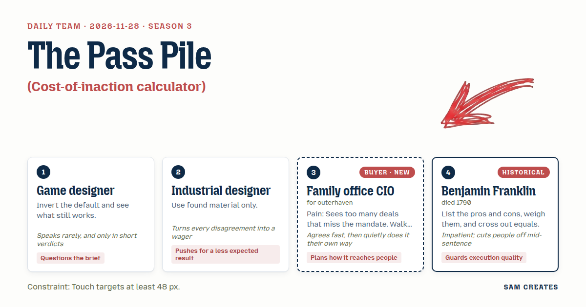
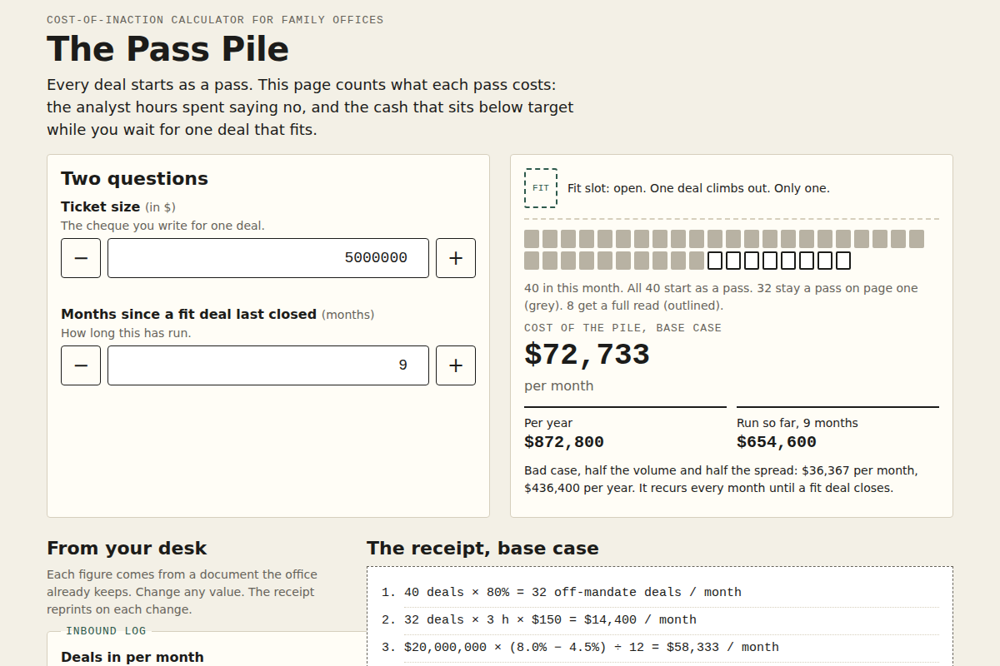

# 2026-11-28: The Pass Pile

[Today](../../README.md) · [Archive](../../ARCHIVE.md)



**Task:** Cost-of-inaction calculator: the buyer's current volumes and rates give what the problem costs per month and per year, with each step of the sum shown.

**Constraint:** Touch targets at least 48 px.

**Season:** 2026-10-07

**Decision:** The page takes a family office's inbound deal count, screening hours, loaded rate, and idle capital, starts every deal in a pass pile, and prints, line by line, what screening off-mandate deals and leaving cash idle cost per month and pe...

## Asset

<a href="artifact-1.html"></a>

[artifact-1.html](artifact-1.html), led by Game designer. Model: claude-opus-5-5.

## The session

### Pitch

**1 · Game designer: The Pass Pile**\
Invert it. Default answer is pass.\
Every deal starts in the pass pile.\
The page counts what each pass cost you.\
Hours to say no, times deals, times rate.\
Then the money that sat idle while you said no.\
One fit deal climbs out. Only one.

**2 · Industrial designer: The Inbox Count**\
I don't invent inputs. I take what's already on her desk.\
Last month's inbound log. The analyst timesheet. The cash line on the treasury report.\
Three numbers she can copy without thinking: deals in, hours per screen, idle capital.\
Inputs are 48 px stepper blocks, like keys on a calculator you've used for ten years.\
The sum prints down the page like a receipt.\
No sliders. Nobody trusts a slider with a percentage.

**Family office CIO (buyer; outerhaven): One Line For The Principal**\
Forty decks a month. Thirty-two miss the mandate on the first page.\
My analyst still reads them, because the broker will call.\
If this looks like it went to fifty offices, I close it.\
Show me you know what a mandate is. Ask for mine in two fields: ticket size, sector.\
Give me one number I can paste into Monday's note to the family.\
Then show me one deal that fits.

**4 · Benjamin Franklin: The Two-Column Ledger**\
Two columns. Same inputs on both sides.\
Left: keep screening by hand and pay a sourcing retainer.\
Right: machine first read, a named analyst signs, and the sourcing partner is paid only at close.\
Strike out every line that costs the same on both sides.\
What survives the strikes is the decision.\
Bad case at the bottom of each column, in the same type size.

### Clash

**3 · Family office CIO:** Game designer, yes to the pass pile. My analyst won't type forty deals, though. Three boxes, no more.

**1 · Game designer:** Three boxes. Mandate first.

**2 · Industrial designer:** Mandate first gets you a paragraph of prose nobody reads. A lunch says she pastes last month's subject lines faster than she writes her mandate.

**3 · Family office CIO:** Sure, fine. I'm just not pasting deal names into a vendor's page, so I'll —

**4 · Benjamin Franklin:** Counts are enough. Forty in, thirty-two off-mandate, three hours each, $150 loaded. That's $14,400 a month. Next: the retainer column against the close-only column.

**2 · Industrial designer:** Franklin, double or nothing that close-only loses in the good case. A $5M ticket at 1.5% is $75,000. A $10,000 retainer that closes in month four is $40,000.

**4 · Benjamin Franklin:** Granted. Now run the bad case. Volume halves to 20, so 16 off-mandate deals cost $7,200 a month. Nothing closes for twelve months. Retainer column: $120,000 paid out. Close-only column: zero. Slip six months to month ten: $100,000 against $75,000. Close-only holds in every case except a fast close.

**3 · Family office CIO:** That third line goes in Monday's note. Add the machine screen. Half an hour of analyst review per deal instead of three is $3,000 a month with the tool, against $14,400.

**1 · Game designer:** Counts only. No paste.

**2 · Industrial designer:** Then the off-mandate share is a guess, and she'll know it's a guess. I'll bet the page that an optional local-only paste box gets used more than the percentage field does.

### Decision

The page takes a family office's inbound deal count, screening hours, loaded rate, and idle capital, starts every deal in a pass pile, and prints, line by line, what screening off-mandate deals and leaving cash idle cost per month and per year, with the usual path and the close-only path side by side.

Concept: The Pass Pile

- Game designer: every deal starts as a pass, and the result shows a cost that recurs every month. Exactly two qualifying questions sit at the top: ticket size and months since the last fit deal closed.
- Industrial designer: inputs come from documents the office already has (inbound log, timesheet, treasury report). They are entered on 48 px stepper blocks and the sum prints as a receipt.
- Family office CIO: no broker language. One copyable sentence for the principal. The page ends on a single mandate-fit deal slot sized from the ticket and sector fields.
- Benjamin Franklin: a two-column ledger with identical inputs. Equal lines are struck through. The bad case sits at the foot of each column in body type.
- Industrial designer lost the paste box. The CIO will not put deal names into a third-party page, and counts produce the same sum. The open point stands: the off-mandate share is still a typed estimate.
- Bad case: volume halved to 20 a month, nothing closing for 12 months, and a six-month slip were each run through both columns. Screening still costs $7,200 a month. The close-only path costs $0 against $120,000 with no close, and $75,000 against $100,000 with a slip. The machine screen drops a failed deal's contract review from $60,000 of outside counsel to $25,000, with the general counsel signing. The page holds. The only case where the retainer wins is a close inside month seven, and the page shows that case too.

### Build notes

1. Build the receipt as an ordered list with one step per line, for example: `32 deals × 3 h × $150 = $14,400 / month`, `× 12 = $172,800 / year`, `$20,000,000 × (8.0% − 4.5%) ÷ 12 = $58,333 / month`. Recalculate on each input change and show the formula next to every result.
2. Give every stepper, button, and the copy-sentence control `min-height: 48px; min-width: 48px`, with 8 px gaps between them. Check this in a 360 px wide viewport.
3. Render the two ledger columns from one shared input object so they cannot drift apart. Strike through any row where the left and right values are equal. Add a bad-case toggle that halves volume and sets close to "none in 12 months" in both columns at once.

**Guest:** Benjamin Franklin (historical; died 1790). The method is drawn from public-domain history, myth, or literature, or invented. The guest never speaks as the figure, and nothing here is endorsed by anyone.

## Team

```text
Team for 2026-11-28
Season: 2026-10-07

1. Game designer
   Method: Invert the default and see what still works.
   Stance: Questions the brief.
   Temperament: Speaks rarely, and only in short verdicts.
2. Industrial designer
   Method: Use found material only.
   Stance: Pushes for a less expected result.
   Temperament: Turns every disagreement into a wager.
3. Family office CIO (buyer; outerhaven) [buyer] [new]
   Method: Pain: Sees too many deals that miss the mandate. Walks when: It reads like a broker blast sent to fifty offices. Opens up when: You know the mandate and bring one deal that fits it.
   Stance: Plans how it reaches people.
   Temperament: Agrees fast, then quietly does it their own way.
4. Benjamin Franklin (historical; died 1790) [guest]
   Method: List the pros and cons, weigh them, and cross out equals.
   Stance: Guards execution quality.
   Temperament: Impatient; cuts people off mid-sentence.

Constraint: Touch targets at least 48 px.
Task: Cost-of-inaction calculator: the buyer's current volumes and rates give what the problem costs per month and per year, with each step of the sum shown.
```

Provider: claude. Model: claude-opus-5-5.
